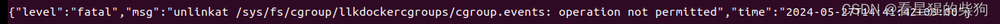
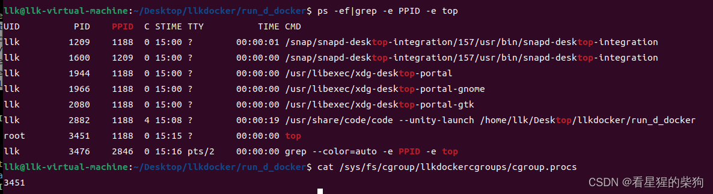
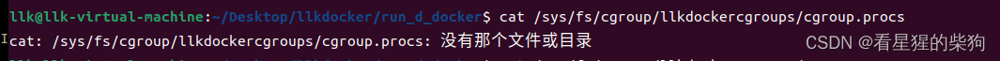
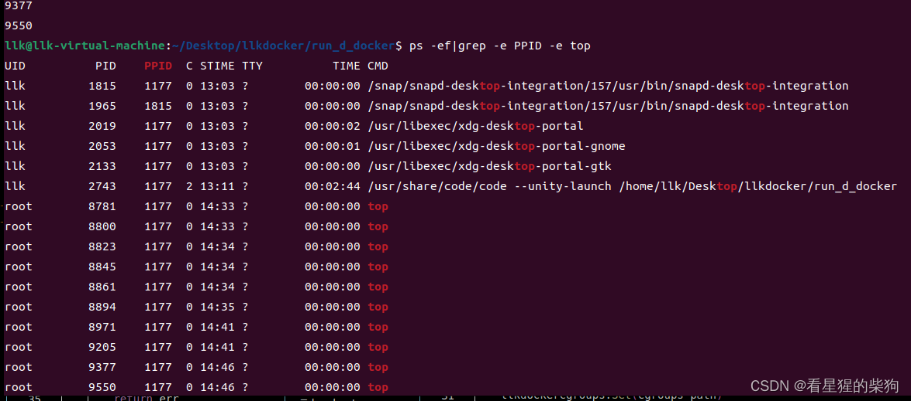
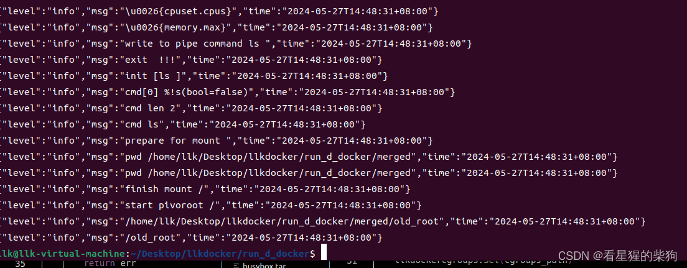
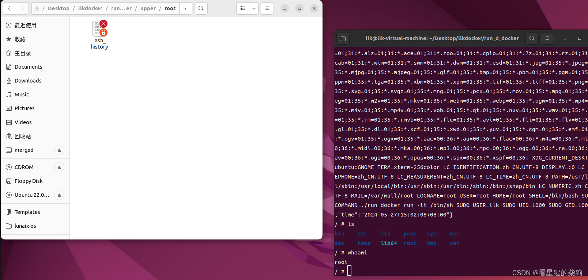
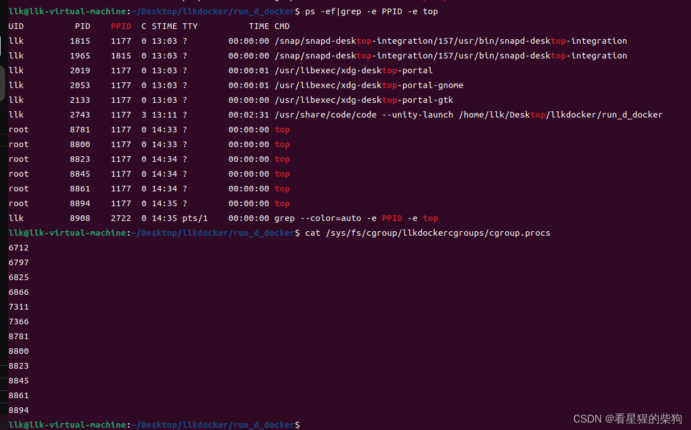


# 实现目的
使用 `docker run -d` 时，容器在后台运行，而不是进入命令行交互模式

1. 首先需要添加 -d 选项
2. 然后设置在添加 -d 选项时，主进程不等待子进程而是直接结束

```go
func Contain_run(cmd string,it bool,resource_config *cgroups.Resource,volume string) {
	command,writepipe,rooturl:=new_contain_process(it,volume)
	log.Infof("cmd %s it %t",cmd,it)
	
	if err:=command.Start();err!=nil{
		log.Error(err)
	}
	log.Infof("cmd %s",cmd)
	cmdstring:=strings.Split(cmd, " ")
	log.Infof("split cmd %v",cmdstring)

	llkdockercgroups:=cgroups.Cgroups{
		Cgroups_Name: "llkdockercgroups",
		Resour:resource_config,
		Sub:cgroups.Subsystemins,
	}
	log.Info(llkdockercgroups.Resour)

	cgroups_path:=cgroups.Get_cgroups_path("cgroup",llkdockercgroups.Cgroups_Name)
	log.Info("in run.go get cgroups_path")
	llkdockercgroups.Move(command.Process.Pid,cgroups_path)

	llkdockercgroups.Set(cgroups_path)
	//defer llkdockercgroups.Remove(cgroups_path) //-d后台运行的话不能删除cgroup

	write_to_pipe(cmdstring,writepipe)
	if it{ //-it实现交互，那么当前终端就不能关闭退出，还需留给子进程使用
		command.Wait()
		// 从容器内的命令行中的退出才会wait结束
		end_volume(rooturl,volume)
		end_overlays(rooturl)
	}
	
	log.Infof("exit  !!!")

}
```
3. 最后要注意，主进程不能删除该进程创建的 cgroup，否则会出现下面的问题。这就是删除 cgroup 导致的问题：原因是该 cgroup 中还有一些正在运行的进程，在这些进程结束前删除 cgroup 会失败


解决办法：在 -it 模式下最后再删除，后台运行时则不删除
```go
if it{ //-it实现交互，那么当前终端就不能关闭退出，还需留给子进程使用
		command.Wait()
		// 从容器内的命令行中的退出才会wait结束
		end_volume(rooturl,volume)
		end_overlays(rooturl)
		llkdockercgroups.Remove(cgroups_path) //-d后台运行的话不能删除cgroup
	}
```
这是 docker 在后台运行

而使用 -it 运行的最终效果如下


# 一个莫名其妙的问题
我发现调试时使用 `log.Infof` 之类的函数，输出最后并没有在终端上完整显示，但用 `ps -ef|grep -e PPID -e top` 检查发现它确实在运行

比如下面的 9550 进程就是在后台运行的 top 进程

但在终端上显示时，有时显示不全，有时又能完整显示

这里我让子进程与当前终端共用同一个标准输入、输出和错误，否则就看不到相关的调试信息

```go
func new_contain_process(it bool,volume string)  (*exec.Cmd,*os.File,string){	
	
	readpipe,writepipe,err:=os.Pipe()
	if err!=nil{
		log.Fatal(err)
	}
	command:=exec.Command("/proc/self/exe","init")
	command.SysProcAttr=&syscall.SysProcAttr{
		Cloneflags: syscall.CLONE_NEWUTS | syscall.CLONE_NEWPID | syscall.CLONE_NEWNS |
			syscall.CLONE_NEWNET | syscall.CLONE_NEWIPC,
	}
	 //主进程和子进程共用一个终端
		command.Stdin=os.Stdin
		command.Stdout=os.Stdout
		command.Stderr=os.Stderr
	
	log.Info(command)
	log.Infof("sucess create a contain process")
	command.ExtraFiles=[]*os.File{readpipe}
	mntURL := "./merged"
	rootURL := "./"
	command.Dir = mntURL
	prepare_overlays(rootURL) 
	prepare_volume(rootURL,volume)

	log.Info(readpipe)
	return command,writepipe,rootURL
	
}
```

# 关于之前 upper 层中出现 root 的补充
之前我一直是复制之前写好的 docker，在复制品上继续写新东西，结果发现其中的 busybox 和刚解压出来的 busybox 相比少了很多东西，于是重新解压生成了 busybox 来使用。之前我发现每次调用相关命令时 upper 中都会出现 root，但当时并没有被修改的文件。这次用了完整的 busybox，发现出现了下面的内容，所以确实是调用命令导致日志记录发生了变化

# 运行某些命令时出现“找不到文件或目录”的原因
当时容器在挂载前查找相关命令，找到的是宿主机上的命令。但我们想要的是 pivot_root 之后根目录下相关命令的路径，所以之后执行这个宿主机路径时就会提示找不到路径，因为那时是以容器的根目录为相对参照的
```go

func Contain_init(){
	
	
	cmd:=readpipe()
	log.Infof("init %s",cmd)
	
	log.Infof("cmd[0] %s",cmd[0]=="/bin/sh")
	log.Infof("cmd len %d",len(cmd))
	log.Infof("cmd %s",cmd[0])
	/*
	path,err:=exec.LookPath(cmd[0])//挂载前得到相关命令的路径会出现找不到
	if err!=nil{
		log.Fatal(err)
	}
	argv:=[]string{}
    for i:=1;i<len(cmd);i++{
		argv=append(argv,cmd[i-1])
	}*/

	log.Infof("prepare for mount ")

	mount()
	path,err:=exec.LookPath(cmd[0]) //挂载后再得到相关命令的路径等
	if err!=nil{
		log.Fatal(err)
	}
	argv:=[]string{}
    for i:=1;i<len(cmd);i++{
		argv=append(argv,cmd[i-1])
	}


	log.Infof("prepare for exec cmd ")
	log.Info(path)
	log.Info(argv)
	log.Info(os.Environ())

	if err:=syscall.Exec(path,argv,os.Environ());err!=nil{
		log.Infof("exec error")
		log.Info(err)
	}
	
}

```

# 代码
[https://github.com/FULLK/llkdocker/tree/main/run_d_docker](https://github.com/FULLK/llkdocker/tree/main/run_d_docker)
#  效果
最后我多次启动了 `sudo ./run_docker run -d top`，在 `cgroup.procs` 中可以看到它们（有些是之前的 `sudo ./run_docker run -it /bin/sh` 添加的，因为我最后把主进程结束时自动删除 cgroup 的功能关掉了）。最后可以看到在后台运行的 top 进程
`


