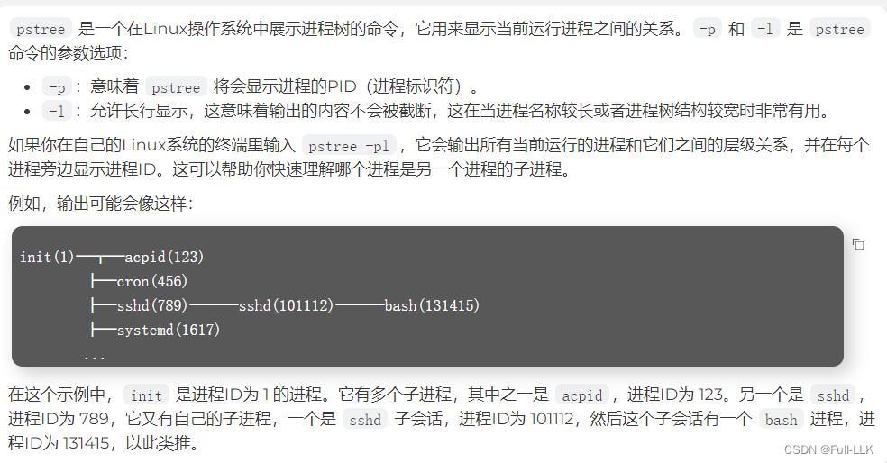
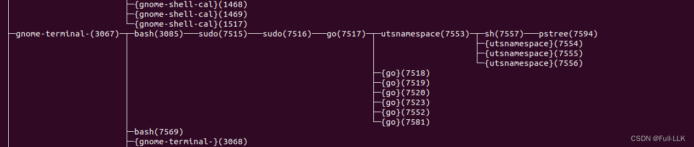
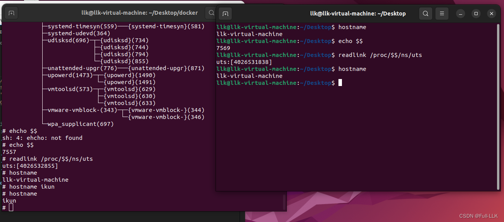


# UTS Namespace
在 Linux 中，UTS（UNIX Time-sharing System）命名空间允许同一系统上不同的进程拥有各自独立的系统标识符，例如主机名和 NIS 域名。这意味着在一个 UTS 命名空间内部，进程可以修改自己的主机名，而不会影响系统上其他进程的主机名。

clone()：这是 Linux 中用于创建新进程的系统调用。相比 fork()，clone() 调用提供了更多选项，因为它允许通过指定不同的标志来控制新进程与原进程之间资源共享的程度。这些标志可以决定新进程属于哪些命名空间。例如，使用 CLONE_NEWPID 标志会为新进程创建一个新的 PID 命名空间。新创建的进程及其之后产生的所有子进程都会被包含在指定的命名空间中。

unshare()：这个系统调用允许一个已经存在的进程脱离某个命名空间（即使这个命名空间之前是与其他进程共享的）。例如，如果一个进程想要创建一个与当前网络命名空间分离的新网络命名空间，就可以通过 unshare() 以及相应的标志（例如 CLONE_NEWNET）来实现。

setns()：setns() 系统调用用于把一个进程移动到一个已经存在的命名空间中。这个调用需要一个文件描述符来指定目标命名空间。它常用于容器技术中，例如把一个进程从主机的命名空间移动到容器的命名空间中。
# unshare 命令与 unshare 系统调用
unshare 命令和 unshare() 系统调用都用于 Linux 系统上的隔离与虚拟化场景，但它们在使用方式和使用场合上有所不同：

unshare 命令：unshare 是一个从命令行运行的用户态工具，它可以创建独立的命名空间，而不需要启动新的 init 进程。命名空间是 Linux 用来隔离诸如进程、网络、用户 ID 和文件系统等资源的一种机制。通过 unshare 命令，用户可以为某个特定进程或脚本创建新的命名空间，而不影响系统的其他部分。

unshare 命令的常见用法示例：

```bash

unshare --创建命名空间类型 程序

unshare --uts sh 创建UTS 的namespace，并在其中运行sh
```

unshare() 系统调用：unshare() 是一个用 C 编写的底层编程接口（API），是 Linux 内核提供的系统调用之一。开发者可以在应用程序中直接调用 unshare()，来改变一个已存在进程的命名空间归属，使其脱离某些资源的共享。
unshare() 系统调用的原型：
```c

#include <sched.h>

int unshare(int flags);
```
 
该调用接收一个 flags 参数，用于指定要取消共享哪些类型的资源。成功时返回 0；失败时返回 -1，并设置 errno 来指明错误原因。

二者都是实现 Linux 容器化和操作系统级虚拟化的基础工具和调用。例如，像 Docker 这样的容器技术在底层很大程度上依赖命名空间和 cgroup 等机制，而 unshare 命令和 unshare() 调用都是操作命名空间的方式之一。
# 修复 root 用户缺少普通用户 go 命令的问题
由于不允许直接用 go 运行这个程序，需要切换到 root 用户或使用 sudo。
```bash
首先 su  切换到root用户
添加以下行到 root 用户的 shell 配置文件（例如 /root/.bashrc 或 /root/.bash_profile）中：

export PATH=$PATH:/usr/local/go/bin

之后，运行以下命令来应用更改：

source /root/.bashrc
```

但烦人的是，用 su 切换之后，想要运行的 utsnamespace.go 文件就不在那了。
# 使用 sudo go

```bash
当你运行 echo $PATH 命令时，我们看到 /usr/local/go/bin 包含在你的用户的 PATH 环境变量中，这意味着你的用户应该能够找到 go 命令。

然而，当你以 sudo 运行 go 命令时，你遇到了 sudo: go: command not found 错误。这可能是因为当使用 sudo 命令时，sudo 可能没有使用你用户的 PATH 环境变量，它可能使用了一个不包含 /usr/local/go/bin 的不同的 PATH。

你可以用下面的命令来查看 sudo 的 PATH 环境变量：

sudo env | grep PATH
 
如果从这个命令的输出中看不到 /usr/local/go/bin 目录，这会解释为什么 sudo 不能找到 go 命令。一个比较快捷的解决方法是指定 go 命令的完整路径：

sudo /usr/local/go/bin/go run utsnamespace.go
 
如果这个方法有效并且你想要修正 sudo 的 PATH 问题，一个更持久的解决方案是编辑 /etc/sudoers 文件，你可以使用 visudo 命令来安全地编辑这个文件：

sudo visudo
 
在 visudo 编辑器中，寻找 secure_path 这一行并且确保 /usr/local/go/bin 被包含在里面。例如：

Defaults    secure_path="/usr/local/sbin:/usr/local/bin:/usr/sbin:/usr/bin:/sbin:/bin:/usr/local/go/bin"
```
# 代码分析

## os 包与 os/exec 包
```go
exec是os/exec包的一部分，正确的导入方式应该是：

import "os/exec"
```

os 包：os 包提供了一组用于与文件系统交互的函数，例如创建、删除、读取和写入文件及目录，以及获取和设置环境变量。这些都是你的程序与操作系统之间直接进行的标准交互，不需要启动或与外部的独立程序交互。

os/exec 包：os/exec 包用于执行外部命令和程序。它允许你的 Go 程序启动另一个独立的进程，运行操作系统外部的命令或脚本，例如 Shell 命令或其他可执行文件。os/exec 可以捕获这些外部进程的输出，向它们提供输入，处理它们的错误输出，并控制它们的执行（例如启动、等待完成、终止进程等）。

用一个简单的例子来说明两者的区别：

假设你想读取一个文件并打印它的内容。这个任务只需要 os 包：打开文件、读取其内容，然后关闭文件。
现在假设你想在操作系统上运行 ls 命令（在 Unix 中用于列出目录内容）或者 dir 命令（在 Windows 中）。这个操作需要一个 Shell 环境来解释并执行该命令。在这种情况下，os/exec 就是你需要的东西；你的 Go 程序会用它来启动一个新的外部进程来运行该命令。
因此，exec 包在与外部进程交互时能做到的一些事情，仅靠 os 包是做不到的，因为 os 包并没有提供启动和控制外部进程的能力。反过来也是一样：os/exec 包并不是为文件系统层面的操作设计的，而 os 包正是专门为这类任务设计的。

## log.Fatal(err)
在 Go 中，log.Fatal 函数用于记录一条错误信息，然后终止程序。它是 log 包提供的一个便捷函数，先把参数（通常是一条错误信息）输出到日志中，然后调用 os.Exit(1) 来终止程序。仔细看看这行代码：

```go
log.Fatal(err)
```

 
这行代码的目的是检查 err 变量是否不为 nil（即是否存在错误）。如果发生了错误：

1.  log.Fatal(err) 会把错误信息 err 输出到标准错误（stderr）。输出格式通常包含当前的时间戳和文件名，这有助于调试。

2. 错误信息记录完成后，log.Fatal 会调用 os.Exit(1) 来终止程序。传给 os.Exit 的参数 1 是程序的退出状态码。在 UNIX 及类 UNIX 系统中，退出状态码为 0 通常表示程序执行成功，而非零值则表示执行过程中发生了错误。因此，1 表示程序因为错误而终止。

##  SysProcAttr 
Cmd 结构体代表一个待执行的外部命令，在 Go 的 os/exec 包中它封装了与执行相关的信息。当使用 Cmd 的 Run 或 Start 方法时，会创建一个新进程来执行指定的命令。SysProcAttr 结构体的字段用于调整这个新进程的系统级属性。

关于 SysProcAttr 结构体的 Cloneflags 字段，下面是它的含义和作用：

- Cloneflags：这个字段用于向底层的系统调用（在 Linux 上通常是 clone）传递一组位标志。这些标志定义了进程启动时的特殊行为，包括它与其他进程共享资源的方式，以及是否应该运行在不同的命名空间中。

- syscall.CLONE_NEWUTS：这个特定的位标志要求操作系统为新创建的进程创建一个新的 UTS（UNIX Time-sharing System）命名空间。UTS 命名空间允许进程拥有自己的系统标识符，例如主机名和域名，这样在该命名空间内修改主机名就不会影响其他命名空间，从而提升隔离性。

所以，在上面这段 Go 代码片段中，cmd.SysProcAttr 被设置为带有 syscall.CLONE_NEWUTS 标志的 &syscall.SysProcAttr{}，这意味着当 cmd 所代表的命令运行时：

1. 会创建一个新进程。这个新进程的创建过程中会包含一个新的 UTS 命名空间，使它拥有独立的主机名和域名，与其他进程隔离开来。
2. 执行该命令。


## cmd 的输入输出
1. cmd.Stdin=os.Stdin
这一行把命令的标准输入设置为来自操作系统的标准输入，通常指的是终端或命令行界面的输入。这意味着外部命令可以读取用户通过终端输入的数据。

2. cmd.Stdout=os.Stdout
这一行把命令的标准输出设置为操作系统的标准输出，通常指的是终端或命令行界面的输出。这意味着正在运行的命令会把自己的输出数据发送回终端，用户可以直接看到。

3. cmd.Stderr=os.Stderr
这一行把命令的标准错误设置为操作系统的标准错误，通常也是终端或命令行界面。标准错误用于输出错误信息；通过将标准错误设置为 os.Stderr，命令的错误信息会直接显示在当前的错误输出设备上，这通常也是终端。

总的来说，上面的代码把命令的输入、输出和错误流都重定向到当前终端，这样命令运行时用户可以通过终端与其交互，并在终端中看到它的输出和错误信息。这是执行外部命令时非常常见的做法，它能保证命令行工具具有交互式的使用体验。

# Go 代码
核心逻辑：创建一个新进程，让它运行在一个新创建的 UTS 命名空间中（该命名空间拥有独立的主机名和域名，与其他进程隔离），然后让这个新进程运行 sh 命令。
```go
package main

import
(
	"exec"
	"syscall"
	"os"
	"log"
)

func main(){
	cmd:=exec.Command("sh")
	cmd.SysProcAttr=&syscall.SysProcAttr{
		Cloneflags: syscall.CLONE_NEWUTS,}
	cmd.Stdin=os.Stdin
	cmd.Stdout=os.Stdout
	cmd.Stderr=os.Stderr

	if err:=cmd.Run();err!=nil{
		log.Fatal(err)
	}
}
```
# pstree -pl

# 结果演示




