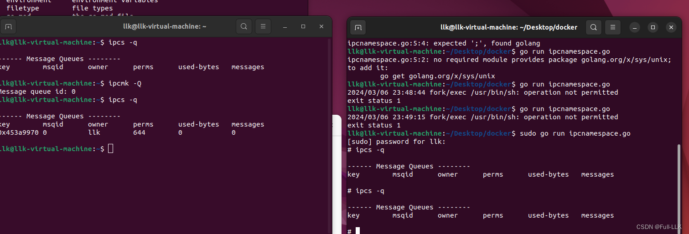


# System V IPC 和 POSIX
我们通过一个简单的餐厅订单处理的类比，来理解 System V IPC 和 POSIX 消息队列以及它们之间的区别。

假设一家餐厅有前厨和后厨。前厨负责接收顾客的订单，然后需要把订单传给后厨去烹饪。

**System V IPC 消息队列**

System V IPC 就像使用一套特殊的点餐系统。在这套系统中：

- 前厨写下订单，并给每个订单贴上指定的类型标签，例如“开胃菜”“主菜”“甜点”等。
- 后厨有一份包含所有订单类型的清单。
后厨可以选择查看特定类型的订单；例如，现在后厨只想看“主菜”订单。
- 这些订单被放在一个特殊的柜台上，后厨人员必须遵循特定的规则查看柜台，例如使用一把特殊的钥匙。（这里的“钥匙”指的是 System V IPC 消息队列中的键值 key_t。）
- 订单一旦写下，即使前厨人员离开，订单也会留在柜台上，直到后厨有人明确处理它。

**POSIX 消息队列**

而如果这家餐厅使用 POSIX 消息队列来处理订单：

- 前厨使用更现代的系统写订单，每个订单都可以标注紧急程度。
- 后厨有一块显示屏，会自动把最紧急的订单排在前面。
- 后厨可以一直查看这块显示屏，按紧急程度依次取订单。
- 显示屏还有一个指示灯；如果后厨太忙没空看，指示灯会告诉他们是否有新订单等待处理。（这里的“指示灯”可以看作 POSIX 消息队列的非阻塞特性。）
- 订单完成后，显示屏会自动更新，不需要特殊的钥匙或操作。
区别

现在总结一下它们之间的主要区别：

- 命名和访问方式：SysV IPC 使用一个整数键值（key_t）访问消息队列，需要用特殊的方法生成和获取键值。而 POSIX 消息队列像文件一样通过字符串名称访问，这使它看起来更像操作系统的一部分，而不是一个独立的服务。
- 消息优先级：POSIX 允许为消息设置优先级，确保最重要的消息最先被处理。SysV 消息队列也能实现类似的功能，但通常没有那么直观或简单。
- 接口和功能：POSIX API 通常被认为更现代、更一致，具有更好的错误处理和更完整的功能集。SysV IPC 在某些操作系统的某些版本中可能不够直观或不够可靠。

这些区别使得在新系统或需要更多功能的场景中，POSIX 消息队列可能是更好的选择，而 SysV IPC 可能出于兼容性考虑在旧系统中使用。

# IPC Namespace

想象一下，进程间通信（IPC）就像一个邮局系统。在这个系统中，一座城市的居民（各个进程）想要相互寄送信件或包裹（数据）。为了完成这项任务，他们使用邮局提供的服务，例如邮箱、包裹传送带或邮递员（这些对应于消息队列、信号量、共享内存等 IPC 通信方式）。

现在来说说“ipcnamespace”。这个术语可以理解为一个独立的小社区或小区。在每个小社区内，居民有自己的小邮局、自己的邮箱和包裹传送带。社区外的人不能直接使用其他社区的邮箱和邮局服务。这样，每个社区内部的通信都是独立且私密的。

在计算机中，IPC namespace 的作用类似。当你创建一个新的 IPC namespace 时，实际上是在现有操作系统中创建了一个隔离的小社区，进程可以在这个社区内部自由传递消息，而外部进程无法干扰。当你不希望某些程序受到外界影响时，这一点特别有用，例如使用 Docker 等容器技术隔离和管理不同的应用程序时。每个容器都运行在自己的 IPC namespace 中，保证了内部进程通信的独立性和安全性。这就像给应用程序一个只为容器内部服务的“私人邮局”，彼此互不干扰。
# cmd.Run()
cmd.Run() 方法在命令执行成功时返回 nil（没有错误）；如果发生错误（例如找不到命令或执行过程中出错），则返回一个 error 类型的值。
# 什么是消息队列
消息队列是一种进程间通信（IPC）或应用间通信（不同应用程序或服务之间）的方法，它允许进程通过读写队列进行通信，而无需直接了解彼此。队列是消息的有序集合，消息可以是数据、命令，或任何可以转换为字节串的信息。

消息队列的工作方式类似于现实生活中的邮局系统：

- 发送消息（寄信）：一个进程（或线程）作为消息的发送方（就像寄信的人），把消息放入消息队列。

- 存储消息（邮局保管信件）：队列临时存储这些消息，直到接收方准备好接收。消息队列可以保证消息的顺序，并确保消息不会丢失。

- 接收消息（取信）：另一个进程（或线程）作为消息的接收方，按顺序从队列中取出消息进行处理。

# 消息队列相关结构
消息队列的基本结构简单但至关重要，能够有效协调消息的生产者（发送方）和消费者（接收方）。以下是消息队列的一些主要组成部分：

- 消息：消息是消息队列结构中的基本数据单元。它可以包含任何形式的数据，例如字符串、对象或字节流。通常，一条消息由两部分组成：消息头（包含消息 ID、时间戳、优先级等元数据）和消息体（包含实际发送的数据）。

- 队列：队列是消息的有序集合，按照先进先出（FIFO）原则运作。也就是说，最先发送到队列的消息会最先被接收和处理。队列在消息生产者和消费者之间提供了一个缓冲区，使它们可以以不同的速率工作。

- 生产者（发送方）：生产者是创建消息并将其发送到队列的实体。生产者把消息发送到队列，发送完成后通常不再关心消息是否被消费。

- 消费者（接收方）：消费者从队列中读取并处理消息。消费者可以是直接监听队列、在消息到达时立即处理的进程，也可以是定期检查新消息的进程。在某些情况下，消费者处理完消息后会发送响应或结果。

# ipcs -q
ipcs 命令是 Linux 操作系统中用于报告进程间通信（IPC）设施状态的工具。ipc 是进程间通信的缩写，可以包括消息队列、信号量和共享内存段。ipcs 命令可以显示每种 IPC 对象的当前状态，这对于诊断或系统监控很有用。

当 ipcs 命令与 -q 选项一起使用时（即 ipcs -q），它专门报告消息队列的信息。输出将包括每个消息队列的 key、msqid 以及其他附加信息。

下面是 ipcs -q 命令的一个典型输出示例：

```bash
------ Message Queues --------
key        msqid      owner      perms      used-bytes   messages    
0x12345678 0          myuser     644        0            0           
0xaabbccdd 1          anotherusr 644        16384        4
 
```

上述示例中各列的含义解释：

- key：用于唯一标识消息队列的键值。
- msqid：消息队列在内核内部的唯一标识符。
- owner：创建该消息队列的用户。
- perms：消息队列的权限，通常以八进制形式显示。
- used-bytes：队列中当前所有消息占用的总字节数。
- messages：队列中当前的消息数量。


# ipcmk -Q
ipcmk 是 Linux 上用于创建 IPC（进程间通信）资源的命令，可以创建消息队列、共享内存和信号量。使用 ipcmk -Q（注意参数 Q 是大写）时，它会创建一个新的消息队列。

下面是 ipcmk -Q 的简单用法和输出：

```bash
$ ipcmk -Q
Message queue id: 32768
 
```

在这个示例中，ipcmk -Q 命令创建了一个新的消息队列，并输出了它的消息队列 ID（msqid）。这个 ID 是访问和管理该消息队列的关键标识符。如果需要在程序中使用这个消息队列，就需要用到这个 ID。
#  msqid 和 key 的区别
想象我们有一个邮局，里面有很多邮箱，每个邮箱都有一个唯一的邮箱号码（这就像 msqid）。如果你想把一封信放进某个邮箱，就需要知道这个邮箱的号码。

然而，要获得一个邮箱号码，你首先需要告诉邮局一个口令或代码，这样他们才能根据这个口令为你分配一个邮箱（这个口令就像 key）。这个口令可能是共享的，也就是说其他人也可能知道这个口令，并用它申请到同一个邮箱号码。


例如，假设一所学校想搭建一个信息发布系统。他们决定使用消息队列来发布通知，并选择使用学校的识别码“123”和一个特定的项目标识符 'A' 来生成这个 key。

首先，他们为此生成一个 key：

```go
// 学校使用识别码（例如123）和项目标识符（例如 'A'）生成key
key_t key = ftok("/path/to/somefile", 'A');  
```

 
得到这个 key 之后，学校就可以用它来获取自己的邮箱号码（msqid）：

```go

// 学校通过提供key来请求（如果不存在，则创建）一个邮箱号码（msqid）
int msqid = msgget(key, IPC_CREAT | 0666); 
 
```

如果请求成功，邮局（操作系统）就会为学校的信息发布系统分配一个唯一的邮箱号码（msqid）。

此时，学校的信息发布部门就可以用这个邮箱号码（msqid）发送通知，知道这个邮箱号码的其他学校部门或服务也可以拿着这个邮箱号码去“邮局”接收通知。他们不需要知道原来的口令（key），只要有邮箱号码（msqid），就能访问那个邮箱（消息队列）。
# 代码
与之前相比，唯一的区别是 **Cloneflags:CLONE_NEWUTS|CLONE_NEWIPC**
```go
package main

import
(
	
	"os/exec"
	"syscall"
	"os"
	"log"
)
func main(){
	cmd:=exec.Command("sh")
	cmd.SysProcAttr = &syscall.SysProcAttr{
		Cloneflags: syscall.CLONE_NEWUTS | syscall.CLONE_NEWIPC ,
	}
	cmd.Stdin=os.Stdin
	cmd.Stdout=os.Stdout
	cmd.Stderr=os.Stderr

	if err:=cmd.Run();err!=nil{
		log.Fatal(err)
	}
}
```
# 演示


