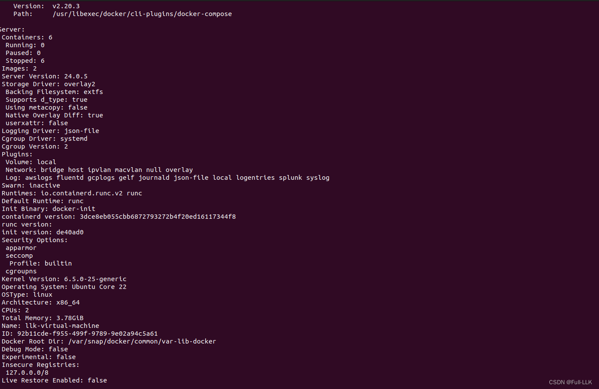
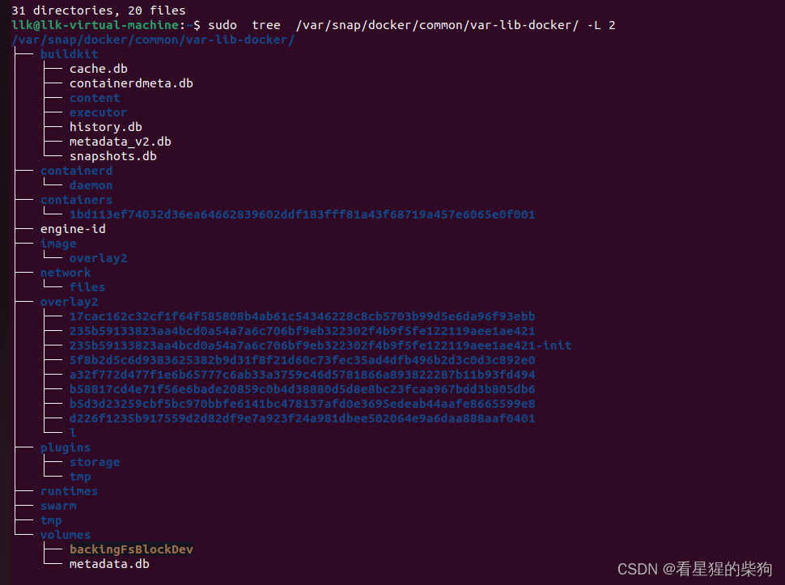
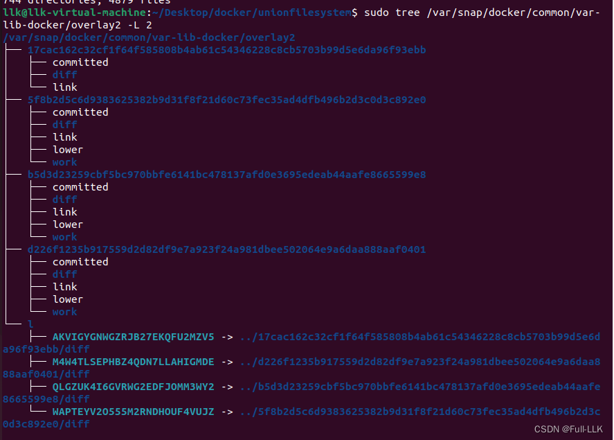
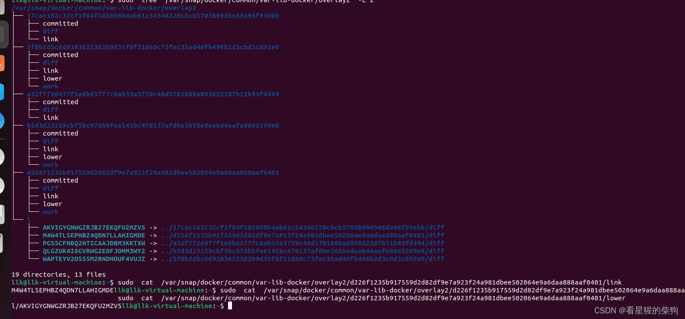
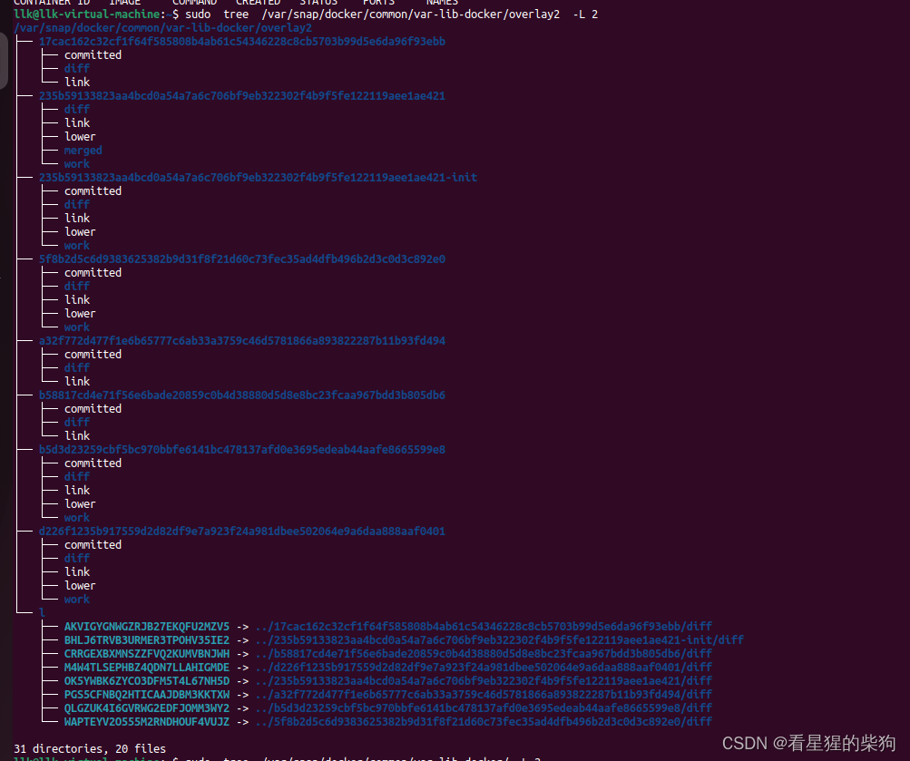
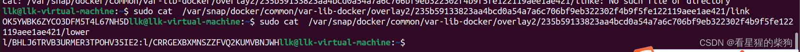
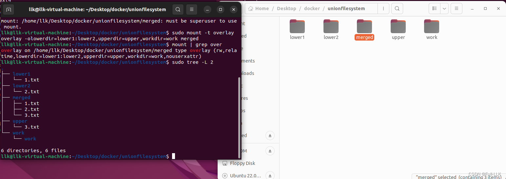
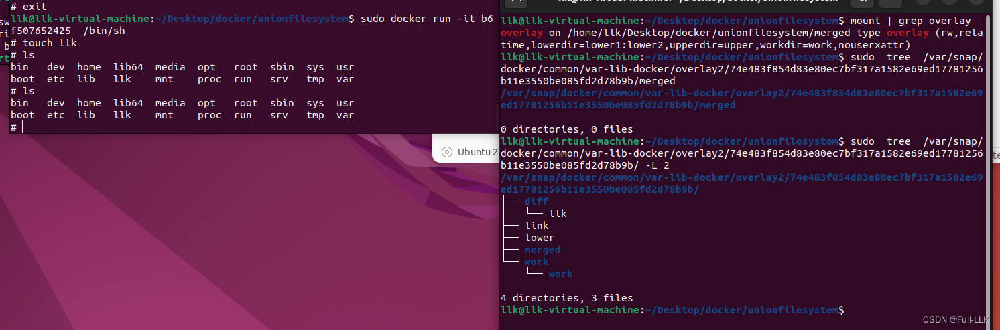


[https://cloud.tencent.com/developer/article/2272892](https://cloud.tencent.com/developer/article/2272892)
# 联合文件系统
- 它把多个目录合并成一个目录
- 它使用一种叫写时复制（COW）的机制。如果要修改的文件位于只读层，UnionFS 会把该文件拷贝到最上层的可写层，再在那里进行修改。这样可以保证底层文件系统保持不变，变化只发生在最上层。


# overlay 挂载
使用 mount 命令挂载到某个位置；需要指定 lowerdir、upperdir、workdir、merged_dir
```bash
mount -t overlay overlay -o lowerdir=lower1:lower2:lower3,upperdir=upper,workdir=work merged_dir
```
这条命令把 lower1、lower2、lower3、upper、work 这几个目录的内容放到 merged_dir 目录中

lowerdir：只读层，对应当前层以下所有层的文件
upperdir：读写层，当前层的文件
workdir：不用管它
merged_dir：合并结果存放的位置


此时，如果修改某个文件的内容，如果该文件来自 lowerdir，那么修改之后，upperdir 中会出现一个带有修改内容的文件，但 lowerdir 中的内容不会改变

此时，如果从 merged_dir 中删除某个文件，如果该文件来自 lowerdir，那么在 merged_dir 中删除之后，upperdir 中会出现一个 whiteout 文件（标记该文件已经消失），但 lowerdir 中的文件不会改变
# sudo docker info 
查看 docker 相关的配置信息



存储 Docker 镜像的文件系统是 extfs。d_type 支持为 true。

Docker 镜像和容器数据存放在 "/ var / snap / docker / common / var-lib-docker" 目录下。具体来说，镜像位于 "/ var / snap / docker / common / var-lib-docker / image" 目录，而容器数据和其他相关文件位于 "/ var / snap / docker / common / var-lib-docker" 目录。




#  docker 的 overlay2
docker 拉取镜像时，镜像位于
```bash
/var/snap/docker/common/var-lib-docker/overlay2
```
查看这个目录

除了 l 目录之外，其他都是镜像层
- diff：该镜像层的文件
-  link：当前镜像层 diff 在 l 目录下对应符号链接的名字
-  lower：该镜像层以下所有层的符号链接名字（对应 diff，即以下所有镜像的全部文件）




# 镜像、容器与 overlay2
实际上，`/var/snap/docker/common/var-lib-docker/overlay2` 还可以存放 init 层和 container 层。一个完整的容器分为 3 层：image 层、init 层、container 层。docker 创建容器时会创建 init 层和 container 层

 overlay2 使用联合挂载技术，把 image 层的 diff、init 层的 diff 以及 container 层的 diff 挂载到 container 层的 merged 目录上

- init 层：做容器所需的一些配置；因为 image 层是只读层不能修改，所以用 init 来做配置
- image 层：对应 container 层以下的镜像
- container 层：对应挂载后 merge 所在的目录

此时对应的 overlay 挂载层级如下
- lowerdir：container 层以下镜像的 diff 文件
- upperdir：container 层的 diff 文件
- merged：container 层的 merged


container 层把 init 层和 image 层中同名的内容合并到 container 层的 merged 层中


# 动手实践

[https://github.com/FULLK/llkdocker/tree/main/unionfilesystem](https://github.com/FULLK/llkdocker/tree/main/unionfilesystem)

创建五个文件夹
- lower1：1.txt
- lower2：2.txt
- upper：3.txt
- work：无
- merged：无

```bash
sudo mount -t overlay overlay -olowerdir=lower1:lower2,upperdir=upper,workdir=work merged
挂载到merged上去
```



然后在 merged 中删除 1.txt；发现 diff 中多了一个 whiteout 的 1.txt 文件。修改 merged 中 2.txt 的内容；发现 diff 中多了一个修改后的 2.txt 文件。在 merged 中新建一个 4.txt，upper 中也出现了一个同样的 4.txt
```bash
llk@llk-virtual-machine:~/Desktop/docker/unionfilesystem$ sudo tree -L 2 
.
├── lower1
│   └── 1.txt
├── lower2
│   └── 2.txt
├── merged
│   ├── 1.txt
│   ├── 2.txt
│   └── 3.txt
├── upper
│   └── 3.txt
└── work
    └── work

6 directories, 6 files
llk@llk-virtual-machine:~/Desktop/docker/unionfilesystem$ cat ./merged/1.txt
from lower 1 
llk@llk-virtual-machine:~/Desktop/docker/unionfilesystem$ rm ./merged/1.txt
llk@llk-virtual-machine:~/Desktop/docker/unionfilesystem$ sudo tree -L 2 
.
├── lower1
│   └── 1.txt
├── lower2
│   └── 2.txt
├── merged
│   ├── 2.txt
│   └── 3.txt
├── upper
│   ├── 1.txt
│   └── 3.txt
└── work
    └── work

6 directories, 6 files
llk@llk-virtual-machine:~/Desktop/docker/unionfilesystem$ cd merged
llk@llk-virtual-machine:~/Desktop/docker/unionfilesystem/merged$ touch 4.txt
llk@llk-virtual-machine:~/Desktop/docker/unionfilesystem/merged$ sudo tree -L 2 
.
├── 2.txt
├── 3.txt
└── 4.txt

0 directories, 3 files
llk@llk-virtual-machine:~/Desktop/docker/unionfilesystem/merged$ cd ../
llk@llk-virtual-machine:~/Desktop/docker/unionfilesystem$ sudo tree -L 2 
.
├── lower1
│   └── 1.txt
├── lower2
│   └── 2.txt
├── merged
│   ├── 2.txt
│   ├── 3.txt
│   └── 4.txt
├── upper
│   ├── 1.txt
│   ├── 3.txt
│   └── 4.txt
└── work
    └── work

6 directories, 8 files
llk@llk-virtual-machine:~/Desktop/docker/unionfilesystem$ editor merged/2.txt
llk@llk-virtual-machine:~/Desktop/docker/unionfilesystem$ sudo tree -L 2 
.
├── lower1
│   └── 1.txt
├── lower2
│   └── 2.txt
├── merged
│   ├── 2.txt
│   ├── 3.txt
│   └── 4.txt
├── upper
│   ├── 1.txt
│   ├── 2.txt
│   ├── 3.txt
│   └── 4.txt
└── work
    └── work

6 directories, 9 files
llk@llk-virtual-machine:~/Desktop/docker/unionfilesystem$ 

```
# 疑问


也就是说，docker 运行容器后，会把 image 层、init 层以及当前 container 层的 diff 挂载到 container 层的 merged 上，但我发现 merged 里面没有内容
而且 mount | grep overlay2 也没有找到 docker 启动容器时应该挂载的那个 merged

有大佬说我需要参考源码才能知道最新的流程。这里先放一放，等后面遇到如何实现的时候再回来看

[https://github.com/microsoft/docker/blob/master/volume/volume.go#L18](https://github.com/microsoft/docker/blob/master/volume/volume.go#L18)

[https://github.com/microsoft/docker/blob/master/daemon/graphdriver/overlay/overlay.go#L234](https://github.com/microsoft/docker/blob/master/daemon/graphdriver/overlay/overlay.go#L234)



