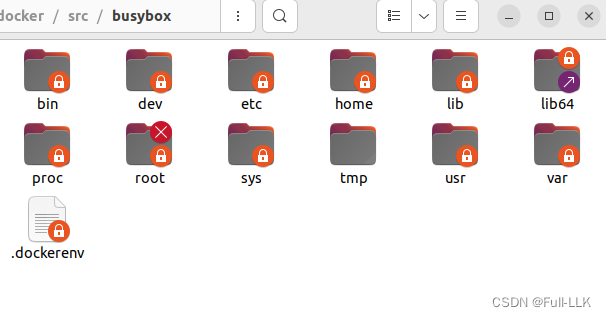
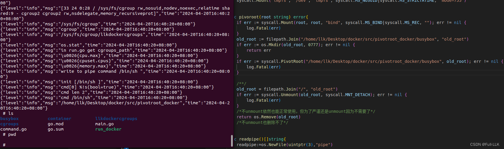
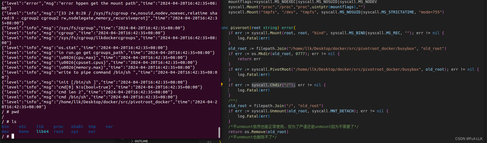
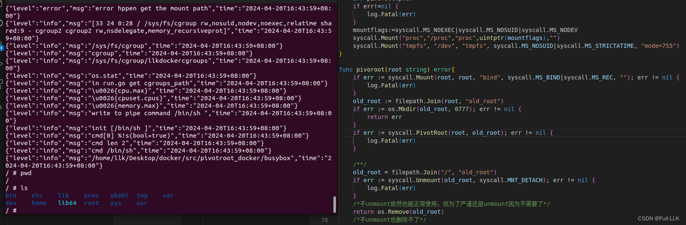
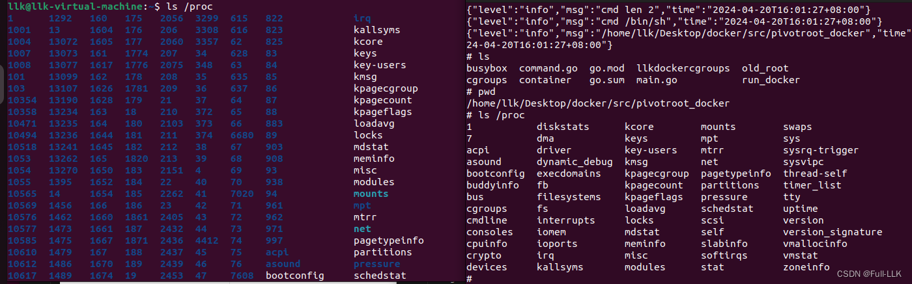
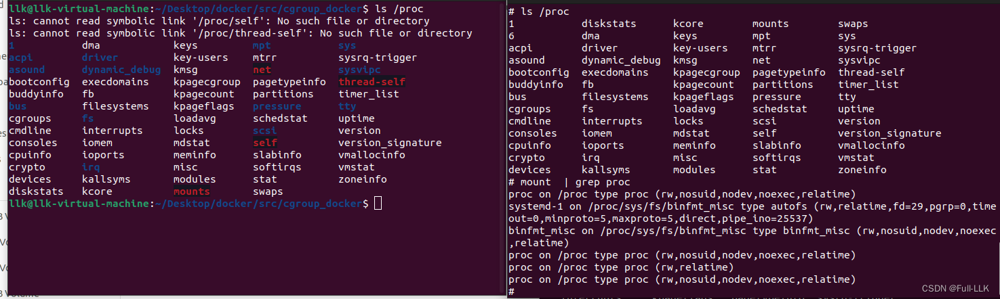
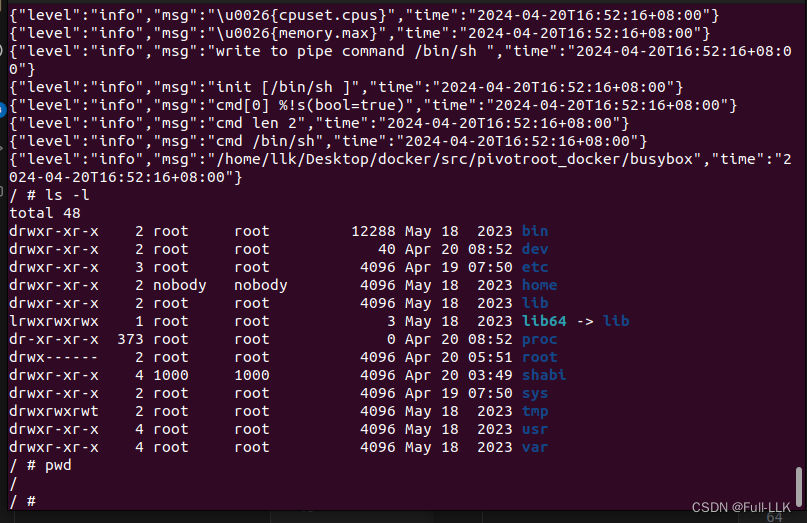


# busybox
一个简单的 UNIX 文件系统，里面有很多文件；可以把 busybox 看作一个文件夹
我们把它作为第一个容器内运行的文件系统

# `docker run -d busybox top`

命令 `docker run -d busybox top` 用于在 Docker 中启动一个新容器并执行特定操作。下面是对该命令每个部分的详细解释：

- `docker run`：这是 Docker 的主要命令之一，用于从指定镜像启动一个新容器

- `-d`：这是一个标志，告诉 Docker 以分离模式（detached mode）运行容器。也就是说容器会在后台运行，而不是直接连接到用户的终端。以这种方式运行容器时，Docker 会立即返回容器 ID，用户可以继续在命令行中执行其他命令，而不影响正在运行的容器

- `busybox`：这是镜像的名称。BusyBox 是一个轻量级的类 Unix 工具集合，把大量常用的命令行工具打包进一个很小的镜像里

- `top`：这是要在容器内执行的命令。在 Linux 系统上，`top` 命令会提供实时的系统状态报告，显示系统中各进程的资源使用情况，比如 CPU 和内存的使用率

总的来说，当你执行 `docker run -d busybox top` 时，Docker 会从 BusyBox 镜像创建一个新容器，并在该容器内启动 `top` 命令，使其成为一个长期运行的进程，让容器在后台持续运行。这种方式常用于测试或监控目的，让容器内的 `top` 命令持续显示容器内部的系统状态

# `containerId=(docker ps --filter "ancestor=busybox:latest"|grep -v IMAGE|awk '{print $1}')` 
Shell 命令 `containerId=(docker ps --filter "ancestor=busybox:latest"|grep -v IMAGE|awk '{print $1}')` 的目的是获取从 `busybox:latest` 镜像启动的最新容器的 ID，并赋值给变量 `containerId`。我们逐一拆解一下：

- `docker ps`：这是一个 Docker 命令，用于列出所有正在运行的容器及其相关信息
  
- `--filter "ancestor=busybox:latest"`：这是一个过滤参数，过滤出由 `busybox:latest` 镜像派生出的容器

- `|`（管道符号）：用于把前一个命令的输出作为后一个命令的输入

- `grep -v IMAGE`：`grep` 命令用于在文本流中查找匹配项；`-v` 参数表示反向选择，即排除包含指定模式的行。这里是为了过滤掉输出中描述镜像的那一行，因为我们只需要容器 ID

- `awk '{print $1}'`：`awk` 是一个强大的文本分析工具；这里用来提取每行的第一列，也就是容器 ID 这一列

`awk '{print $1}'` 是一个基于 `awk` 工具的命令行表达式，用于处理和操作文本数据流。在这条命令中：

- 它会读取一个文件或输入流（这里是经由管道传入的 `docker ps` 的输出），并按指定的模式处理每一行数据

- `{}` 花括号中包含的是 awk 命令要执行的动作

- `print` 是 awk 的内置命令，用于输出指定的字段或变量

- `$1` 是 awk 中的一个特殊变量，表示每行记录的第一个字段（默认情况下字段以空格或 Tab 等空白字符分隔）。在许多 UNIX/Linux 命令的输出格式中，第一列常常包含关键信息；例如在 `docker ps` 的输出中，第一列通常就是容器 ID


结合上面的命令，实际上就是从正在运行的容器列表中找出最近启动的、基于 `busybox:latest` 镜像的容器，并提取它的 ID。然后在 shell 脚本中把这个 ID 值赋给变量 `containerId`

最后的 `echo "containerId" $containerId` 用于输出变量 `containerId` 的值，这样你就能看到实际获取到的容器 ID


# `docker export -o busybox.tar $containerId` 或 `sudo docker export 09bbf421d93f > ./busybox.tar `
`docker export -o busybox.tar $containerId` 是一个 Docker 命令，用于把指定容器的文件系统内容导出为一个 tar 归档文件

- `docker export`：这是一个 Docker 命令，用于导出容器文件系统的快照。该命令只导出容器内部的文件系统层级，不包括容器的元数据、配置信息或运行状态

- `-o busybox.tar`：`-o` 选项后面跟的是输出文件的名称；这里指定把导出的内容保存为名为 `busybox.tar` 的 tar 文件

- `$containerId`：这是一个变量，代表前面命令获取到的容器 ID。在这条命令中，它用于指定要导出的具体容器实例

所以整条命令的意思是：把之前通过 `docker run` 命令创建并运行的 BusyBox 容器的文件系统内容，以 tar 文件的形式导出，并将导出的文件命名为 `busybox.tar`。这个 tar 文件包含了容器内部的所有文件和目录结构，可以用来做备份，或者在另一个环境中重新导入这个文件系统

# `tar -xvf busybox.tar -C busybox/`
命令 `tar -xvf busybox.tar -C busybox/` 用于把 `busybox.tar` 文件的内容解压并提取到指定目录。命令各部分的含义如下：

- **tar**：这是 Unix/Linux 系统中用于处理归档文件（通常是 *.tar 文件）的工具；可以用来打包、压缩、解压，以及列出归档内的文件

- **-x**：这个选项表示执行提取操作。它告诉 tar 工具从指定的 tar 归档中提取文件

- **-v**：这是详细模式；在提取过程中会显示详细信息，包括正在提取的文件名，方便用户了解提取进度

- **-f**：这个选项后面跟的是要操作的 tar 文件名，即 `busybox.tar`。指定要提取的 tar 归档时必须要有这个参数

- **-C**：这个选项用于指定提取出的文件存放的目录；它后面跟着目标目录路径 `busybox/`。这意味着从 `busybox.tar` 中提取出的所有文件和目录都会放到名为 `busybox` 的目录下

总的来说，这条命令的整体效果是把 `busybox.tar` 中的所有文件提取出来，解压到当前目录下的 `busybox/` 子目录中。如果 `busybox/` 目录尚不存在，`tar` 会在提取之前先创建这个目录



#  mount namespace 的共享性

在 Linux 的 `mount namespace` 中挂载文件系统是否会影响宿主机的文件系统，取决于具体情况

- **默认情况下（在引入 systemd 之前，或设置了 MS_SHARED 传播类型时）**：
  如果你在一个新的 `mount namespace` 中挂载文件系统，并且该挂载点是共享挂载（即挂载传播类型为 `MS_SHARED`），那么在新的 `mount namespace` 中进行的挂载操作会传播回宿主机以及共享该挂载点的其他 `mount namespace`。这意味着宿主机的文件系统视图也会相应发生变化

- **设置为私有挂载（MS_PRIVATE）**：
  如果在创建 `mount namespace` 时，把挂载点设置为私有（通过 `syscall.Mount("", "/", "", syscall.MS_PRIVATE|syscall.MS_REC, "")` 命令），那么在这个新的 `mount namespace` 中挂载的任何文件系统，都不会影响宿主机，也不会影响没有设置为私有的其他 `mount namespace`。也就是说，新 `mount namespace` 中对文件系统的挂载和卸载操作只会影响该 namespace 本身，宿主机的文件系统视图不会发生变化

在 Docker 等容器技术中，通常会创建一个新的 `mount namespace`，并将其内部的挂载点设置为私有，以确保容器内部的文件系统操作不会影响宿主机或其他容器，从而实现容器级别的文件系统隔离


# 自挂载（Self Mount）

想象你有一棵大树：树干代表宿主机的根文件系统，树枝代表挂载在其上的各个目录。当你想创建一个独立的分支（比如 `/newroot`）作为容器的新根目录时，如果不采取措施，这个分支仍然会受到整棵树（宿主机）其他变化的影响

**举例说明**：
假设宿主机上有如下目录结构：
```
/
├── bin
├── etc
├── home
├── newroot
│   ├── bin
│   ├── etc
│   └── var
└── var
```

你想让 `/newroot` 成为容器的独立根目录，但如果不对 `/newroot` 进行自身的绑定挂载，那么在 `/newroot` 下进行的挂载操作会影响到宿主机的其他部分。例如，如果在 `/newroot/var` 下挂载了一个临时文件系统，这个挂载也会传播到宿主机的 `/var` 目录

但是，通过执行自身的绑定挂载（`mount --bind /newroot /newroot` 或 `syscall.Mount("/newroot", "/newroot", "", syscall.MS_BIND|syscall.MS_REC, "")`），你实际上创建了一个在挂载行为上独立于宿主机其余部分的“镜像”分支。此后，在 `/newroot` 下进行的任何挂载操作，比如把临时文件系统挂载到 `/newroot/var`，都只会影响 `/newroot` 这个“镜像”分支，而不会影响宿主机原本的 `/var` 目录

这样一来，在执行 `pivot_root` 把 `/newroot` 切换为容器的新根目录时，新根目录（`/newroot`）就是一个干净独立的文件系统视图，不会影响宿主机的其余部分，从而实现了容器所需要的隔离

# `syscall.Mount("", "/", "", syscall.MS_PRIVATE|syscall.MS_REC, "")` 
`syscall.Mount("", "/", "", syscall.MS_PRIVATE|syscall.MS_REC, "")` 是 Go 语言中的一段代码，调用了 Linux 内核的 `mount()` 系统调用，目的是修改当前进程根目录挂载点的挂载标志。具体来说：

- 第一个参数 `""` 代表当前挂载点；这里空字符串表示当前进程的根目录 `/`
- 第二个参数同样是 `"/"`，指的是目标挂载点，这里同样是根目录
- 第三个参数 `""` 代表文件系统类型；由于这不是挂载新的文件系统，而是修改已有挂载点的属性，所以这里也留空
- 第四个参数是挂载标志，`syscall.MS_PRIVATE|syscall.MS_REC`：
  - `syscall.MS_PRIVATE`：把当前挂载点及其所有子挂载点设置为私有挂载。这意味着对该挂载点进行的任何挂载、卸载或重新挂载操作都不会传播到其他 mount namespace，从而实现挂载事件的隔离，这对于创建独立的容器环境或其他需要文件系统隔离的场景至关重要
  - `syscall.MS_REC`：这是一个递归标志，意味着这个私有挂载属性不仅应用于根目录 `/`，还应用于根目录下所有的子挂载点，确保整个挂载树都变成私有挂载
- 第五个参数 `""` 代表额外的挂载选项参数；这里是空字符串，表示不需要设置额外的挂载选项

总的来说，这条命令的效果是把当前进程整个文件系统挂载树（包括根目录及其所有子目录）设置为私有挂载，确保在当前进程及其子进程的 mount namespace 内进行的挂载操作不会影响宿主机或其他进程的 namespace

#  bind mount
这是因为“bind mount”操作会在宿主机上创建一个新的文件系统挂载点，它的内容与原始的 `/container_root` 目录相同，但位于不同的文件系统中

具体来说：

1. 在容器中，`/container_root` 是容器的根文件系统
2. 当我们执行 `mount --bind /container_root /container_root` 时，会在宿主机上创建一个指向 `/container_root` 目录的新文件系统挂载点
3. 这个新的文件系统挂载点与宿主机的根文件系统 `/host_root` 是不同的文件系统

也就是说，从宿主机的角度看，`/container_root` 现在是一个独立的文件系统，而不是与宿主机根文件系统 `/host_root` 处于同一个文件系统中

这个过程可以用一个例子来说明：

假设在宿主机上，`/container_root` 原本是宿主机根文件系统 `/host_root` 的一个子目录。但执行 `mount --bind` 之后，`/container_root` 变成了一个独立的文件系统挂载点，不再与 `/host_root` 处于同一个文件系统中

这样做的目的是为了满足 `syscall.PivotRoot` 函数的要求，即新的根文件系统和旧的根文件系统不能处于同一个文件系统下。通过“bind mount”操作，我们可以满足这个要求

# 私有挂载点 vs. 私有 mount namespace

Mount Namespace 的属性主要指的是 Namespace 中挂载点的传播属性（Mount Propagation）。下面的例子可以说明这一点：

**示例场景**：
假设宿主机上有两个目录 `/mnt/shared` 和 `/mnt/private`，宿主机根目录 `/` 的挂载传播属性为默认值

1. **创建一个新的 Mount Namespace 并设置挂载点的传播属性**：
   我们可以用 `unshare` 命令创建一个新的 Mount Namespace，把 `/mnt/shared` 设置为共享挂载属性，`/mnt/private` 设置为私有挂载属性

   ```bash
   sudo unshare -m bash            # 创建一个新的Mount Namespace
   sudo mount --make-shared /mnt/shared    # 设置/mnt/shared为共享挂载
   sudo mount --make-private /mnt/private  # 设置/mnt/private为私有挂载
   ```

2. **Namespace 内部的操作**：
   - **共享挂载（/mnt/shared）**：在新的 Namespace 中，如果把一个新的文件系统挂载到 `/mnt/shared/subdir`，由于 `/mnt/shared` 是共享挂载，这个新增的挂载点在宿主机或其他 Mount Namespace 中也能看到
   - **私有挂载（/mnt/private）**：如果在新的 Namespace 中对 `/mnt/private` 进行任何挂载或卸载操作，这些操作都不会影响宿主机或其他 Mount Namespace。换句话说，新 Namespace 中对 `/mnt/private` 做出的任何改动，对外部的 Namespace 都是透明的

3. **效果**：
   - 对于 `/mnt/shared`，Namespace 内外的挂载操作会相互影响，而对于 `/mnt/private`，两者是完全隔离的

通过这个例子，我们可以看到 Mount Namespace 的属性如何影响不同 Namespace 之间挂载点的可见性以及操作带来的效果。在容器技术中，Mount Namespace 的这些属性为容器提供了独立的文件系统视图，有助于实现资源隔离和安全性

# pivotroot
它会切换根系统目录，但不会自动把当前工作目录切换到根系统目录。如果不手动切换，你仍会停留在程序执行时所处的工作目录
如下图所示

加上 `syscall.Chdir("/");`

不加 `syscall.Chdir("/");`，但加上 `command.Dir = "/home/llk/Desktop/docker/src/pivotroot_docker/busybox"`
那么当前工作目录会在 command.start 时自动切换


#  我自己的理解
1. 不同的 mount namespace 各自拥有符合当前 namespace 的挂载点列表，也就是说挂载后显示的文件系统是不同的，但文件视图仍与从宿主机继承而来的一样。挂载操作是否会影响宿主机以及其他 mount namespace 的文件，取决于这个挂载点的属性。如果是私有的，就会修改宿主机和其他 mount namespace 的文件，否则就不会影响它们

下图展示了把当前进程根目录挂载点设置为私有，并在直接在 mount namespace 中启动后，把 proc 挂载到当前容器内部的 /proc；可以发现这不会覆盖原宿主机上的 /proc

而如果不把当前进程根目录挂载点设置为私有，挂载的内容就会影响宿主机的 /proc

2. 把当前进程根目录挂载点下的一切都设置为私有，意味着该进程在这个挂载点上进行操作时，不会影响宿主机以及其他 mount namespace 的根目录挂载点
3.  对新根目录挂载点进行绑定挂载，是因为 pivotroot 要求新根目录和原根目录处于不同的挂载点。由于新的根目录必须在原根目录的挂载点之内，为了让两者不处于同一个挂载点，我们把它绑定挂载到自身，这样当前进程就会把新根目录所在的挂载点视为新的根目录，这就使得两者不处于同一个挂载点

# 代码
[https://github.com/FULLK/llkdocker/tree/main/pivotroot_docker](https://github.com/FULLK/llkdocker/tree/main/pivotroot_docker)

# 结果


