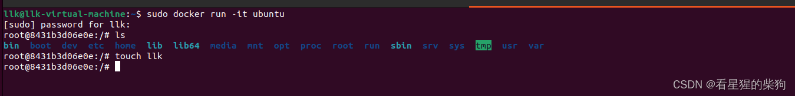
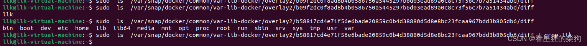
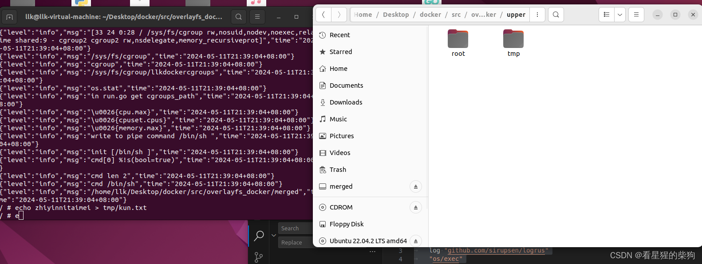
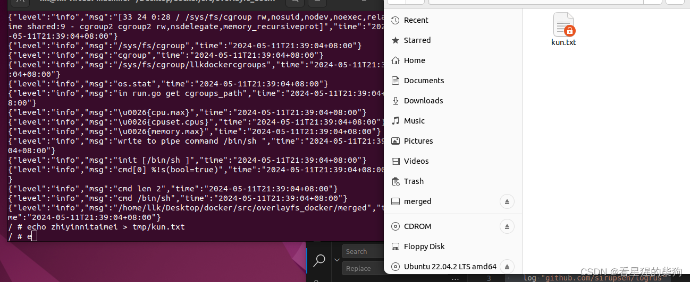
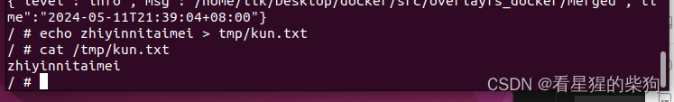
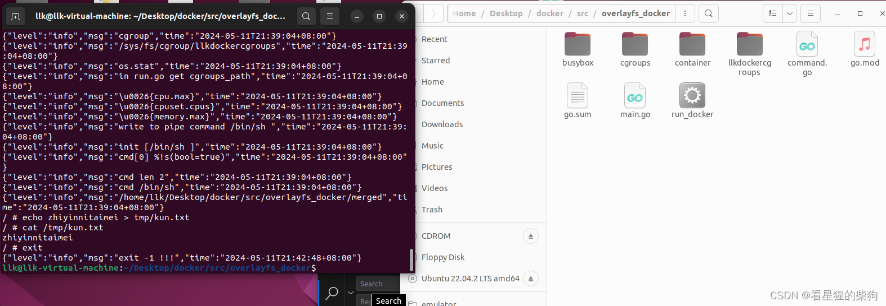


# overlayfs
它是一种联合文件系统，把多个文件合并成一个统一的视图

overlayfs 一般分为四个目录：lower、upper、merged、work

- lower：只读层；这一层的数据永远不会被修改
- upper：读写层；所有的修改都发生在这一层，即使是对 lower 中数据的修改
- merged：视图层，在这里能看到 lower 和 upper 的所有内容
- work：overlayfs 内部使用

在容器内创建一个新文件时

当前的 upper 层会被修改，但 lower 层不会改变


# `exec.Command("tar", "-xvf", busyboxTarURL, "-C", busyboxURL).CombinedOutput()` 
`exec.Command("tar", "-xvf", busyboxTarURL, "-C", busyboxURL).CombinedOutput()` 这行代码会启动一个新进程来执行 `tar` 命令，并自动执行
`CombinedOutput` 调用这个方法会执行该命令，并收集标准输出（stdout）和标准错误（stderr）合并后的输出。如果命令执行成功，会返回一个包含输出内容的字节数组；如果执行过程中出现错误，就会返回该错误（通常意味着命令执行失败）


# `exec.Command`
Go 中的 `exec.Command` 函数用于执行外部命令，其基本格式为：

```go
cmd := exec.Command(command, arg1, arg2, ..., argN)
```

其中，`command` 是你想要执行的外部命令的名称（比如 `ls`、`curl` 等），`arg1` 到 `argN` 是传给该命令的参数。参数之间用逗号分隔，每个参数都是单独的字符串；即使在命令行里看起来像是一个整体的参数（比如包含空格的文件路径），也需要作为单独的字符串传入

### 格式差异

- **命令与参数**：执行不同命令时，格式上的主要差异在于命令本身的名称以及它所需要的参数。每个命令根据自身功能的不同，有不同的参数要求和格式。例如，`ping` 命令可能需要一个主机名作为参数，而 `cp` 命令则需要一个源文件路径和一个目标文件路径

- **传递选项和参数**：有些命令支持长选项（如 `--help`）和短选项（如 `-h`）；这些选项以及它们后面跟的参数（如果有的话）的使用方式也是 `exec.Command` 参数的一部分。例如 `exec.Command("grep", "-r", "pattern", "directory")`

- **环境变量和工作目录**：除了命令和参数之外，`exec.Command` 还允许通过 `Cmd.Env` 和 `Cmd.Dir` 字段设置环境变量和工作目录。这不会改变命令的基本格式，但会影响命令执行的环境

- **输入输出重定向**：就像前面代码展示的那样，可以用 `Cmd.Stdin`、`Cmd.Stdout` 和 `Cmd.Stderr` 来重定向命令的标准输入、输出和错误流。这不会影响命令的格式，但会影响它的交互方式


# 挂载（mount）
- 把 busybox 目录准备成只读的 lower 层
- 准备读写的 upper 层
- 准备 merged 层，把读写层和只读层挂载到 merged 层上（以上操作都在容器启动前运行）
-  容器（子进程）运行时，pivotRoot 会切换目录（在子进程切换到命令行之前）

```go
package contain
import(
	log "github.com/sirupsen/logrus"
	"os/exec"
	
	"os"
)

func prepare_overlays(rooturl string){
	create_lower(rooturl)
	create_upper(rooturl)
	create_merged(rooturl)
	create_work(rooturl)
	mount_overlays(rooturl)
	log.Infof("prepare_overlays suceess")
}
func create_lower(rooturl string){
	busyboxurl:=rooturl+"/busybox"
	busytarurl:=rooturl+"/busybox.tar"
	_, err := os.Stat(busyboxurl)
    if err != nil {
        if os.IsNotExist(err) {
            log.Infof("文件不存在")
			if err:=os.Mkdir(busyboxurl,0777);err!=nil{
				log.Infof("mkdir error")
			}
			if _,err=exec.Command("tar", "-xvf", busytarurl, "-C", busyboxurl).CombinedOutput(); err!=nil{
				log.Infof("tar busybox.tar error")
			}	
        } else {
			log.Infof("无法获取文件信息: %v\n", err)
        }
    }
	
}
func create_upper(rooturl string){
	upperurl:=rooturl+"/upper"
	if err:=os.Mkdir(upperurl,0777);err!=nil{
		log.Infof("mkedir upper error")
	}
}

func create_merged(rooturl string){
	mergedurl:=rooturl+"/merged"
	if err:=os.Mkdir(mergedurl,0777);err!=nil{
		log.Infof("mkedir merged error")
	}
}
func create_work(rooturl string){
	workurl:=rooturl+"/work"
	if err:=os.Mkdir(workurl,0777);err!=nil{
		log.Infof("mkedir merged error")
	}
}

func mount_overlays(rooturl string){
	mnturl:=rooturl+"/merged"
	dirs:="lowerdir="+rooturl+"/busybox"+",upperdir="+rooturl+"/upper"+",workdir="+rooturl+"/work"
	cmd:=exec.Command("mount","-t","overlay","overlay","-o",dirs,mnturl)
	if err:=cmd.Run();err!=nil{
		log.Infof("mount overlay error")
		log.Error(err)
	}
}
```

# 卸载（unmount）
- 容器退出后（子进程退出后程序环境会发生变化，此时根目录也会改变，所以之后才能卸载并删除之前的根目录），卸载挂载点
- 删除 upper、merged、work 层；lower 保持不变

```go
package contain
import(
	log "github.com/sirupsen/logrus"
	"os/exec"
	
	"os"
)
func end_overlays(rooturl string){
	unmount_overlays(rooturl)
	delete_upper_work_merged(rooturl)
}
func unmount_overlays(rooturl string){
	mntrul:=rooturl+"/merged"
	cmd:=exec.Command("umount",mntrul)
	if err:=cmd.Run();err!=nil{
		log.Infof("unmount merged error")
	}
}
func delete_upper_work_merged(rooturl string){
	upperurl:=rooturl+"/upper"
	mergedurl:=rooturl+"/merged"
	workurl:=rooturl+"/work"

	if err:=os.RemoveAll(upperurl);err!=nil{
		log.Infof("delete upper error")
	}
	if err:=os.RemoveAll(mergedurl);err!=nil{
		log.Infof("delete merged error")
	}
	if err:=os.RemoveAll(workurl);err!=nil{
		log.Infof("delete work error")
	}
}
```

# 代码仓库
[https://github.com/FULLK/llkdocker](https://github.com/FULLK/llkdocker)
# 效果展示
- 使用 sudo 运行后，upper 层一开始什么都没有，但只要有命令运行，就会创建一个 root 文件夹，因为它是以 root 用户执行的。名称可能会影响文件夹的修改，因为 merged 中的 root 文件夹里什么都没有
- 新建一个文件：修改会出现在 upper 中，也会出现在 merged 中，但不会出现在 lower 中

- 查看文件内容

- 退出后


