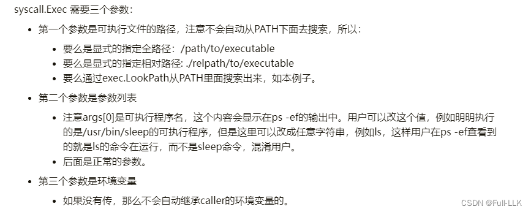



# 命令行输入参数长度过长

当用户输入的参数过长或包含特殊字符时，这种方式可能遇到的问题包括：

1. 参数长度限制：大多数命令行环境对单个命令行参数的长度都有限制；超过这个限制，参数可能无法完整地传递给程序。解决方法是在程序中处理长参数时使用多参数模式，或者通过文件传递参数。

2. 特殊字符转义问题：引号、空格、换行符等特殊字符通常需要在命令行中正确转义才能作为参数的一部分。例如，如果某个参数包含空格，整个参数应该用双引号括起来（在兼容 POSIX 的 shell 中），比如 `"this is a long param with spaces"`。处理这类参数时，你的程序需要能够识别并正确解析这些转义规则。

3. 内部处理逻辑问题：如果 `Contain_init` 函数内部没有正确处理长参数或特殊字符，那么即使参数成功传入该函数，也可能导致函数失败或无法按预期工作。
#  通过匿名管道把参数从父进程传给子进程

- 管道是两个进程之间传输数据的一个中间缓冲区
- 管道一般有固定大小，为 4KB
- 半双工（即数据在同一时刻只能单向传输）
- 只有管道中有空闲空间时才能写入
- 只有管道中有已写入的内容时才能读取
#  `[]*os.File{}`
在 Go 中，`[]*os.File{}` 是一个指向 `os.File` 类型指针切片的初始化表达式。`os.File` 是 Go 标准库 `os` 包中的一个结构体类型；它表示一个已打开的文件对象，可以是普通的磁盘文件，也可以是其他类型的 I/O 资源，比如管道和终端设备。

`[]*os.File{}` 表示一个保存 `*os.File` 类型指针的切片；星号 `*` 表示指针，也就是说该切片中的元素是指向 `os.File` 结构体的指针。

例如，`[]*os.File{readPipe}` 表示一个只包含一个元素的 `os.File` 指针切片，其中 `readPipe` 是指向某个已打开的 `os.File` 的指针。

在 Go 的 `os/exec` 包中，当我们创建一个 `exec.Cmd` 结构体实例来执行外部命令时，可以通过 `Cmd.ExtraFiles` 字段传递这样一个文件指针切片。这样做的目的是在执行外部命令时把这些文件描述符传递给子进程，以便子进程能够访问和操作这些文件资源，比如用于进程间通信（IPC）。

#  `os.NewFile` 与 `io.ReadAll` 
在这段 Go 代码中，`os.NewFile` 和 `io.ReadAll` 分别用于从一个底层文件描述符创建一个 `os.File` 对象，以及读取该文件的全部内容。

1. `pipe := os.NewFile(uintptr(fdIndex), "pipe")`：
   - `fdIndex` 是一个表示已知文件描述符索引的整数。（因为 3 已经是传递过来的文件描述符了，因为每个进程默认都有 3 个文件描述符：标准输入、标准输出和标准错误。创建子进程时默认会带上这 3 个）
   - `os.NewFile` 函数接受两个参数：一个是文件描述符的数值表示（这里转换为 `uintptr` 类型），另一个是为该文件描述符起的名字（这里是字符串 "pipe"）。
  
>os.NewFile 函数接受两个参数：第一个是表示一个已有文件描述符的 uintptr 值；第二个是用于指定文件名的字符串（在这个场景中通常是一个描述性的名字，而不是真实路径）。

2. `msg, err := io.ReadAll(pipe)`：
   - `io.ReadAll` 是一个函数，它从给定的 `io.Reader` 接口（这里是实现了 `io.Reader` 接口的 `pipe`）中读取全部数据，直到遇到 EOF（文件结束）。
   - 它返回两个值：一个是读取到的数据（这里是 `msg` 变量），类型为 `[]byte`（字节数组）；另一个是错误信息（`err`），如果读取过程中出现错误，该值会非空。
   - 这行代码尝试从刚创建的 `pipe` 文件对象中读取全部数据，并把读到的内容存入 `msg` 变量。
#  exe.LookPath
在 Go 的 `os/exec` 包中，`exec.LookPath` 函数用于查找给定可执行文件的路径。其函数原型如下：

```go
func LookPath(name string) (string, error)
```

当你调用 `exec.LookPath(cmdArray[0])` 时，`cmdArray` 是一个字符串数组，其中 `cmdArray[0]` 是你想要执行的命令或程序的名字（不带完整路径）。`LookPath` 函数会根据当前系统的 `$PATH` 环境变量，查找该名字对应可执行文件的完整路径。

如果找到了对应可执行文件的路径，`LookPath` 函数会返回该路径；如果没有找到，则返回一个空字符串和一个错误对象。这个功能通常用于在执行外部命令之前验证某个命令是否存在；这是执行 `exec.Command` 之前常见的一个预先步骤。

例如，假设你有一个 `cmdArray := []string{"ls", "-l", "."}`，想要执行 `ls -l .` 命令。在执行该命令之前，你可能会先调用 `exec.LookPath(cmdArray[0])`，检查系统上是否存在名为 `ls` 的可执行文件。如果存在，就可以安全地创建并执行 `exec.Command(cmdArray[0], cmdArray[1:]...)`。

#   syscall.Exec
[https://xieys.club/go-syscall-exec/](https://xieys.club/go-syscall-exec/)
[https://gobyexample-cn.github.io/execing-processes](https://gobyexample-cn.github.io/execing-processes)


# `strings.Split(msgStr, " ")` 

`strings.Split(msgStr, " ")` 是 Go 中的一个字符串处理函数，来自 "strings" 包。该函数接受两个参数：

1. `msgStr`：这是你想要进行分割操作的字符串变量。
2. `" "`：这是分隔符，一个空格字符，表示你想按空格对 `msgStr` 进行分割。

该函数执行后，会返回一个字符串切片（`[]string` 类型），其元素是 `msgStr` 按空格分割出来的子串。例如，如果 `msgStr` 是 `"hello world how are you"`，那么执行 `strings.Split(msgStr, " ")` 的结果将是 `["hello", "world", "how", "are", "you"]`。

这个操作通常用于把一个以空格分隔的单词字符串转换为一个单词列表，以便后续遍历、处理或分析。
# /bin/ls: cannot access '': No such file or directory
原因是

```c
err:=syscall.Exec("/bin/ls",argv,os.Environ())
```
当 `argv` 是 `["/bin/ls",""]` 时，会出现这个问题；解决方法是从切片中去掉对应 `""` 的那个元素。我不确定为什么会这样，可能是 Split 的机制导致的

> 如果存在末尾的空格字符，分割结果自然会包含由末尾空格产生的空字符串元素。


#  代码
[https://github.com/FULLK/llkdocker/tree/main/pipe_docker](https://github.com/FULLK/llkdocker/tree/main/pipe_docker)

