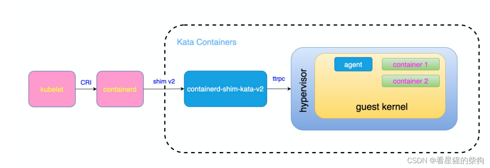
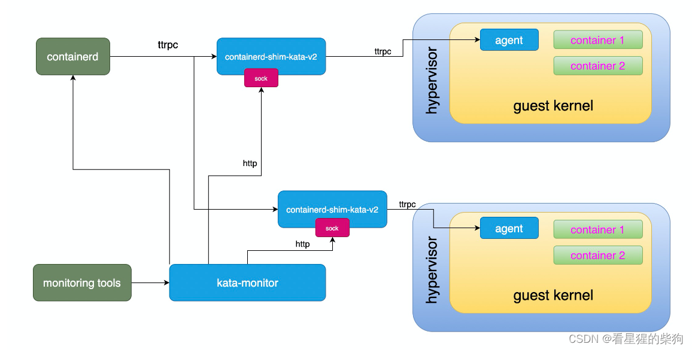
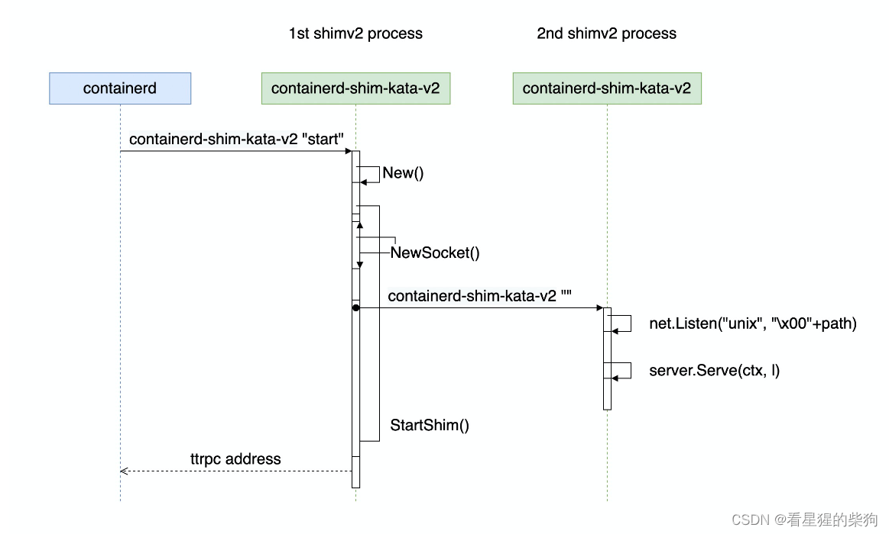
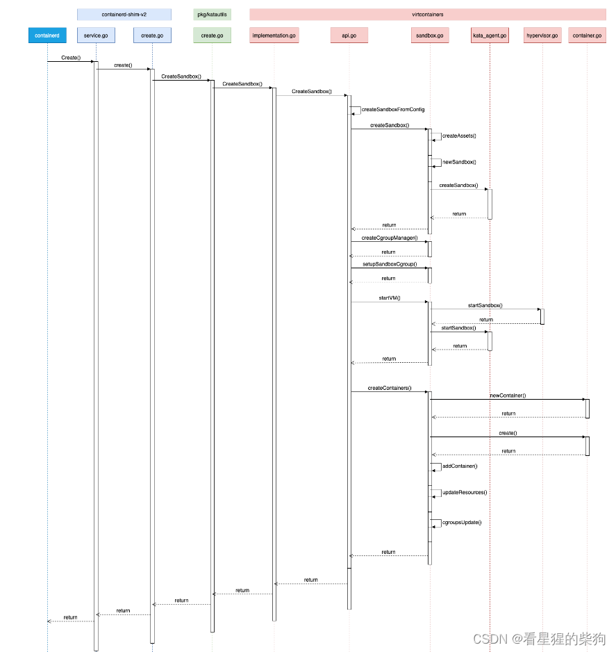
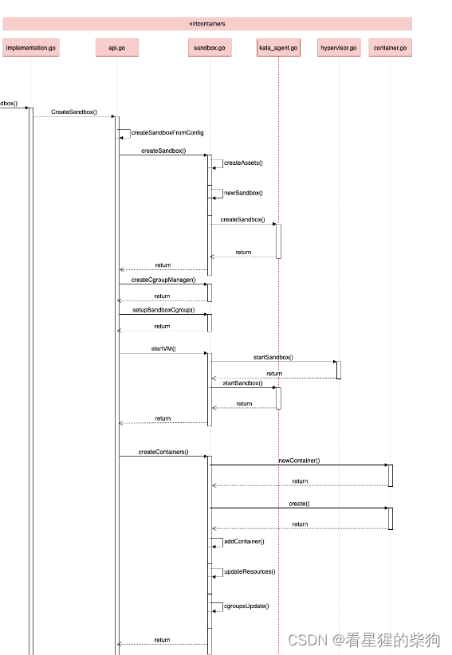
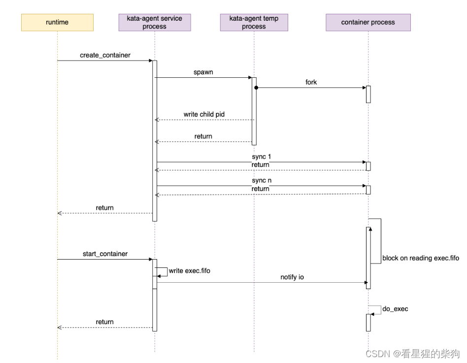


[http://liubin.org/kata-dev-book/src/runtime-arch.html](http://liubin.org/kata-dev-book/src/runtime-arch.html)

> 由于我也是刚入门，如有错误欢迎指出，非常感谢！！

# Docker 与 Kata Containers 的区别

### Docker 容器共享宿主机内核

Docker 容器基于 Linux 内核的命名空间（namespaces）和控制组（cgroups）技术实现。简单来说，Docker 让容器看起来拥有独立的文件系统、网络、进程空间、用户 ID 空间等，但实际上，所有容器以及宿主机上的 Docker 守护进程共享同一个 Linux 内核。这意味着虽然容器在逻辑上是隔离的，但在物理层面它们共享宿主机的 CPU、内存和操作系统内核。如果内核存在安全漏洞，或者容器内的程序试图访问未经授权的系统资源，理论上就存在安全风险。

### 每个容器实例运行在一个轻量级虚拟机（MicroVM）中

Kata Containers 等技术采用了不同的方法：为每个容器实例创建一个非常轻量的虚拟机（MicroVM）。在这种模式下，每个容器不再直接共享宿主机的操作系统内核，而是拥有自己的微型虚拟化环境，包括独立的内核。这通常通过 QEMU-KVM 之类的技术实现，为每个容器提供隔离的硬件抽象层——包括 CPU、内存、I/O 设备等——以及独立的内核。

这意味着即使容器内的程序试图突破其安全边界，也无法直接影响宿主机或其他容器，因为每个容器都运行在自己的微型虚拟机中，具有更严格的硬件级隔离。这种设计显著提高了安全性，尤其是在运行不可信代码或需要强隔离的场景中。代价是可能会略微增加资源消耗和启动时间，因为每个容器都需要启动自己的内核和虚拟化环境。

### 小结

- Docker 容器通过命名空间和控制组实现逻辑隔离，共享宿主机的内核。资源利用效率高，但隔离程度相对较低。
- Kata Containers 等技术利用 MicroVM 技术为每个容器提供独立的内核和硬件抽象层。隔离性高、安全性增强，但可能会牺牲一点启动速度和资源效率。

#  Kata Containers 架构的直观示例


这张图展示了 Kubernetes（kubelet）如何通过 CRI 接口与 Containerd 和 Kata Containers 交互。


- **Kubernetes（kubelet）** 是我们的智能管家。
- **Containerd** 是物业经理。
- **Kata Containers** 提供了一种更安全的容器运行方式——就像在每个房间外面再加一座小房子（轻量级虚拟机），使不同房间之间隔离得更好。

现在，假设房东（用户）想在一个更安全的环境中运行他的软件。于是他告诉管家（Kubernetes）："我需要一个特殊的房间，里面有一座独立的小房子，确保我的软件与其他一切完全隔离。"

1. **管家（Kubernetes）接到命令**：了解了房东的需求后，管家决定使用 Kata Containers 提供的服务。他通过 CRI 接口告诉 Containerd，这次需要一个特殊的房间——也就是一个带轻量级虚拟机的容器。

2. **Containerd 调用 Kata Containers**：为了满足这一需求，Containerd 调用一个叫做 "containerd-shim-kata-v2" 的东西，它是专门处理 Kata Containers 请求的代理程序。这个代理程序进一步与 hypervisor（虚拟机管理器）通信，告诉它需要创建一个轻量级虚拟机来容纳新容器。

3. **hypervisor 创建轻量级虚拟机**：收到请求后，hypervisor 在宿主系统上创建一个轻量级虚拟机。这个虚拟机有自己的客户操作系统（guest kernel）。在这个虚拟机内部，hypervisor 还为新容器创建了一个单独的空间。

4. **容器运行在轻量级虚拟机中**：最后，hypervisor 在轻量级虚拟机内部的空间中启动新容器。这个容器与其他容器和其他进程之间获得了更好的隔离保护。

整个过程完成后，管家（Kubernetes）就可以告诉房东（用户），他的软件已经在一个非常安全的环境中运行了。而且由于有 Kata Containers，即使其他房间出了问题，这个特殊的房间也不会受到影响。


# Kata Containers 的实际架构


### 容器技术栈逐层解析

1. **顶层：应用管理平台（如 Kubernetes）**
   - 这一层是用户或管理员与系统交互的地方，用于部署、管理和编排容器化应用。它向下层发送命令，例如创建、停止或重启容器。

2. **容器运行时管理器（Containerd）**
   - Containerd 是负责容器生命周期管理的操作系统级软件。它接收来自上层的命令（例如通过 Kubernetes 的 CRI 接口传来的命令），然后执行创建、启动、停止容器等操作。

3. **Shim 层（containerd-shim-kata-v2）**
   - Shim 层是一个轻量级进程，充当 Containerd 与底层容器运行时技术之间的桥梁。`containerd-shim-kata-v2` 专为 Kata Containers 设计：它的工作是把 Containerd 的标准化 API 转换为 Kata Containers 能理解的格式，并管理 Kata Containers 实例的生命周期。Shim 层保证了 Containerd 不需要直接了解 Kata Containers 的实现细节。

4. **Kata Containers**
   - Kata Containers 是一种容器运行时，通过轻量级虚拟化为每个容器提供更强的隔离。与传统容器相比，Kata 使用微型虚拟机（VM）运行每个容器，在尽量保持容器启动速度和资源效率的同时，实现接近虚拟机级别的安全隔离。

5. **Hypervisor**
   - 在 Kata Containers 架构中，Hypervisor 是核心组件之一。它是运行在物理主机上、能够创建和运行虚拟机的软件。Hypervisor 负责为每个微型虚拟机分配物理资源（CPU、内存、I/O 设备），并保证它们之间的隔离。对于 Kata Containers，QEMU 是常用的 Hypervisor，它创建并管理运行容器的微型虚拟机。

### 小结
这张图可能详细展示了从应用管理层到底层虚拟化层的整个流程，强调了各层之间的信息流动和职责划分。作为容器运行时的核心，Containerd 通过 shim 层间接控制 Kata Containers 及其所依赖的 Hypervisor；它们共同为容器提供了高度安全和隔离的运行环境。


# agent 与 shim
想象你是一位忙碌的家长（shim 进程），需要照顾住在不同房间的孩子们（容器），每个房间都有一位贴心的保姆（agent）。你既要确保孩子们的需求得到满足，又要监督他们的活动，但你不能直接进入每个房间打扰他们。

### 家长（shim 进程）的角色

作为家长，你负责协调家里的一切，包括孩子们的请求和日常安排。然而，直接和每个孩子交谈既费时又低效。于是你决定通过房间里的对讲系统（agent 协议）与每位保姆沟通。

### 保姆（agent）的职责

保姆住在孩子的房间里，对孩子的需求了如指掌。她们通过房间的对讲机听取家长的指示，例如"给小明准备晚饭"或"让小红休息一下"。收到消息后，保姆立即按要求照顾孩子，同时通过对讲机向家长汇报孩子们的状态，例如"小明已经吃完晚饭，正在看书"。

### "agent 协议"的作用

这里的"agent 协议"就像那套对讲系统：它定义了家长与保姆之间沟通的语言和规则。例如，它规定了如何表达"吃饭时间"、"休息"之类的指令，以及如何汇报"完成了"或"需要帮助"之类的反馈。这样，家长无需直接进入房间就能高效地管理整个家庭的日常生活，同时确保每个孩子（容器）的需求都能得到个性化的关注和满足。

### 对应到真实技术

回到 Kata Containers 的场景：shim 进程就像那位细心的家长，通过"agent 协议"与运行在虚拟机（guest）内部的 agent 通信。该协议确保宿主机上的管理进程能够安全地发送控制命令和获取状态信息，而不直接干预虚拟机的内部运作，从而维护容器的隔离性和安全性。这样，Kata Containers 就能在保证高性能的同时提供虚拟机级别的安全隔离。


#  runtime 部分

想象你经营着一家非常特别的酒店，叫做"容器客栈"。这家客栈有一些特殊的规定和高科技设备，确保每位客人的住宿既舒适又安全。

1. **前台（containerd）**：containerd 就像酒店的前台，负责接待客人（即处理创建、启动和停止容器的请求）。有新客人入住或离开时，前台负责办理所有入住和退房手续。

2. **特殊安全客房（Kata Containers）**：与普通酒店不同，这里的每个房间都是一间高度安全的小公寓，叫做 Kata Container。每个房间都配备了完整的安保系统和独立的管家服务，确保客人之间完全隔离，不会互相打扰或窥探彼此的隐私。就好像每位客人都有自己的一座小房子，而不只是一个房间。

3. **保安兼翻译（containerd-shim-kata-v2）**：由于这些安全客房很特殊，前台需要一个既懂前台规矩又能与客房直接沟通的人——这就是 containerd-shim-kata-v2。它帮助把前台的指令准确传达给安全客房，并把客房的反馈传回前台。

4. **房间内的智能助手（Agent）**：每个安全客房内部还有一个智能助手，负责日常维护，并向安全监控中心报告房间状态。它就像房间里的一个小机器人，不断检查一切是否正常，并与外界保持通信。

5. **安全监控中心（Kata Monitor）**：这是一个先进的监控系统，持续关注所有安全客房的状态，确保一切正常运转。如有任何异常，它会立即通知前台采取行动。

6. **隔离技术（Hypervisor 与 Guest Kernel）**：为了让每个房间完全独立，酒店使用一种高科技手段为每个房间创造一个虚拟世界，包括一个迷你操作系统（Guest Kernel）和一个虚拟环境管理器（Hypervisor）。这样，即使某个房间出了问题，也不会影响其他房间。

#  containerd-shim-v2

```go
type service struct {
    // hypervisor pid, Since this shimv2 cannot get the container processes pid from VM,
    // thus for the returned values needed pid, just return the hypervisor's
    // pid directly.
    hpid uint32

    // shim's pid
    pid uint32

    sandbox    vc.VCSandbox
    containers map[string]*container
    config     *oci.RuntimeConfig
    events     chan interface{}
    monitor    chan error

    id string
}
```

我们用一个类比来理解这段描述中的 `service struct` 及其关键属性，把它放到一个虚拟科技园区的场景中：

想象你是一个科技园区的管理员，负责整个园区的运营和安全。这个园区就像一个 `sandbox`，园区里的各家初创公司就是 `containers`。你手上有一张园区布局图（`service struct`），详细记录了园区的管理政策和关键信息。

1. **hypervisor pid（hpid）**：相当于园区中央控制塔的编号，它监管着整个园区的供电。由于某些特殊原因，当你需要报告园区某个区域的活动状态，却无法直接获取具体公司（容器）的信息时，就直接提供这个控制塔（hypervisor）的编号作为参考。

2. **shim's pid（pid）**：这是你个人的工号，标识你是这个园区唯一的管理员，负责园区的日常运营和应急响应。

3. **sandbox（vc.VCSandbox）**：园区本身作为一个整体，遵循一套标准的管理规范（`vc.VCSandbox` 接口）。这些规范规定了如何维护园区的基础设施、如何接纳新的初创公司、如何保持园区生态健康等。

4. **containers（map[string]*container）**：这是一份详细的园区公司名录，键是公司名称，值是每家公司的详细信息。你用这份名录管理公司的进出、资源分配、活动协调等。许多具体的管理工作——比如帮新公司入驻或调整现有公司的办公空间——都依赖这份名录。

5. **events（chan interface{}）**：这是一个即时消息通道。园区里发生的任何事件（如新公司开业、举办活动、安全警报等）都会通过这个通道即时通知你，让你能够快速响应和处理。

6. **monitor（chan error）**：一个专门报告园区核心设施（尤其是那座中央控制塔）运行状态的监控通道。如果控制塔出现故障或园区面临重大问题，这个通道会向你发送错误信息，确保你能立即介入解决问题，保持园区正常运转。


```go
type Shim interface {
    shimapi.TaskService
    Cleanup(ctx context.Context) (*shimapi.DeleteResponse, error)
    StartShim(ctx context.Context, id, containerdBinary, containerdAddress string) (string, error)
}

type TaskService interface {
    State(ctx context.Context, req *StateRequest) (*StateResponse, error)
    Create(ctx context.Context, req *CreateTaskRequest) (*CreateTaskResponse, error)
    Start(ctx context.Context, req *StartRequest) (*StartResponse, error)
    Delete(ctx context.Context, req *DeleteRequest) (*DeleteResponse, error)
    Pids(ctx context.Context, req *PidsRequest) (*PidsResponse, error)
    Pause(ctx context.Context, req *PauseRequest) (*google_protobuf1.Empty, error)
    Resume(ctx context.Context, req *ResumeRequest) (*google_protobuf1.Empty, error)
    Checkpoint(ctx context.Context, req *CheckpointTaskRequest) (*google_protobuf1.Empty, error)
    Kill(ctx context.Context, req *KillRequest) (*google_protobuf1.Empty, error)
    Exec(ctx context.Context, req *ExecProcessRequest) (*google_protobuf1.Empty, error)
    ResizePty(ctx context.Context, req *ResizePtyRequest) (*google_protobuf1.Empty, error)
    CloseIO(ctx context.Context, req *CloseIORequest) (*google_protobuf1.Empty, error)
    Update(ctx context.Context, req *UpdateTaskRequest) (*google_protobuf1.Empty, error)
    Wait(ctx context.Context, req *WaitRequest) (*WaitResponse, error)
    Stats(ctx context.Context, req *StatsRequest) (*StatsResponse, error)
    Connect(ctx context.Context, req *ConnectRequest) (*ConnectResponse, error)
    Shutdown(ctx context.Context, req *ShutdownRequest) (*google_protobuf1.Empty, error)
}
```

想象你在运营一个由无数小游戏（任务）组成的虚拟游戏世界，每个小游戏都有自己的规则和生命周期。`Shimv2` 就像这个虚拟世界的管理员，负责创建、管理和结束这些小游戏（任务）。

### Shim 接口

- **shimapi.TaskService**：这部分接口就像一本详细的"游戏攻略"，涵盖如何开始一局新游戏（`Create`）、如何让游戏运行起来（`Start`）、如何暂停或恢复游戏（`Pause` 和 `Resume`），甚至如何在游戏中途调整规则（`Update`）等。每局游戏（任务）都有自己的状态（`State`），管理员可以查询它是仍在运行还是已经结束。

- **Cleanup**：一局游戏（任务）结束后，需要有人清理场地，为下一局游戏做准备。`Cleanup` 就是这个清洁工：它确保即使游戏管理员（shimv2 进程）因故提前离开，残留的资源也能通过其他方式被清理掉，保持游戏世界整洁有序。

- **StartShim**：想象你开辟了一个新的游戏区域，需要指派一名新的管理员负责。`StartShim` 就是这个过程：它负责启动一个新的管理员（shimv2 进程），并告诉他游戏世界的入口（containerdBinary 和 containerdAddress）以及他负责的区域编号（id），让他能顺利开始工作。

### 容器与任务

在游戏世界中，"容器"可以比作一套游戏工具包：它包含了游戏开始前所需的所有道具和规则说明，但只有当你真正开始玩这个游戏（运行容器）时，它才变成一个活生生的"任务"——一个有自己生命历程和玩家互动的运行中的游戏实例。

### 一个具体的例子

假设你决定在你的虚拟世界中加入一个"寻宝任务"（容器）。首先，你需要准备任务包（创建容器配置），其中包含地图、宝藏位置等信息（静态资源）。然后，通过 `StartShim` 命令指派一名管理员（启动 shimv2 进程），并告诉他任务规则以及如何与其他系统（containerd）协调。

一旦任务（寻宝游戏）正式开始（任务运行），它就变成一个活动的进程（Task），管理员通过 `TaskService` 接口管理这个任务的方方面面——例如调整难度（资源限制调整）、查看玩家进度（状态查询）、结束任务（删除任务）。

如果某天这个管理员突然消失了（shimv2 进程意外退出），你还可以通过 `Cleanup` 清理遗留问题，确保游戏世界继续平稳运行，为下一个任务做好准备。

## 启动过程



想象你在家里安装了一套智能家居系统。这个系统就像 `containerd`，帮你管理家里的各种智能设备（相当于容器）。而 `shimv2`——你可以把它想象成家里的一个智能中控台。

第一个启动的 `shimv2` 就像中控台进行开机自检，确保一切就绪，然后它开通一条特殊的对讲通道（ttrpc 服务），让它能与其他智能设备高效通信。它还会把这条通道的地址返回给 `containerd`。

第二个启动的 `shimv2` 才是常驻的智能中控台本身。它从不关机，一直在那里等待接收你的命令或自动执行预设任务。例如，你可以用手机 App（相当于 `containerd` 发出的指令）告诉中控台："打开客厅的灯"，或者"把卧室空调温度调到 25 度"。这个中控台（第二个 `shimv2`）通过之前建立的对讲通道（ttrpc server）接收并执行这些命令。

这个智能中控台一直保持通电在线，通过一种特殊的通信方式（ttrpc）等待接收并执行你的各种家居控制命令（经由 `containerd` 发出），确保你的智能家居生活顺畅运行。

## CreateContainer




想象一位总导演要举办一场比赛

1. 总导演（containerd）向技术团队（shimv2）下达命令，要求创建一个新的比赛区域（PodSandbox）。这条命令从 containerd 的 `service.go` 文件中的 `Create()` 方法开始。

2. **技术团队**收到命令后，按照预定步骤开始搭建比赛区域。这个过程涉及多个文件和函数调用，例如 `create.go` 中的 `create()` 方法、`pkg/katautils/create.go` 中的 `CreateSandbox()` 方法以及 `virtcontainers/api.go` 中的 `CreateSandbox()` 方法等。

3. 在搭建过程中，技术团队需要完成以下工作：
   - **规划布局**（`newSandbox()`）：确定比赛区域的基本结构和配置，如网络设置、存储空间等。
   - **创建资源管理器**（`createCgroupManager()`）：设置资源限制和监控机制，确保比赛区域内的资源分配合理。
   - **初始化沙箱的 Cgroups**（`setupSandboxCgroup()`）：确保比赛区域内的资源分配合理，如 CPU 时间片、内存限制等。
   - **启动虚拟机**（`startVMM()`）：为比赛区域提供硬件模拟支持，如处理器数量、内存容量等。
   - **创建并启动容器**（`createContainers()`）：根据比赛需要，在比赛区域内创建并启动与各个比赛项目对应的容器实例。

4. 所有准备工作完成后，技术团队向总导演报告比赛区域已就绪，等待进一步指示。

5. 收到报告后，总导演可以开始安排具体的比赛项目（PodContainer），技术团队则在比赛区域内创建相应的容器实例。

6. 比赛开始后，总导演可以通过控制台（containerd 的 API）实时查看比赛状态、调整资源分配，必要时甚至可以终止某些比赛项目。

7. 比赛结束后，总导演通知技术团队清理比赛区域、释放资源。技术团队按照既定流程逐步关闭容器、停止虚拟机并删除比赛区域。

通过这种方式，`containerd` 利用 `shimv2` 实现了对容器生命周期的有效管理和调度。。

### PodSandbox 与 PodContainer
想象你正在后院筹划一场周末烧烤派对。这个场景可以帮助我们形象地理解 `PodSandbox` 和 `PodContainer` 的区别。

### PodSandbox：创建沙箱容器

筹备派对时，你首先需要清理并布置出一块区域，作为烧烤活动的专用场地。这块区域就相当于 `PodSandbox`。你铺上防滑垫、搭好遮阳棚、准备好垃圾桶等基础设施，确保场地安全并满足烧烤的基本需求。这块场地本身并不直接烤肉或准备食物，但它为所有烧烤活动提供了基础环境。在 Kubernetes 中，`PodSandbox` 就是这样一个基础环境：它包括网络命名空间、存储卷挂载、安全上下文等，为真正的应用容器的运行提供基础。

### PodContainer：创建普通业务容器

场地准备好后，你开始摆放烤架、准备食材和工具。第一个烤架用来烤肉，第二个用来烤蔬菜；这些烤架及其各自的任务就相当于 `PodContainer`。烤肉架（容器）专注于做出美味的牛排，而烤蔬菜架（另一个容器）专注于烤各种蔬菜。每个烤架（容器）都有其特定功能，它们共同服务于派对的整体目标（Pod）。在 Kubernetes 中，`PodContainer` 就是执行具体应用逻辑的容器——例如一个容器运行数据库，另一个运行前端服务，它们协同工作，提供完整的应用服务。

### 小结

因此，`PodSandbox` 就像搭建一个具备基础服务和环境的舞台，而 `PodContainer` 则是在这个舞台上扮演不同角色的演员，各自承担一部分表演，共同完成一场精彩的演出（提供服务）。在 Kubernetes 中，这种设计使应用的部署和管理更加灵活高效。


# agent
- ttrpc 服务：作为 agent 服务，通过 ttrpc 响应来自 shim 进程的请求
-  启动容器：启动容器时，agent 通过在新进程中运行 agent 二进制文件来启动容器

想象你经营着一家快递公司，它就像我们的容器环境。这家公司里有一个叫做 Agent 服务的核心部门，扮演调度中心的角色。

**ttrpc 服务——快递调度中心的接线员**


Agent 服务的一项重要职责是通过 ttrpc（可以想象成一套高级对讲系统）接收并响应来自各个配送站（这里比作 shim 进程）的请求。每个配送站代表一个特定的任务区域。它们根据客户（外部系统）的需求，通过 ttrpc 对讲机向调度中心（Agent 服务）发送请求，例如："客户 A 需要加急寄一个包裹，请安排取件"。

收到这些请求后，调度中心的接线员（ttrpc 服务部分）迅速记录下来，然后分派给合适的快递员（相当于 Agent 的内部处理逻辑），确保每个请求都能得到及时准确的处理和响应。这样，无论是收件、派件还是查询包裹状态，一切都能高效进行，保证整个快递网络的顺畅运转。

**启动容器——一支新的快递配送小分队**

此外，当有新业务扩展或特殊需求时——比如开通一条全新的快递线路（启动一个新的容器服务）——Agent 服务就不只是调度中心了，它还可以充当"人力资源部"。这时，它会组建一支全新的快递小分队（通过在新进程中运行 Agent 二进制文件）。这支小分队专门负责这条新线路的所有快递事务，确保新业务能够独立高效地运行，而不干扰现有业务。


##  启动 ttrpc 服务

```rust
fn main() -> std::result::Result<(), Box<dyn std::error::Error>> {
    let args: Vec<String> = env::args().collect();

    // 如果是 kata-agent init，则准备进入创建容器的步骤
    if args.len() == 2 && args[1] == "init" {
        rustjail::container::init_child();
        exit(0);
    }

    let rt = tokio::runtime::Builder::new_multi_thread()
        .enable_all()
        .build()?;

    // 在 real_main 里启动 ttrpc 服务。
    rt.block_on(real_main())
}
```

 启动 agent 服务的代码在 real_main 函数中。


## 启动容器之前
在前面的图中，shim v2 之后通过 agent 创建容器（为实际容器提供基础环境），但这是通过 shim 的定义文件 agent.go 完成的


目前创建和启动容器的部分是用 Rust 编写的


## create_container/do_create_container

### 创建容器前的准备工作

1. **rescan_pci_bus**：想象你在整理家里的储物间，发现了一些新设备（比如新的 USB 设备）。这一步会重新扫描虚拟化环境中的硬件，确保系统能识别这些新设备并为容器使用做好准备。

2. **add_devices** 和 **add_storages**：就像为新房子购置家具一样，你需要根据装修蓝图（OCI Spec）挑选和摆放家具（设备配置）。这两步确保容器能访问所需的物理或虚拟设备，并挂载必要的存储卷，以满足应用的运行需求。

3. **update_container_namespaces** 和 **update_device_cgroup**：容器就像一间独立的公寓，有自己专属的地址（命名空间）和物业管理规则（cgroup）。这两个操作调整容器的隔离环境，确保它拥有独立的网络、文件系统视图和资源限制。

4. **append_guest_hooks**：类似于入住前为智能家居系统设置自动化脚本，这一步在容器启动前后添加一些自定义脚本或钩子，用于执行特定的初始化或清理任务。

5. **setup_bundle**：创建容器的"生活空间"（bundle 目录），包括配置文件（config.json）——就像为新房子准备一份入住指南，其中包含启动容器所需的全部配置信息。

### 真正"启动"容器

```rust

let mut ctr: LinuxContainer =
    LinuxContainer::new(cid.as_str(), CONTAINER_BASE, opts, &sl!())?;

let p = if oci.process.is_some() {
    Process::new(
        &sl!(),
        &oci.process.as_ref().unwrap(),
        cid.as_str(),
        true,
        pipe_size,
    )?
} else {
    return Err(anyhow!(nix::Error::from_errno(nix::errno::Errno::EINVAL)));
};

ctr.start(p).await?;
```

- **创建 LinuxContainer 对象**：`ctr` 就像新公寓的物业管理处，负责管理这个容器的一切。它通过 `LinuxContainer::new()` 初始化，设置容器 ID、基础路径、启动选项等基本信息。

- **创建 Process 对象**：`p` 代表将在容器内运行的"住户"（进程）。它通过 `Process::new()` 创建，包含进程的入口点、环境变量、工作目录等细节。

- **ctr.start(p）**：虽然名字叫 "start"，但这个阶段主要是做最后的准备和初始化工作。


##  ctr.start(p）

```rust
let exec_path = std::env::current_exe()?;
let mut child = std::process::Command::new(exec_path);
let mut child = child
    .arg("init")
    .stdin(child_stdin)
    .stdout(child_stdout)
    .stderr(child_stderr)
    .env(INIT, format!("{}", p.init))
    .env(NO_PIVOT, format!("{}", self.config.no_pivot_root))
    .env(CRFD_FD, format!("{}", crfd))
    .env(CWFD_FD, format!("{}", cwfd))
    .env(CLOG_FD, format!("{}", cfd_log));

if p.init {
    child = child.env(FIFO_FD, format!("{}", fifofd));
}

child.spawn()?;
```

### 初始化阶段


1. **Kata Agent 的自启动**
   
   Kata Containers 准备启动一个新容器时，第一件事就是让 Kata Agent 启动一个以 `init` 模式运行的新进程。

   - `std::env::current_exe()?` 获取当前正在执行的 Kata Agent 的路径，类似于找到自己的"身份证"。
   - `std::process::Command::new(exec_path)` 创建一个命令对象，准备启动一个与当前进程相同的副本。
   - `.arg("init")` 指定启动模式，告诉新的 Agent 进程它需要初始化容器环境，而不是处理普通的 RPC 请求。
   - 设置环境变量和标准 I/O 重定向，确保新进程拥有正确的环境配置以及与外界的通信通道。

### 准备进程间通信

```rust

let pid_buf = read_async(&mut pipe_r).await?;
let pid_str = std::str::from_utf8(&pid_buf).context("get pid string")?;
let pid = match pid_str.parse::<i32>() {
    Ok(i) => i,
    Err(e) => {
    }
};


let (prfd, cwfd) = unistd::pipe().context("failed to create pipe")?;
let (crfd, pwfd) = unistd::pipe().context("failed to create pipe")?;

let mut pipe_r = PipeStream::from_fd(prfd);
let mut pipe_w = PipeStream::from_fd(pwfd);
```

2. **建立管道**

   - 使用 `unistd::pipe()` 创建两个匿名管道。这就像搭建两座桥：一座供父进程（当前的 Kata Agent）向子进程发送信息（`crfd` 到 `pwfd`），另一座供子进程向父进程回传消息（`prfd` 到 `cwfd`）。
   - `PipeStream::from_fd` 把原始文件描述符转换为更便于操作的流对象，使读写更加方便。

### 启动容器进程

3. **启动 Kata Agent 子进程并传递 PID**

   - `child.spawn()?` 启动新的 Agent 进程。此时新进程执行 `do_init_child` 函数，开始容器的初始化工作。
   - 一旦容器的 init 进程（PID 为 1 的进程）在子 Agent 中成功启动（需要执行 `do_init_child`），它就通过之前建立的一个管道（`cwfd`）把自己的 PID 发送给父进程。
   - 父进程通过 `read_async` 等待并接收这个 PID，从而得知容器进程的确切标识。

### 命名空间与进程管理

4. **加入命名空间**

   - `join_namespaces` 是 Kata Agent 内部的关键步骤。它负责为新创建的容器进程设置命名空间，包括 PID 命名空间、网络命名空间等，确保容器进程运行在完全隔离的环境中——就像在一个独立的房间里开展活动，不受外界干扰。（ctr.start() 最后执行的重要函数之一就是 join_namespaces）
   - 这个过程可能涉及 `clone` 系统调用，它允许新进程继承父进程的某些属性，同时在某些方面（如命名空间）与父进程分离，创造出全新的执行环境。

### 容器进程的执行

5. **在新的 Agent 进程中执行 `do_init_child`**

   - 在这一步，子 Agent（充当容器的守护进程）开始执行 `do_init_child` 函数，完成剩余的初始化操作，如挂载文件系统、配置网络、执行用户指定的应用程序。
   - 通过之前传入的环境变量和文件描述符——例如 `FIFO_FD` 所指向的 `exec.fifo` 文件——可以控制容器进程启动的时机和方式，确保一切按计划进行。


##  do_init_child

```rust
// kata-containers/src/agent/rustjail/src/container.rs

fn do_init_child(cwfd: RawFd) -> Result<()> {
    match fork() {
        Ok(ForkResult::Parent { child, .. }) => {
            let _ = write_sync(cwfd, SYNC_DATA, format!("{}", pid_t::from(child)).as_str());
            // parent return
            return Ok(());
        }
        Ok(ForkResult::Child) => (),
        Err(e) => {
        }
    }

}
```

### `do_init_child` 函数的作用

- **Fork 与角色分工**：`do_init_child` 函数在 Kata Agent 以 `init` 参数启动后的子进程中执行。它首先执行 `fork()` 系统调用，产生两个进程。父进程（即此处运行 `do_init_child` 的进程）主要负责把新创建的子进程（真正的容器进程）的 PID 写入 `cwfd`，然后退出。子进程则继续执行，成为容器内的第一个进程。

- **PID 同步**：父进程通过 `write_sync(cwfd, SYNC_DATA, format!("{}", pid_t::from(child)).as_str())` 把刚创建的子进程的 PID 写入管道，这样父进程（实际上是 Kata Agent 主进程）就能通过读取管道的另一端（`crfd`）获知容器进程的真实 PID。

### 容器进程初始化
```rust

if init {
    if init {
        fifofd = std::env::var(FIFO_FD)?.parse::<i32>().unwrap();
    }

    ... ...

    let fd = fcntl::open(
        format!("/proc/self/fd/{}", fifofd).as_str(),
        OFlag::O_RDONLY | OFlag::O_CLOEXEC,
        Mode::from_bits_truncate(0),
    )?;
    unistd::close(fifofd)?;
    let mut buf: &mut [u8] = &mut [0];
    unistd::read(fd, &mut buf)?;
}

do_exec(&args);
```
- **读取 `exec.fifo`**：当启动参数包含 `init` 时，表示需要初始化容器的主进程。`do_init_child` 函数根据环境变量 `FIFO_FD` 找到 `exec.fifo` 文件的描述符，然后通过一系列文件操作（`fcntl::open`、`unistd::close`、`unistd::read`）读取 `exec.fifo` 文件。这个过程实际上是在等待一个信号，因为 `exec.fifo` 是用来控制容器进程何时启动的同步机制。

- **`do_exec` 与进程替换**：读取 `exec.fifo` 之后，调用 `do_exec(&args)`。在这个函数中，使用 `execvp` 系统调用替换当前进程映像，加载容器应用的可执行文件（`args` 指定的命令）。此时容器进程才真正开始执行用户指定的程序；之前的所有步骤都是为这一刻做准备。

### 容器启动与 RPC 请求之间的同步


- **等待 `start_container` RPC**：虽然调用了 `do_exec`，但由于之前的 `read` 操作在等待 `exec.fifo` 的信号，容器进程实际上会阻塞在这里，直到外部（例如通过 shim 发送的）`start_container` RPC 请求到达。该请求通常会触发对 `exec.fifo` 文件的写入，解除读阻塞，使 `do_exec` 得以继续，容器进程开始执行。

## start_container/do_start_container（启动容器）
### `exec` 函数

这个函数的主要任务是通过向一个叫 `exec.fifo` 的 FIFO（命名管道）文件写入数据，来触发容器内进程的启动。具体步骤如下：

1. **构造 FIFO 文件路径**：首先通过格式化字符串构造 FIFO 文件的完整路径。该 FIFO 文件通常位于容器的根目录下，名称固定（由 `EXEC_FIFO_FILENAME` 定义）。

2. **打开 FIFO 文件**：使用 `fcntl::open` 函数以写模式（`O_WRONLY`）打开上述路径的 FIFO 文件。模式也设为 0，表示不改变现有权限。

3. **写入数据并通知**：向刚打开的 FIFO 文件写入一个字节的数据（本例中为 `[0]`）。这一步实际上是一种信号机制，用来通知在该 FIFO 另一端（读端）等待的进程可以继续执行了。这是因为在容器初始化过程中，通常有一个进程阻塞在那里等待这个信号，以便知道何时开始执行容器内的实际应用。

4. **记录启动时间和状态变化**：记录容器进程的启动时间，并把容器状态更新为 `RUNNING`。

5. **关闭文件描述符**：最后，关闭之前打开的 FIFO 文件的文件描述符。

```rust
start_container 最终会执行到这个函数：

// kata-containers/src/agent/rustjail/src/container.rs
fn exec(&mut self) -> Result<()> {
    let fifo = format!("{}/{}", &self.root, EXEC_FIFO_FILENAME);
    let fd = fcntl::open(fifo.as_str(), OFlag::O_WRONLY, Mode::from_bits_truncate(0))?;
    let data: &[u8] = &[0];
    unistd::write(fd, &data)?;
    info!(self.logger, "container started");
    self.init_process_start_time = SystemTime::now()
        .duration_since(SystemTime::UNIX_EPOCH)
        .unwrap()
        .as_secs();

    self.status.transition(ContainerState::RUNNING);
    unistd::close(fd)?;

    Ok(())
}
```

核心逻辑就是往 exec.fifo 文件里写入一些数据。此时，我们上面看到的 do_init_child 函数中阻塞在读取 exec.fifo 的地方就会继续执行，然后执行后面的 do_exec 方法

```rust
fn do_exec(args: &[String]) -> ! {
    let path = &args[0];
    let p = CString::new(path.to_string()).unwrap();
    let sa: Vec<CString> = args
        .iter()
        .map(|s| CString::new(s.to_string()).unwrap_or_default())
        .collect();
    let a: Vec<&CStr> = sa.iter().map(|s| s.as_c_str()).collect();

    let _ = unistd::execvp(p.as_c_str(), a.as_slice()).map_err(|e| match e {
        nix::Error::Sys(errno) => {
            std::process::exit(errno as i32);
        }
        _ => std::process::exit(-2),
    });

    unreachable!()
}
```
最终通过 execvp 系统调用启动容器中指定的进程。
### `do_exec` 函数

这个函数负责真正执行容器内的命令或程序。其工作流程如下：

1. **准备参数**：从传入的参数切片中取出第一个元素作为程序路径，并转换为 `CString` 类型，因为 `execvp` 系统调用要求参数为 C 字符串格式。同时把所有参数转换为 `CString` 数组，准备传给 `execvp`。

2. **执行 `execvp` 调用**：
   - 使用 `execvp` 尝试用指定程序替换当前进程映像。它接收两个参数：一个是程序路径（C 字符串格式），另一个是参数列表（指向 C 字符串的指针数组）。
   - 如果 `execvp` 成功，当前函数不会返回，因为进程已经被新程序替换。
   - 如果失败，则根据错误类型决定退出码。如果是系统错误，直接用错误号作为退出码；其他类型的错误默认使用 -2 作为退出码。

3. **`unreachable!()`**：这条语句表示如果执行流到达这里，理论上是不可能的，因为 `execvp` 成功时不会返回，失败时直接退出进程。这是一个逻辑断言，帮助静态分析工具理解代码预期的执行流程。


# agent 启动容器部分



想象你是一位准备拍电影的导演。你可以把这个过程类比为 `create_container` 和 `start_container` 的过程。

### create_container 阶段

1. **导演（kata-agent service）规划场景**：作为导演（相当于 `kata-agent service`），你决定开拍一部新电影（创建一个容器）。为了开始工作，你首先需要安排一名助理（`kata-agent init`）去准备拍摄场地。

2. **助理组建摄制组**：助理组建了一个摄制组（容器的临时进程），其中包括副导演、摄影师、灯光师等（各种初始化工作）。安排好一切后，助理（父进程）把真正负责拍摄工作的副导演（子进程）的联系方式（pid）留给导演（kata-agent service），然后就可以离开了。

3. **副导演等待指示**：副导演（子进程）此时已在拍摄现场，一切准备就绪，但仍在等待导演的具体拍摄指示。于是他坐在导演椅上，盯着一盏特定的信号灯（阻塞在读取 `exec.fifo` 上）。

### start_container 阶段

4. **导演发出开拍信号**：导演（kata-agent service）觉得一切就绪，于是按下按钮（向 `exec.fifo` 写入数据），点亮了那盏信号灯。

5. **正式开拍**：副导演（子进程）一看到信号灯亮起，立即起身开始执行拍摄计划（通过 `execvp` 启动容器的真正进程，比如开始录制第一场戏）。这标志着电影拍摄正式开始——也就是容器内的应用开始运行。

6. **幕后沟通**：在整个拍摄过程中，导演（父进程）和副导演（子进程）需要保持沟通（通过管道文件句柄同步数据）——例如导演需要告诉副导演调整机位或演员站位，确保拍摄顺利进行。

