
# 概述
c++ 兼容 c
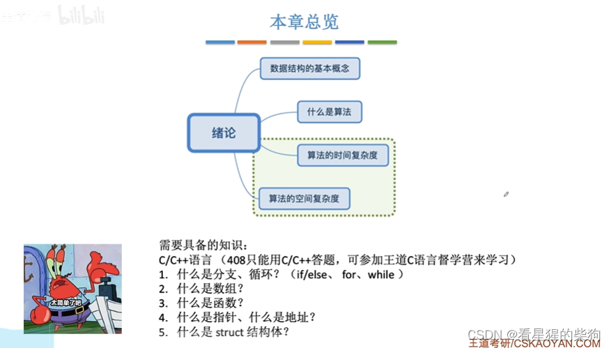
# 数据结构的基本概念
## 概述
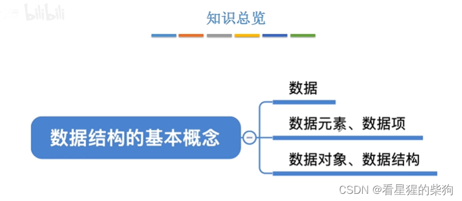
## 数据

## 早期与现代计算机处理的数据
早期计算机大多专注于计算数值型问题
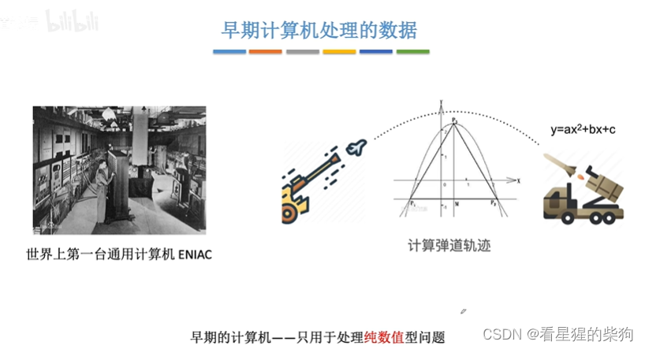
现代计算机还经常处理非数值型问题，比如具体的信息（字符串）以及关系
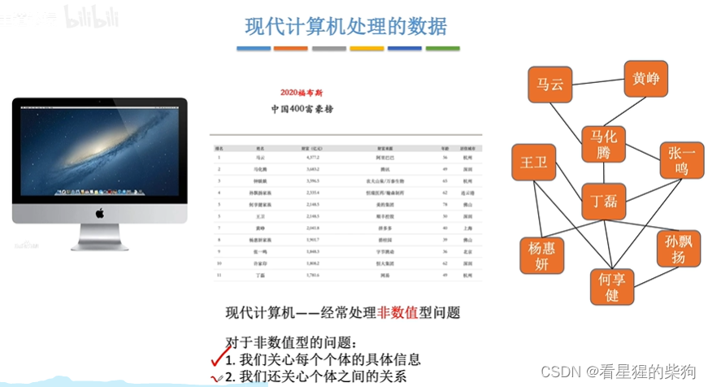
## 数据元素——描述一个个体
数据元素是数据集合中的一个具体个体
比如取号等餐的例子
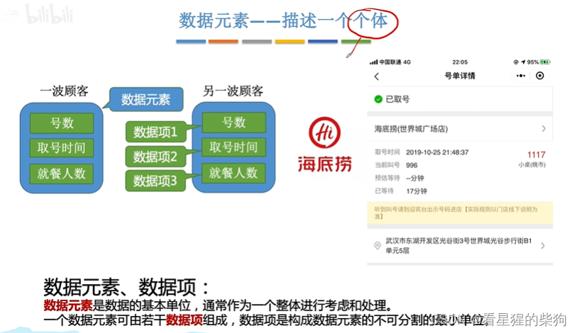
比如微博上的一个具体账号就是一个数据元素
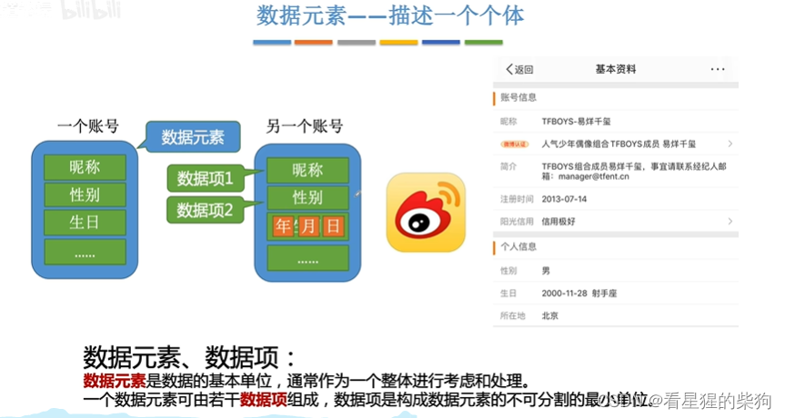
## 数据对象——一类数据元素
数据由不同的数据对象组成
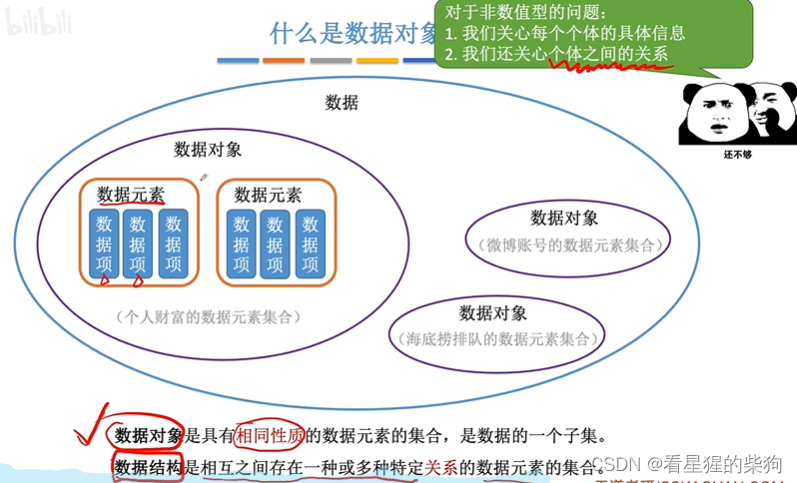
## 什么是数据结构
数据结构就是数据元素之间的关系——当然，它们可以属于同一类数据对象，也可以属于不同类的数据对象
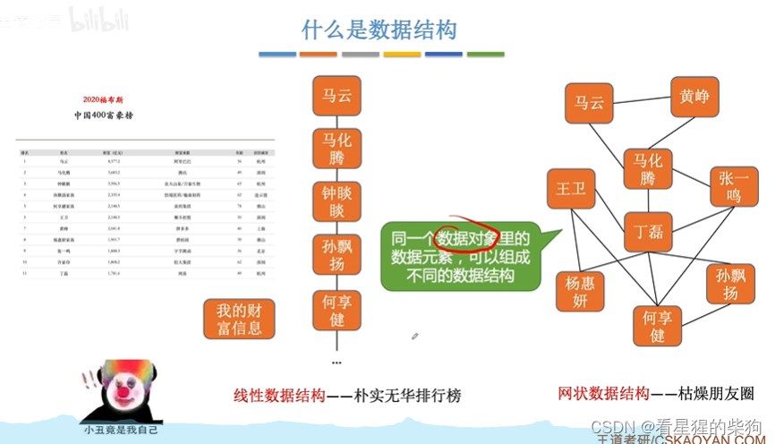
## 小结
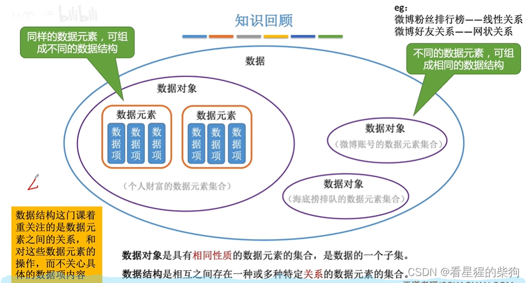
# 数据结构的三要素
## 概述
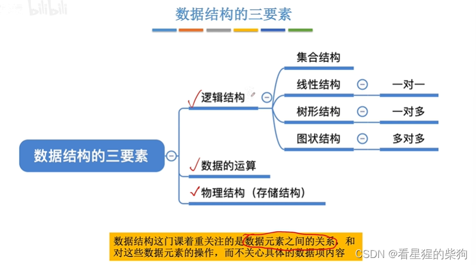
## 逻辑结构——集合结构
只是被归为一堆而已，其余的不属于这一堆

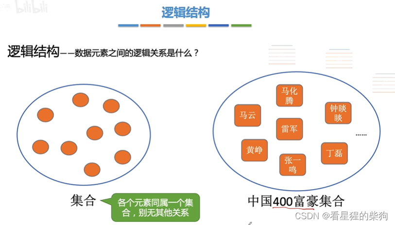
## 逻辑结构——线性结构
一对一
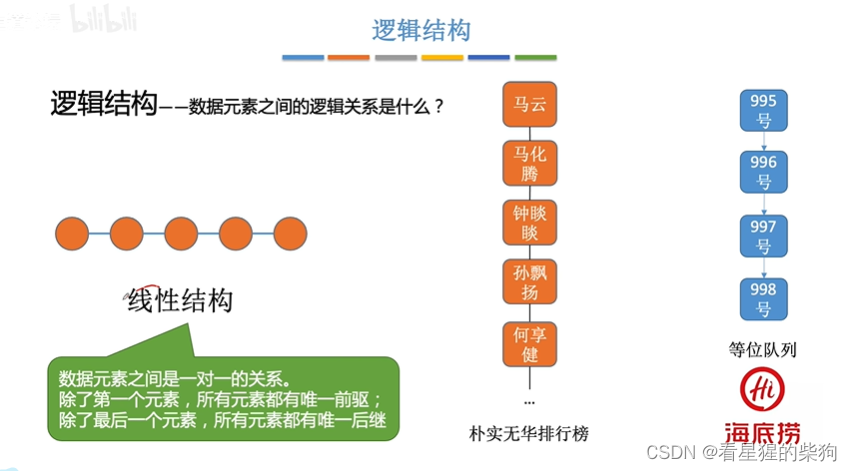
## 逻辑结构——树形结构
一对多
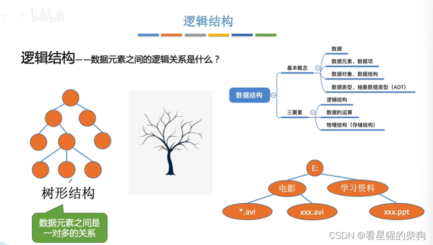
## 逻辑结构——图状结构
多对多
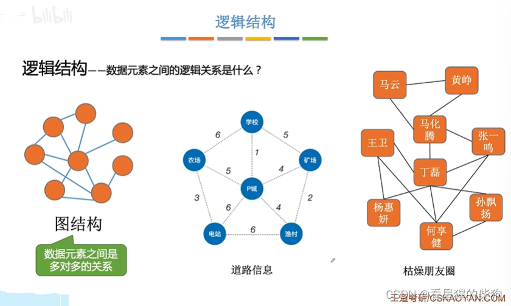
## 逻辑结构——小结
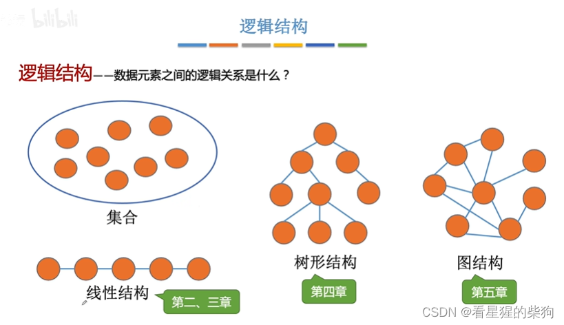
## 数据的运算
不同的数据结构有不同的运算
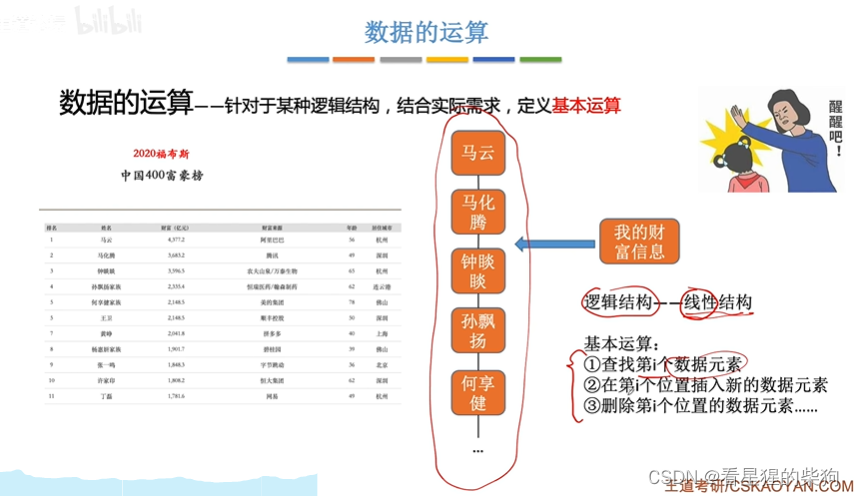
## 物理结构（存储结构）
### 顺序存储
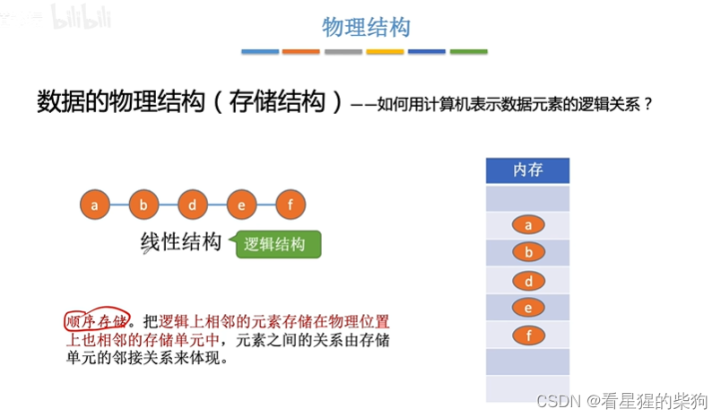

### 链式存储
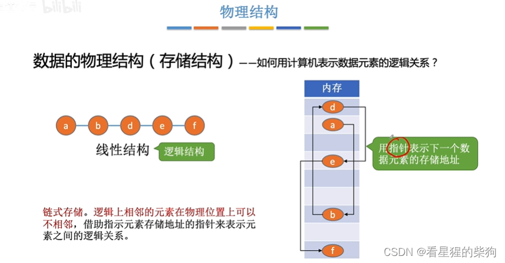

### 索引存储
索引表中存放关键字及其存储地址
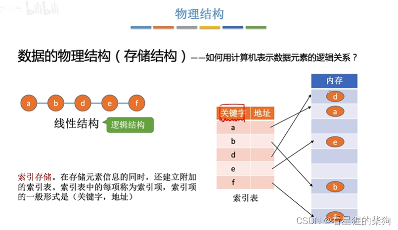

### 散列存储
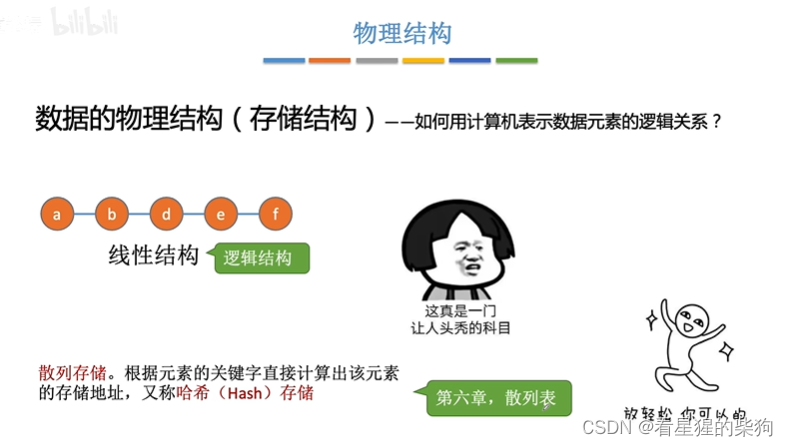
### 小结

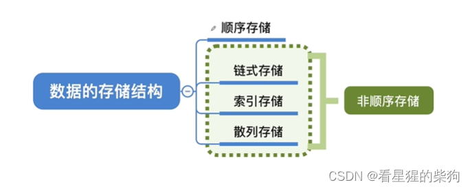
## 运算与存储结构
顺序存储需要连续的空间，而链式存储只需要离散的空间
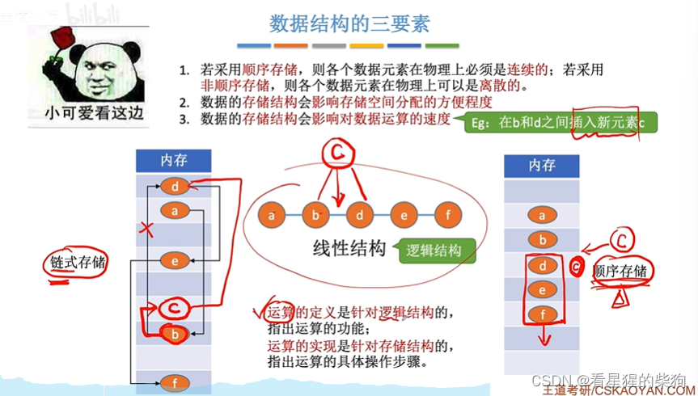
## 数据类型、抽象数据类型
### 数据类型
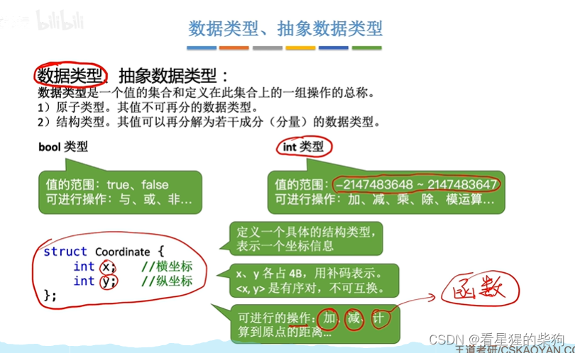
### 抽象数据类型
不用管内部是怎么实现的——已经帮你实现好了，呈现给别人的只是一些抽象概括的数据类型和一些抽象概括的函数

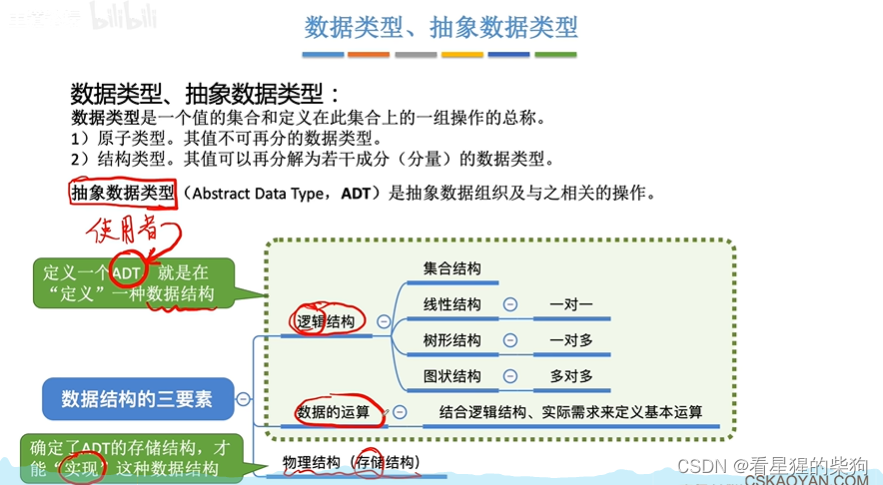
# 小结
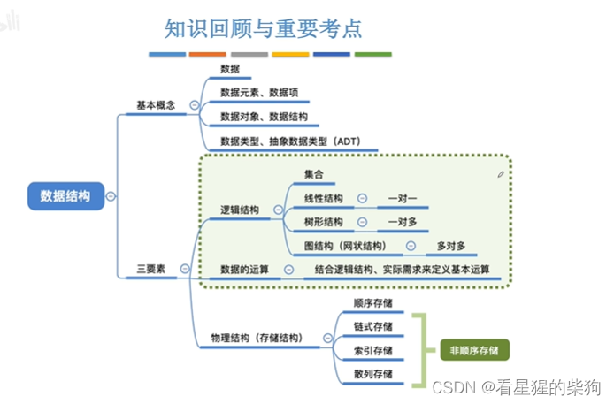

