
# 算法的基本概念
## 概述
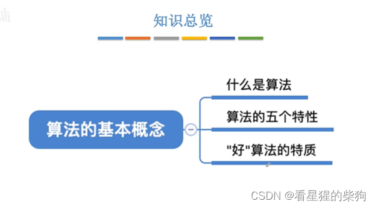
## 什么是算法
算法就是处理问题的步骤序列
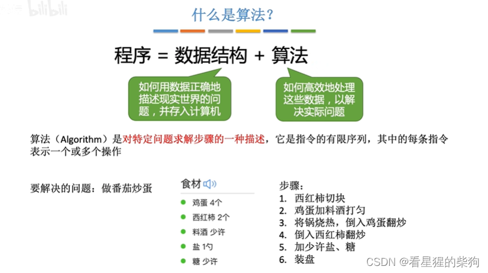
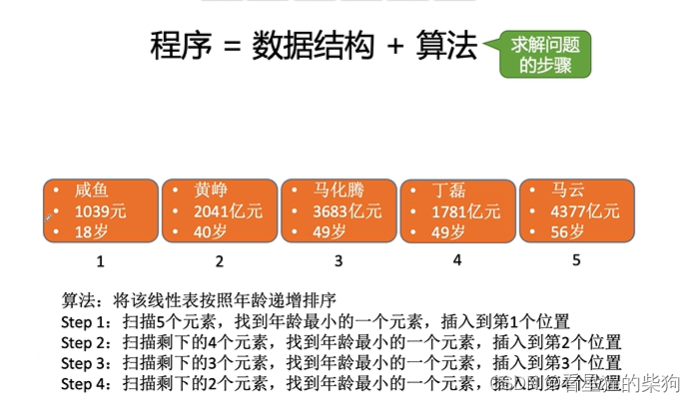
## 算法的特性
程序可以永远运行下去，所以说程序是无穷的
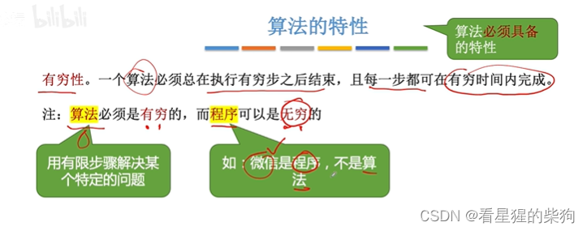
不能出现两种不同的结果，相同的输入必须始终得到相同的输出
如下图所示，当出现两个相等的值时，可以加入一个决胜规则来保证结果唯一
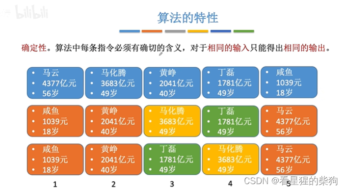
注意输入和输出的个数
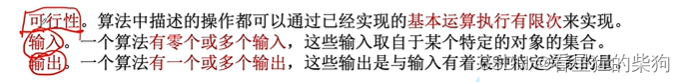
只要有一条特性不满足，就不能称为算法
##  好算法的特点
正确性是指结果正确
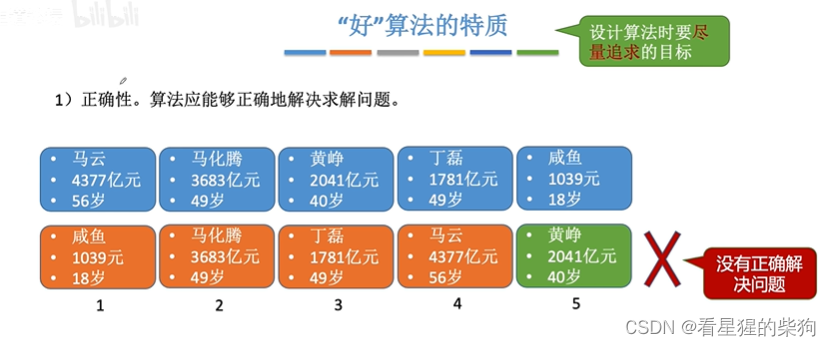
可读性是指有注释等，让别人能够看懂
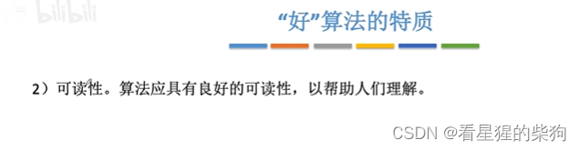

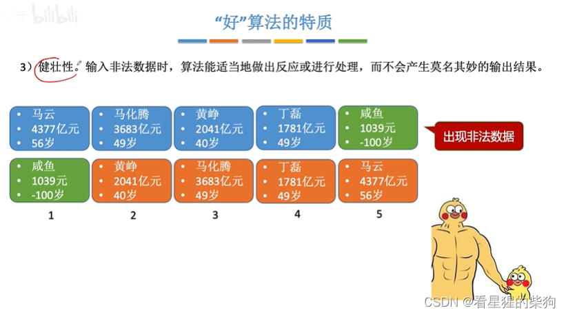
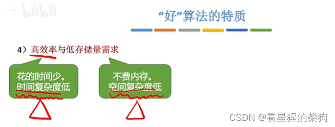
## 总结
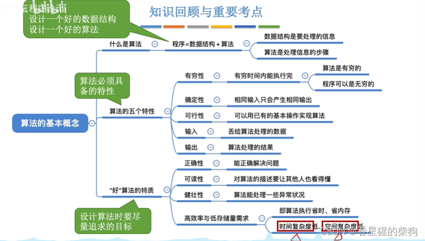
# 算法的时间复杂度
## 如何评估算法的时间开销
如果在机器上运行算法，运行结束后再去测量时间，由于机器不同、实现算法所用的语言不同、编译器效率不同，结果会有差异
而且有些算法无法等到运行结束后再测量其运行时间，所以先运行算法再测量运行时间是不合理的
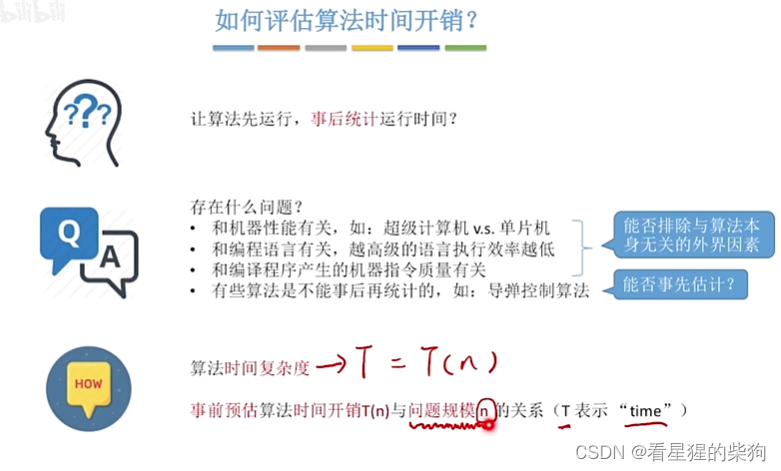
## 计算算法的时间复杂度
统计每条语句的执行次数，得到时间复杂度为 3n+3
当程序语句太多、时间复杂度表达式过于复杂时，该怎么办？
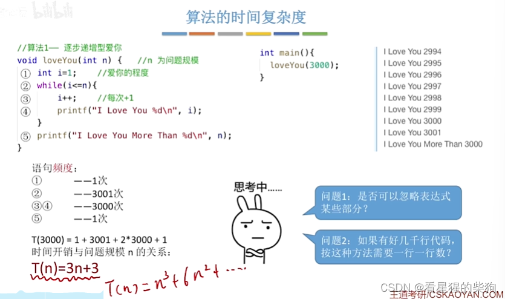
### 忽略表达式中的某些部分
可以用洛必达法则来证明
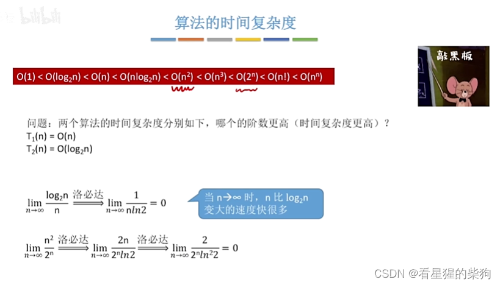
量级递增的顺序，以及对应的图像
记住口诀：常对幂指阶
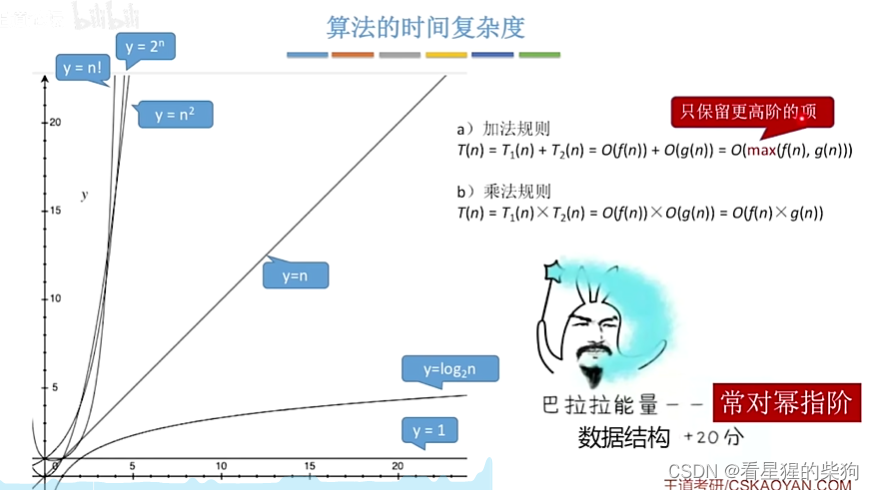
注意计算方式以及大 O 的含义

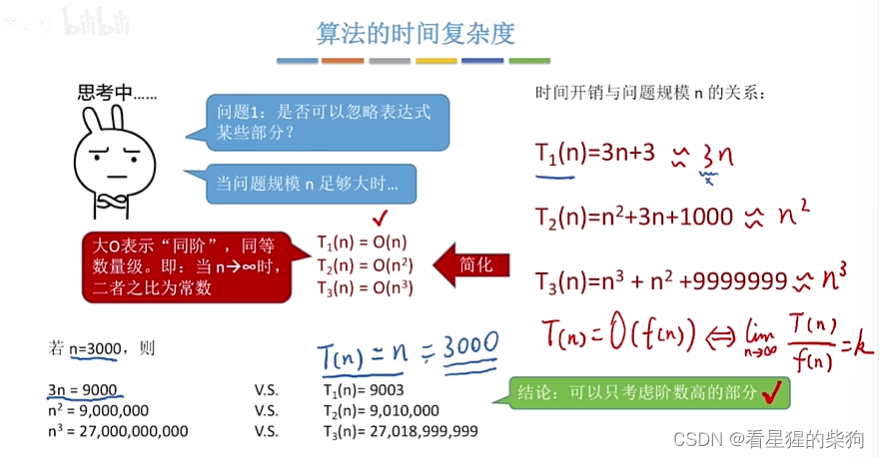
计算规则
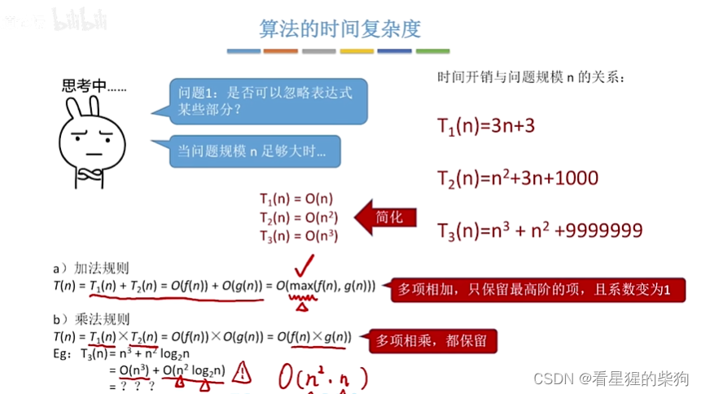
### 需要逐行统计代码吗？
顺序执行的代码只影响常数项，所以不予考虑
循环内部的多个操作同样只影响 n 的系数，也不予考虑，只需考虑循环中一次操作执行了多少次
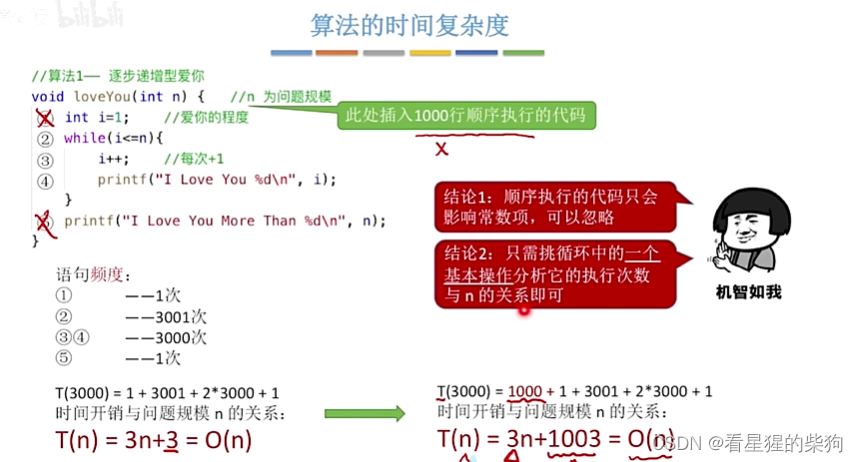
存在多层嵌套循环时，外层循环相对于内层循环可以忽略
所以只需考虑最内层循环的执行次数
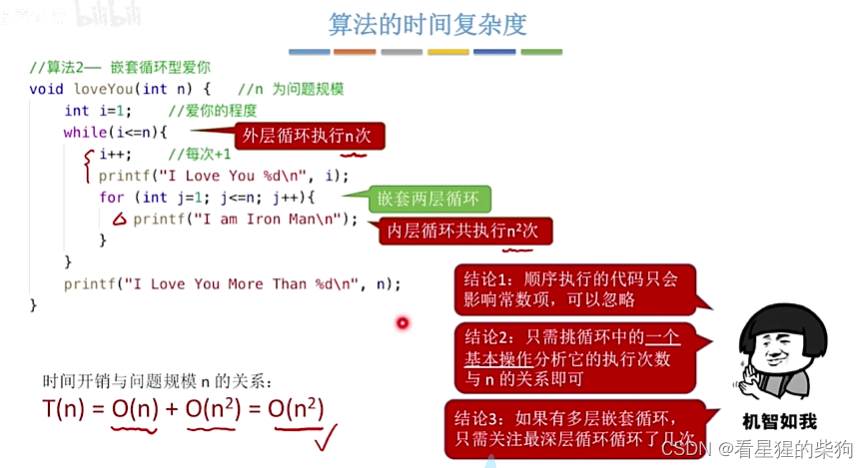
## 小练习 1
先找到循环的终止条件，再计算循环次数
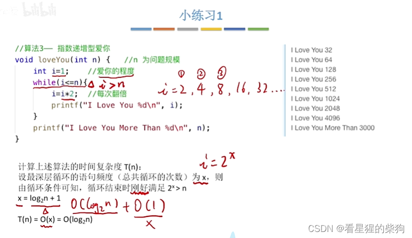
## 小练习 2
要查找的数不同，对应的循环次数也不同，一般计算的是平均时间复杂度
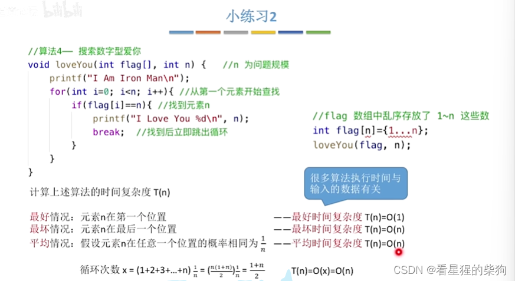
## 最坏时间复杂度与平均时间复杂度
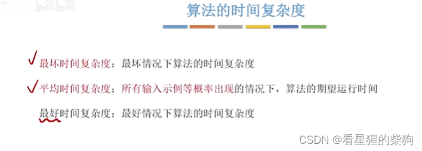
## 总结
算法的性能问题只有在 n 很大时才会显现
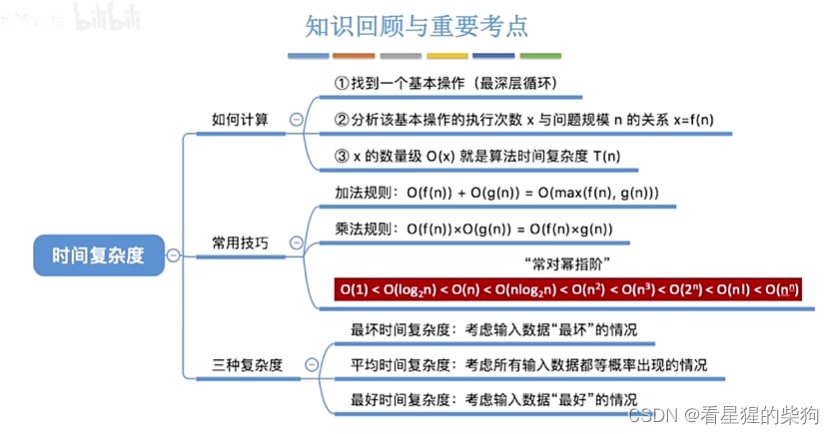
# 算法的空间复杂度
## 程序运行时的内存需求
大小固定、与问题规模无关，意味着所占空间不随输入的变化而变化
原地工作意味着空间复杂度为常数
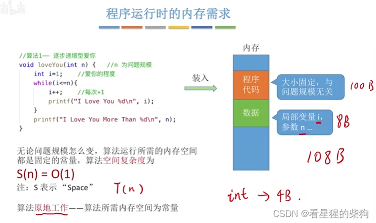
当这里的 n 变得很大时，常数级的项可以忽略，所占空间取决于与问题规模相关的变量
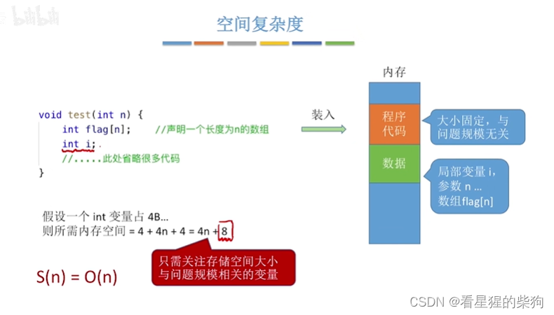
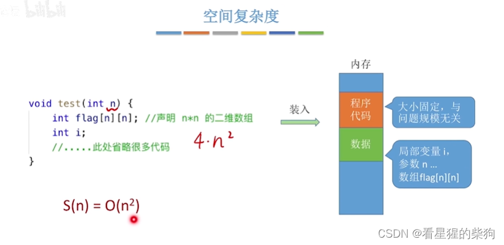
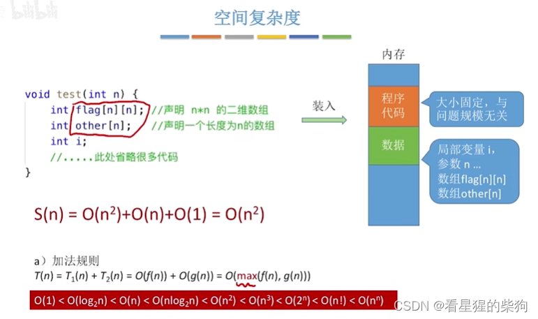
## 递归函数的空间复杂度
每一层调用所使用的参数和局部变量都需要额外的存储空间
可以参考函数调用栈，其中存放了函数栈信息的保存与恢复，以及对应函数的局部变量和参数
每一层递归进入函数后所需的空间是固定的（下图中是固定的），作为系数可以忽略
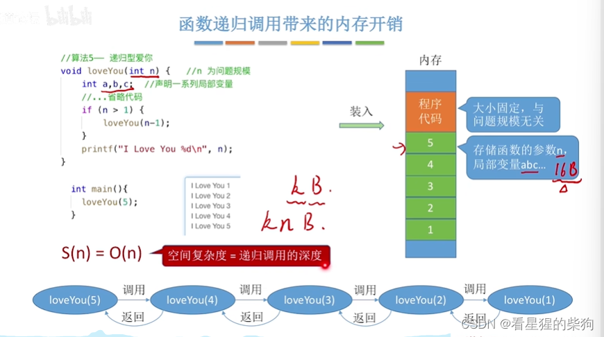
这里每一层递归的函数调用所占空间取决于传入的参数，因此所需空间不固定
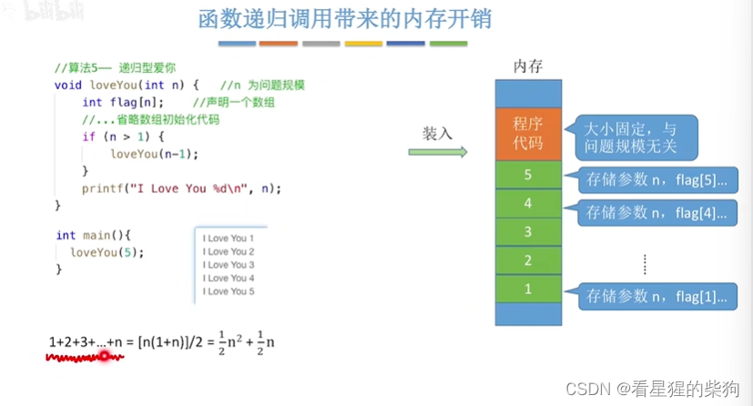
## 总结
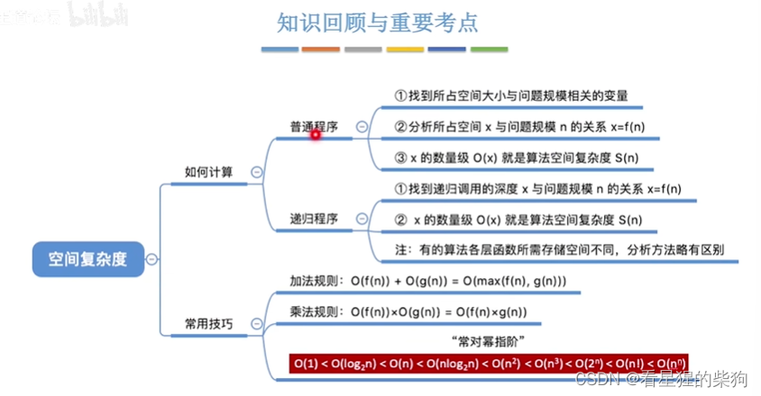

