
# 概述
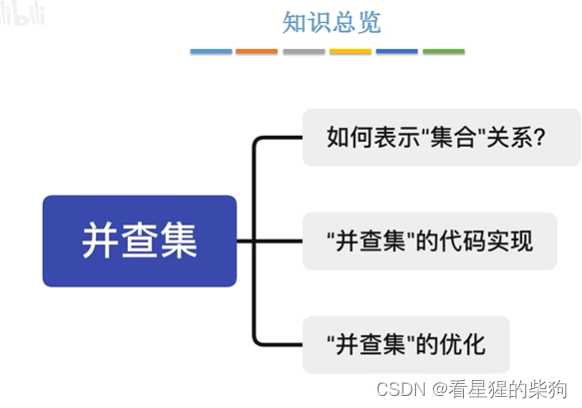
# 逻辑结构——集合

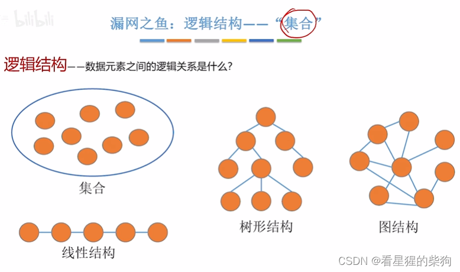
喜欢不同水果的人被划分为不同的子集
两个元素要么属于同一个集合，要么不属于同一个集合
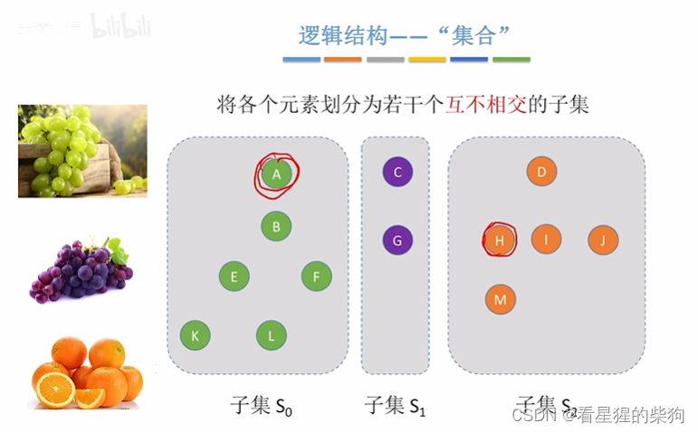
## 树的回顾 

森林中的每棵树都可以用来表示一个集合
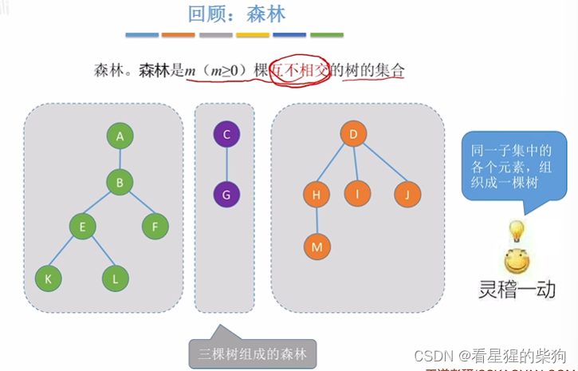
# 查（Find）
通过根节点来判断两个元素是否属于同一个集合，或者属于哪个集合
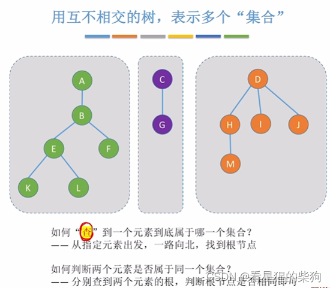
# 并（Union）
合并时，把一棵树的根节点连到另一棵树的根节点上
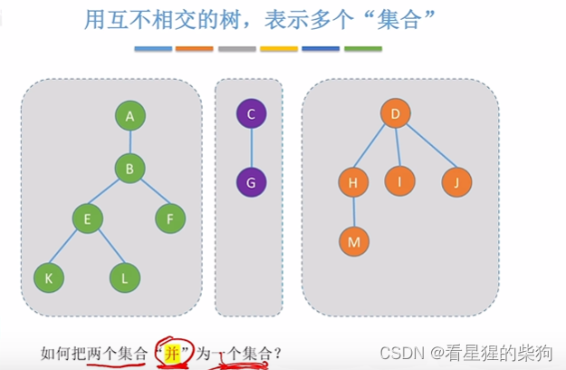
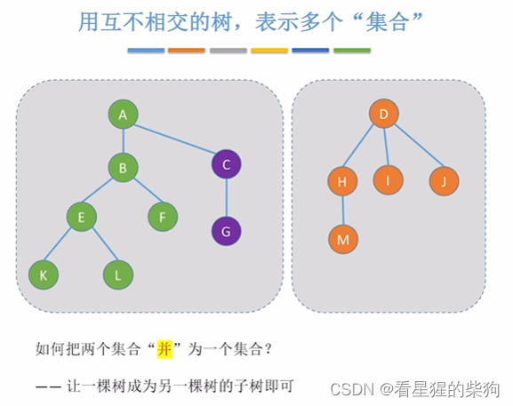
# 并查集
实现了 Union 和 Find 功能的集合
# 树的存储回顾：双亲表示法
双亲表示法：每个节点保存其父节点的位置
这样查找根节点的位置非常方便
因此可以很方便地实现 Union 和 Find
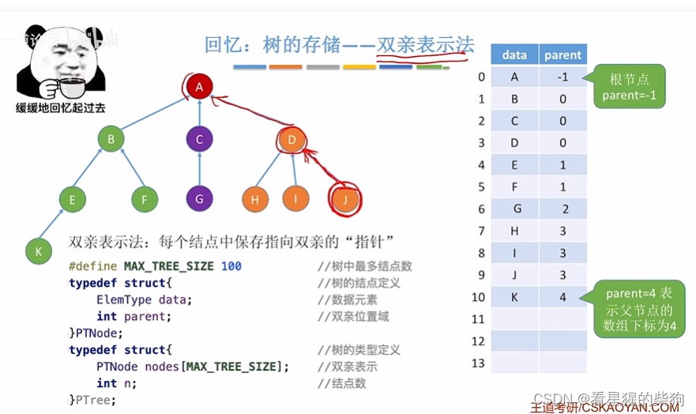
# 并查集的存储结构
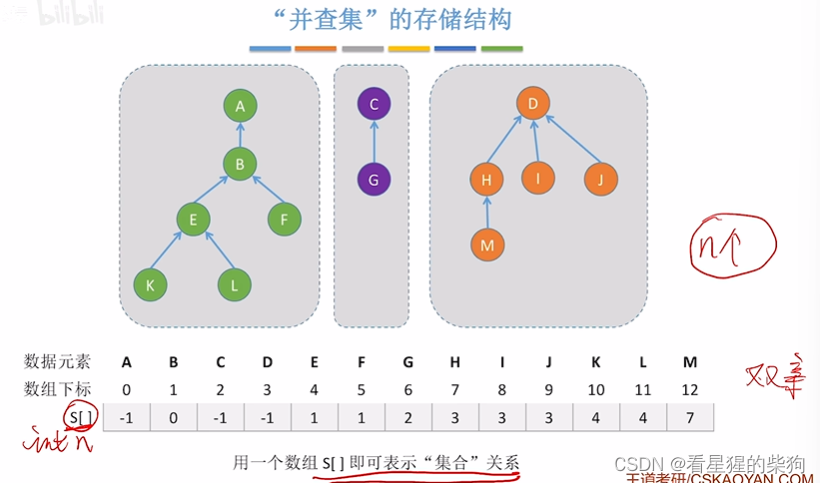
# 并查集的基本操作
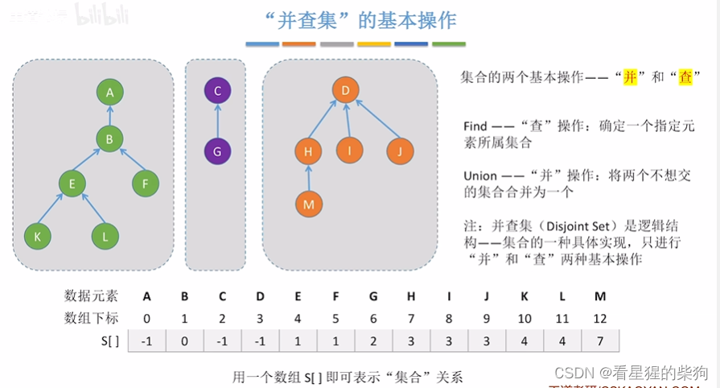
# 并查集的代码实现——初始化
先初始化，使每个节点各自成为一个独立的子集
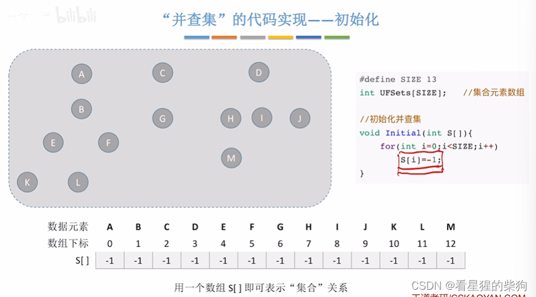
# 并查集的代码实现——并与查
并：先找到两个集合的根，然后把一个根的父节点下标值赋给另一个根的父节点内容
查：沿着节点的父节点一路向上遍历即可

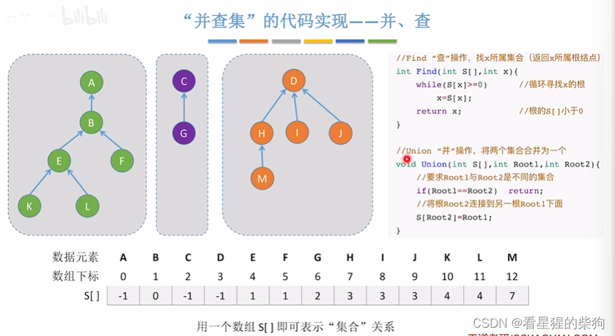
# 时间复杂度分析
时间复杂度主要来自合并操作，与表示集合的树的高度有关
树越矮，时间复杂度越低
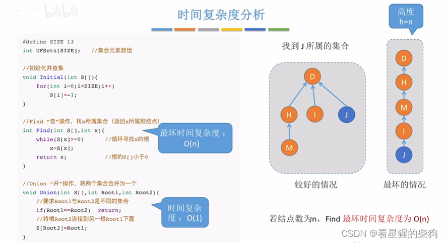
# 优化 Union 操作
把矮树合并到高树的根下作为孩子（小树并入大树）
这样整体树高相比原来较高的那棵树不会增加
根节点的内容为当前树节点个数的相反数
通过节点内容的正负来判断它是否为根节点
于是，内容更小的根节点对应的是更高的树
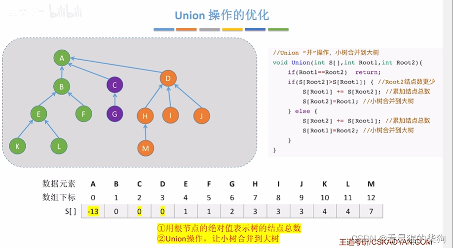
简单来说，这种方法使合并后的树每一层都是满的
所以 n 个节点的树的高度可以用与满二叉树相同的方法计算
由于高度降低了，最终可以降低 Find 操作的时间复杂度
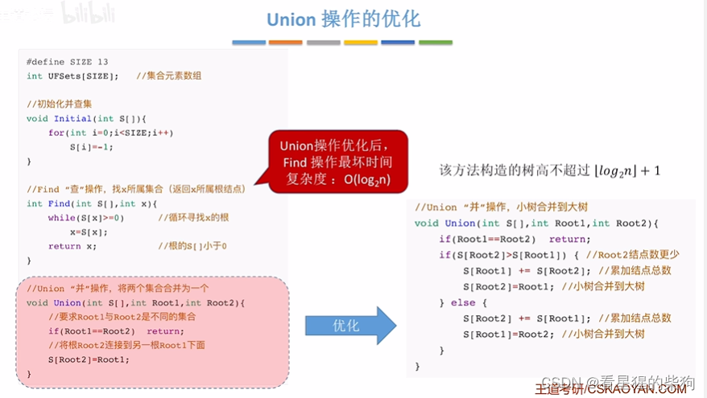
# 小结
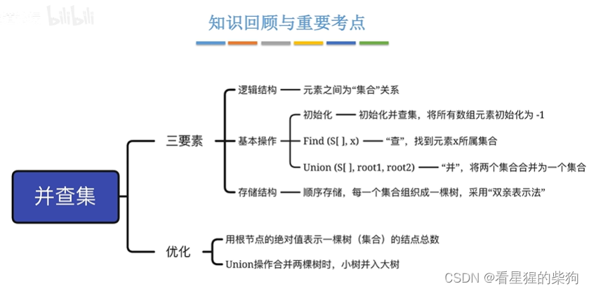
# 并查集的终极优化（路径压缩）
Find 操作有两个循环
第一个循环：找到根节点
第二个循环：再次遍历查找根节点，把途经的每个节点的内容都更新为第一个循环找到的根节点
这样第二次 Find 就能直接定位到对应的根节点

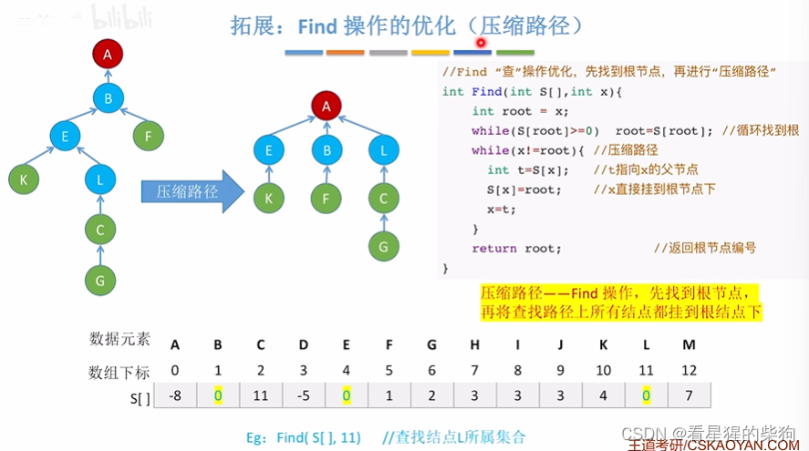
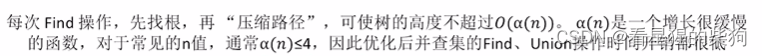
## 对比
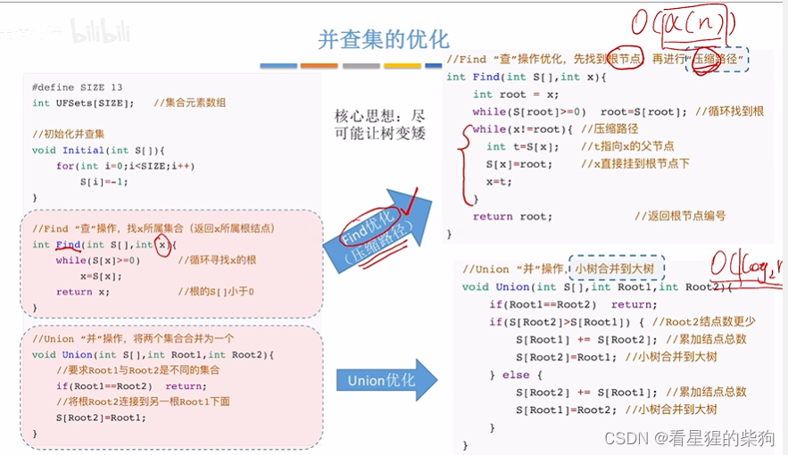
合并 n 个独立元素时，Union 先要找到每个独立元素对应的根节点（其时间复杂度与树高有关），然后进行 n-1 次合并。所以总时间复杂度为合并次数乘以一次查找的时间复杂度
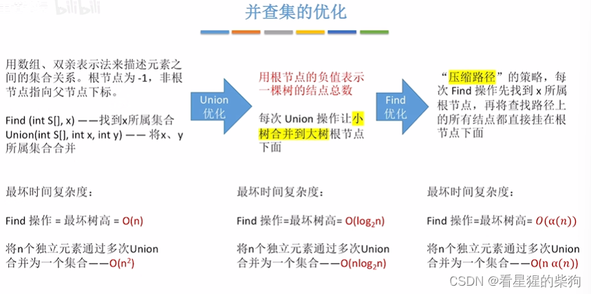

