
# 线索二叉树的概念
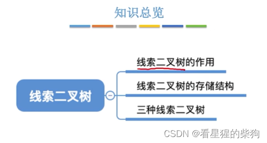
要找某个结点，必须从遍历得到的序列开始遍历才能访问到所有结点，非常麻烦
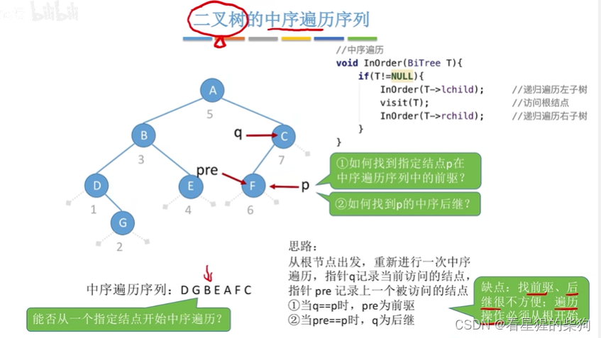
##  中序线索二叉树
   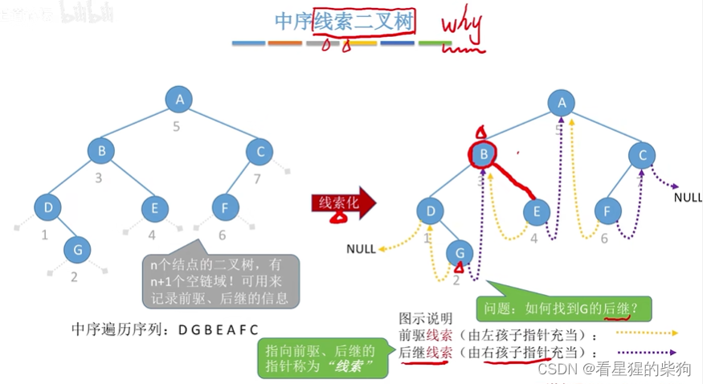
## 线索二叉树的存储结构
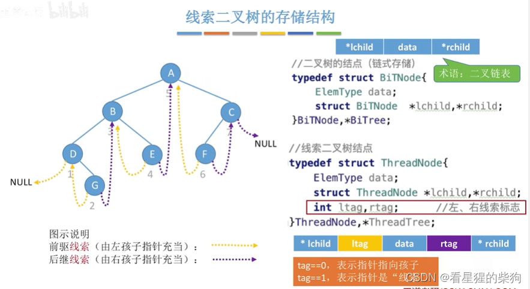
## 先序线索二叉树
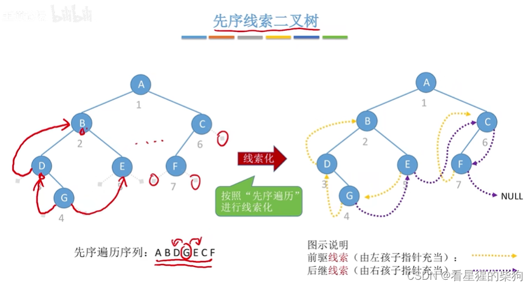
## 后序线索二叉树
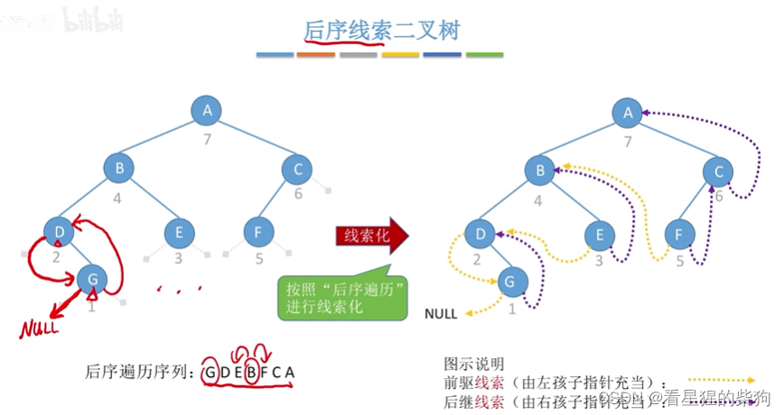
## 三种线索二叉树的对比
也就是确定对应前驱和后继的依据不同
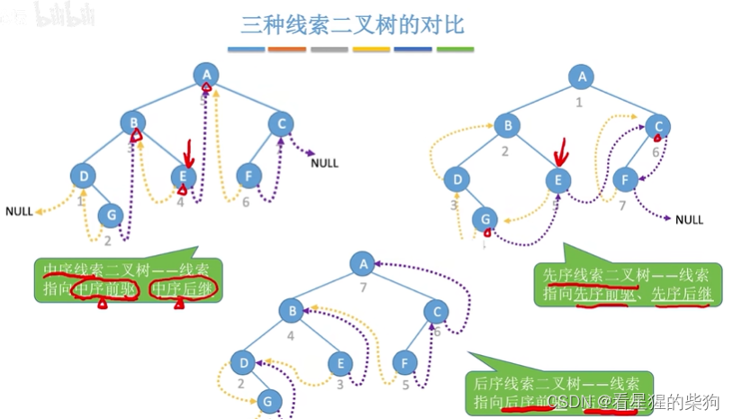
## 总结
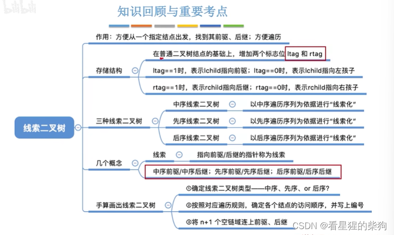

# 二叉树的线索化
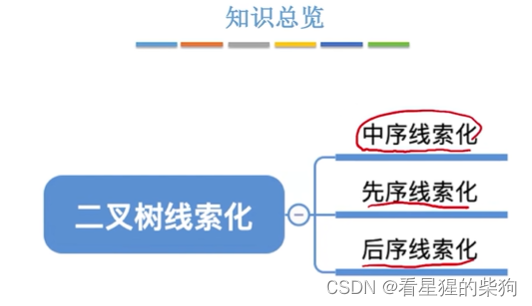
## 用土办法找中序前驱
访问一个结点时，先判断它是否与目标结点相符；若相符，则保存到 final 指针中；若不相符，则更新，把当前结点赋给 pre 指针。然后依次访问后面的结点

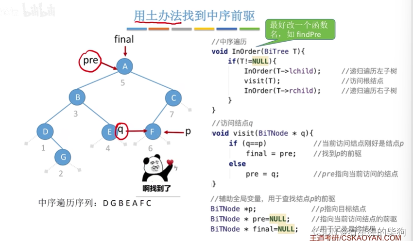
# 中序线索化
检查前驱的右孩子和当前结点的左孩子，若满足条件就将它们连接起来，然后把前驱结点更新为当前结点
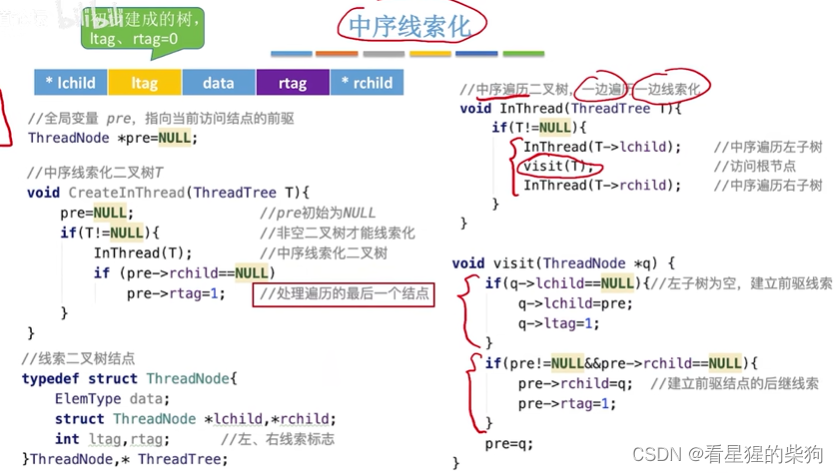
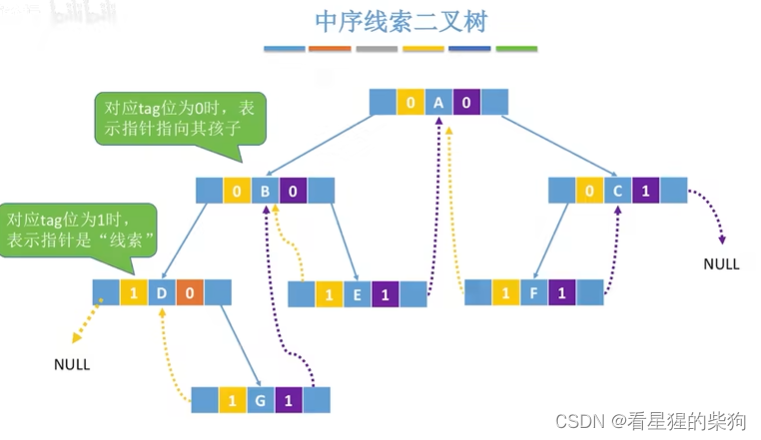
## 王道书版本
pre 参数是引用类型，这样才能修改变量的值
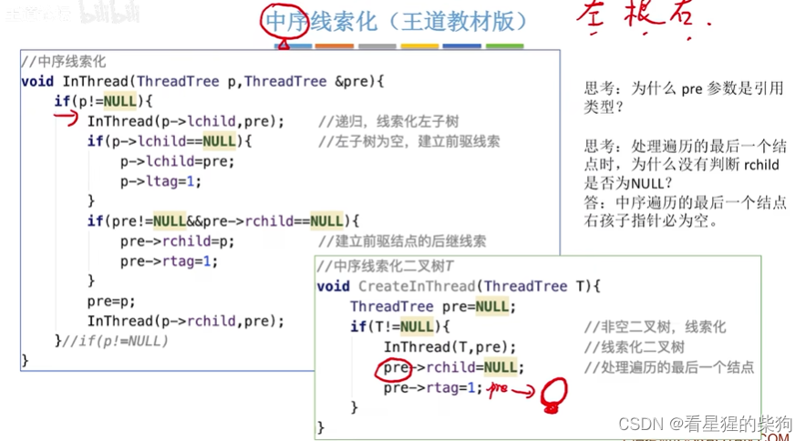
## 先序线索化
访问完第三个结点后还需要遍历其左子树，但左孩子在 visit 中已经被更新成了第二个结点，于是又会重新开始遍历第二个结点，导致死循环
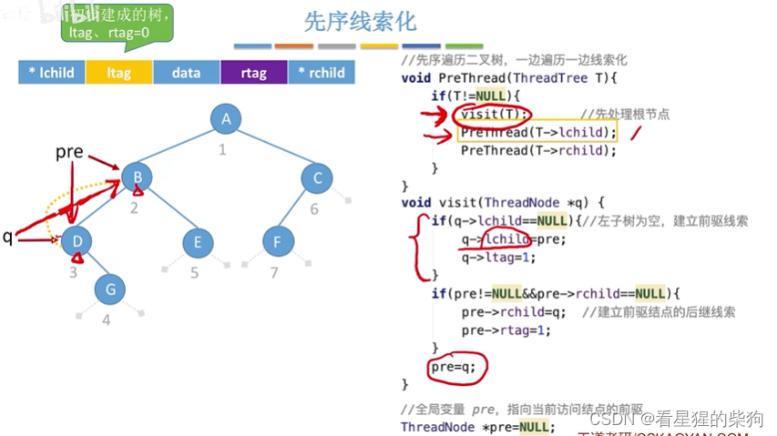

增加了一个对左孩子的判断

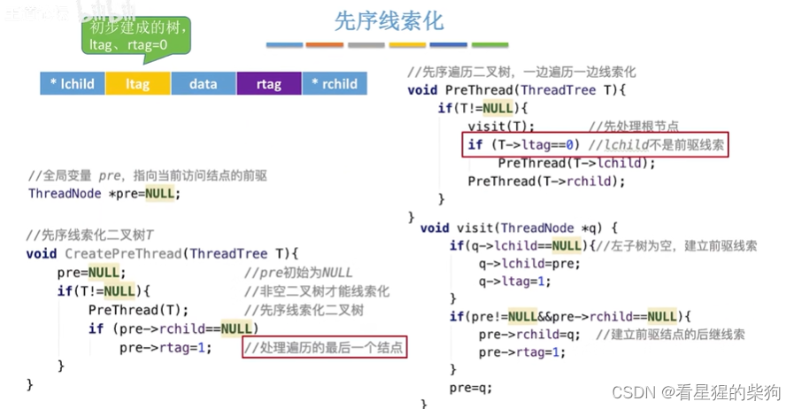

## 王道书版本
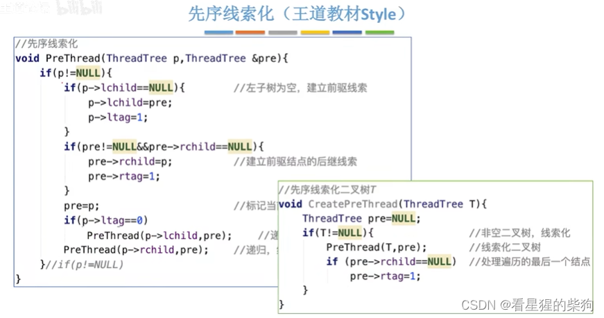
## 后序线索化
不存在访问完一个结点后再去遍历该结点左孩子的情况
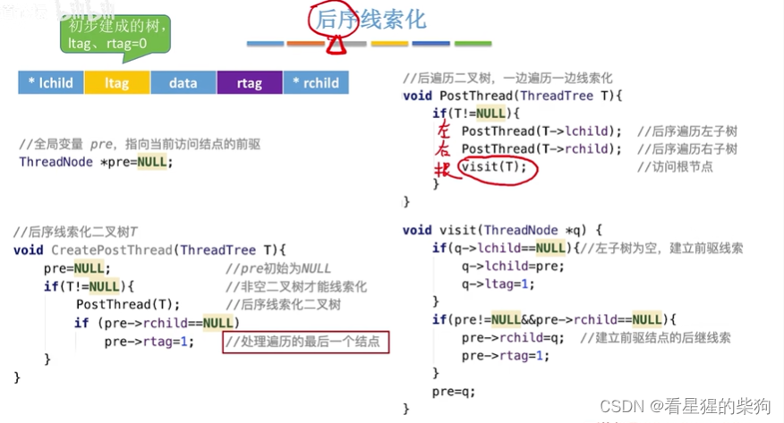
## 王道书版本
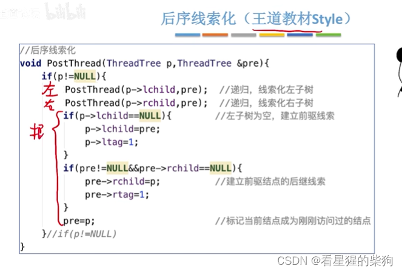
## 总结
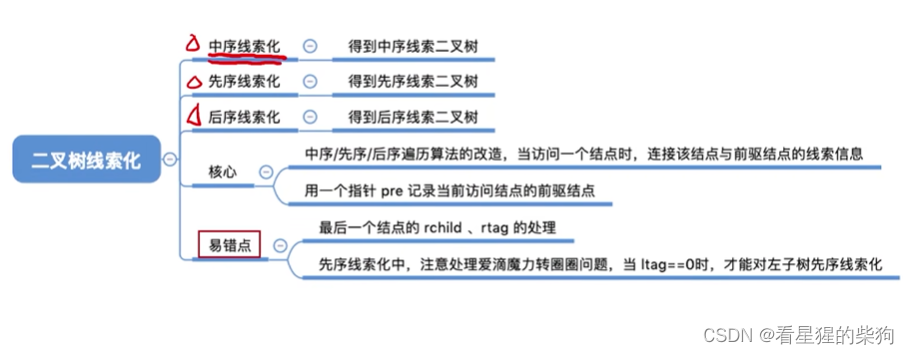
# 在线索二叉树中找前驱和后继
## 在中序线索二叉树中找中序后继
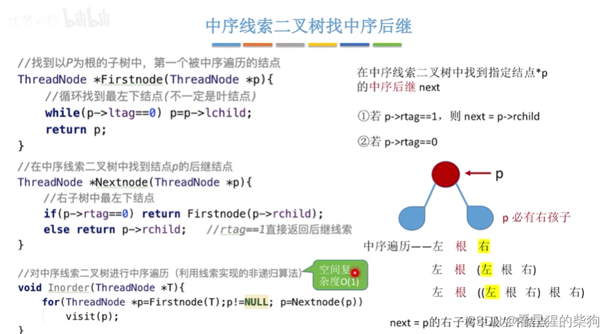
## 在中序线索二叉树中找中序前驱
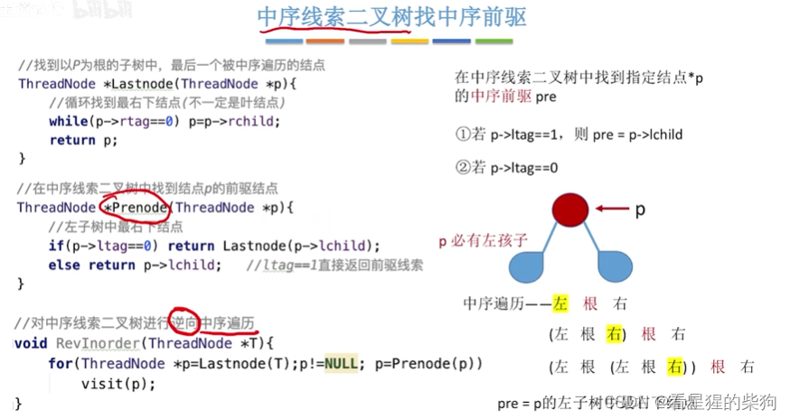
## 在先序线索二叉树中找先序后继
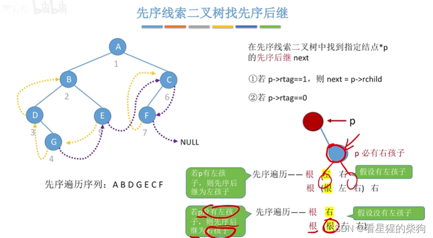
## 在先序线索二叉树中找先序前驱
因为结点的左右孩子只可能是后继，所以无法通过左右孩子找到前驱。这时需要增加一个父结点元素，或者从头开始遍历
第三种情况先往右走，若没有右子树则往左走
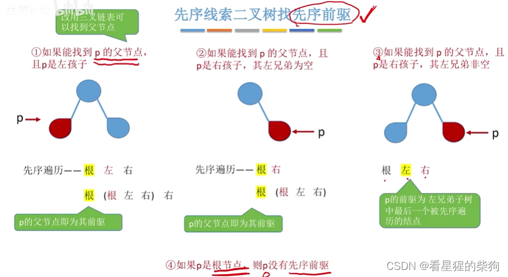
## 在后序线索二叉树中找后序前驱
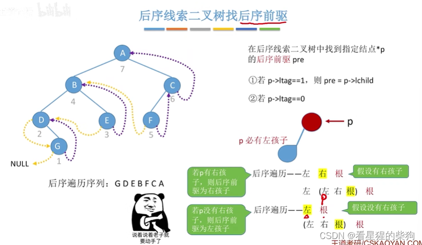
## 在后序线索二叉树中找后序后继
左右孩子只可能是前驱，不可能是后继，所以只能增加父结点元素或者从头开始遍历
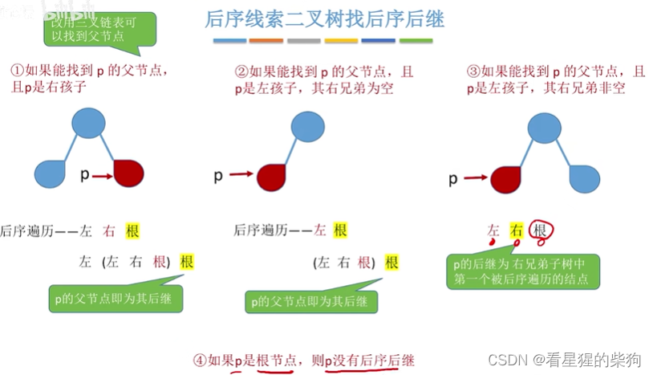
第三种情况先往左走，若没有左子树则往右走
## 总结
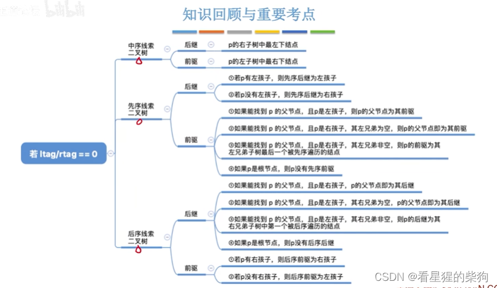
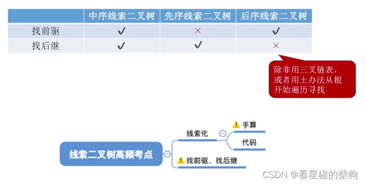

