
# 概述
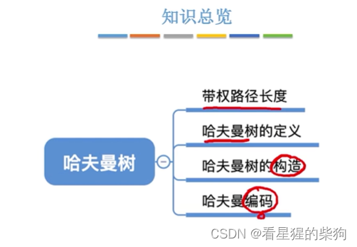
# 带权路径长度
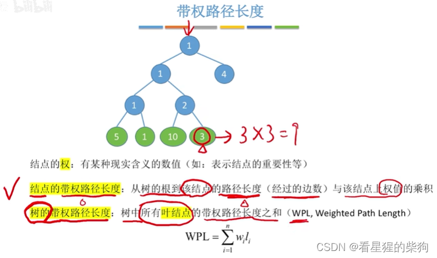
# 哈夫曼树的定义
带权的 n 个叶子结点构成的二叉树可以有很多种形态（左右也不只是两种形态）——可以自己画一画
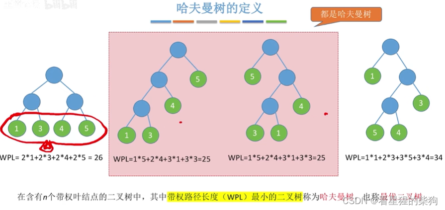
# 哈夫曼树的构造
也就是说，权值最小的叶子结点成为路径最长的叶子结点
## 方法一
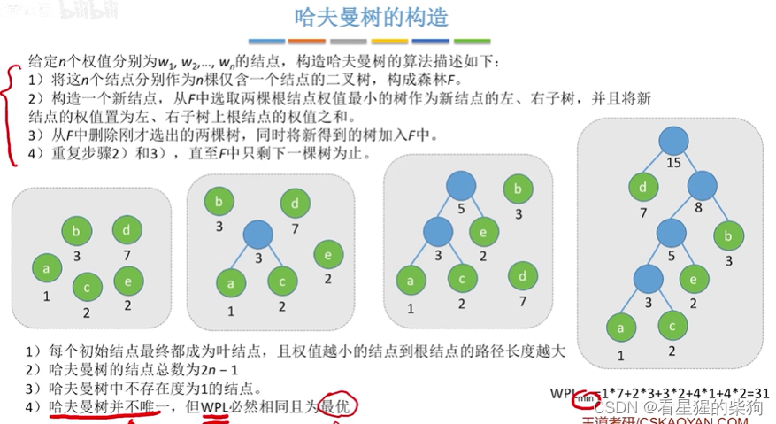
## 方法二
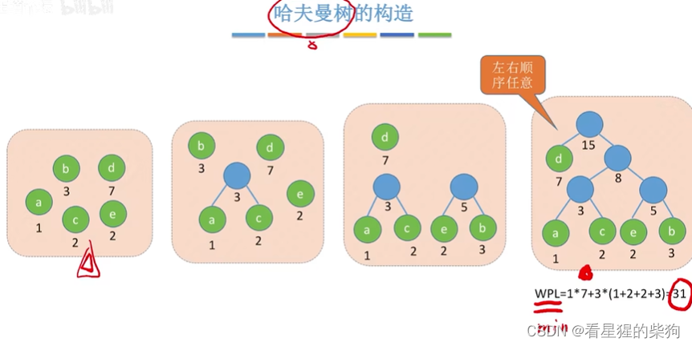
两者本质上是一样的：每次找出权值最小的两个结点，合并成一个新结点

# 哈夫曼编码
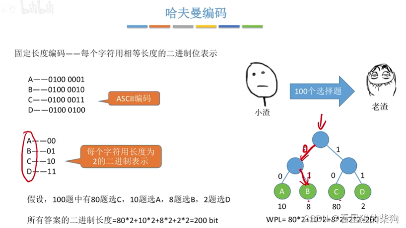

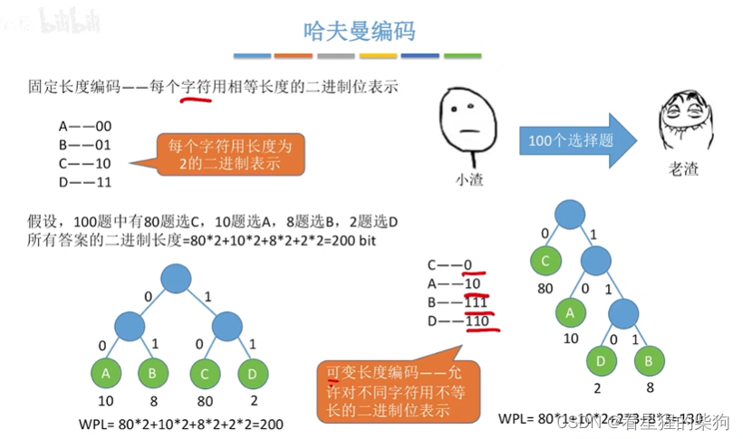
前缀编码是指没有一个编码是另一个编码开头部分的前缀
换句话说，没有一个编码是另一个编码的子集
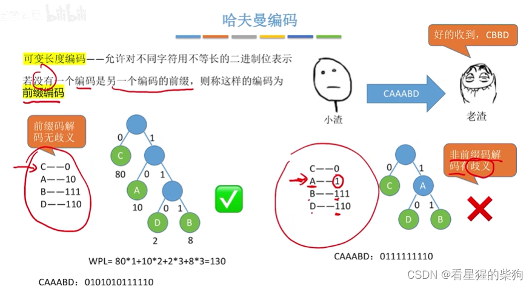
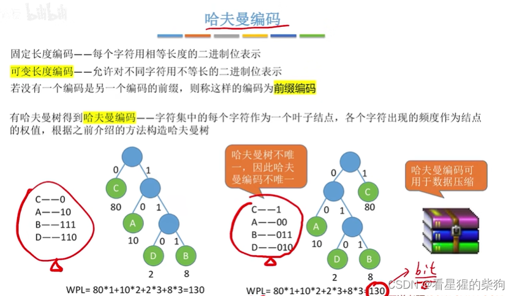
#  英文字母频次
即把每个频次作为权值，然后构造对应的哈夫曼树，最后得到各个编码
数据压缩率可以看作：对应哈夫曼树的 WPL / 原来定长编码的 WPL
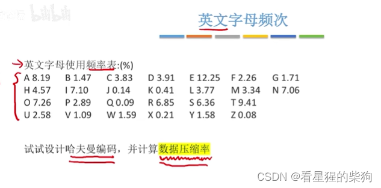
# 总结
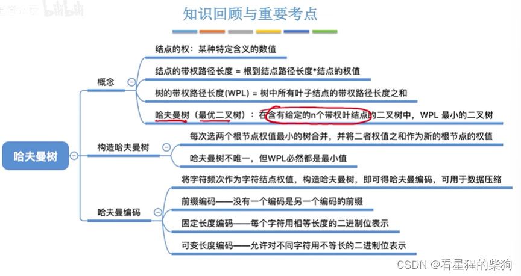


# 实验内容：哈夫曼树 
## 一、实验的问题与要求（需求分析）： 
【问题描述】（1）哈夫曼树问题。（2）利用哈夫曼编码进行通信可以大大提高信道利用率，缩短信息传输时间，降低传输成本。但是，这要求在发送端通过一个编码系统对待传数据预先编码，在接收端将传来的数据进行译码（复原）。对于双工信道（即可以双向传输信息的信道），每端都需要一个完整的编/译码系统。试为这样的信息收发站写一个哈夫曼码的编/译码系统。 
## 二、程序设计的基本思想、原理和算法描述：

  1. 实现哈夫曼编码首先要构造最优二叉树，权值较大的叶子结点离根结点较近。算法是：从键盘输入的字符串长度决定最优二叉树的结点个数；遍历这个字符串长度，用字符建立 n 棵单结点树。选出权值最小和次小的两个根结点合并成一棵树；重复这个过程——合并权值最小和次小的根结点——直到每个结点都出现在最优二叉树中。

  2. 构造哈夫曼编码：

左分支为 0，右分支为 1；每个结点对应的二进制编码就是该结点的哈夫曼编码。采用从叶子结点向上回溯的方法，每回退一步记录一位。把得到的编码存入 code[]。
  
 3. 编码：

  把字符串与得到的哈夫曼树进行比对，按照左分支为 0、右分支为 1 输出对应的编码。

 4. 译码：根据哈夫曼树对编码进行回溯。
## 三、调试和运行程序过程中产生的问题及采取的措施： 
    用 printf 打印相关内容来观察变化
## 四、源程序及注释 

```c
#include"stdio.h"
#include"stdlib.h"
#include"string.h"
#define status int
#define OK 1
#define Maxvalue 100
#define Maxleaf 30 
typedef struct
{ 
    int weight;
    int parent ,lchild,rchild ;
}HTNode,*HuffmanTree;

typedef char * *HuffmanCode; //指向字符指针的指针

status Select(HuffmanTree HT,int n,int &s1, int &s2) //选择最小的两个节点
{
    HuffmanTree p;int i;
    int lnode= Maxvalue,mnode= Maxvalue;
    for(p=HT,i=1;i<=n;i++)
    { 
        //lnode小于始终会小于mmnode，因为if的匹配顺序
        if(p[i].weight<lnode&&p[i].parent==0)// 判断该节点的权重是否小于当前的lnode并且已经有父节点的不要
    { 
        mnode=lnode;         //此时mmode更新为lnode
        lnode=p[i].weight;  //lnode更新为当前节点的权重
        s2=s1;          //S2为mmnode对应节点的索引 S1为lnode对应节点的索引 此时将mnode的索引更新
        s1=i;      //更新lnode的索引更新
    }
    else if(p[i].weight<mnode&&p[i].parent==0) //当该节点的权重大于lnode时并判断是否小于当前的mnode并且已经有父节点的不要
    {
        mnode=p[i].weight;   //更新mnode的为当前节点的权重
        s2=i;           //更新mnode此时的索引
    }
    }
    return OK;
}
void HuffmanCoding(HuffmanTree &HT,HuffmanCode &HC, int *w,int n)
{   
    int i,m,start,f,s1=0,s2=0 ,c;char *cd;
    HuffmanTree p;
    if(n<=1)return;//叶子节点判断
    m=2*n-1;  //求出叶子节点对应的二叉树的节点个数 合并次数+节点个数=对应二叉树的节点个数
    HT=(HuffmanTree)malloc((m+1)*sizeof(HTNode));
    for(p=HT+1,i=1;i<=n;++i,++p,++w)
    { 
        (*p).weight=*w;// 刚开始的节点赋权值
        (*p).parent=0; 
        (*p).lchild=0;
        (*p).rchild=0;
    }
    for(i=1;i<=n;i++)
    { 
        printf("刚开始的第%d个叶子节点weight：%d ,parent：%d ,lchild：%d ,rchild：%d ",i,HT[i].weight,HT[i].parent,HT[i].lchild,HT[i].rchild);
        printf("\n");  //刚开始的
    }
    for(;i<=m;i++)  
    { 
        (*p).weight=0; //其他节点初始化为0
        (*p).parent=0;
        (*p).lchild=0;
        (*p).rchild=0;
        p++; 
    }
    for(i=1;i<=m;i++)
    {   
        printf("初始化完成的哈夫曼树的第%d节点:%d ,%d ,%d ,%d ",i,HT[i].weight,HT[i].parent,HT[i].lchild,HT[i].rchild);
        printf("\n");}
    for(i=n+1;i<=m;++i)
    {
        Select(HT,i-1,s1,s2);  //传入的是原来的和新建的节点范围，返回的是对应节点中权重最小的两个
        HT[s1].parent=i;      //然后建立父子关系
        HT[s2].parent=i;
        HT[i].lchild=s1;
        HT[i].rchild=s2;
        HT[i].weight=HT[s1].weight+HT[s2].weight; //父节点的权重等于两个孩子的权重和
    }
    for(p=HT+1,i=1;i<=m;i++,p++)
    {
        printf("编码完成后的哈夫曼树的第%d个节点：%d,%d,%d,%d",i,(*p).weight,(*p).parent,(*p).lchild,(*p).rchild); 
        printf("\n");
    } 
    //从叶子到根逆向求每个字符的赫夫曼编码
        HC=(HuffmanCode )malloc((n+1) *sizeof(char *)); //编码的字符串地址数组 大小为(n+1)*8 但类型为HuffmanCode，即单位为八个字节 指向char* 
        cd=(char*)malloc(n*sizeof(char));// n个字符的指针，对应编码结果
        cd[n-1]='\0'; //结束符
        for(i=1;i<=n;++i) //遍历初始的叶子的节点
        {
        start=n-1;    //编码从后往前一个一个字符的赋值
        for(c=i,f=HT[i].parent; f!=0; c=f,f=HT[f].parent) //从初始叶子节点遍历父节点，直到对应父节点为0时停止
        {
        if(HT[f].lchild==c) cd[--start]='0'; //如果父节点的左孩子为当前节点则此时编码为0
        
        else cd[--start]='1'; //如果父节点的右孩子为当前节点则此时编码为1

        }//则当前叶子节点对应的编码转换完成
        HC[i]=(char *)malloc((n-start)*sizeof(char));//赋予满足编码长度的字符串地址
        strcpy(HC[i],&cd[start]); //赋值给当前节点的编码
        printf("当前第%d个叶子的编码为：%s\n",i,HC[i]); 
        }
        free(cd);
}

int main()
{
    HuffmanTree HT;HuffmanCode HC;
    int n,i; int w[8]={5,29,7,8,14,23,3,11};
    printf("%d",sizeof(char *));
    printf("请输入叶子节点的个数：\n");
    scanf("%d",&n); //输入叶子节点的个数
    HuffmanCoding(HT,HC, w,n); //生成哈夫曼树并输出对应各个叶子节点的编码
    return 0;
}

```
##  五、运行结果 
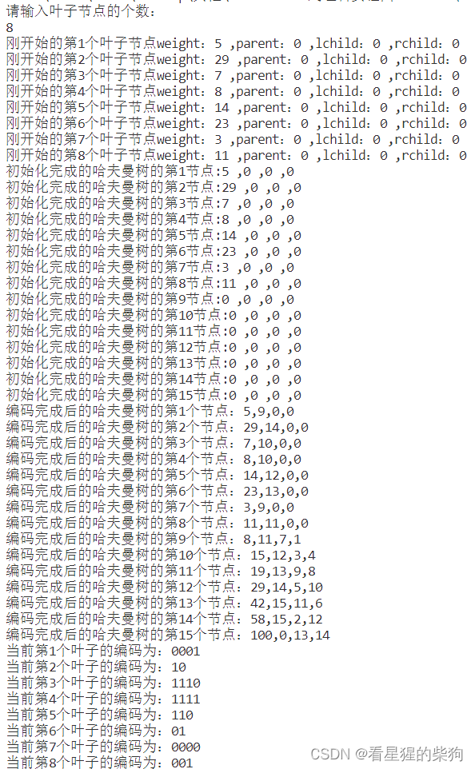

