
# AOV 网
它必须是 DAG（有向无环图）
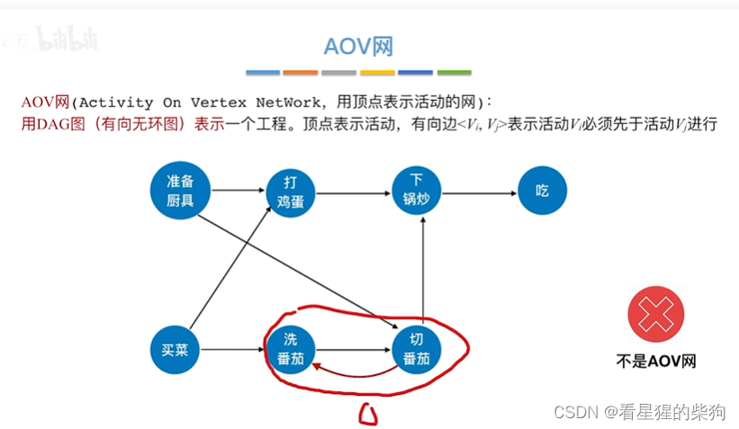
# 拓扑排序
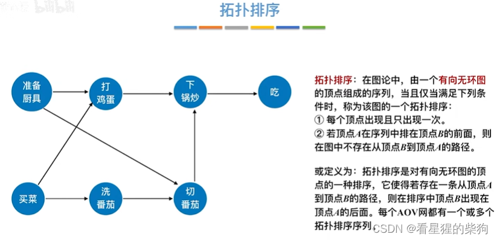
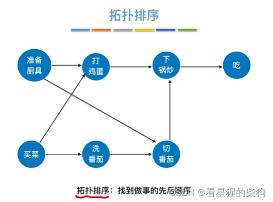
排序后的序列并不唯一
如果当前网中不存在没有前驱的顶点，则说明存在环
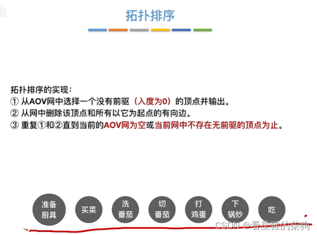
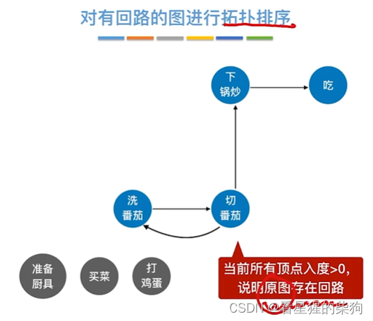
# 代码实现
这里使用邻接表进行存储
先把入度为 0 的顶点压入栈中
然后开始出栈，直到栈空为止；每个出栈的顶点保存到输出数组中，把它所指向的顶点的入度减 1，并在此过程中把入度变为零的顶点压入栈中 
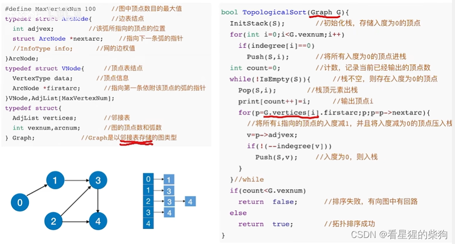
## 时间复杂度
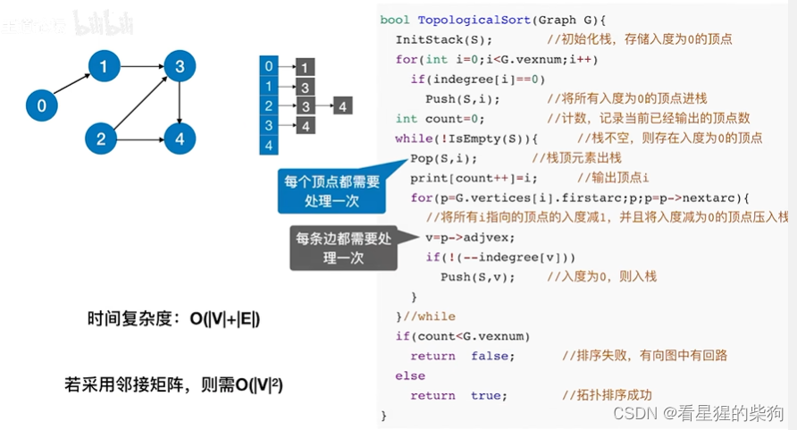
# 逆拓扑排序
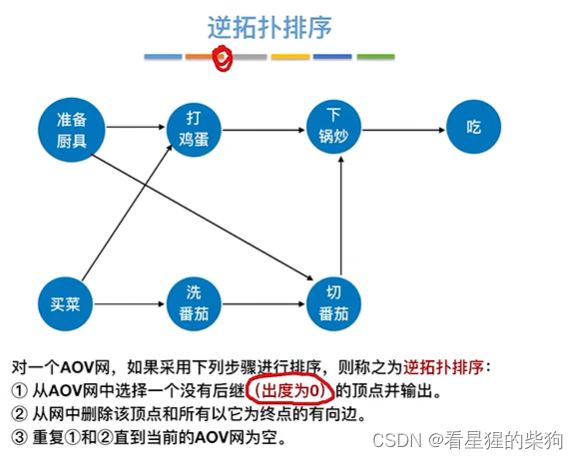
## 实现
逆邻接表
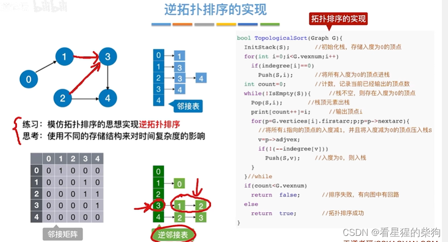
## 用 DFS 算法实现逆拓扑排序
 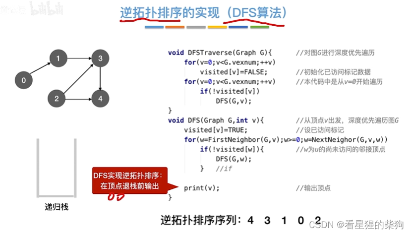

## 总结
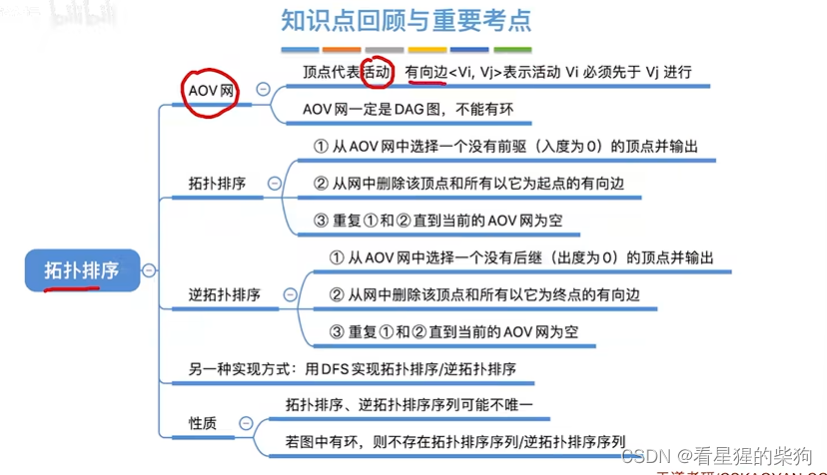
# AOE 网
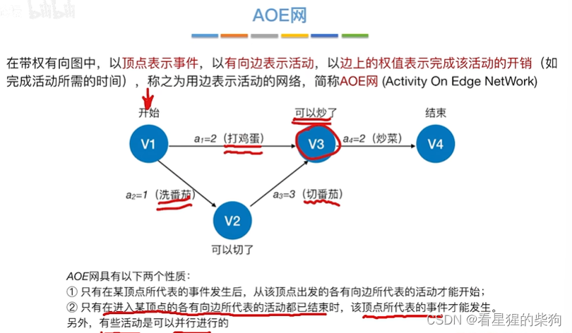
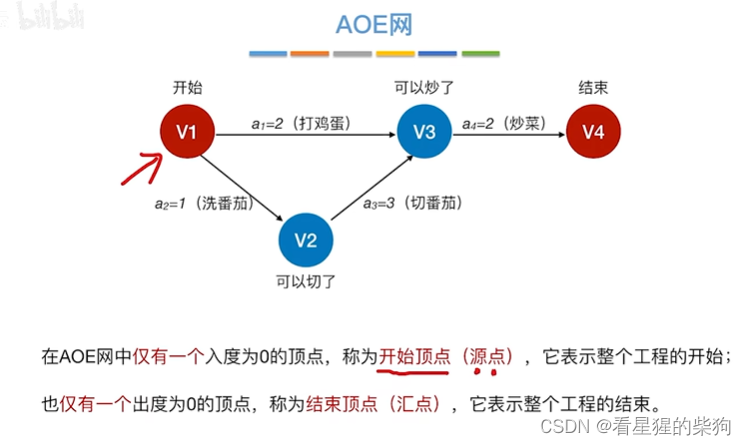
## 关键路径
下图中用红色标出了关键路径
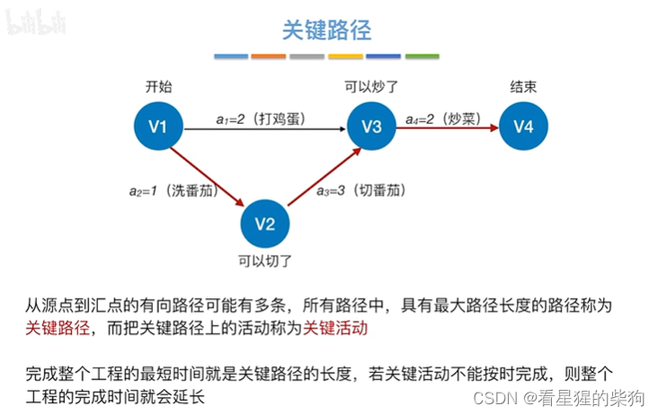
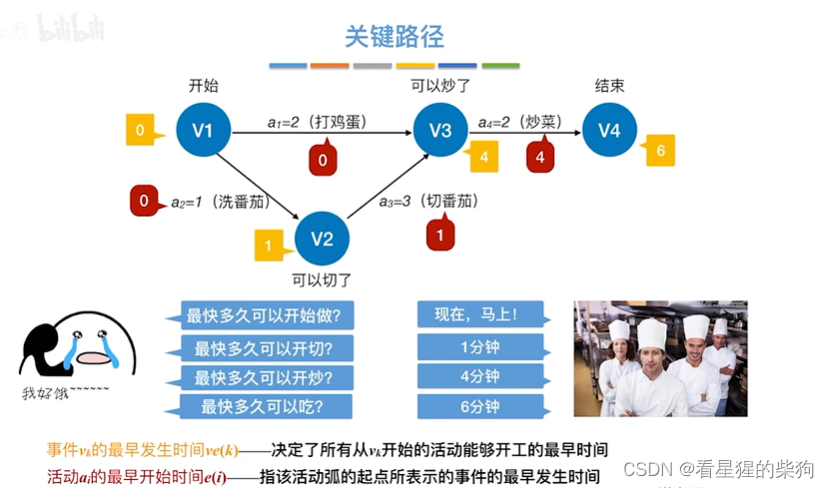
沿着关键路径反向推导
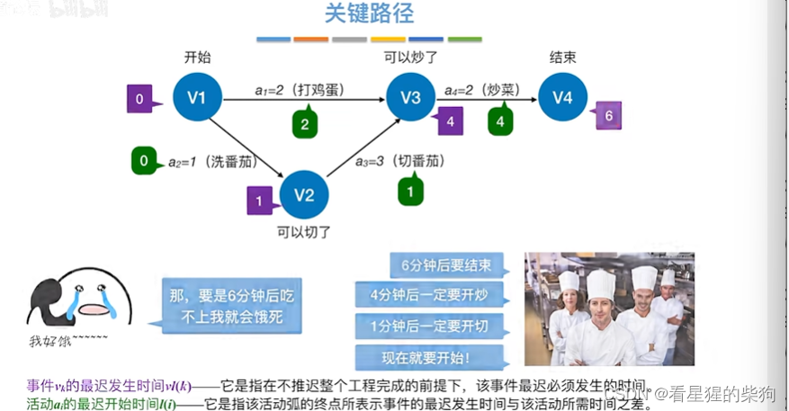
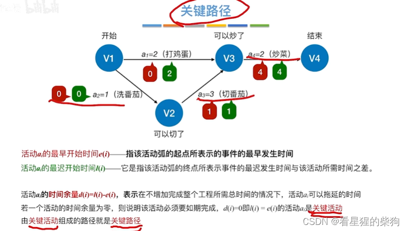
## 求关键路径
所有事件的最早发生时间就是所有活动的最早发生时间
所有事件的最迟发生时间并不等于所有活动的最迟发生时间
所有活动的最迟发生时间必须由活动的执行时间和所有事件的最迟发生时间推导得出
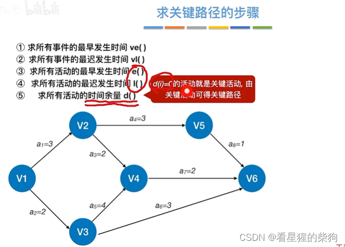
### 求事件的最早发生时间
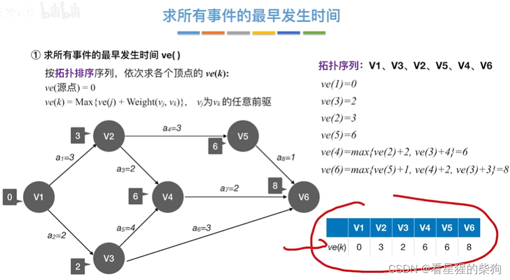
### 求事件的最迟发生时间
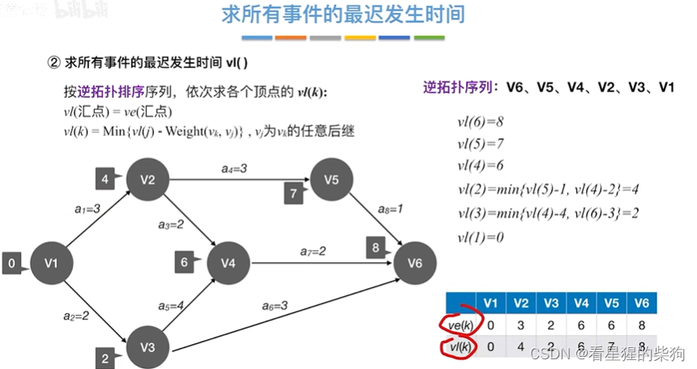
### 求活动的最早发生时间
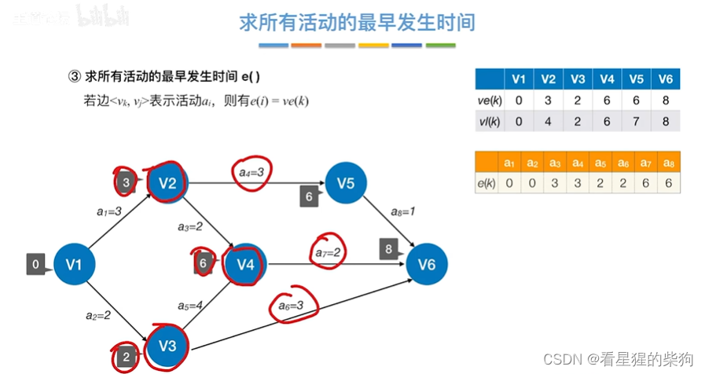
### 求活动的最迟发生时间
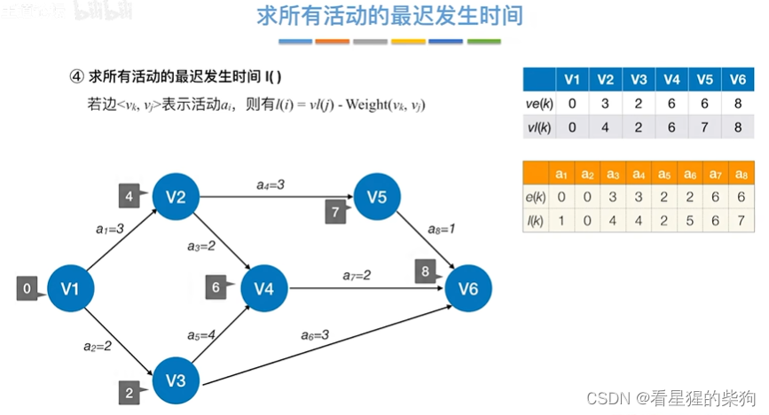
### 求活动的时间余量
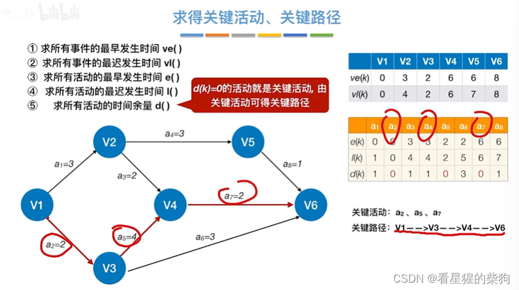
## 关键活动与关键路径的性质

缩短到一定程度之后，再继续缩短就无法再缩短整个工程的工期了

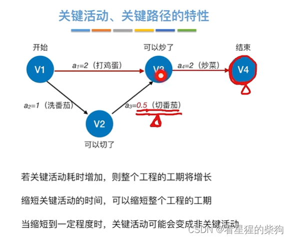
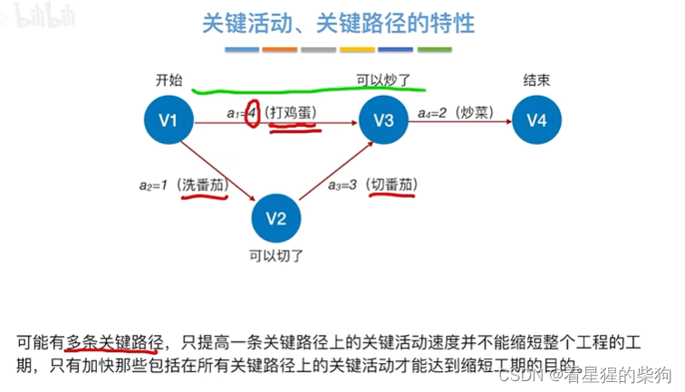
## 总结
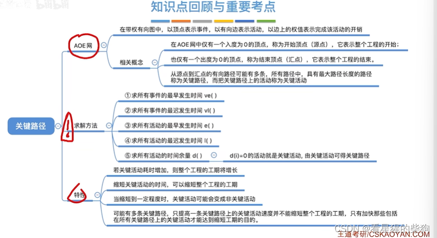
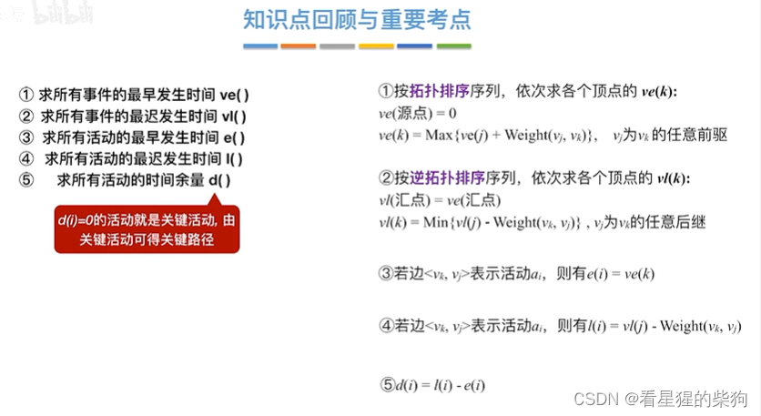

