
# 二叉排序树
## 概览
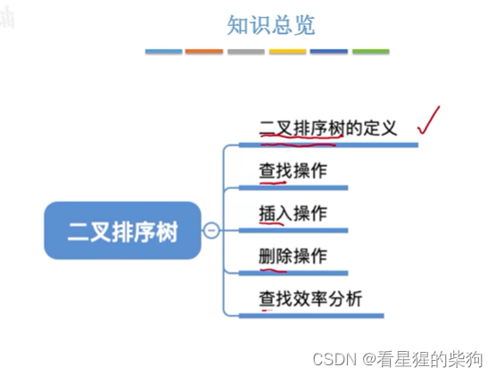
## 二叉排序树的定义
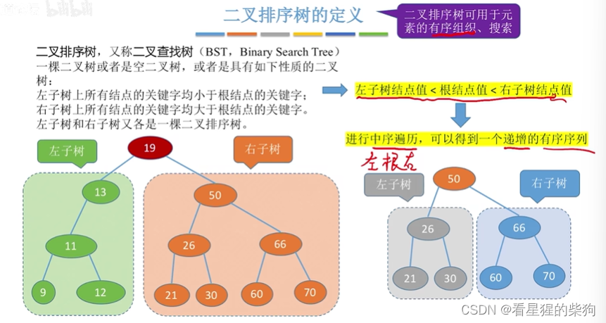
## 二叉排序树的查找
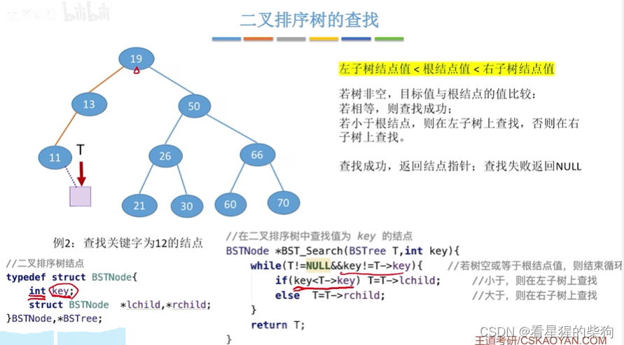
也可以用递归实现
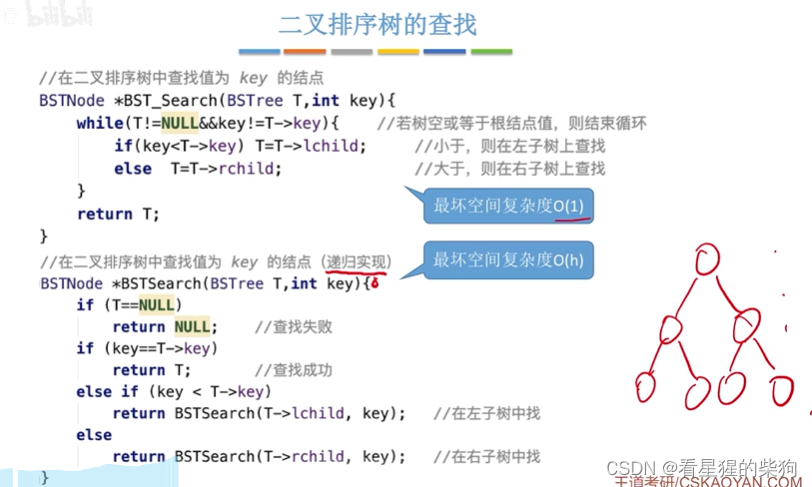
但最坏情况下递归可能需要 h 个函数调用栈帧，或者说同时有 h 个函数在执行
而循环实现始终只有一个函数在执行
## 二叉排序树的插入
先查找到插入位置，再 malloc 一块新空间；如果遇到与插入值相等的元素，则插入失败
函数参数用引用类型，以便修改其值
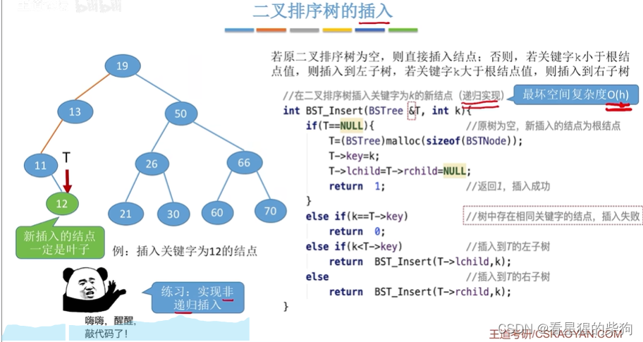
## 二叉排序树的构造
一开始 T 为空，创建一个值等于插入值的结点，由此开始形成一棵树，之后的插入过程与前面相同
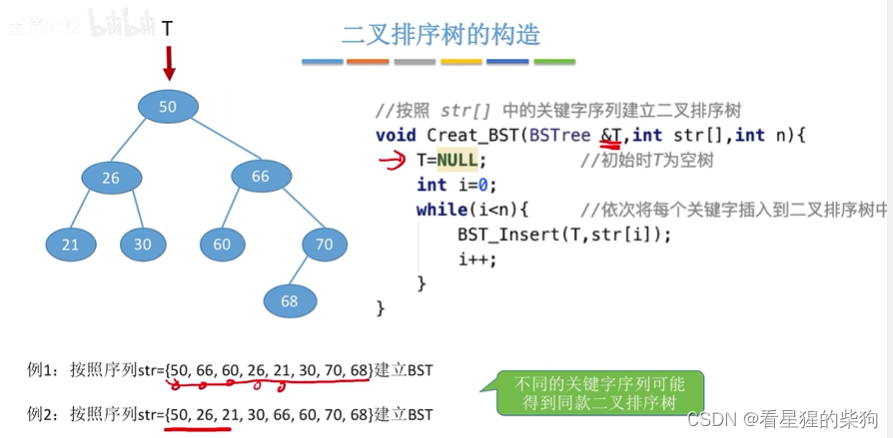
不同序列对应的二叉排序树不一定相同，也不一定不同
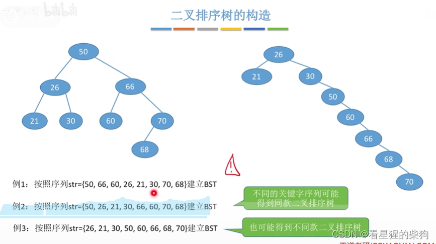
## 二叉排序树的删除
### 删除叶子结点
直接删除，仍然保持二叉树的性质
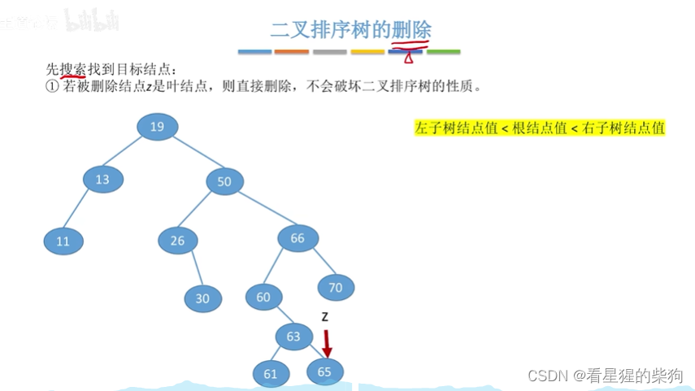
### 删除只有左子树或只有右子树的结点
直接替代即可，性质仍然成立，因为替代后子树相对于其祖父树，必然满足父树相对于其祖父树所具有的同样性质
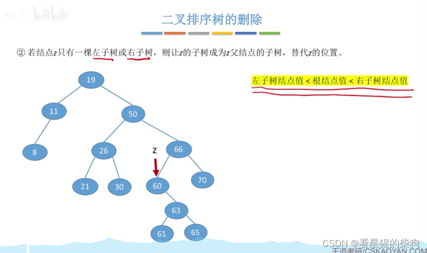
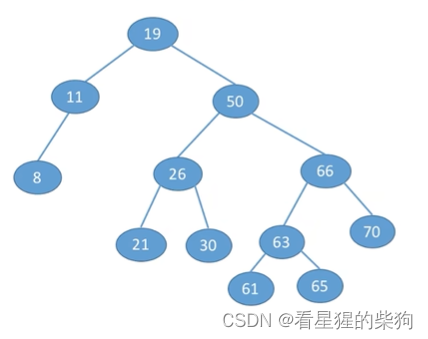
### 删除既有左子树又有右子树的结点
这里可以找右子树的最小结点来替代它（右子树最左下的结点）
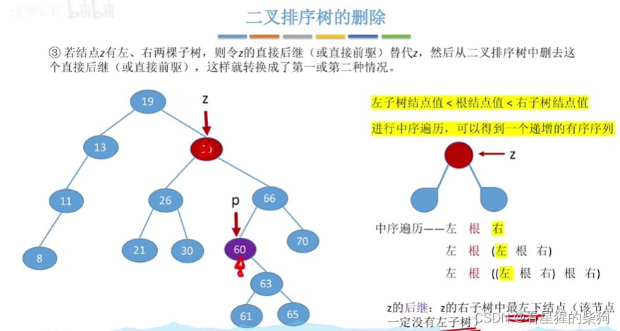
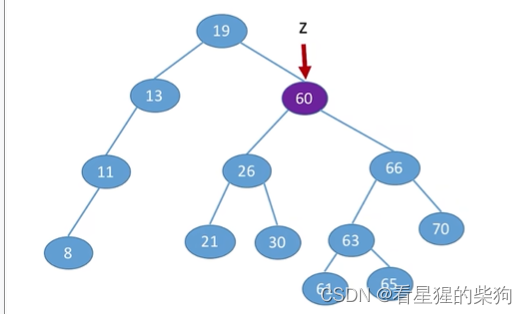
也可以找左子树的最大结点来替代它（左子树最右下的结点）
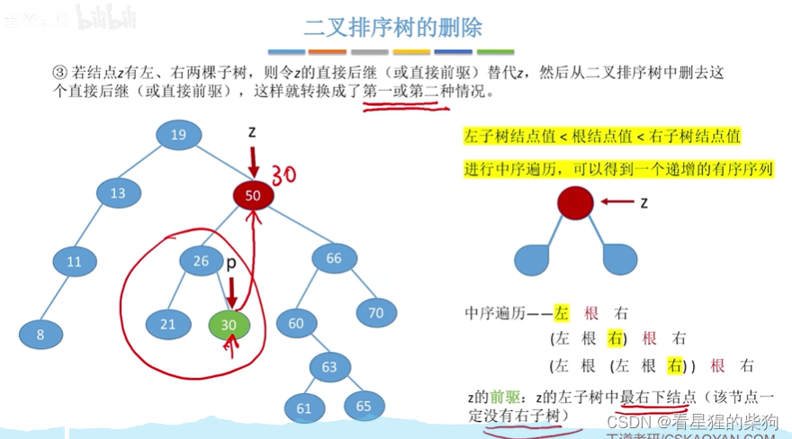
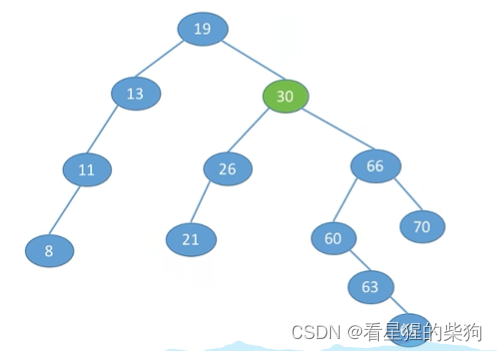

## 查找效率分析
### 查找成功
最坏情况下的查找长度也与这棵树的高度相同
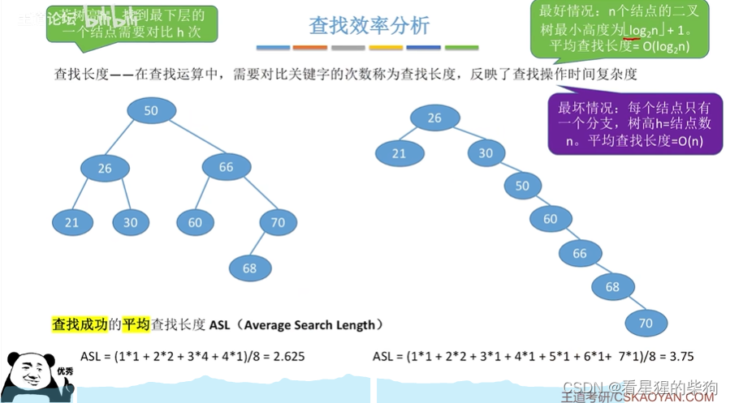
如果二叉树尽可能保持平衡，其高度就会更低
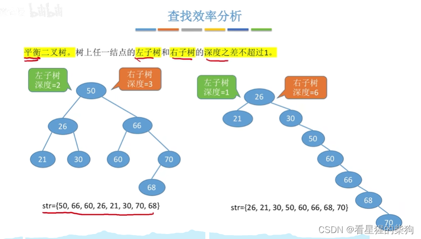
### 查找失败
查找失败会落到空结点的位置，先把空结点补上
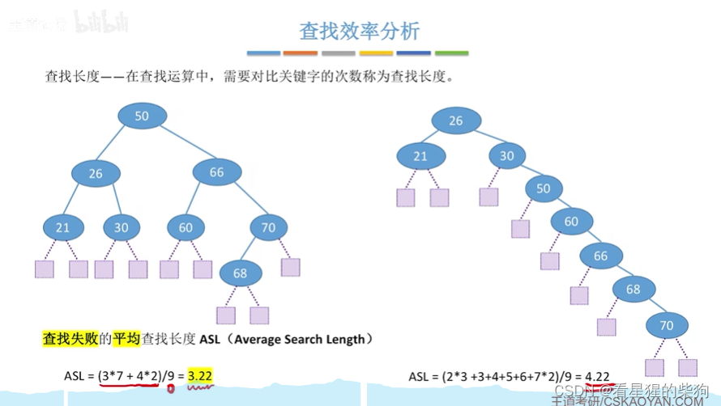

## 总结
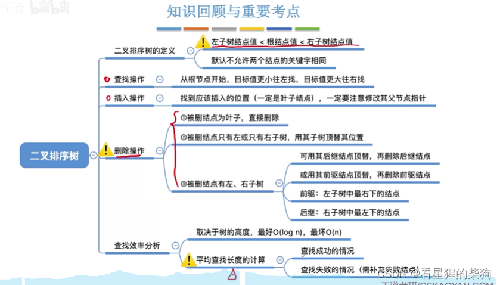

