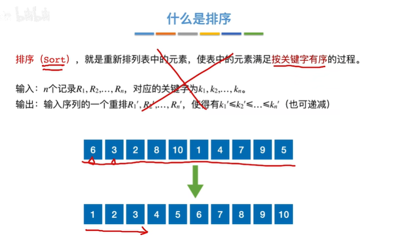
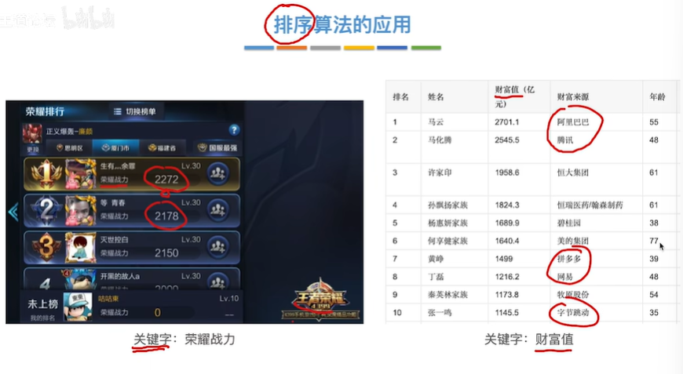
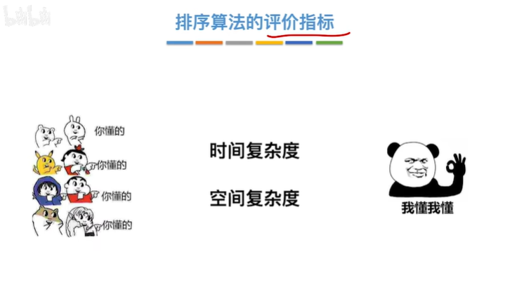
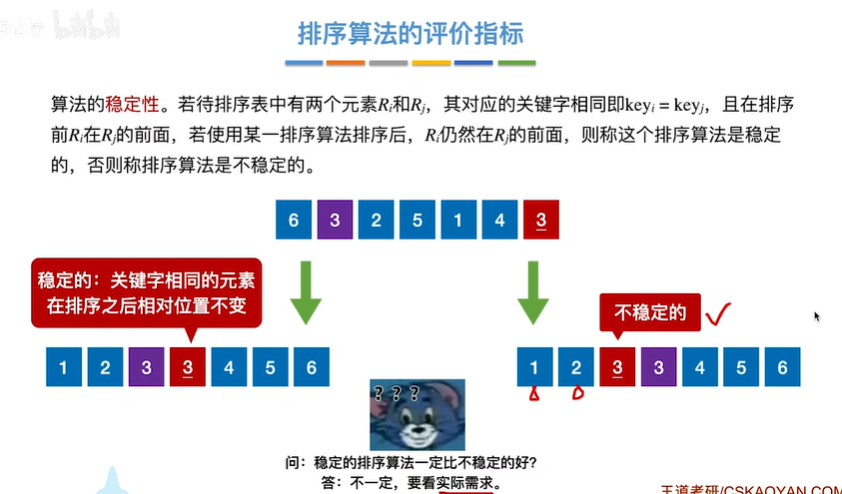
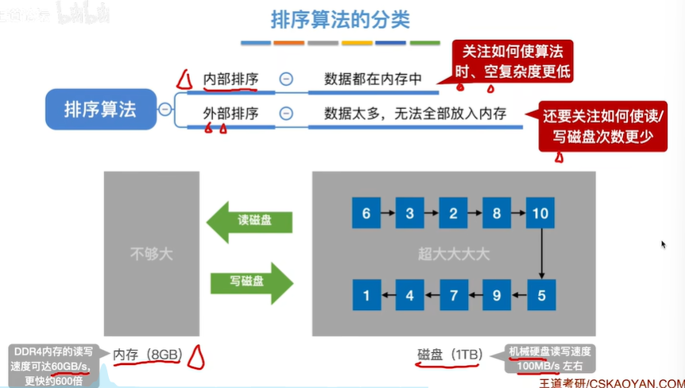
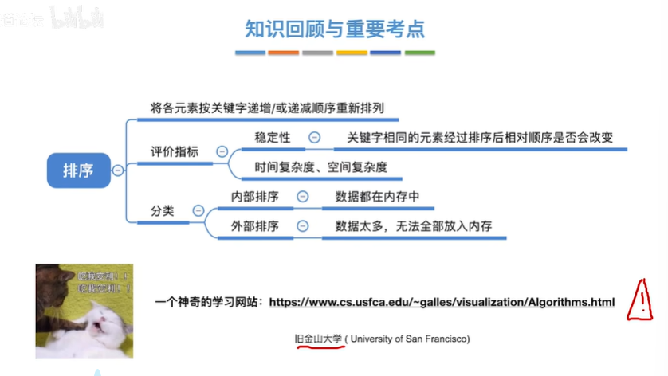


带叉的表示：文字别看，文字难懂
# 什么是排序
关键字可以相同

# 排序算法的应用

# 排序算法的评价指标

即：如果相同的元素保持与之前相同的相对顺序，则排序是稳定的；否则是不稳定的

# 排序算法的分类
内部排序：待排序数据放在内存中，排序完成后写回磁盘
外部排序：数据无法一次全部放入内存进行排序，需要分多次处理。每次从磁盘读取、排序，再写回磁盘，并且需要额外的处理，因为每次只对部分数据排序，把不同部分合并到一起可能无法直接完成

# 总结


