
# 概述
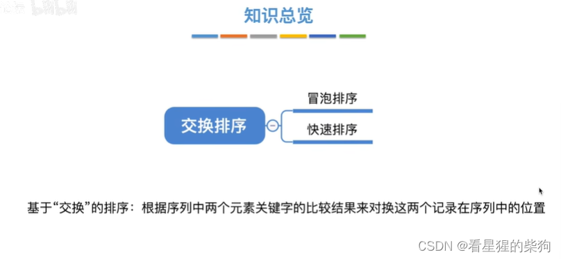
# 冒泡排序
## 冒泡？
自然界中的冒泡
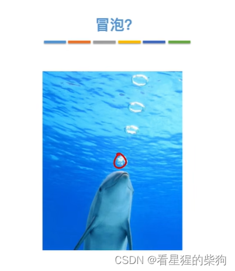
## 什么是冒泡排序
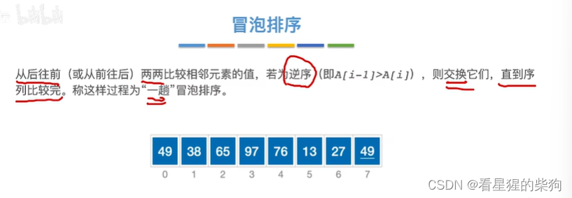
## 冒泡排序的过程
这里要求序列递增
先比较 27 和 49，符合递增序列——较小的在左边
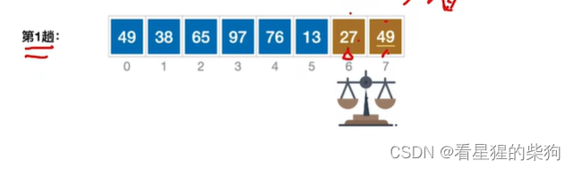
然后比较 13 和 27——较小的仍在左边，符合预期
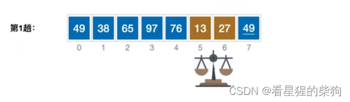
然后比较 76 和 13——较小的在右边，于是交换
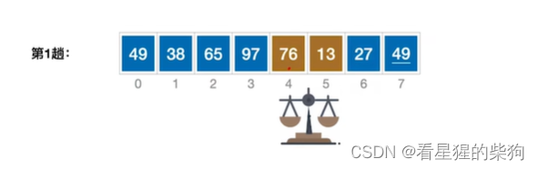
此时 13 已被交换到 76 的位置；接着比较 97 和 13——较小的在右边，于是交换
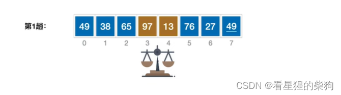
此时 13 已被交换到 97 的位置；接着比较 65 和 13——较小的在右边，于是交换
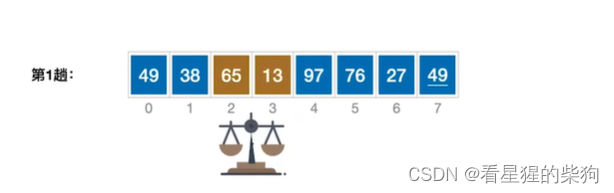
此时 13 已被交换到 65 的位置；比较 38 和 13——较小的在右边，于是交换
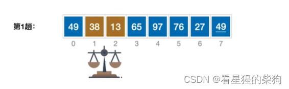
此时 13 已被交换到 38 的位置；比较 49 和 13——较小的在右边，于是交换
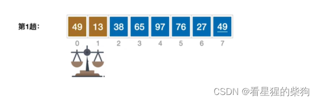
第一趟冒泡排序的结果
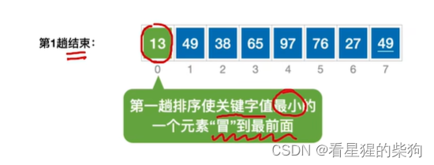
开始第二趟，步骤与前面相同
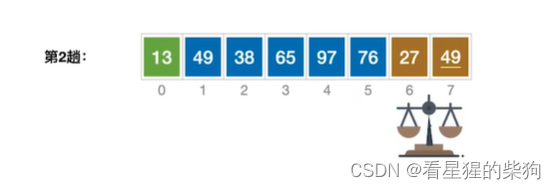
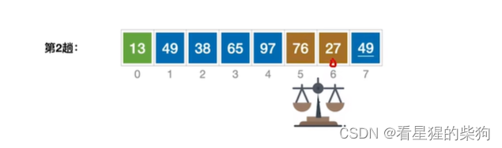
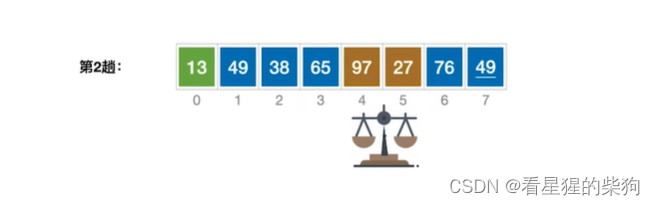
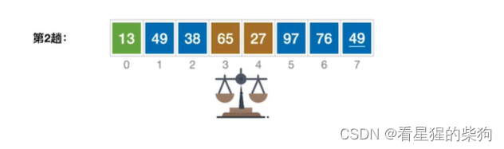
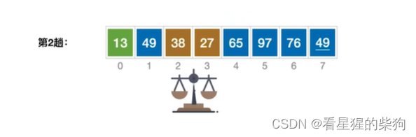
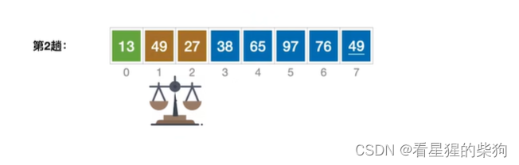
无需再与前面几趟已经冒出的元素比较
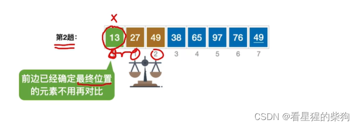
第二趟的结果
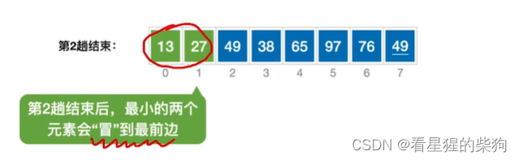
第三趟及之后的过程类似
每一趟都会在位置尚未确定的元素中找出最小的，并把它放到位置已经确定的元素之后
注意第四趟中，相等的元素比较时不交换，这保证了稳定性
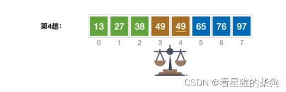
注意第五趟没有发生交换，因此可以认为序列已经有序
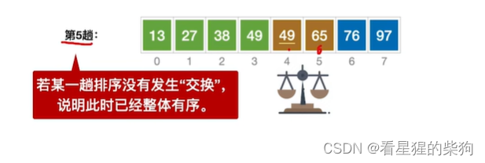
## 算法实现
flag 标记是否发生了交换；如果没有发生交换，说明序列已经有序
循环共迭代 n 次，从 0 开始
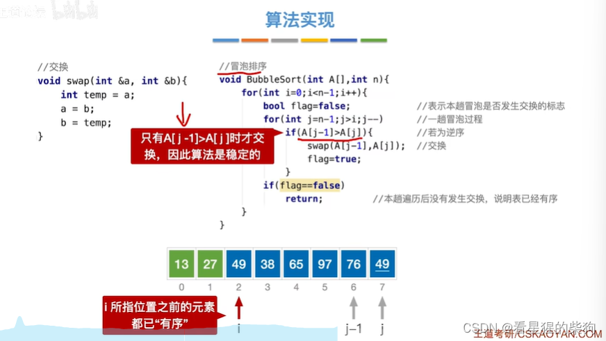
## 算法性能分析
即使序列已经有序，仍然需要 n 次比较；只有在没有发生交换时，才知道它是有序的
最坏情况下，每次比较的序列都是逆序的
交换一次元素需要移动三次元素
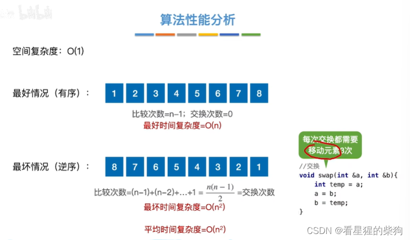
## 稳定性
稳定——相等时不发生交换
##  冒泡排序是否适用于链表
是的，同样适用
将链表当前指针所指的元素与其后一个指针所指的元素比较，如果当前元素大于后一个元素，就交换它们
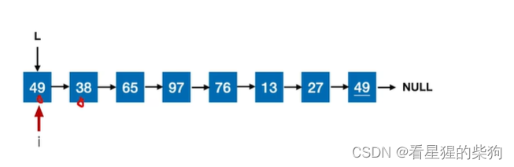
这里 49 与其后一个元素比较——不需要交换
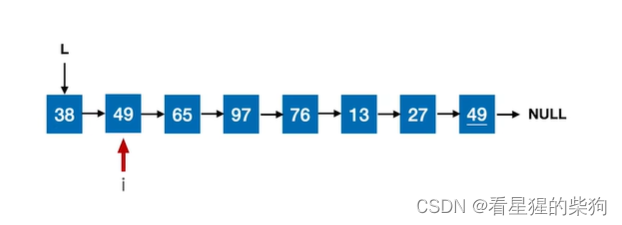
这里 69 与其后一个元素也不需要交换
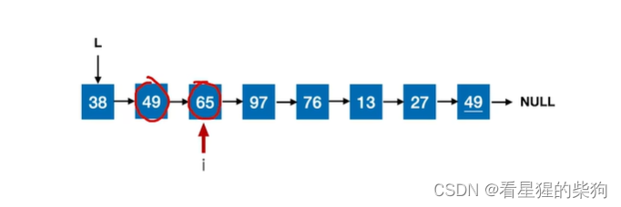
97 需要与其后一个元素交换
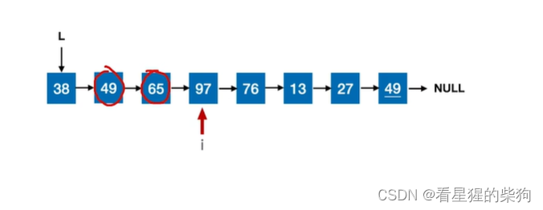又需要交换一次
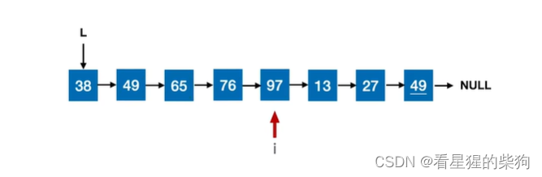
仍然需要交换
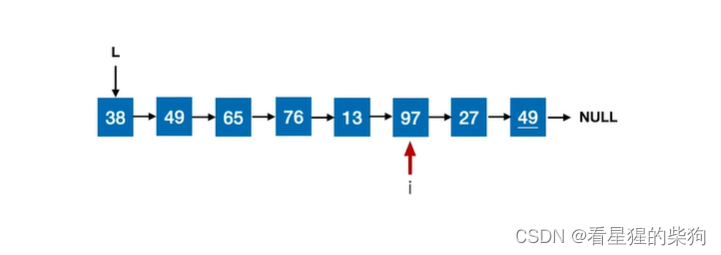
仍然需要交换
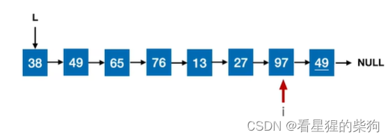
仍然需要交换
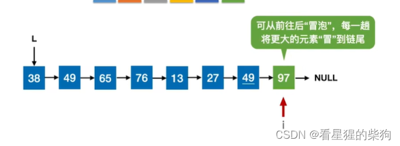
至此第一趟结束，然后从头开始继续这样处理
# 总结
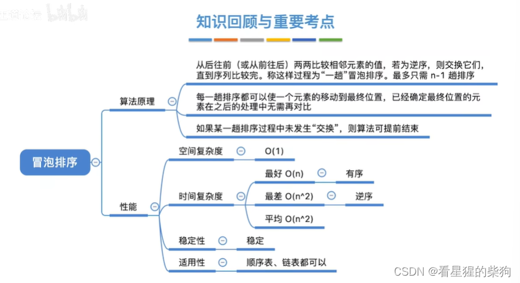

