
# 希尔排序
“基本有序”指的是存在有序的子序列
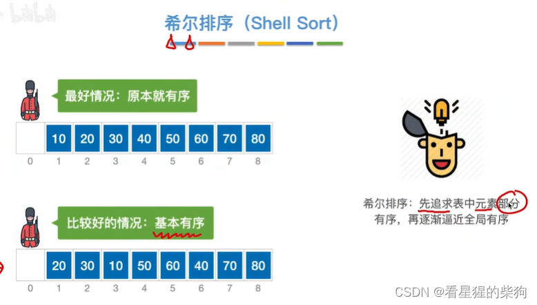
子表是通过增量 4 得到的
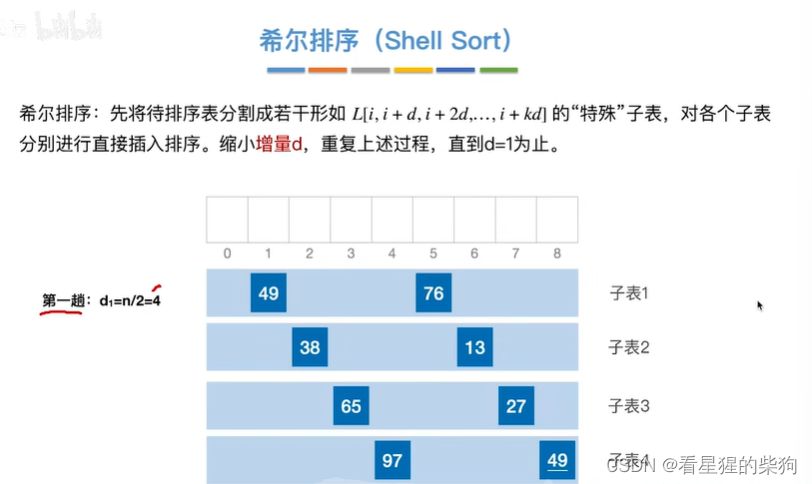
分别对各个子表进行插入排序
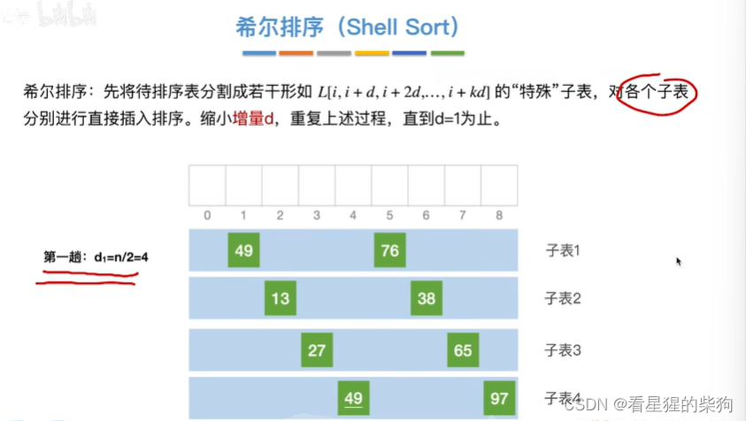
增量再除以 2 缩小，得到的子表如下
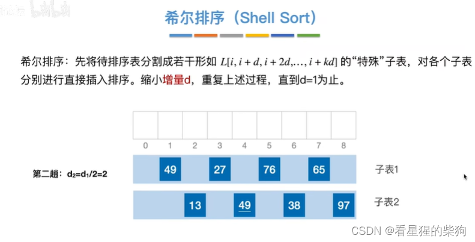
对各个子表进行插入排序
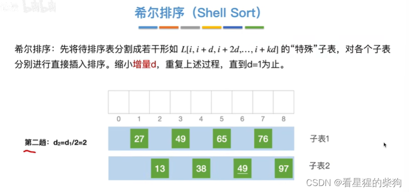
增量再除以 2 缩小
最后子表就是整个表，对整个表进行插入排序
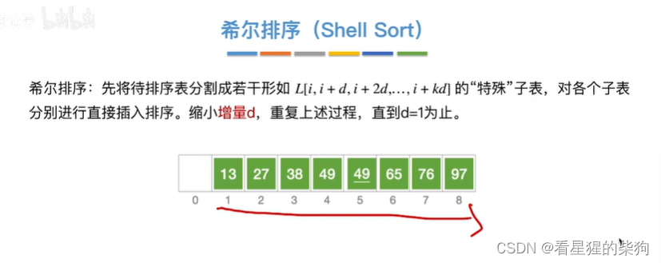
## 过程总结
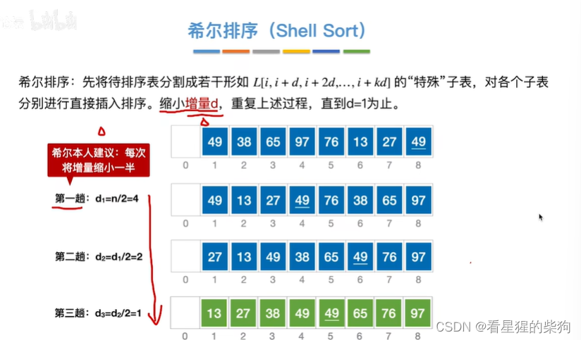
## 增量序列不是固定的
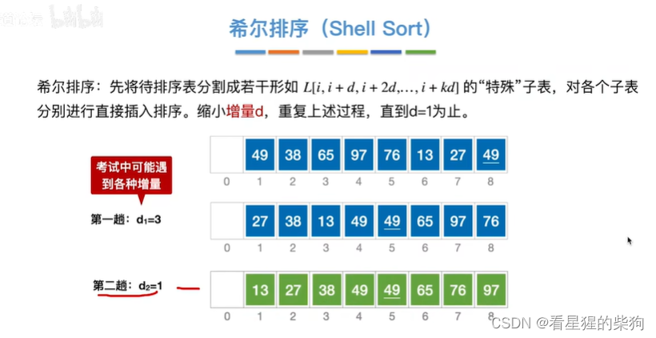
# 算法实现
对每个子表进行插入排序时，直接从子表的第二个元素即 d+1 位置开始，一直遍历到 n

然后进行比较，但比较的始终是相隔增量序列中增量的位置，移动位置也要按增量的步长进行

最终找到更大的元素时，被比较元素的位置要前进一个增量
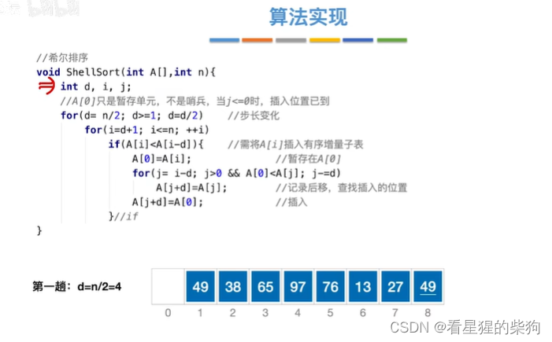
# 算法性能分析
增量序列不同，趟数和每趟的比较次数也不同
最坏情况下增量为 1，与插入排序相同
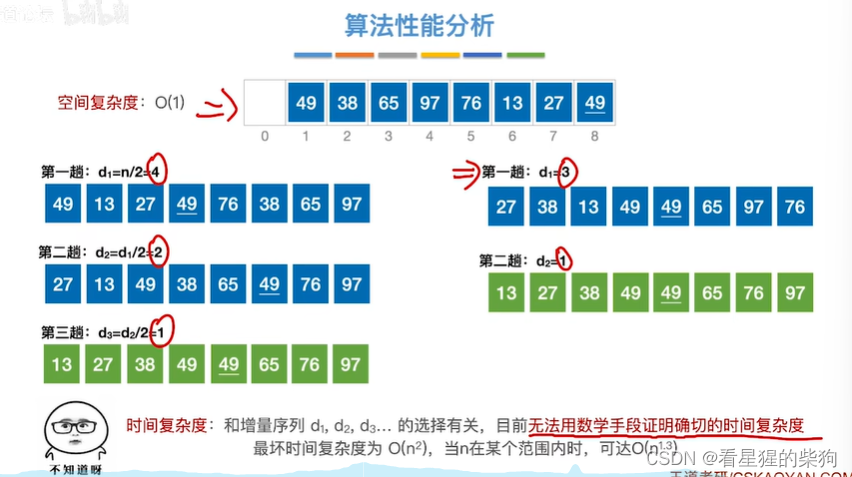
# 稳定性
由于需要用增量 d 来定位元素位置，用链表实现比较麻烦，因此只适用于顺序表
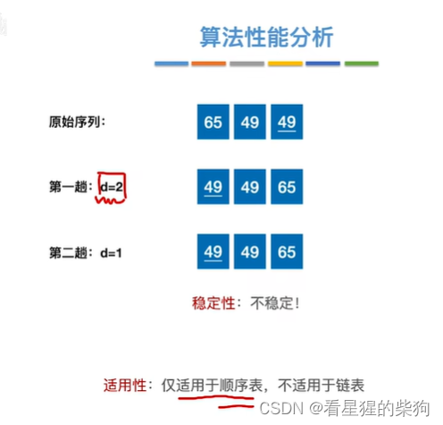

# 总结
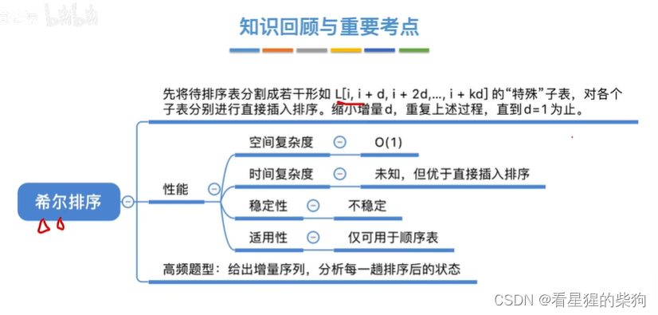

