
# 插入排序
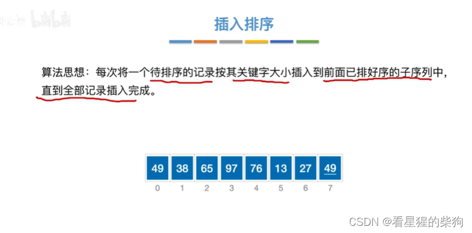
先把 49 当作第一个已排好序的元素。将第二个元素与前面的元素比较，发现它小于 49，于是 49 后移
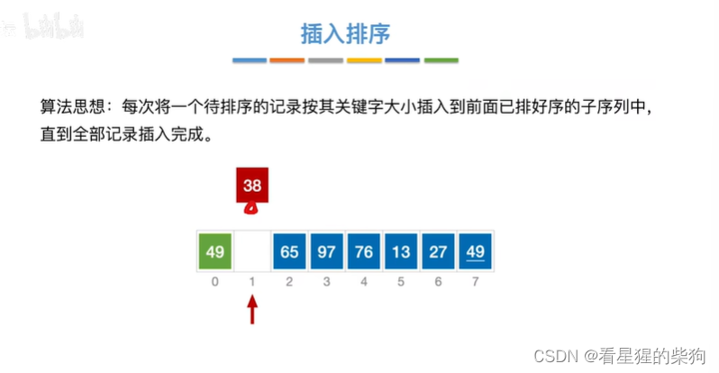
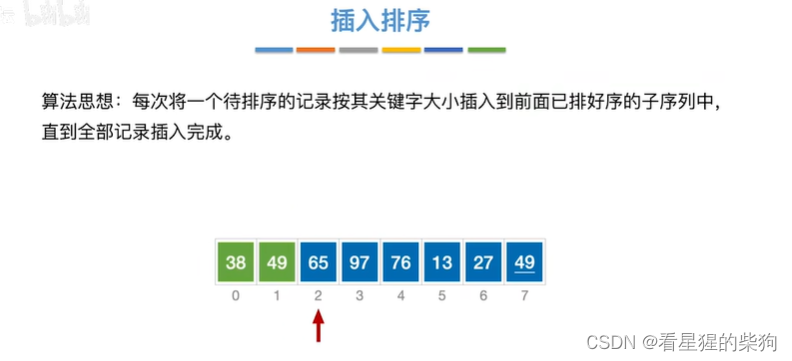
现在将 65 与前面的元素比较，发现它最大，所以位置不变
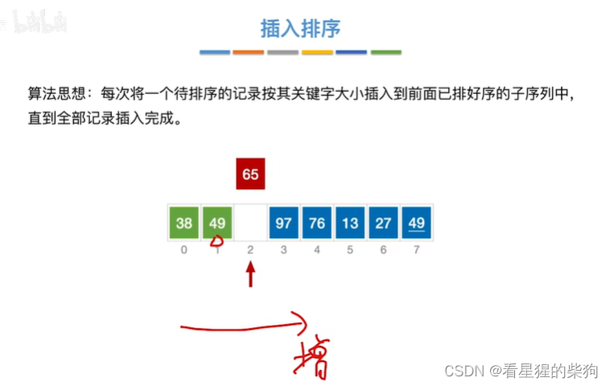
97 的处理与 65 相同
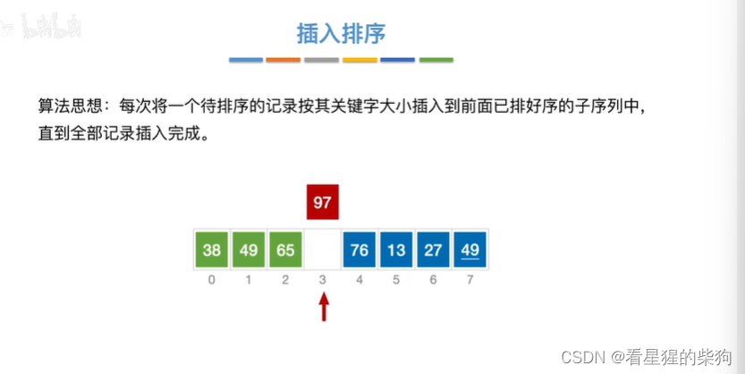
这里 76 小于 97，所以 97 后移；然后 76 与更前面的元素比较，发现更大，于是原地不动
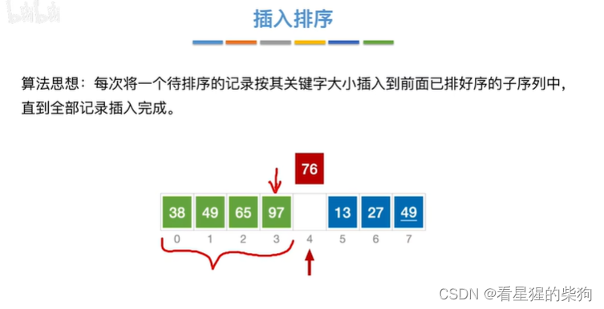
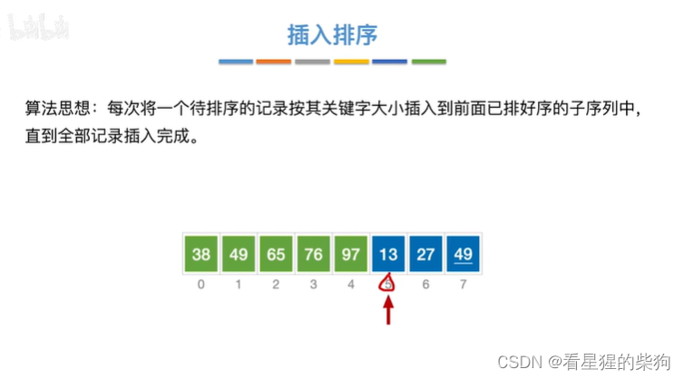
这里 13 最小，与前面每个元素比较都更小，所以它们都要后移
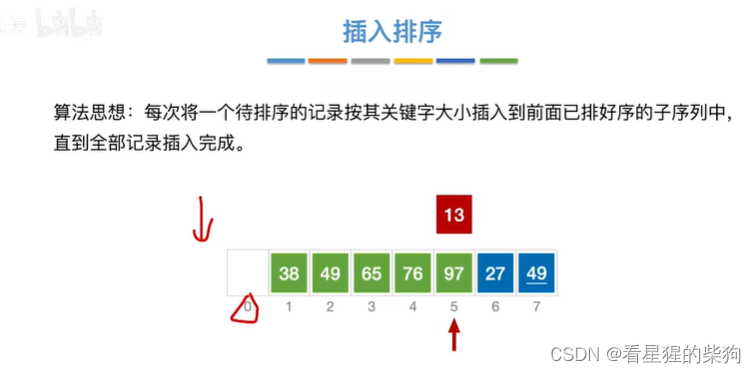
不断比较、后移，直到最后 13 更大为止
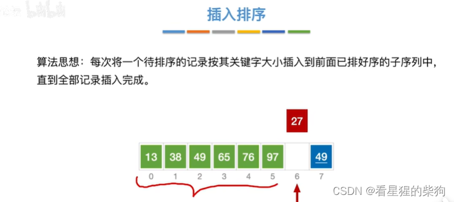
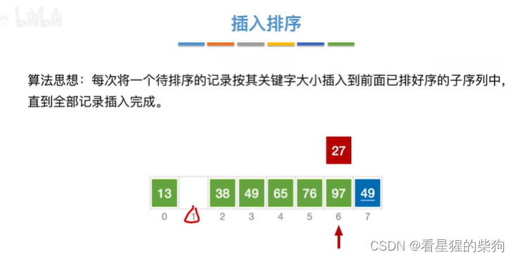
49 与前面的元素比较时，只有前面的元素更大才移动——相等或更小则不移动，这保证了稳定性
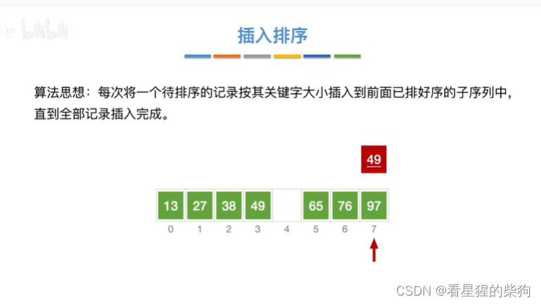
# 算法实现
循环执行 n 次，每次将第 i 个元素与前面 i-1 个元素比较，只要发现某元素大于第 i 个元素，就把该元素右移一位
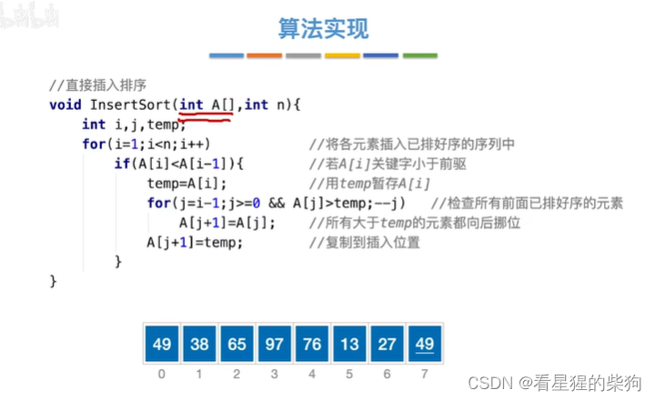
从下标 1 开始存储，0 号位置作为哨兵，存放当前第 i 个元素
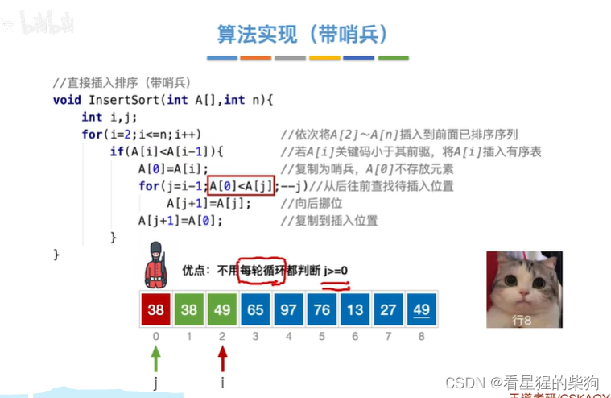
# 算法效率分析
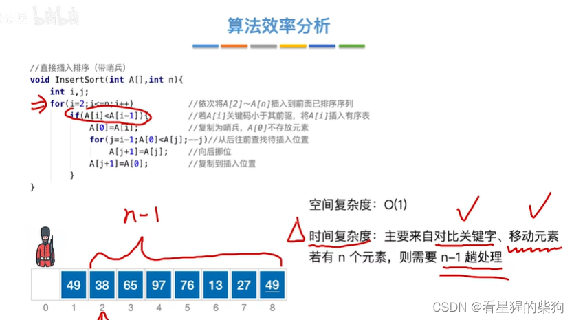
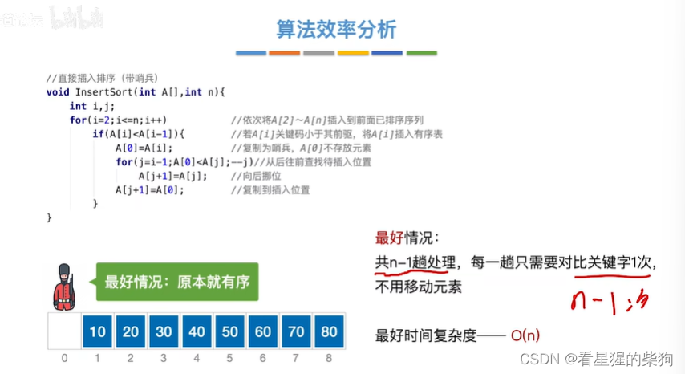
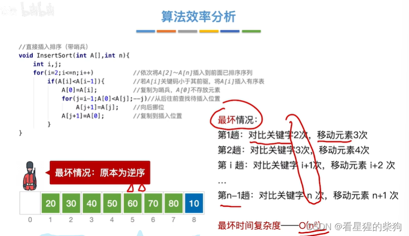
平均时间复杂度按（最好情况 + 最坏情况）/ 2 计算，一般与最坏时间复杂度相同
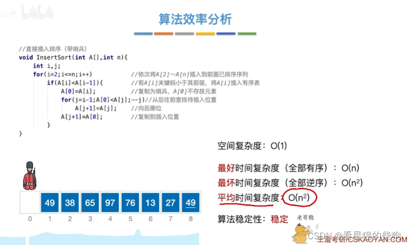
# 优化——折半插入排序
0 号位置存放要与前 i-1 个元素比较的元素；发现 55 大于 mid，于是 low=mid+1
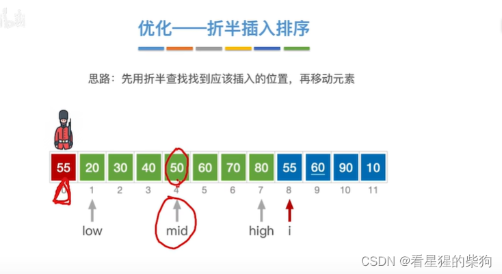
此时 55 小于 70，于是 high=mid-1
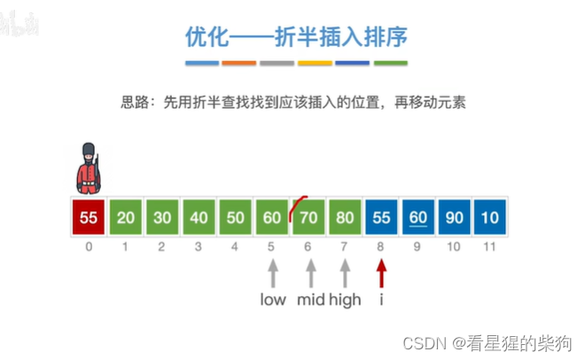
此时 high、mid、low 三者相等
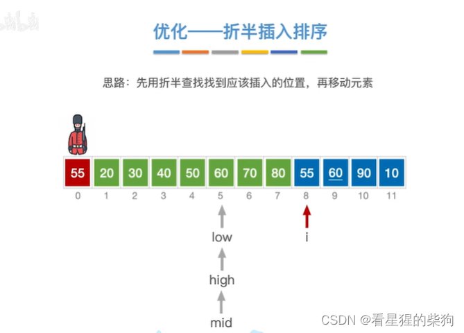
然后 55 小于 60，low=mid+1；此时 low 大于 high，low 处的元素大于 55，high 处的元素小于 55
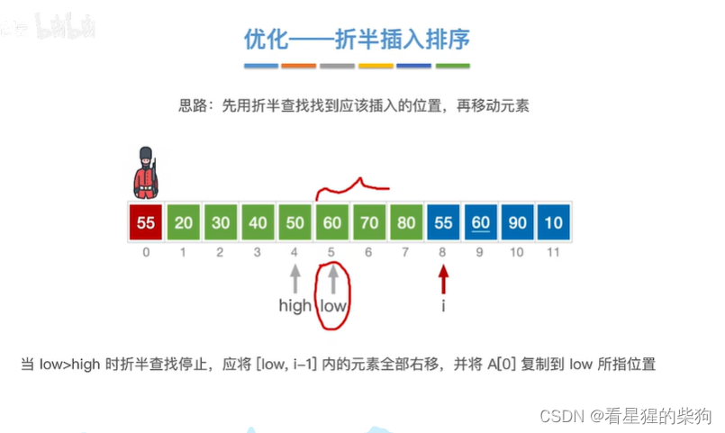
插入 60
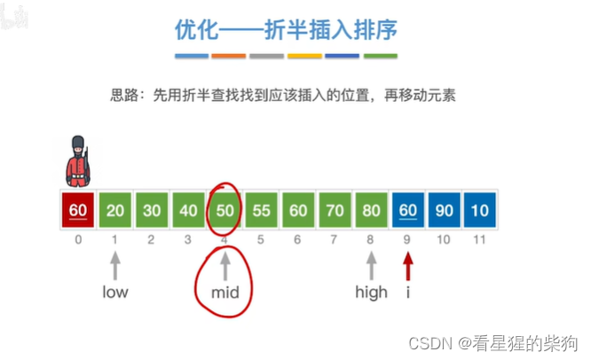
这里找到 mid=60；为了保证稳定性，此时不停止查找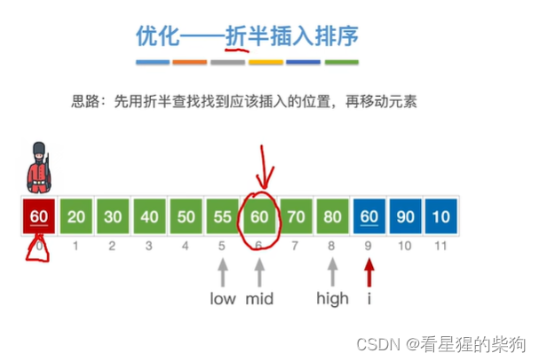
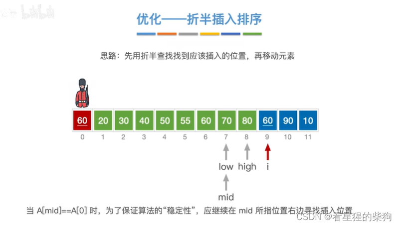
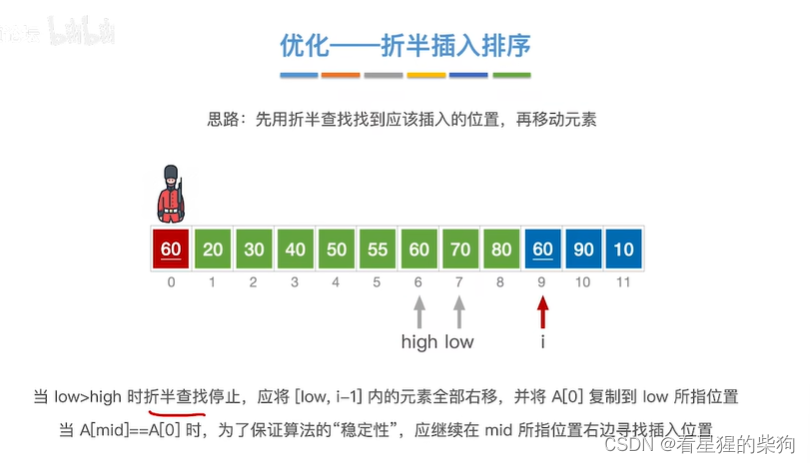
插入 90：最终在 low 大于 high 时
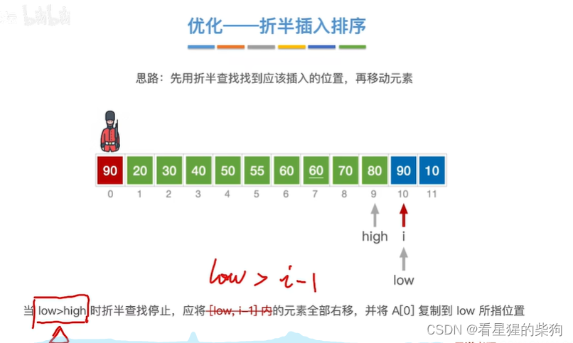
插入 10：最终在 low 大于 high 时
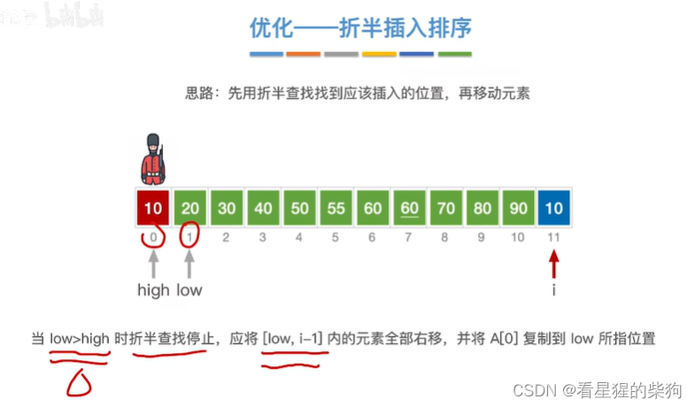
# 代码实现
这里相等时也要 low=mid+1
当 low 最终大于 high 时，high+1=low
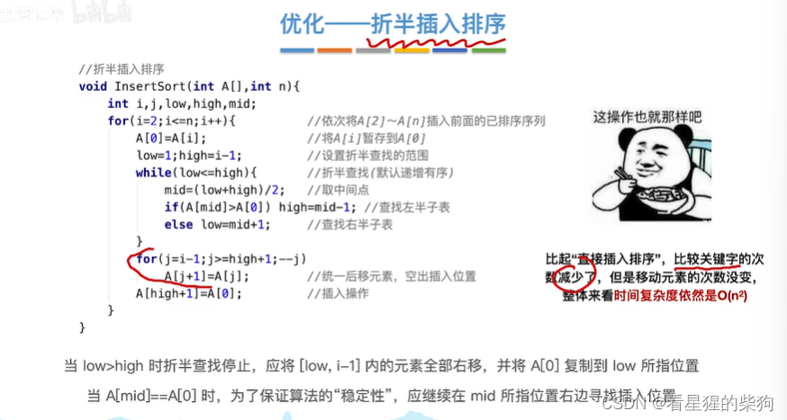
# 链表上的插入排序
链表无法实现折半查找
比较次数保持不变
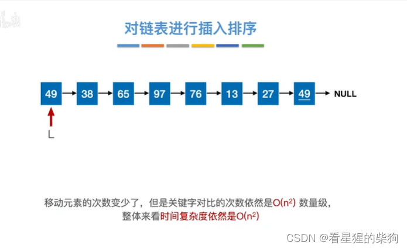
# 总结
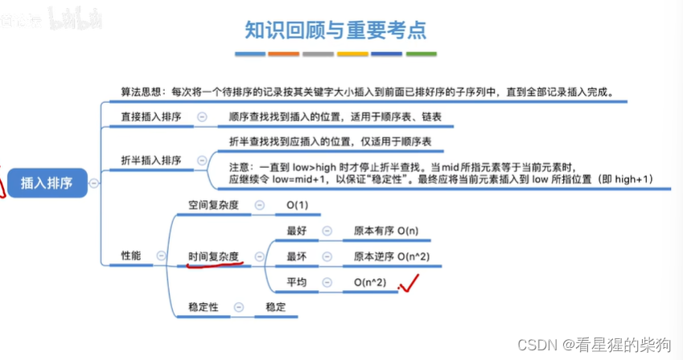

