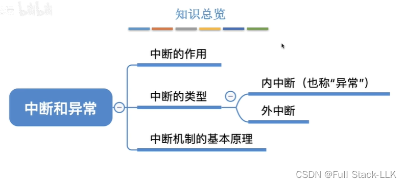
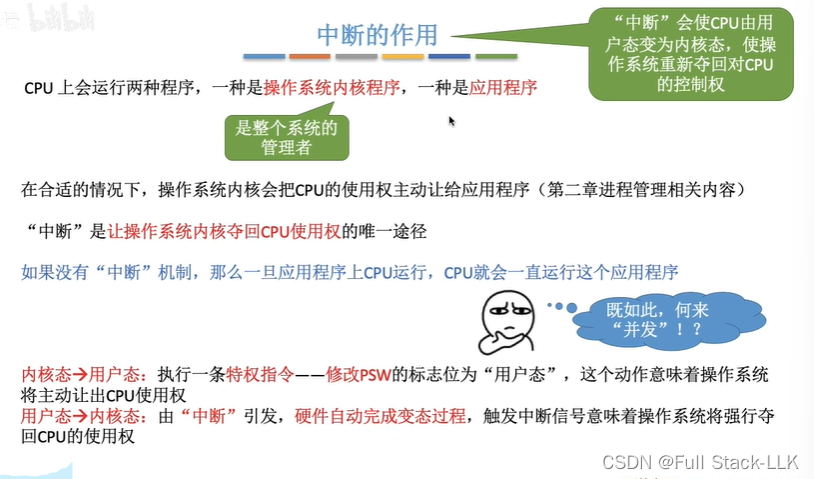
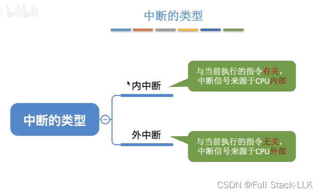
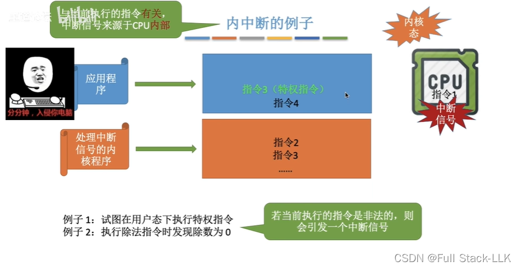
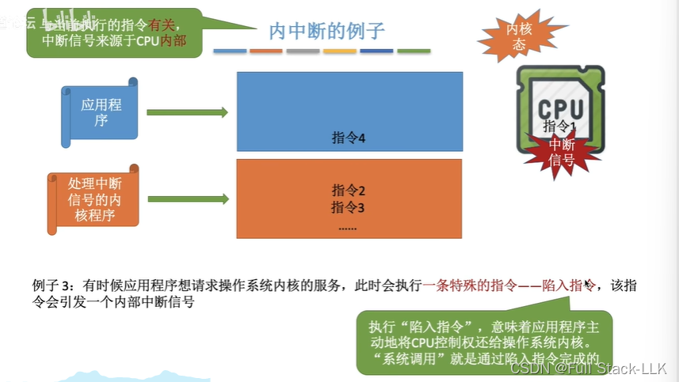
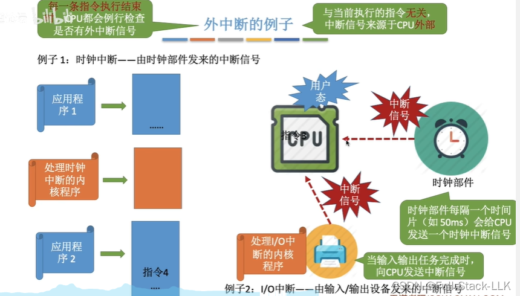
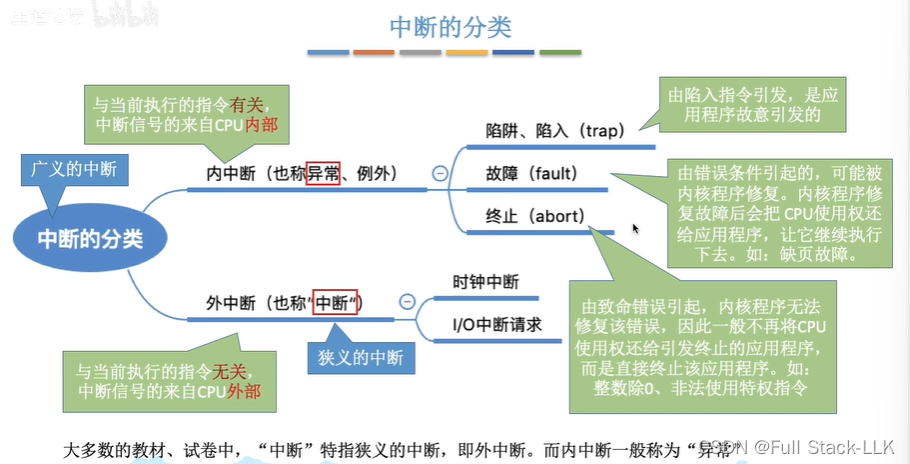
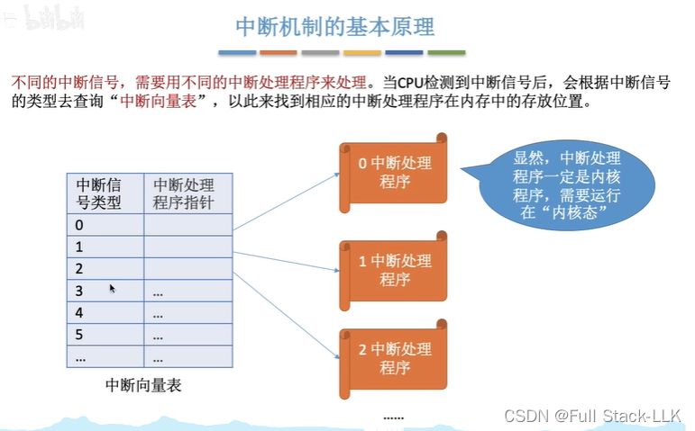
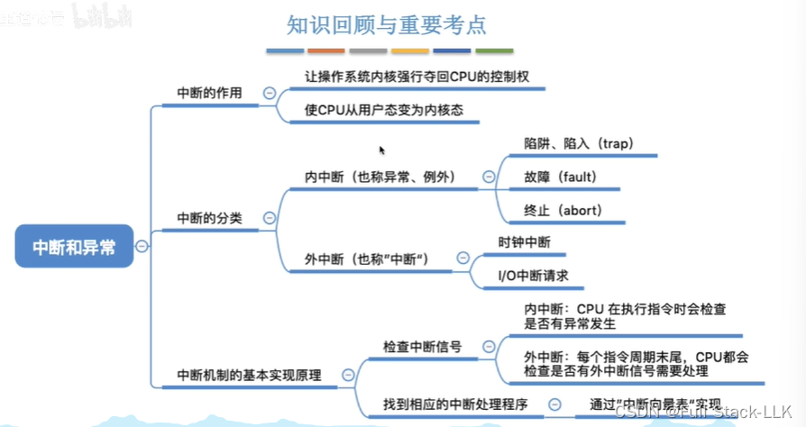


# 概述

# 中断的作用
刚启动后在 CPU 上运行的是内核程序

# 中断的类型

# 内中断示例
“当前执行的指令非法”是指参数等原因造成的问题

trap 指令会主动切换状态，但它不是特权指令

# 外中断
时钟中断每隔一段时间触发一次；中断处理程序执行完毕后，系统切换到用户态去运行其他程序，如此反复。也许经过多次时钟中断之后，原来的程序才重新开始执行

I/O 中断由外部设备发出；当一次输入或输出操作完成时（即 I/O 操作完成或设备完成其工作），就会发出中断信号

# 中断的分类
故障（fault）不在本节讨论范围内，后面会更详细地介绍

# 中断机制的基本原理
中断向量表中存放的是中断向量，中断向量的内容是跳转到中断处理程序的指令

# 总结


