
# 整体式内核与微内核
## 概述
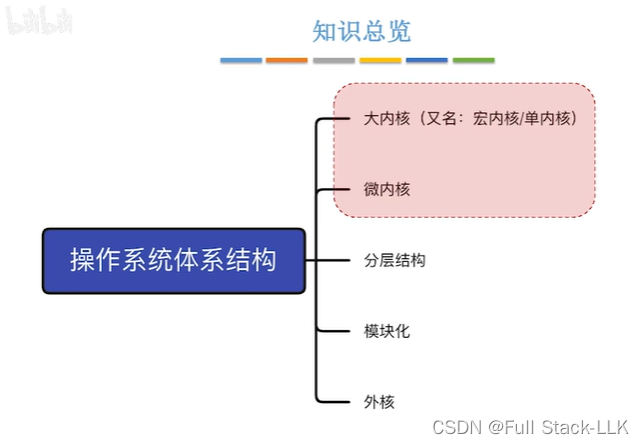
## 操作系统内核
操作系统的核心功能都在内核中
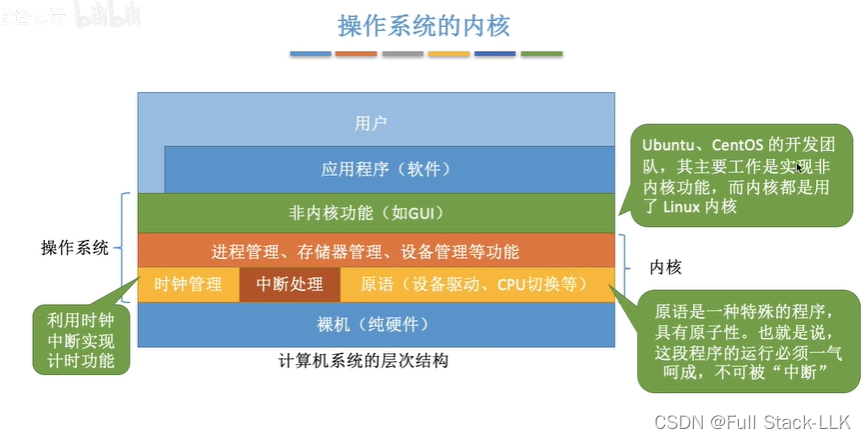
按照程序与硬件联系的紧密程度分类
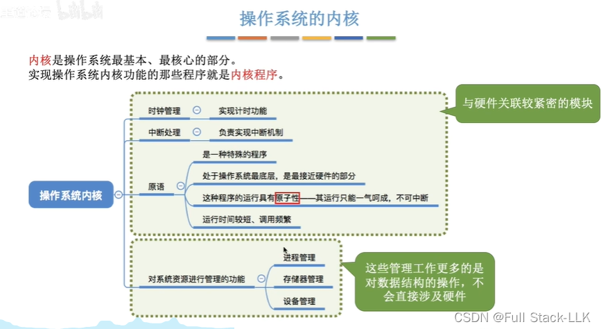
由于进程管理、内存管理、设备管理等工作与硬件的联系较少，有时它们不会被放进内核中
所以有些操作系统不把这些功能放进内核，只保留与硬件联系最紧密的部分

因此，这里就产生了两种内核设计方案

属于内核的功能需要在内核态下运行；不属于内核的功能在用户态下运行
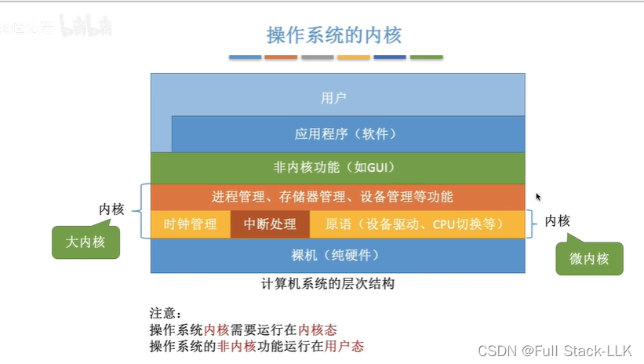

##  整体式内核与微内核的性能差异
使用微内核时，进程管理、存储管理和设备管理都涉及需要向内核请求的工作，这需要进行一次模式切换

整体式内核只需要两次模式切换

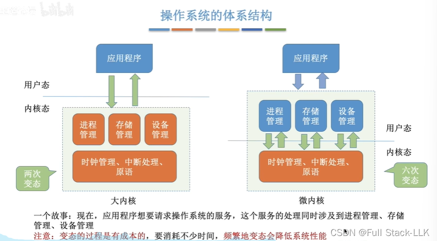
## 小结
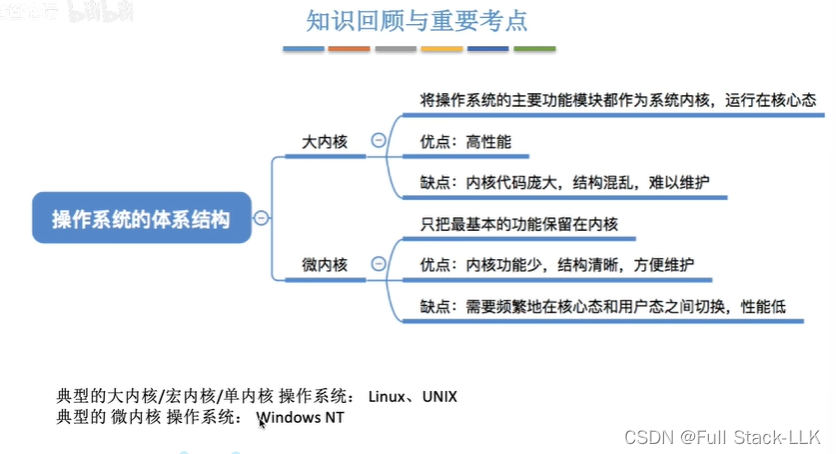
# 分层结构、模块化与外核
## 概述
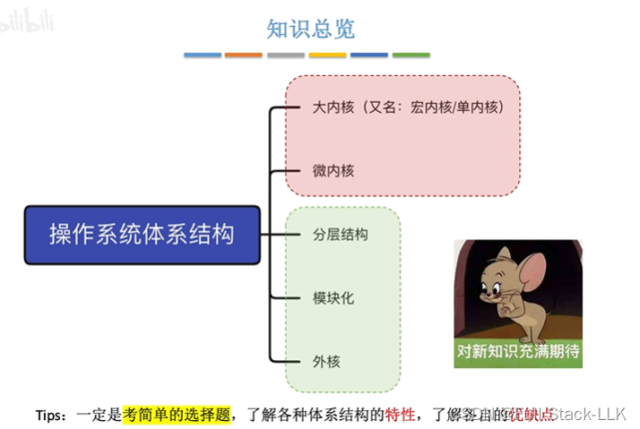
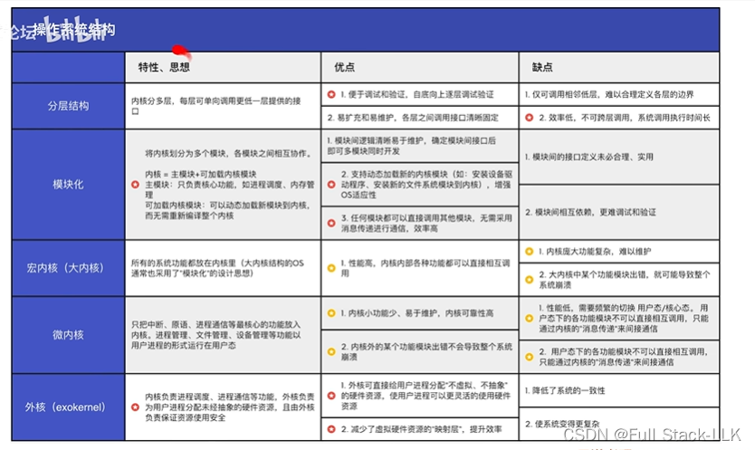
## 分层结构

每一层只使用其下一层的接口

调试从最底层开始，保证上一层对下一层的接口调用没有问题后，只需专注于调试当前层即可

容易扩充：只需提供层与层之间的接口

有时底层可能需要用到上层的功能，这与"上层只能调用下层"的规则相冲突，所以很难合理界定各层的边界

不允许跨层调用，所以请求需要逐层向下传递
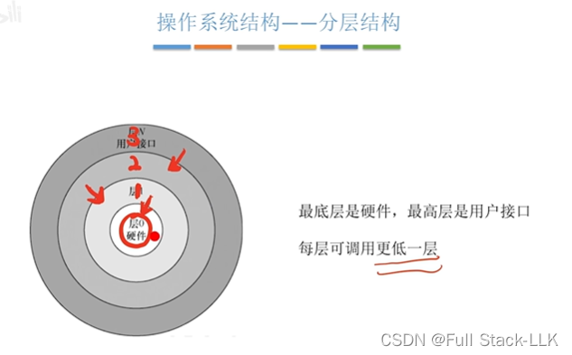
## 模块化
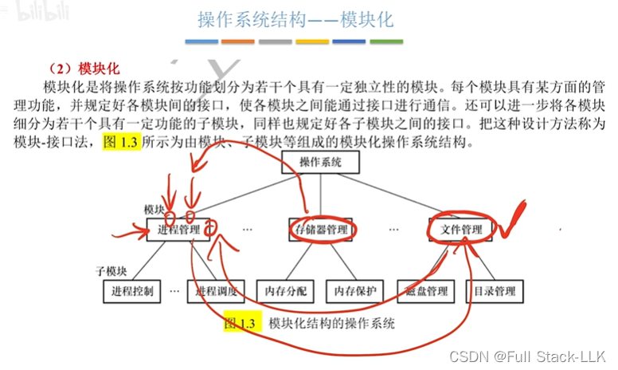

模块之间的调用很多，所以接口的定义与实现有时不够完善，难以让每个模块都完全契合

各模块之间可以相互调用，所以如果某个模块出现问题，问题可能出在被调用的模块中，也可能出在该模块本身

接口确定后即可并行开发，意味着接口定义完成后，各接口的代码实现可以同时进行

## 整体式内核、微内核
内核中各模块之间的依赖关系非常强，所以当内核的某个模块出现问题时，可能会导致整个系统出现问题

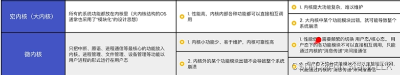

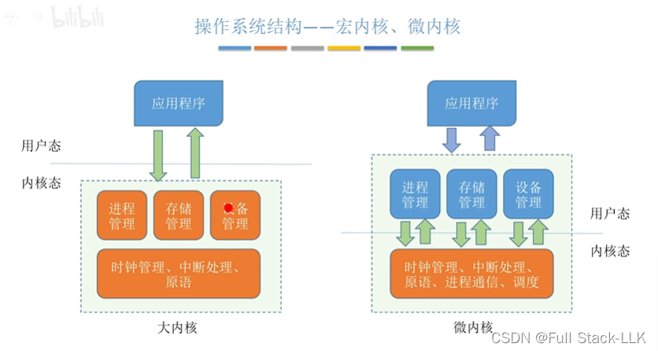
## 外核

外核
外核分配和回收未经抽象（非虚拟化，即物理地址）的硬件资源

程序通过库函数调用普通内核的一些内核功能，也可以调用外核的一些功能

在普通操作系统中，进程申请内存空间时得到的是一个（连续的）虚拟地址空间，其中虚拟页对应实际的物理页框，而这些物理页框在内存中实际上是离散的。分配给进程的外存空间（通常用于存储文件）同样是一个（连续的）虚拟地址空间，而对应的物理磁盘存储空间也可能是离散的

外核直接把未经抽象的硬件资源分配给用户进程。当用户进程频繁随机访问其被分配的虚拟外存空间时，由于实际对应的物理空间是离散的，随机访问各个位置可能需要大量的磁头移动。使用外核分配时，进程直接得到一块连续的物理外存空间，因此随机访问各个地址时磁头移动的距离会减少，从而提高性能

外核也可以分配连续的物理内存空间，这种情况下用户看到的就是实际的物理内存地址空间

外核需要保证硬件资源使用的安全性，即一个进程不能访问其他进程的空间，其他进程也不能访问该进程的空间
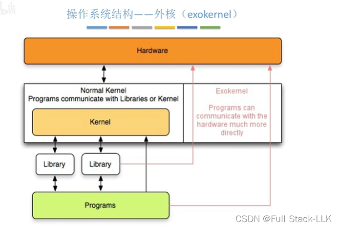
 一致性：每个进程申请的地址类型不同（物理地址 vs 虚拟地址），这要求后续管理需要做不同的处理，因此也更为复杂

使用虚拟地址分配时，进程访问自己的地址空间时，需要查询页表把虚拟地址转换为实际的物理地址


