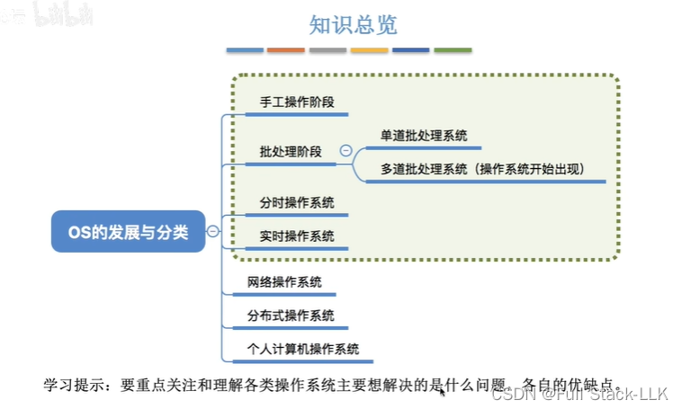
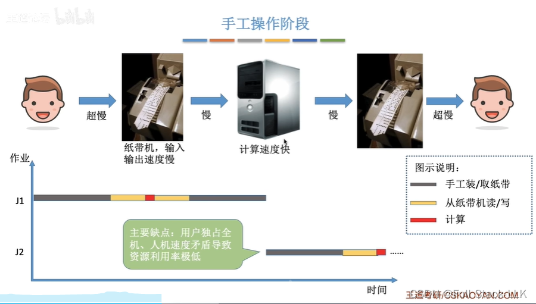
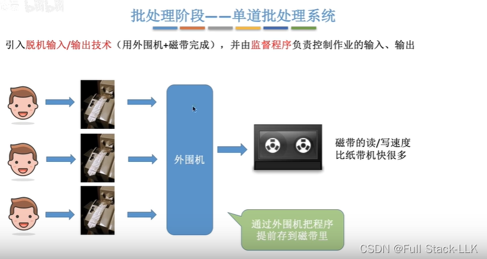
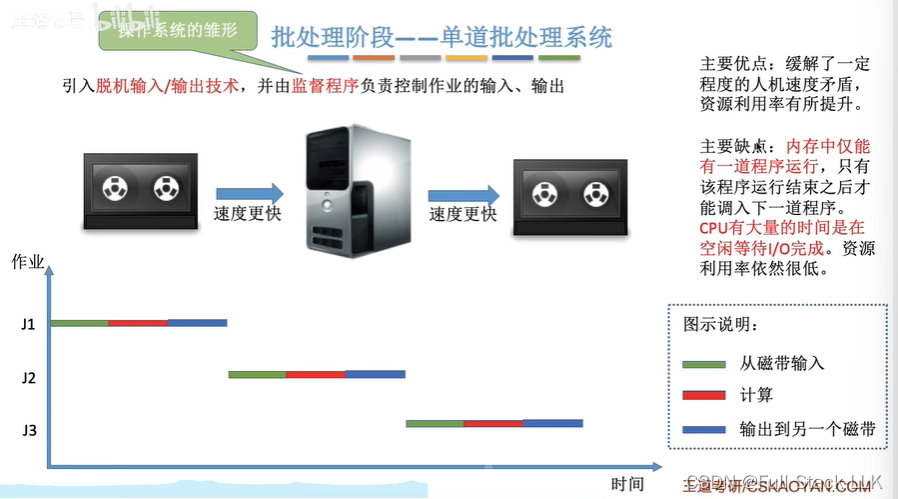
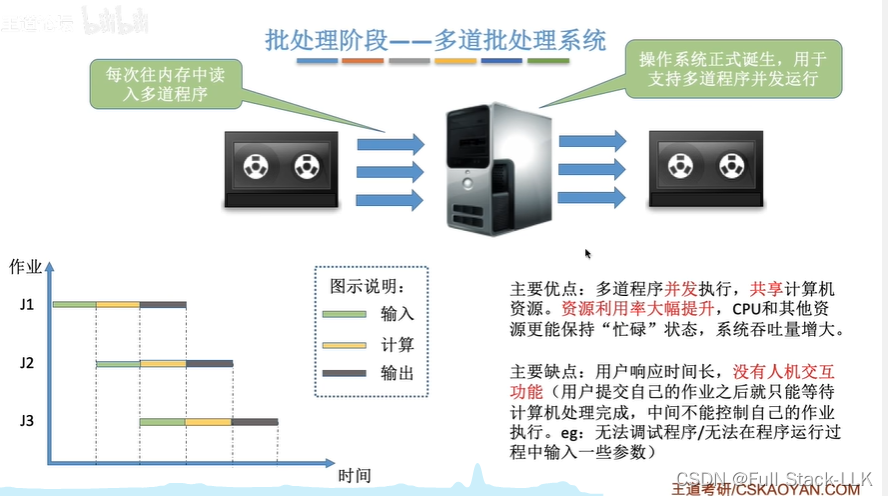
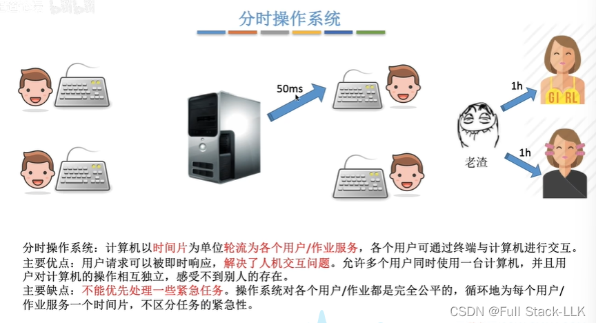
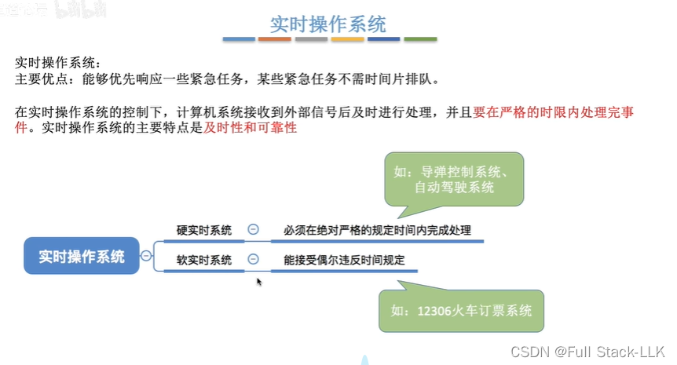
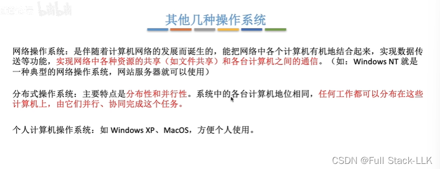
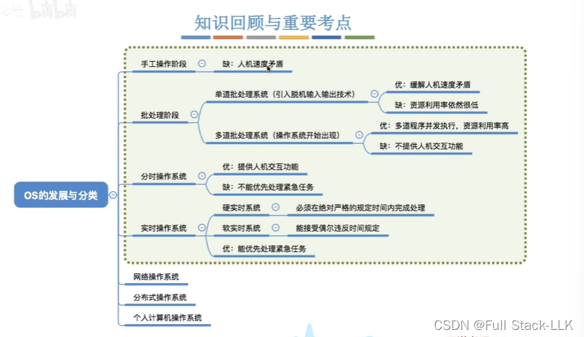


# 概述
绿色框出的部分是考试重点

# 人工操作阶段
有孔代表1，无孔代表0

程序被写到纸带上，然后机器读取并执行纸带上的内容，再把内容写回纸带，之后程序员取走纸带
用户独占整台机器：两个人不能同时使用，必须轮流一个一个来

# 批处理系统 - 单道批处理系统
先由外围机把每条纸带处理后存到磁带上

监控程序控制计算机自动读入纸带内容，然后再输出到纸带上

此时仍然是串行的（一次只将一个程序读入内存）

# 批处理系统 - 多道批处理系统
此时不再是串行的了，每个程序的读入、运行、输出这三个过程可以重叠进行

# 分时操作系统
注意关键词"轮流"
终端：键盘、鼠标等

# 实时操作系统
它可以进行优先级处理，对信号的处理也具有在限定时间内完成事件的特点

硬实时：每个规定的时间间隔内必须有反馈结果。例如导弹控制中，必须实时反馈位置信号才能精确调整

  
# 其他操作系统

# 小结


