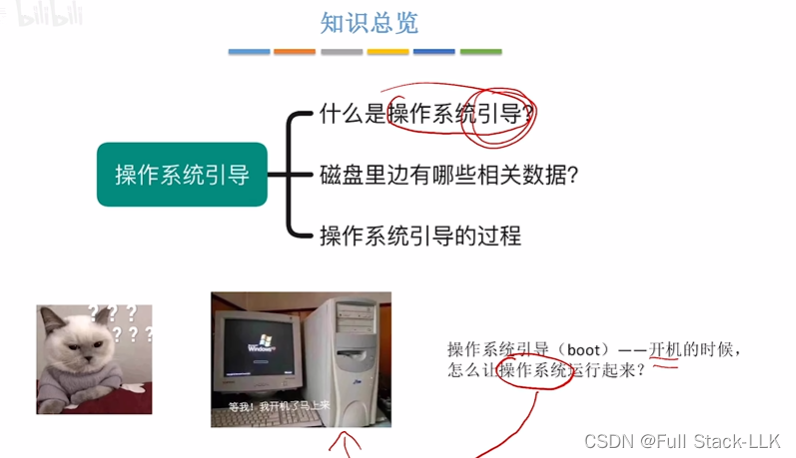
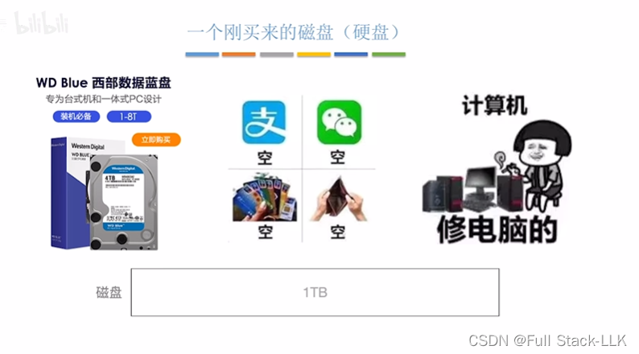
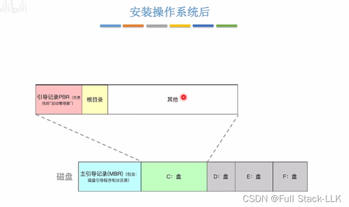
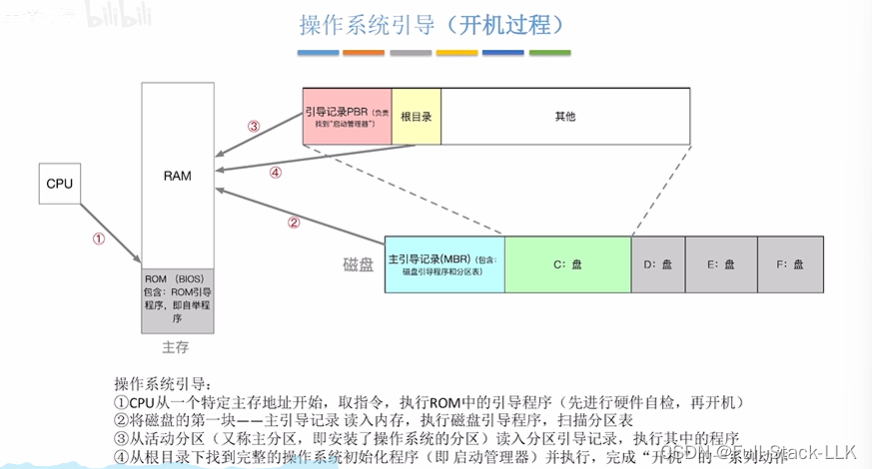
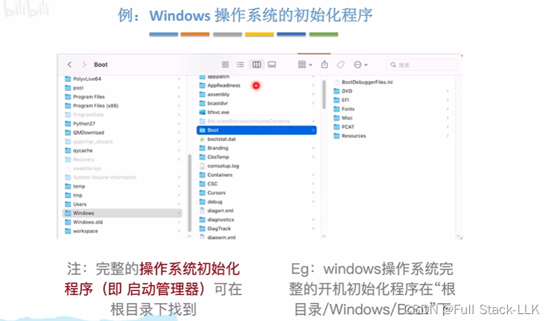


# 概述

# 一块全新的磁盘（硬盘）
此时里面完全是空的

# 在磁盘上安装操作系统之后
操作系统位于 C 盘

主引导记录不属于任何一个具体的磁盘分区 

根目录：双击打开 C 盘后看到的文件和文件夹

# 操作系统的引导过程

BIOS：基本输入输出系统（basic input ouput system）

开机时，CPU 首先到主存中执行 ROM 里的引导程序。该引导程序让 CPU 把磁盘的主引导记录读入内存，然后根据分区表执行磁盘引导程序。此时找到 C 盘，并把 C 盘的引导记录（PBR）读入内存，再执行该引导记录以找到启动管理器。接着从根目录中找到启动管理器并读入内存，CPU 随后执行启动管理器

# 示例：Windows 操作系统的初始化程序
它会找到 /Windows/Boot 文件夹并执行其中的内容


