
# 大家熟悉的操作系统
NOKIA：诺基亚
使用 Symbian 系统
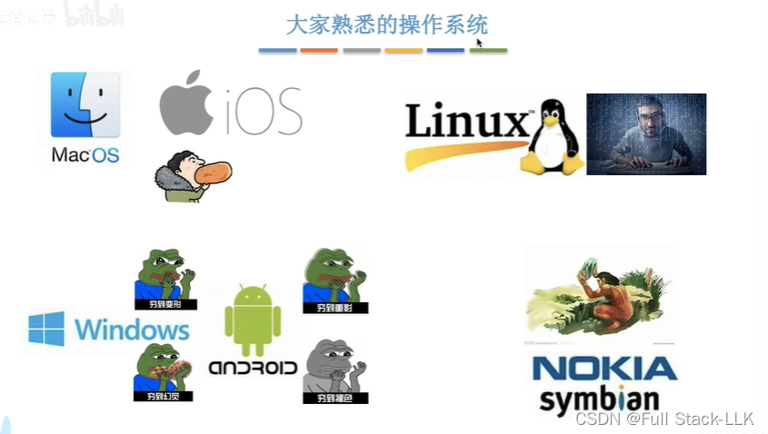
# 概述
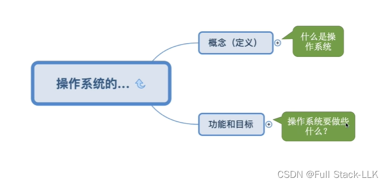
# 操作系统的概念（定义）
图中用户与应用程序部分重叠
应用程序与操作系统也部分重叠
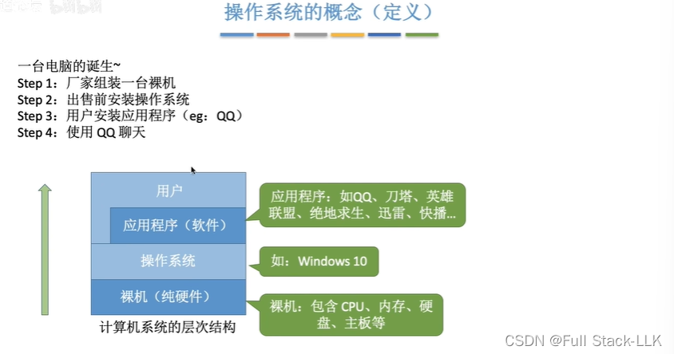
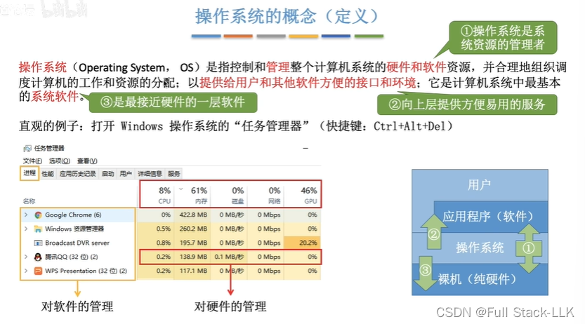
# 操作系统的功能和目标 - 作为系统资源的管理者
每一步都对应操作系统提供的一项功能
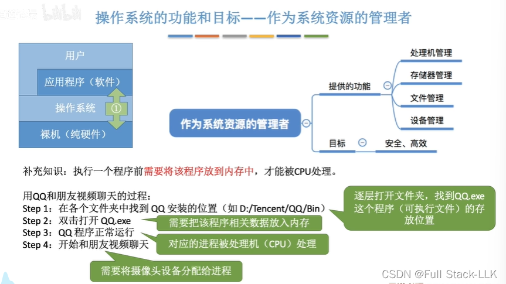
#  操作系统的功能和目标 - 向上层提供方便易用的服务
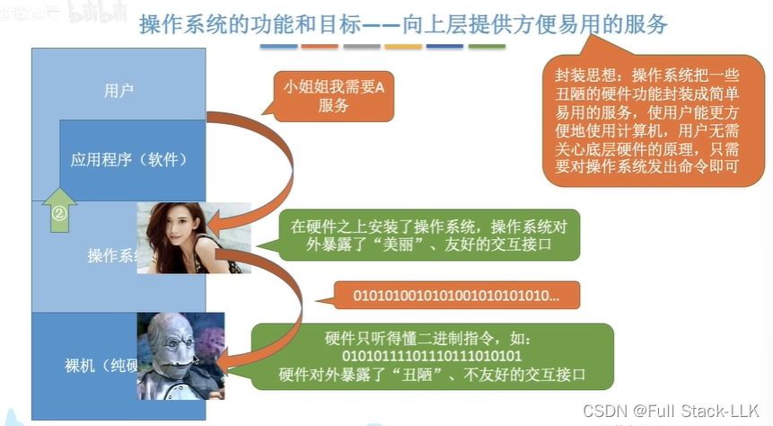
封装思想就像汽车上的按钮及其对应的内部工作部件
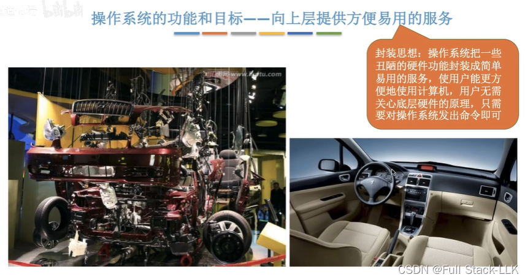
## 图形用户界面
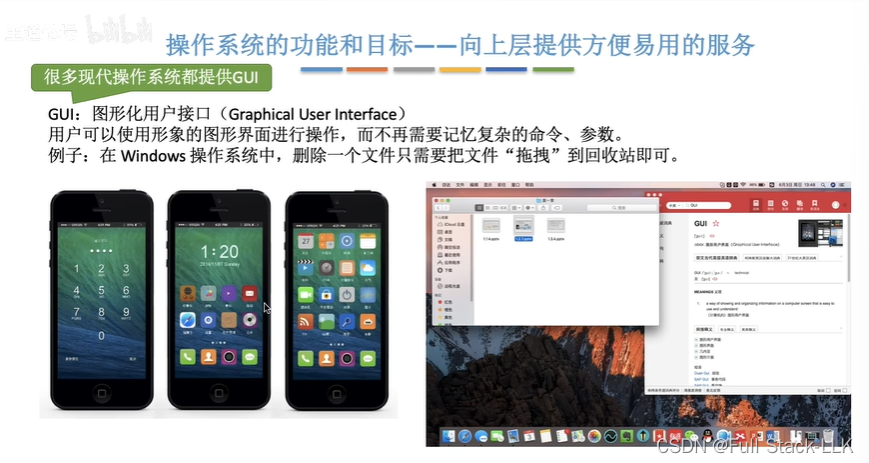
## 联机命令接口
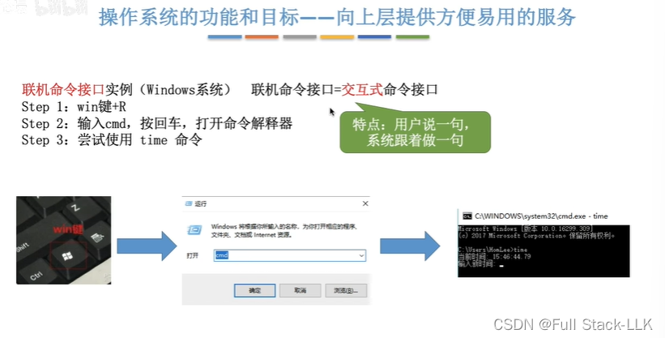
## 脱机命令接口
一个 *.bat 文件包含一系列命令
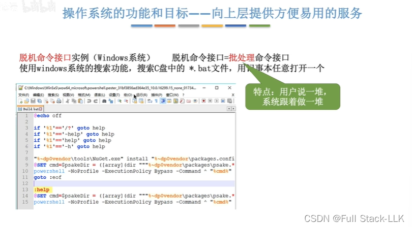
## 程序接口
即通过系统调用来实现功能，由操作系统执行这些系统调用
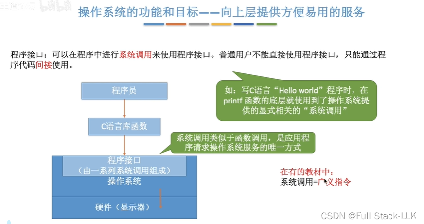
## 小结
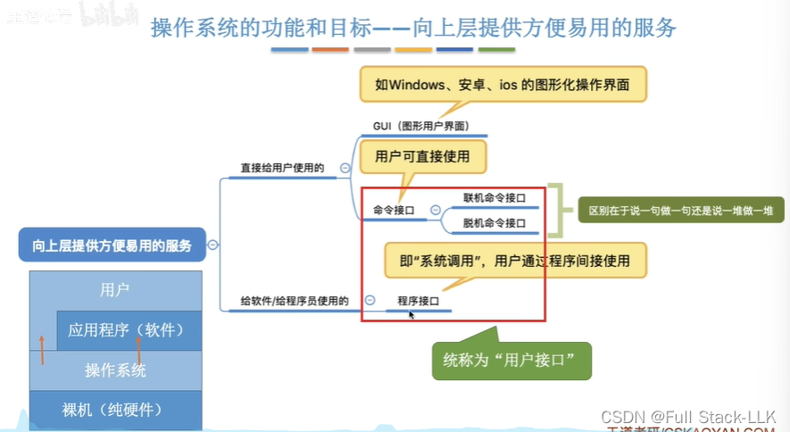
# 操作系统的功能和目标 - 作为最接近硬件的层次
它可以将不同的硬件组合起来
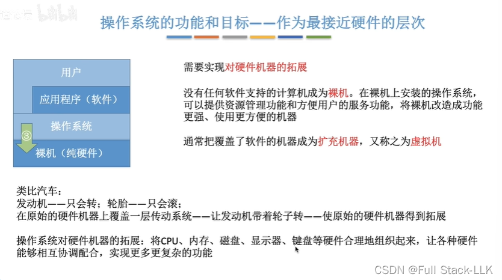
# 小结
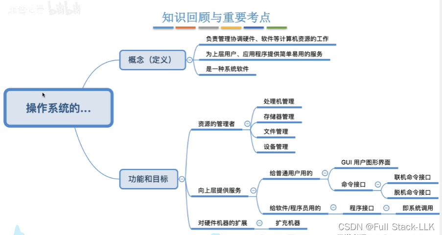

