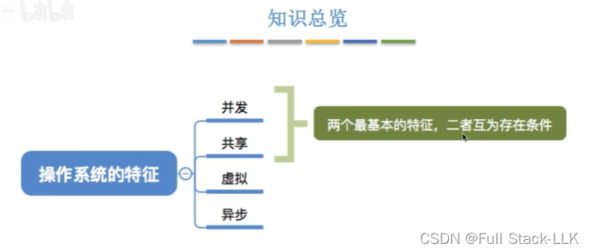
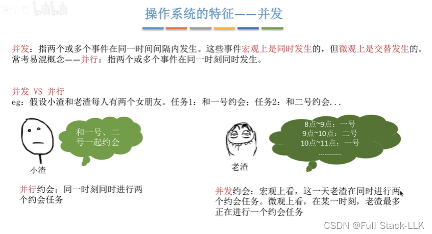
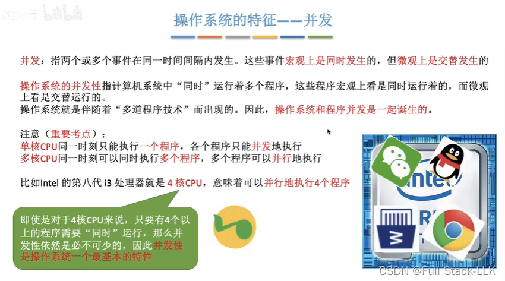
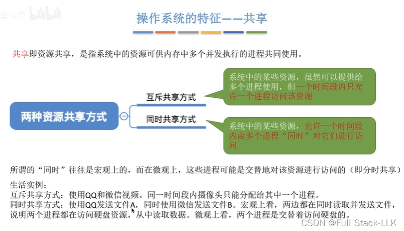
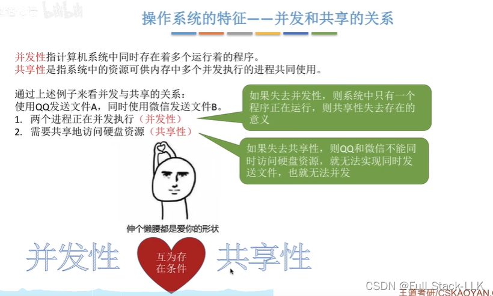
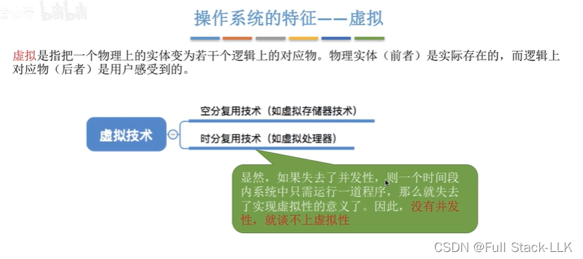
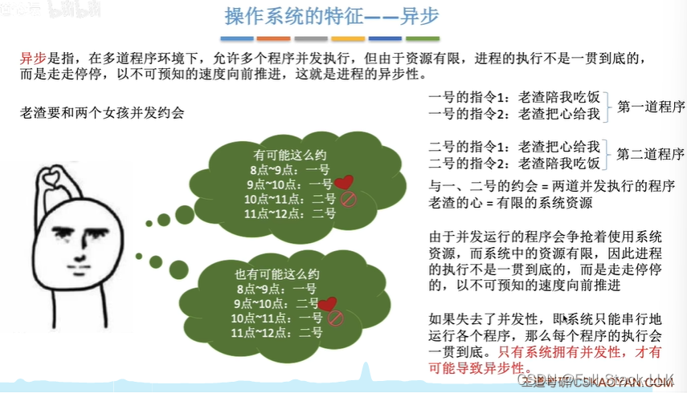
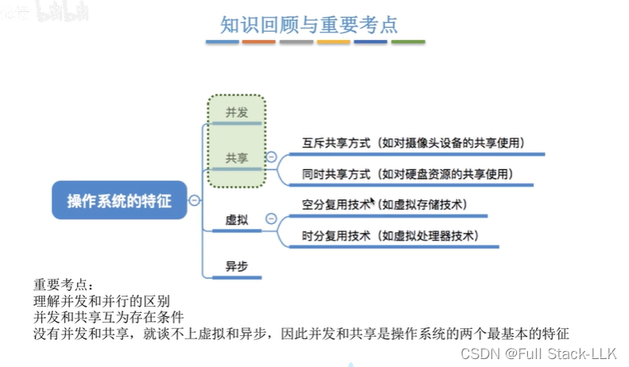


# 概述

# 操作系统的特征 - 并发
并行：同一时刻做多件事
并发：在任意一个时刻只发生一件事，但事件之间会切换，所以宏观上看多件事可能都完成了

当一个四核 CPU 执行五个程序时，并发依然存在：4 个程序并行运行，2 个程序并发运行

# 操作系统的特征 - 共享
同时：指的是宏观角度，但在某些情况下微观上也确实是同时的（例如扬声器同时被音乐和游戏使用）
注意共享可以提供给

# 并发与共享的关系
假设没有并发：那么每一时刻只会运行一个程序，因此也就不需要同时共享资源。而一旦没有同时共享资源，并发运行的多个程序就需要在每一时刻轮流访问资源；由于该时间段内只能有一个程序使用某资源，并发运行程序也就没有意义了

# 操作系统的特征 - 虚拟
你计算得到的内存要比实际的大得多

也就是微观与宏观之间的差异

如果失去并发，那么每个时间段只允许一个程序运行；此时的内存大小刚好就是该程序的大小（不需要空分复用），也不需要在微观上与其他程序交替执行（时分复用）
 
# 操作系统的特征 - 异步
由于并发特性，两个连续的微观时间段可能对应需要同一资源的不同进程（例如，某个寄存器的数据属于前一个进程，所以此时第二个进程不能直接使用该寄存器）——此时就会发生阻塞

# 小结
没有并发就不可能有虚拟和异步；而由于并发和共享是相互依存的条件，也可以把并发和共享看作一个整体：没有并发和共享就不可能有虚拟和异步


