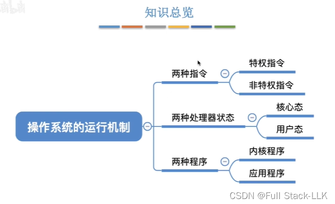
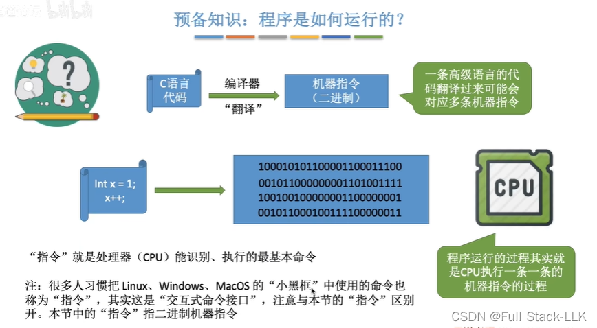
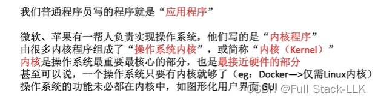
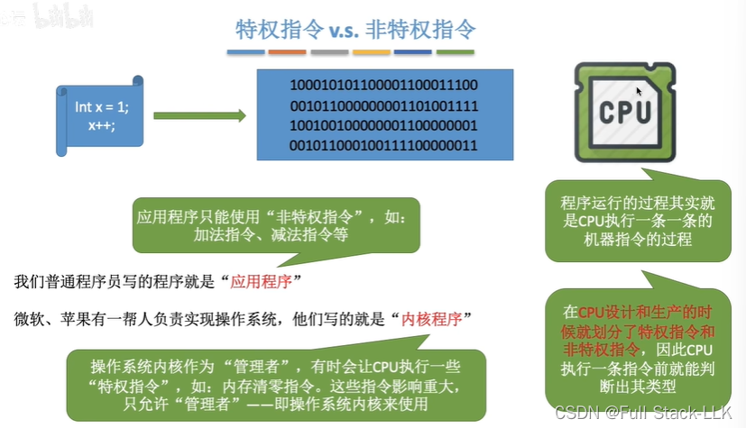
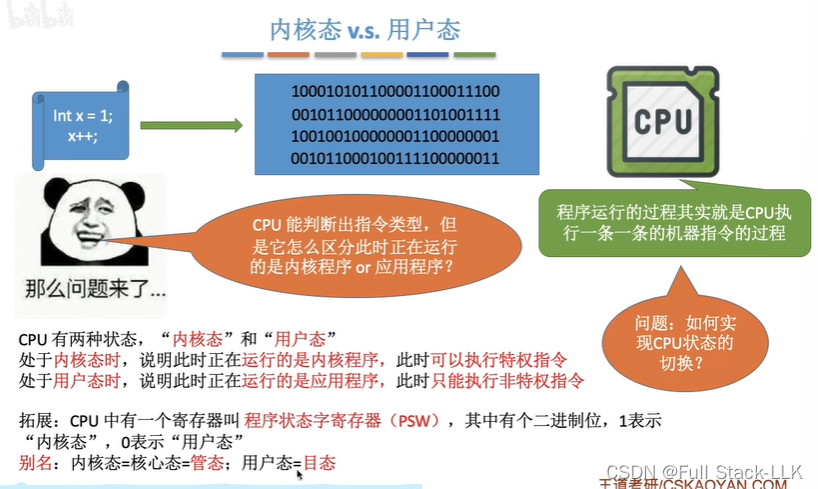
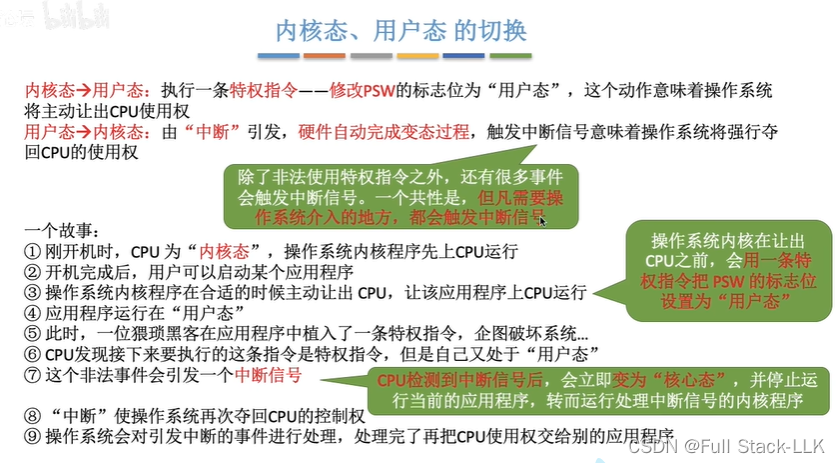
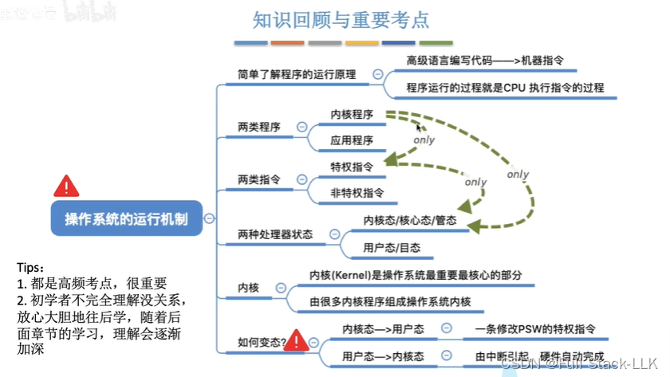


# 概述

# 前置知识：程序是如何运行的？
程序被转换为机器码放入内存，然后按顺序执行

# 内核程序与应用程序
应用程序运行在内核之上
操作系统包括内核和其他程序（如 GUI）

# 特权指令与非特权指令

# 内核态与用户态
先区分指令是特权指令还是应用指令，再判断当前所处的状态

# 用户态与内核态之间的切换
如果 CPU 判断指令类型为特权指令而当前处于用户态，就会发出中断信号，由硬件自动完成状态切换，切换到内核态并处理中断，处理完成后再切换回用户态，返回原程序或其他程序

# 总结
只有内核程序才能使用特权指令，并且只有处理器处于内核态时才能执行内核程序和特权指令


