
# 概述
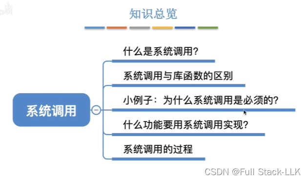
# 什么是系统调用
操作系统向上提供给用户的接口是 GUI，而程序接口则由系统调用组成

与函数类似，但有区别
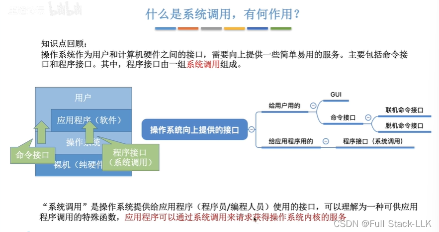
# 系统调用与库函数的区别
部分 C 库函数会使用系统调用

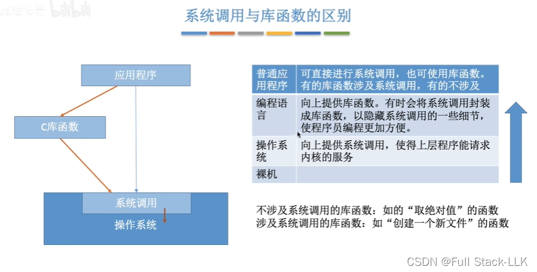

# 一个小例子：为什么需要系统调用
此时 WPS 和 Word 是两个进程

系统调用用来处理多个并发进程使用同一资源的情况。为了避免这种对同一资源的同时使用引发意外，由内核接管来完成
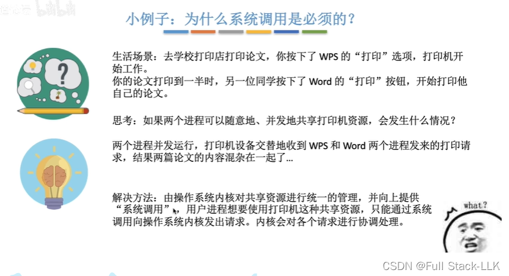
# 系统调用的分类
与共享资源有关

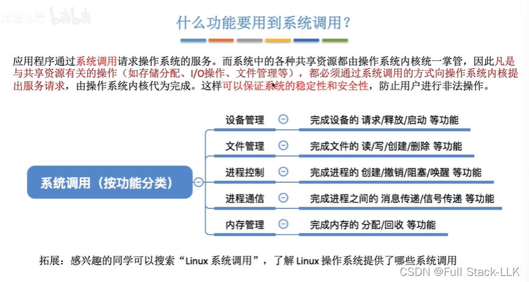
# 系统调用的过程
 将参数放入寄存器（CPU 中）后，执行陷入指令
 
 首先执行传递参数的指令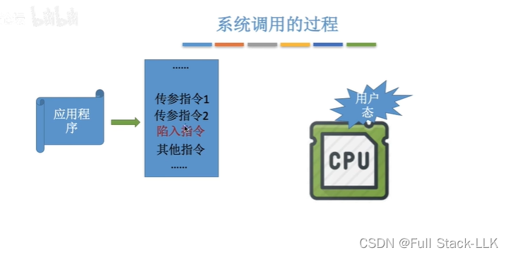
 之后执行陷入指令，系统切换到内核态执行系统调用入口程序
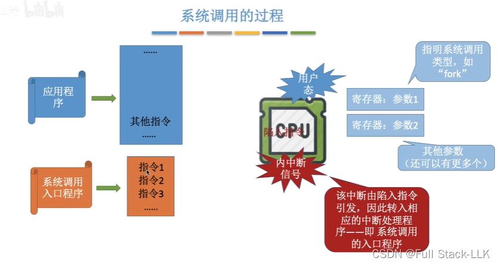
系统调用入口程序根据之前传入的参数确定需要哪一个系统调用服务
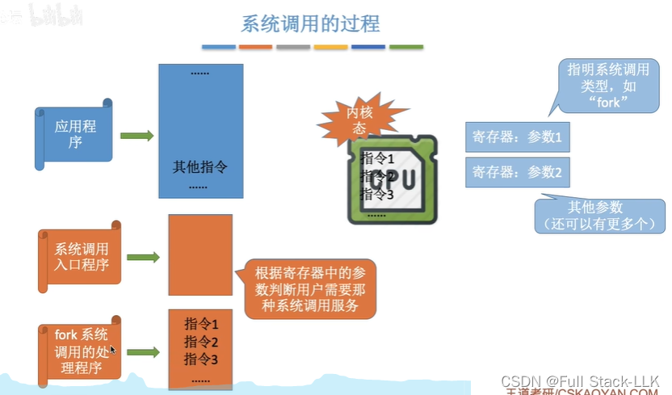
 然后运行相应的系统调用处理程序。该处理程序执行完毕后，系统切换回用户态，继续执行之前程序中陷入指令的下一条指令
 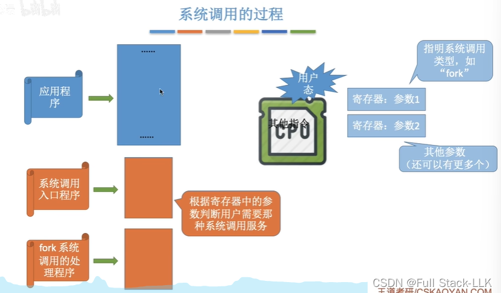
陷入指令不是特权指令
陷入指令 = trap 指令
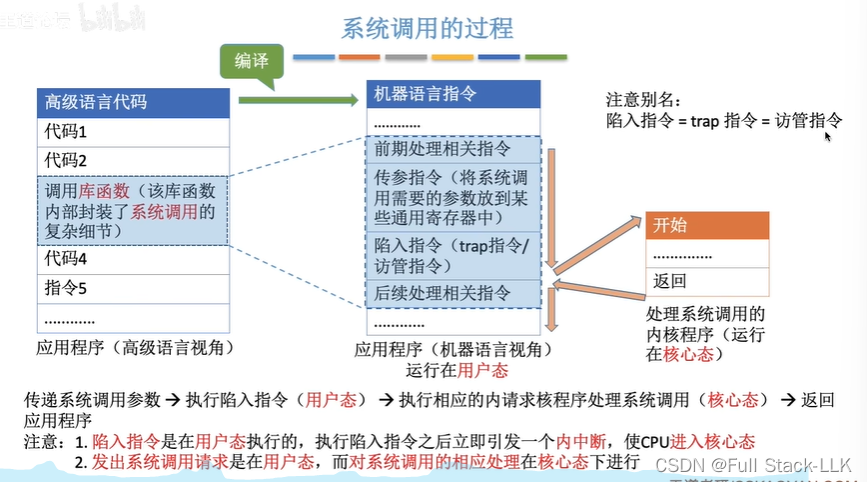

 
# 总结
 并发进程会竞争共享资源，因此为了保证各个进程的正确运行，需要操作系统介入。所以当发生涉及共享资源的操作时要使用系统调用，而系统调用程序运行在内核态，此时就由操作系统介入。
 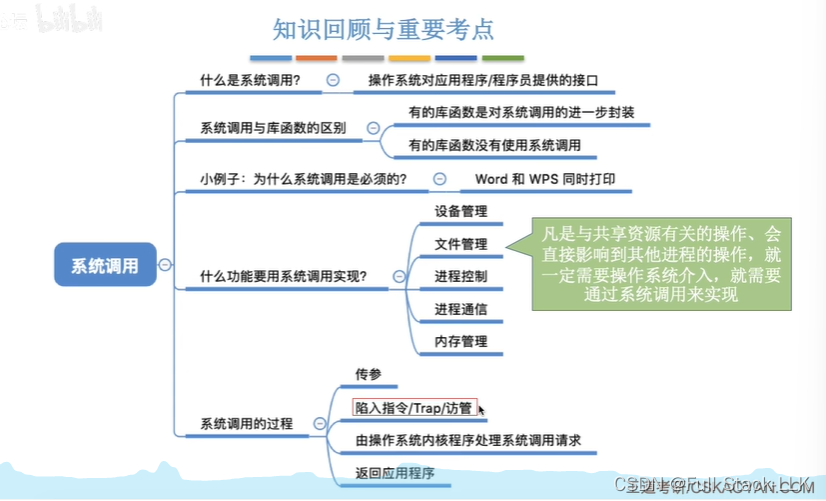

