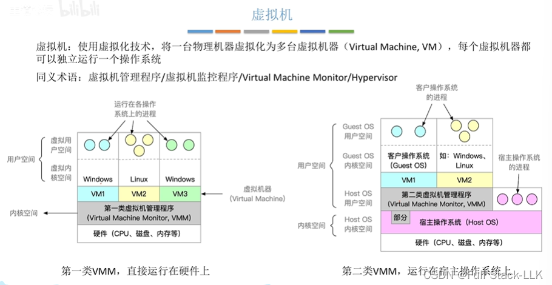
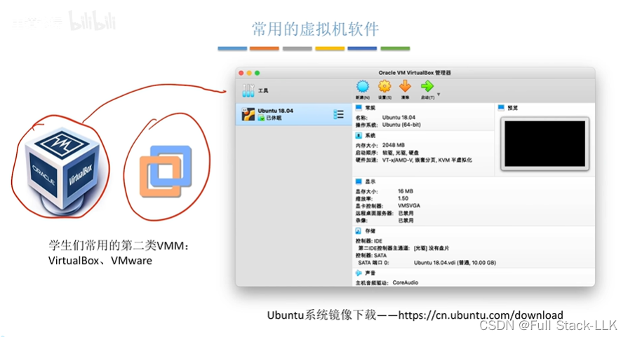
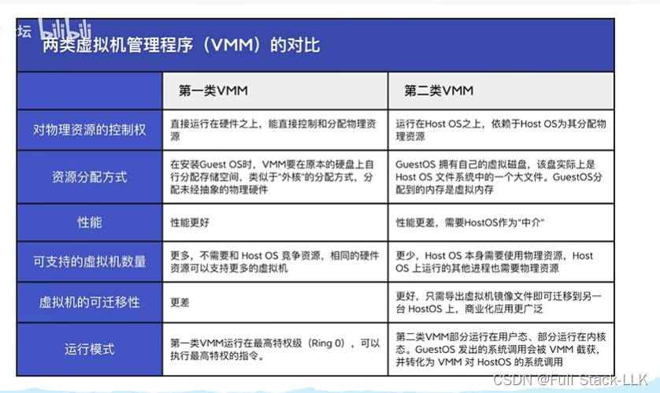
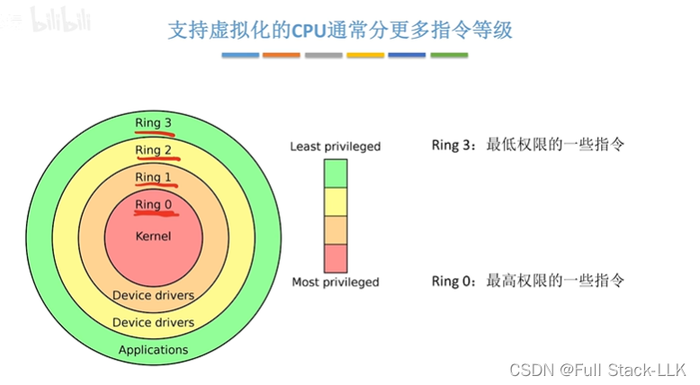


# 传统计算机
传统的物理机只有一个操作系统
在同一个操作系统上运行两个进程存在一些风险（相互干扰、争夺资源等）
解决办法：如果每个进程运行在不同的操作系统上（不同的物理机），这些风险就消失了。但这样会浪费物理机的硬件资源，因为一台物理机本来可能可以运行多个进程

# 虚拟机

 在第一类中，VMM 管理硬件资源并将其分配给各个虚拟机
 单核 CPU 可以按时间片划分，让不同的虚拟机使用不同的时间片；从每个虚拟机的角度看，就像拥有一个专属的 CPU（本质上是把 CPU 的一部分时间片分配给了该虚拟机）。磁盘和内存同样被划分成不同区域分配给不同的虚拟机
 VMM 运行在内核态，可以执行特权指令，而虚拟机的内核态和用户态都运行在 guest 模式下
 虚拟机的操作系统认为自己处于内核态；当它执行特权指令时，VMM 会捕获该指令并进行等效转换，这样虚拟机就会认为该指令执行成功了
 

在第二类中，VMM 作为主机操作系统之上的一个进程运行。VMM 必须向主机操作系统申请硬件资源，然后再重新分配。硬件资源真正的管理者仍然是主机操作系统

注意这两类虚拟机从主机的角度来看，都是作为主机的一个进程运行的

# VMM 的比较
资源分配：第一类直接获取物理地址，划分并分配给虚拟机后，再虚拟化成虚拟机的虚拟地址。第二类 VMM 向 Host OS 申请一大块虚拟空间，然后划分并分配给各个虚拟机（内存和存储都是虚拟地址）；虚拟机再把拿到的虚拟地址当作物理地址，所以还需要再虚拟化一次，变成虚拟机自己眼中的虚拟地址

支持的虚拟机数量：第一类没有 host OS，也没有 host OS 的进程；全部运行的都是虚拟机，所以虚拟机占用了大部分硬件资源，能支持更多的虚拟机。第二类中，host OS 及其进程同样需要硬件资源，所以能分给虚拟机的虚拟资源相对较少，自然支持的虚拟机数量也更少

可迁移性：第一类虚拟机持有的是物理地址，迁移到另一个 VMM 时对物理地址的要求相当繁琐。第二类虚拟机持有的是 host OS 分配的虚拟地址，这个条件就容易满足得多

执行方式：在第一类中，假设 VMM 处于 ring0，guest OS 处于 ring1，guest 用户空间处于 ring2；指令根据类型被分发到不同的地方。可以把特权指令看作被拆分到 ring1 和 ring0 中：非敏感指令放在 ring1（通过要求 guest OS 处理 ring1 的指令，使其跳转到 guest OS 执行），敏感指令放在 ring0，这样陷入 VMM 的指令就更少，陷入 VMM 的切换次数自然也减少了。在第二类中，VMM 一部分处于内核，一部分处于用户空间；系统调用会像俄罗斯套娃一样嵌套：guest 应用发出系统调用后先切换到 guest 内核态，guest OS 把系统调用传给 VMM，VMM 再向 host OS 发出请求

# 支持虚拟化的 CPU 通常拥有更多的指令级别（特权与敏感）
特权指令通常包含了敏感指令

在虚拟化技术中，特权指令和敏感指令都是与 CPU 执行权限和资源管理密切相关的概念。具体来说：

特权指令：只能在最高权限级别（通常是内核态或 ring 0）执行的指令。这些指令可以访问和操作计算机的关键资源，比如内存管理单元和 I/O 设备
敏感指令：在虚拟化环境中，这些是虚拟机监视器（VMM）必须捕获并模拟的指令，这样 guest OS 才能在不直接访问硬件的情况下运行
在大多数情况下，敏感指令确实是特权指令，因为它们通常涉及访问和管理关键的系统资源。例如，在 RISC 处理器（如 MIPS、PowerPC、SPARC）上，敏感指令是特权指令的一个子集。但是在 x86 架构上，尽管绝大多数敏感指令都是特权指令，但也存在一些“敏感但非特权”的指令，它们在执行时不会自动触发陷入，供 VMM 捕获

总的来说，特权指令和敏感指令在虚拟化技术中都扮演着重要的角色；它们保证了系统的安全性和稳定性


