
# 线程的实现方式与多线程模型
## 概述
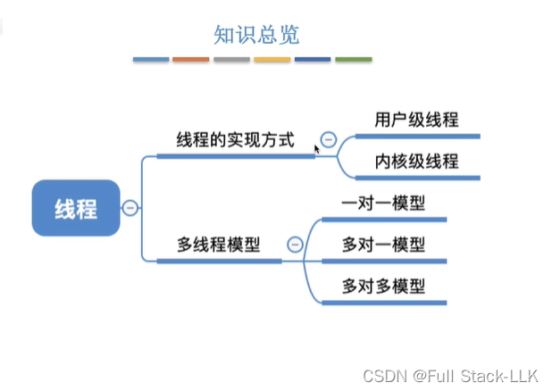
## 线程的实现方式
## 用户级线程
程序本身通过自己设计的线程库来实现线程的管理和调度

例如，QQ 有三个功能需要同时运行；如果用进程来实现，就是三个进程，每个功能一个

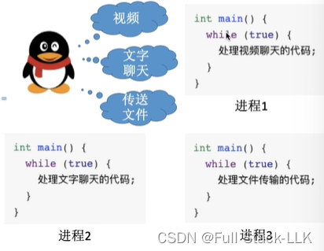
如果由单个进程来实现呢？那就相当于并发地执行这三个函数
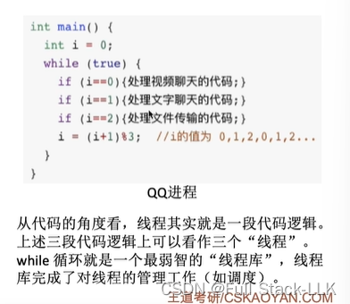

线程管理工作：由线程库完成（如上面的 while 循环），而不是由操作系统完成。
线程切换由程序自己的线程库完成，不需要切换 CPU 模式
操作系统并不知道用户级线程的存在，它只是在执行进程的代码，而这段代码中的线程库部分让各线程得以并发运行

优点：切换线程只需要在用户态完成
缺点：当某个线程在一段代码上阻塞时，整个进程的所有其他线程也会随之阻塞，并且多个线程都在单个 CPU 上运行（CPU 的调度单位仍然是进程）

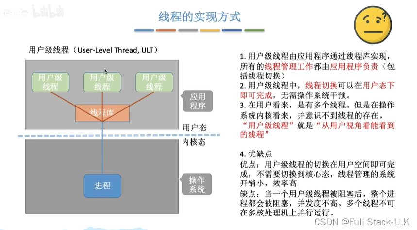

## 内核级线程
线程管理工作由操作系统完成
线程切换需要切换 CPU 模式（需要操作系统参与）

引入内核级线程之后，CPU 调度的基本单位变成了线程，多个线程也可以被分派到多个 CPU 上并行运行

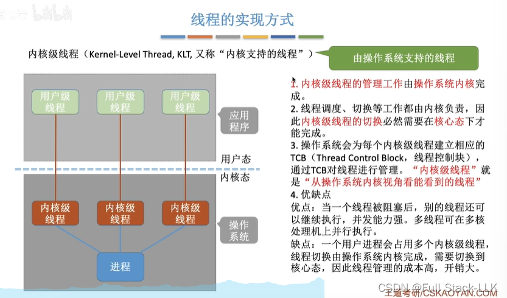
## 多线程模型
### 一对一
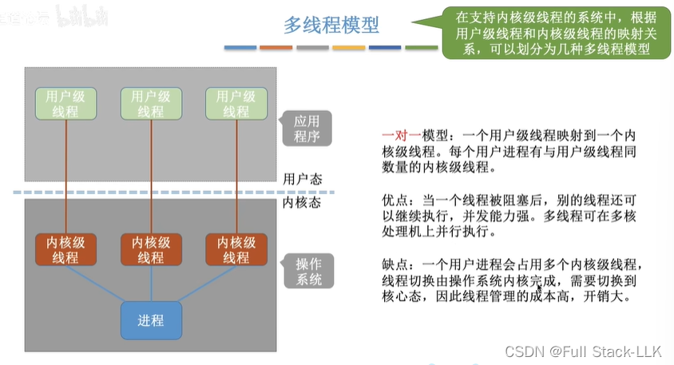

### 多对一
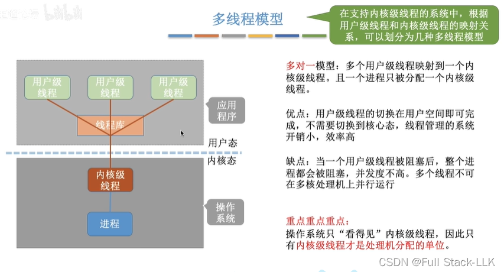
### 多对多
此时内核级线程与用户级线程之间有两种映射
一个内核级线程映射到多个用户级线程就是上面的多对一情形
一个内核级线程映射到一个用户级线程则是一对一情形

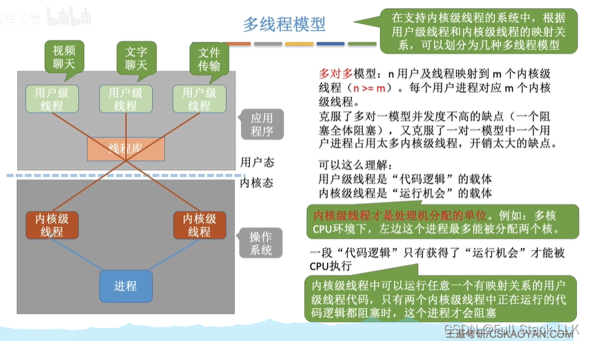
## 总结
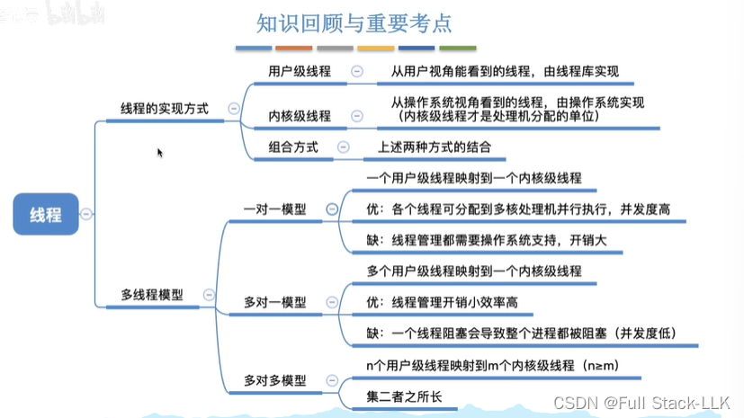
# 线程的状态、转换、组织与控制
## 概述
线程的状态与转换和进程的大致相同
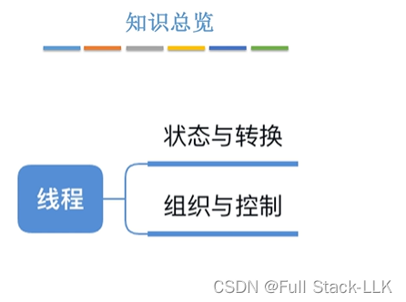
#
## 线程的状态与转换
时间片用完是并发执行中轮转的原因

我们通常关注这三种状态
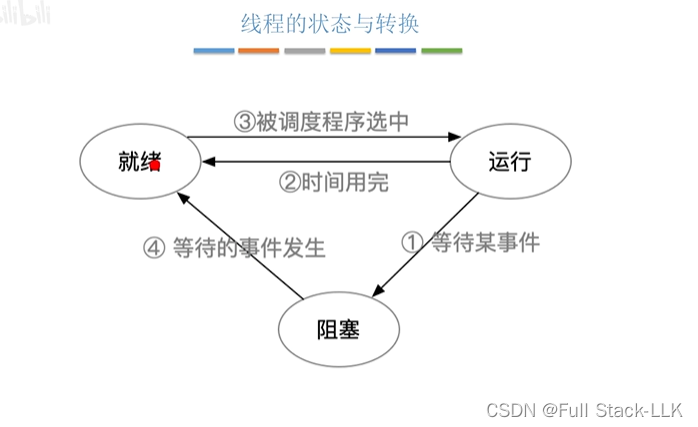
## 线程的组织与控制
保存栈指针就是保存线程的栈顶和栈底地址；切换线程之后，该线程的栈信息仍然保留在内存中

线程表可以用不同的方式组织：例如系统中所有线程放在一张表里，或者按进程分别组织各自的表，或者按线程状态组织表

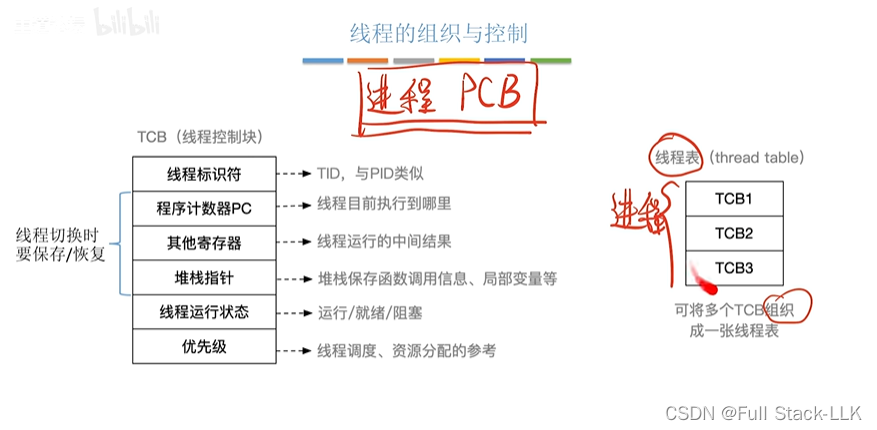
控制就是实现线程状态的转换和线程的调度

