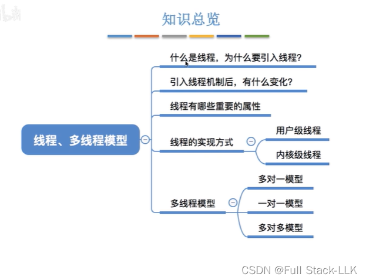
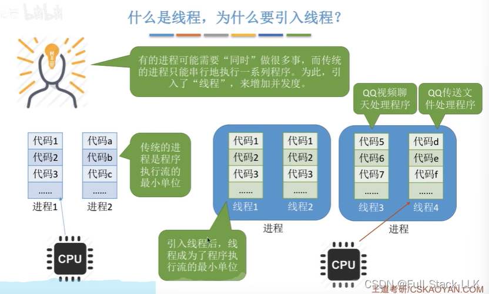
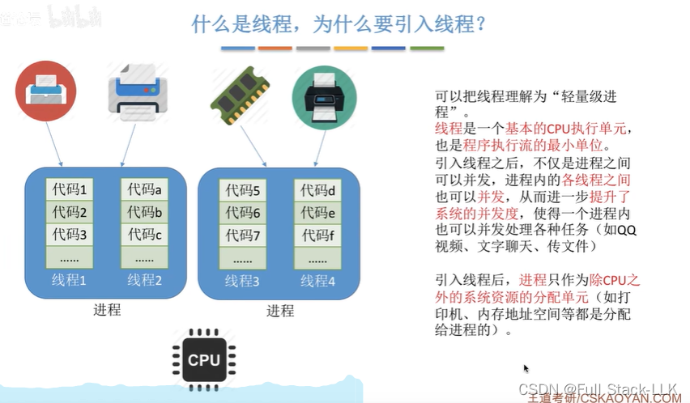
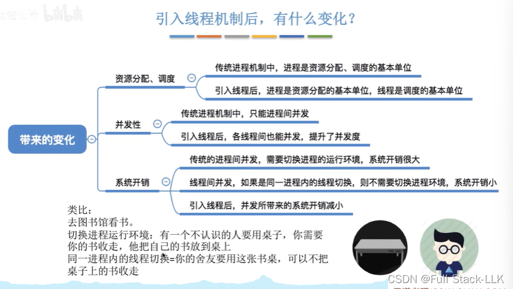
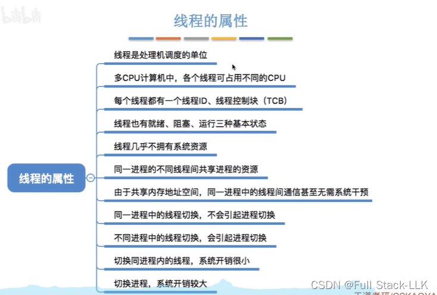


# 概述

# 什么是线程，为什么要引入线程
在 QQ 进程中，视频聊天、文字聊天和文件传输可以同时进行；如果进程内部是顺序执行的，那么任一时刻只能执行一个功能，显然这些任务就无法同时进行。

CPU 轮流为各个线程服务（即线程并发）

除 CPU 之外的所有资源都以进程为单位分配；只有 CPU 的使用权以线程为单位获得

# 引入线程机制带来的变化

注意线程并发不需要切换进程环境，因此开销减小

并发开销更小：在同一段时间内进程切换的次数变少，系统开销自然就小了（可以这样理解：只有不同进程的线程之间切换时才需要切换进程环境——不像以前每次切换必然切换进程环境；现在切换的单位是线程，并不是每次切换都会切换进程环境）

# 线程的属性

注意同一进程的线程共享进程的资源；同一进程内的线程切换，系统开销很小

**线程共享所属进程的资源，是因为它们是同一个进程的不同执行路径，自然继承了进程的资源。线程共享的进程资源如下：**

- 代码段：所有线程执行相同的程序代码；这部分是只读的，因此可以在多个线程之间安全共享。
- 数据段：全局变量和静态变量在所有线程之间共享，这意味着任何一个线程对这些变量的修改都会影响其他线程。
- 堆：动态分配的内存是共享的，任何线程都可以通过指针访问该内存区域中的数据。
- 文件描述符、套接字和端口：打开的文件、网络连接等资源可以被所有线程访问，这对于 I/O 操作尤其重要。
- 信号处理函数：在类 Unix 操作系统中，信号处理是在进程范围内设置的，因此所有线程共享相同的信号处理行为。
- 环境变量：环境变量由所有线程共享，通常包含系统配置信息。
此外，线程也有一些私有资源，例如线程 ID、寄存器组的值、线程的栈以及错误返回码。这些资源对于线程的独立执行和上下文切换至关重要。

总之，线程被设计为共享进程资源，是为了提高资源利用率和程序的并发性。通过共享内存空间、文件描述符等资源，线程之间可以高效地通信与协作，而不必借助进程之间所需的更复杂的 IPC（进程间通信）机制。这种资源共享机制是多线程编程能够提高效率的关键原因之一。

**线程切换不需要切换共享的进程资源，是因为线程共享所属进程的资源。**

线程是 CPU 调度的基本单位，而进程是资源分配的基本单位。同一进程中的线程共享进程的虚拟地址空间、打开的文件句柄、全局数据等资源。因此，操作系统切换线程时不需要重新分配或切换这些资源，只需要保存和恢复线程的执行上下文。具体来说：

1. 虚拟地址空间：由于线程共享进程的虚拟地址空间，切换线程时不需要切换地址空间。
2. 文件句柄和全局数据：线程使用的是进程的资源，而不是自己拥有这些资源。这意味着这些资源在线程切换过程中保持不变，线程可以直接访问它们。
3. 上下文切换：线程切换主要涉及保存当前线程的执行状态（如寄存器值、程序计数器等）并加载下一个线程的状态——这是一个相对轻量的操作。
4. 性能影响：线程切换可能会影响 TLB（Translation Lookaside Buffer，快表）缓存的性能，但这种影响通常比进程切换小得多，因为进程切换涉及更多资源的重新分配。

总之，线程之间的资源共享机制使得线程切换比进程切换更高效，因为它避免了资源的重复分配和释放。这种设计提高了多线程程序的运行效率，尤其是在频繁创建和销毁线程的场景下。


