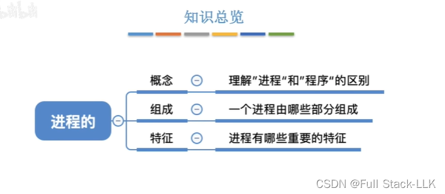
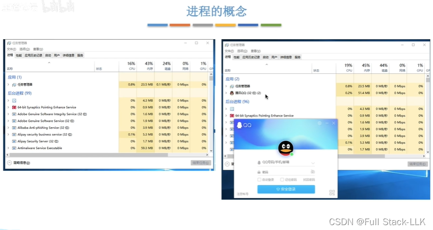
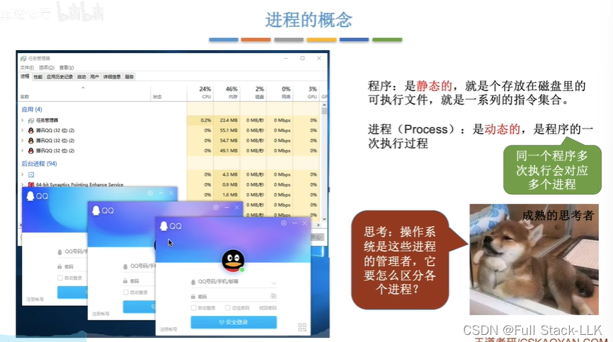
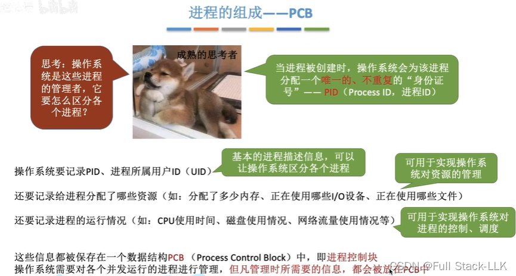
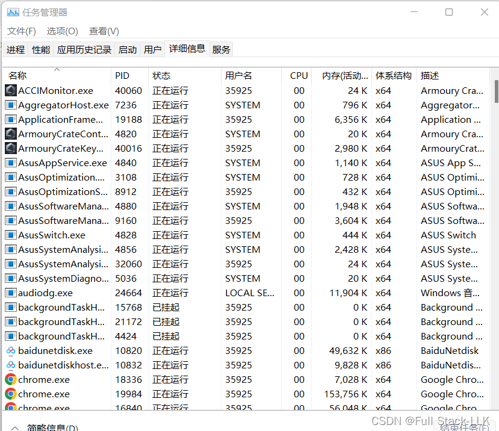
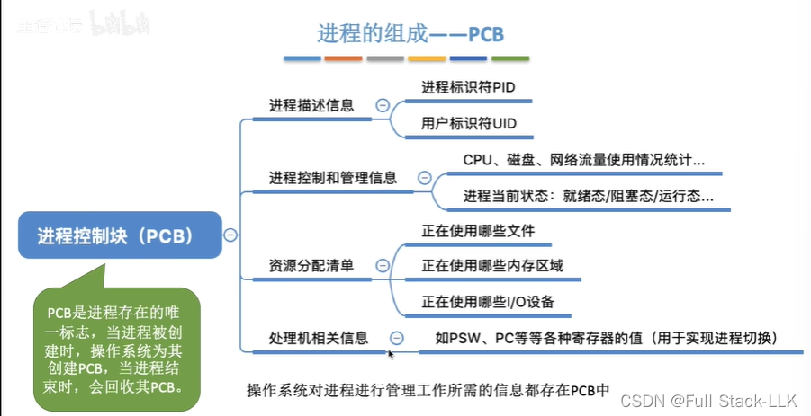
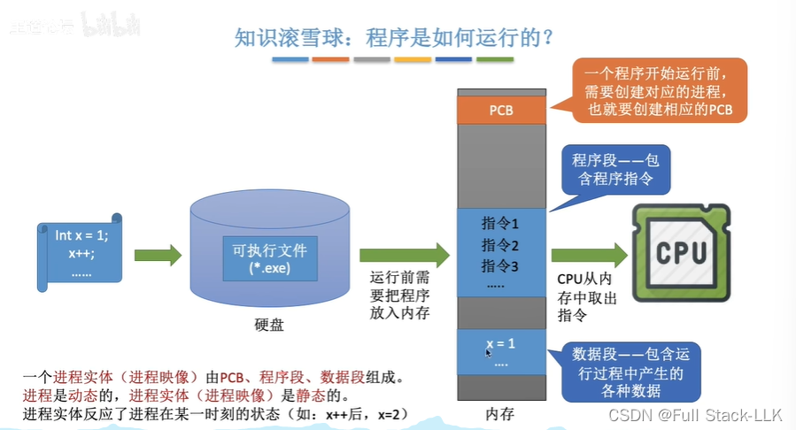
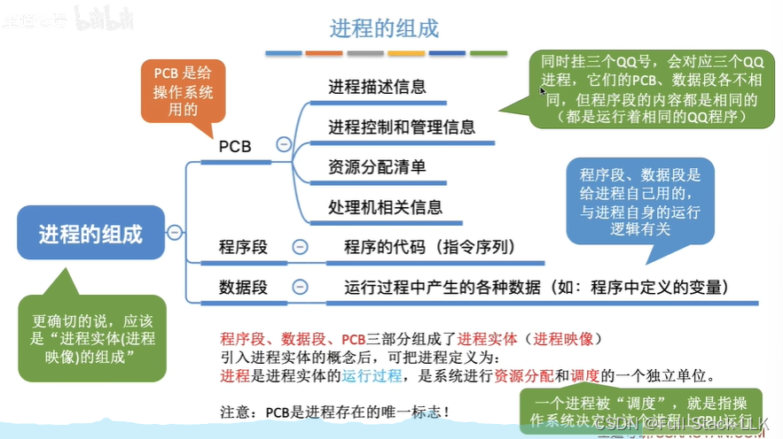
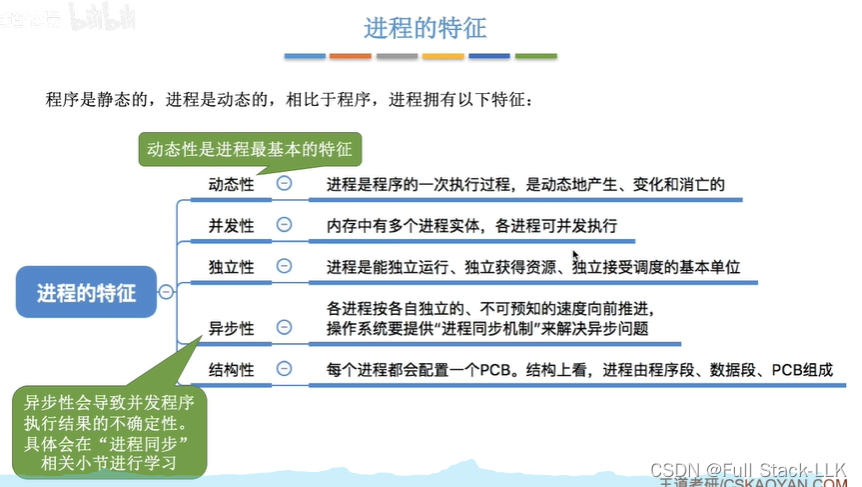
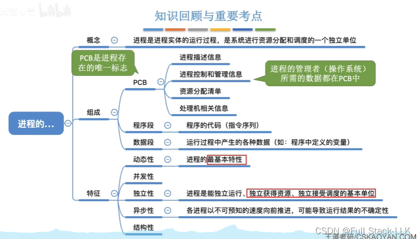


# 概览

# 进程的概念
任务管理器：显示正在运行的进程

打开 QQ 前后对比

打开三个 QQ 就得到三个进程

# 进程的组成 - PCB
PCB 中包含进程的大量信息

每个进程的 PID 都不同，

# PCB 中存放了什么

# 程序是如何运行的
进程实体可以理解为进程运行时属于它的那部分内存
进程是程序的一次执行，进程实体是进程在执行的某一时刻驻留在内存中的部分

# 进程的组成 - 程序段、数据段

 操作系统以进程为单位分配资源
 注意进程存在的唯一标志
 

# 进程的特征
动态性，因为它一直在执行、一直在变化
独立性：进程不依赖其他进程运行或获取资源

# 总结
注意进程存在的唯一标志和进程最基本的特征
引入线程后，调度的最小单位变成了线程，但进程仍是独立获得资源的最小单位


