
# 概述
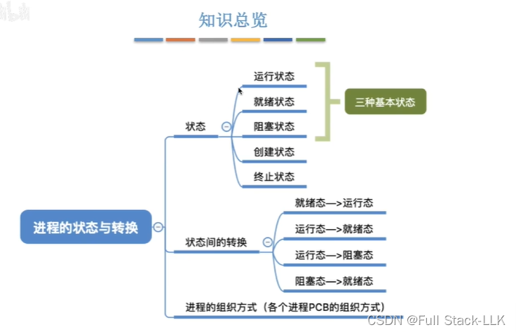
## 进程状态 - 创建态、就绪态
进程正在被创建时：创建态
创建完成后：就绪态
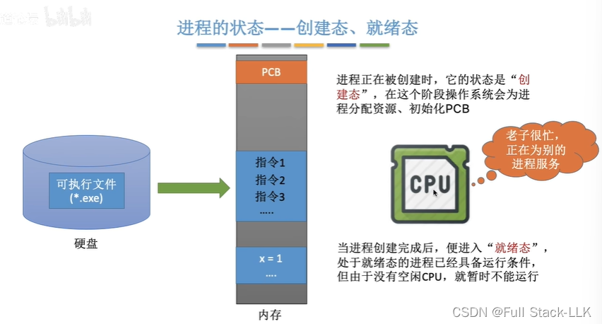
## 进程状态 - 运行态
在运行内存中某个程序的一段指令序列时，执行到系统调用，发现 I/O 设备忙，其资源暂时不可用
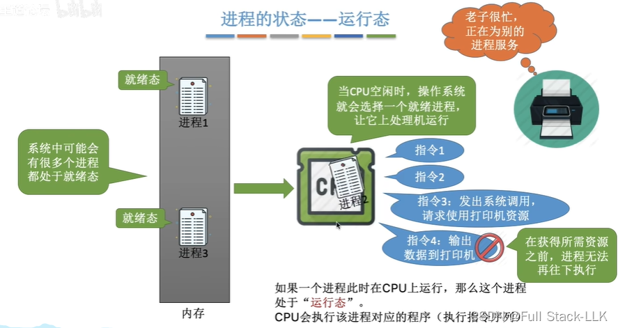
## 进程状态 - 阻塞态
此时，由于进程 2 必须等待操作系统把打印机资源分配给它这一事件，CPU 就把进程 2 从 CPU 上换下，让进程 1 在 CPU 上运行。当打印机完成上一个任务变为空闲时，操作系统把打印机资源分配给进程 2；进程 2 所等待的事件已经发生，OS 便把进程 2 从阻塞态转为就绪态。
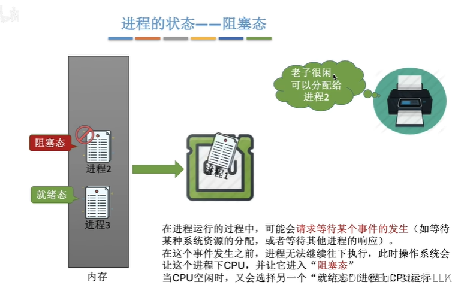

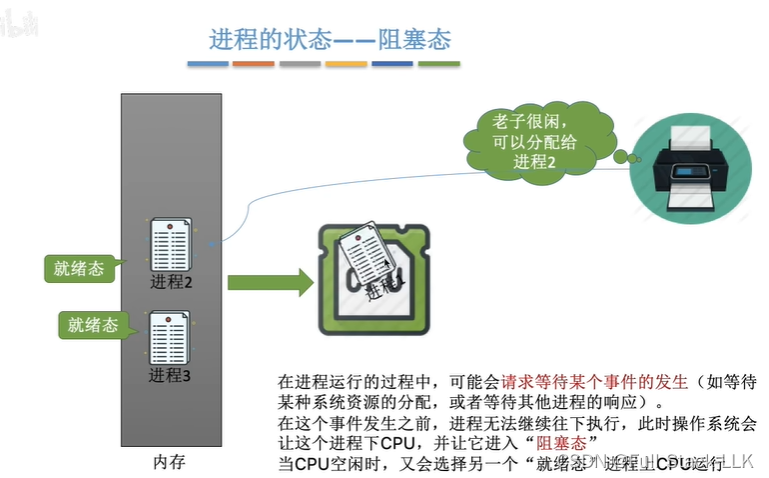
## 进程状态 - 终止态
此时正在运行的进程 1 已经运行结束，结束时发出 exit 系统调用，进入终止态。
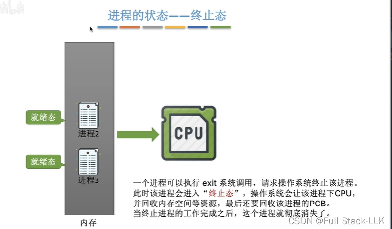
## 进程状态的转换
就绪态只缺处理机
阻塞态：“其他”是指在等待某个事件，而该事件的发生条件同样尚未满足
主动行为：进程主动请求等待某个事件，或主动发起系统调用；条件不满足时主动进入阻塞态
被动行为：只能等待某个事件发生，不受进程自身控制，因此是被动的

运行态可以回到就绪态：时间片用完，发生进程切换（并发）

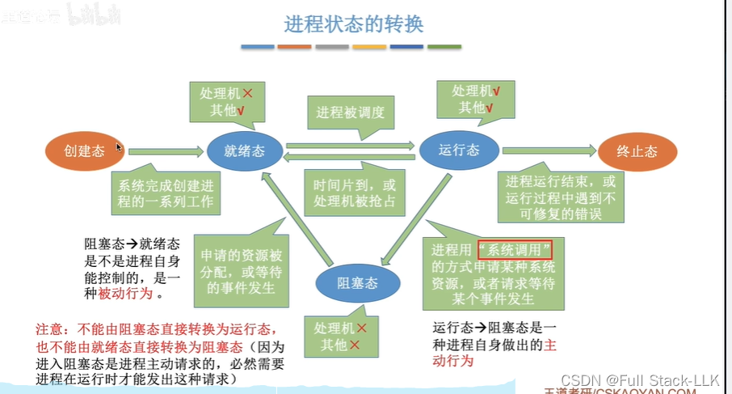

# 进程状态 - 总结
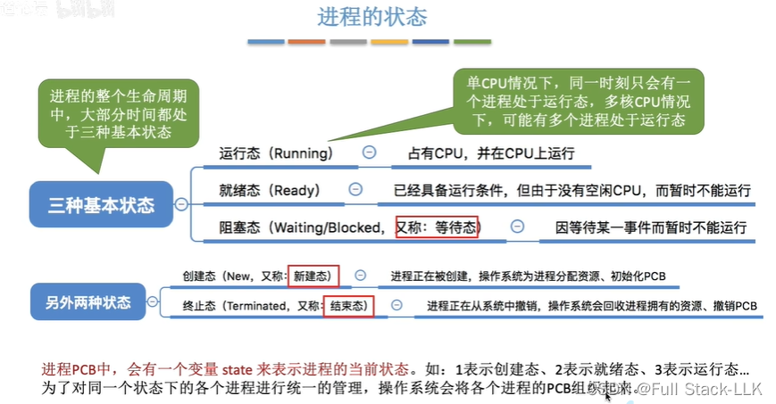
## 进程的组织 - 链接方式

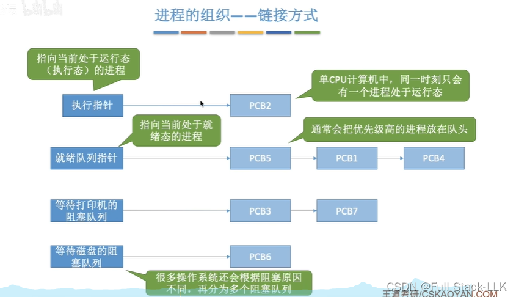PCB 会根据阻塞原因被放入不同的阻塞队列

## 进程的组织 - 索引方式
通过索引找到对应的 PCB
 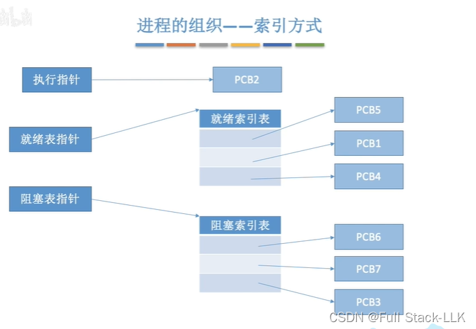
# 进程的组织 - 总结
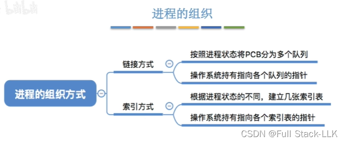
# 总结
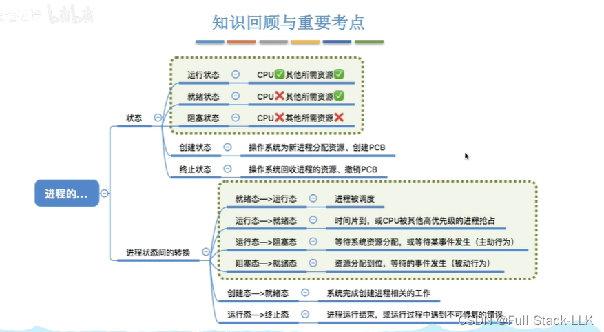

