
# 什么是进程间通信
分享一篇八卦文章就涉及进程间通信

进程间通信需要操作系统的支持

# 为什么进程间通信需要操作系统支持？
进程不能访问不属于自己的内存空间

当进程 P 和 Q 需要交换数据时，P 不能直接把数据写入 Q 的地址空间，因此需要操作系统的支持来完成

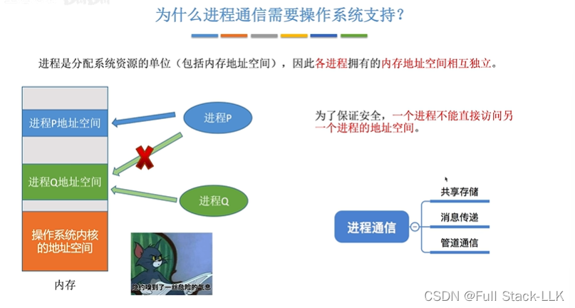
# 共享内存
申请一块内存区域作为共享内存区，并把这块共享区映射到每个参与进程的地址空间中

对共享内存区的访问必须是互斥的

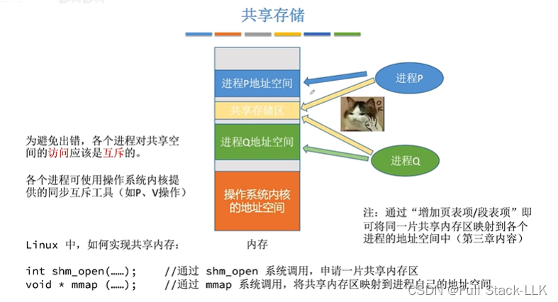
操作系统只负责提供共享内存区和映射；各进程在这块区域中存放的数据格式以及存放位置，由进程自己控制。

基于数据结构的共享：相当于定义一个数据结构变量，作为其他进程的共享区。这种情况下通信的自由度较低：访问必须遵守该变量的规则（例如定义了一个整型数组变量，那么每次写入和读取都必须是整型，并且要遵守数组的约束，比如元素个数限制）。

左图是基于数据结构的共享
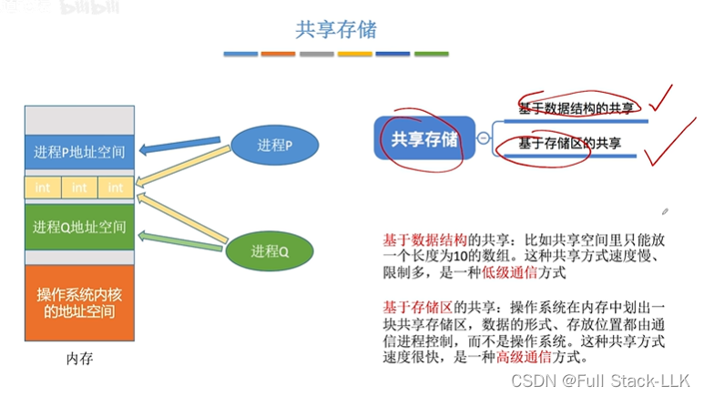
# 消息传递
格式化的消息由消息头和消息体组成

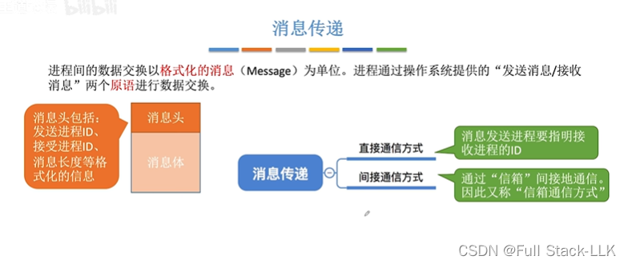

## 直接通信
内核区保存着每个进程的 PCB，每个进程的 PCB 中包含该进程的消息队列——即其他进程发送给该进程、该进程应当接收的消息。

P 向 Q 发送消息：在 P 的进程空间中先组装好要发送的消息，然后使用 send 原语，该原语指明消息的接收方
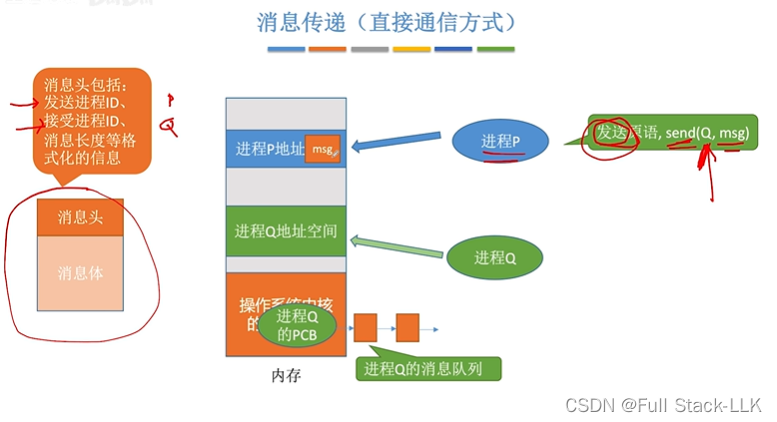
这个 send 原语会让 OS 内核接收要发送的消息，并把它挂到进程 Q 的消息队列上（更准确地说，是拷贝过去）
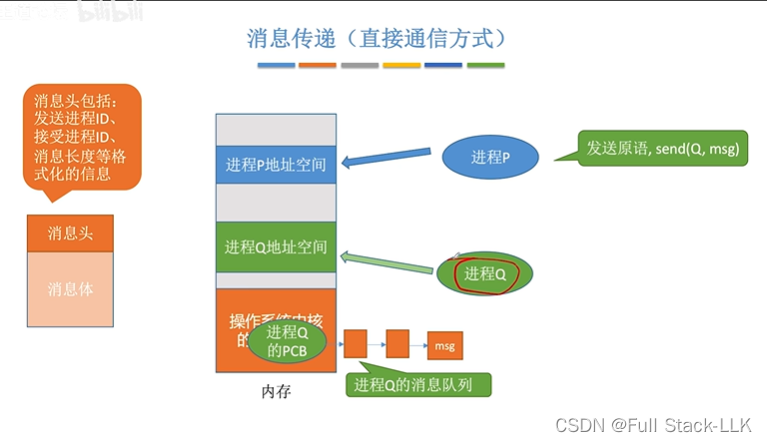
进程 Q 使用 receive 原语，该原语指明要接收谁的消息；随后 OS 内核把 Q 的消息队列中来自 P 的消息拷贝到进程 Q 的地址空间中

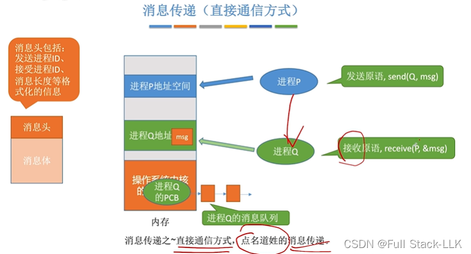
## 间接通信
进程 P 通过系统调用在内核空间中申请一个信箱 A（也可以是多个信箱）
进程 P 在自己的进程空间中组装好消息（类似于代码执行过程中处理数据）
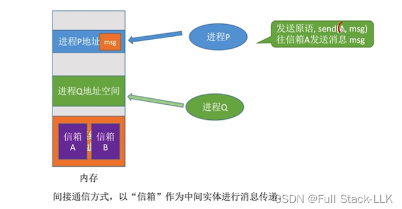

然后使用 send 原语，该原语指明目标信箱 A，操作系统把消息拷贝到信箱 A 中
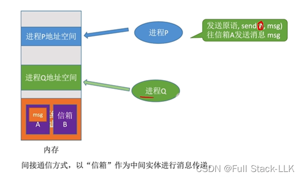
进程 Q 使用 receive 原语，该原语指明从哪个信箱接收消息，操作系统把消息从信箱 A 拷贝到进程 Q 的地址空间中
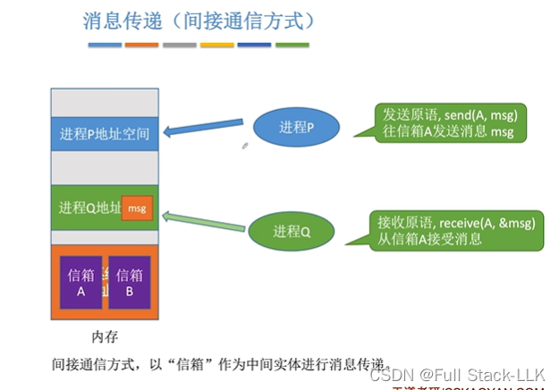
注意

# 管道通信
管道在任一时刻都是单向的（半双工）
一个进程向管道中写入，另一个进程从管道中读出内容（循环队列）

通过系统调用申请一个管道文件，其本质是一块内存缓冲区

如果管道前面还有空位，就必须先写前面的空位；只有前面写满了，才能继续往后写。读取同理（先进先出——本质是循环队列：先写入的先进入、先出来；如果前面有空位再写入，则先写前面）

半双工：在任一时间段内，管道中的数据只能沿一个方向从一端流向另一端。不同时刻方向可以不同，但管道在同一时刻只有一个流向

多个进程读取同一个管道会造成混乱——无法保证哪些数据被谁读走了

进程对管道的访问是互斥的：任一时刻只有一个进程在向管道写入或从管道读取

5. 在第二种方案中，由操作系统控制对管道的读取
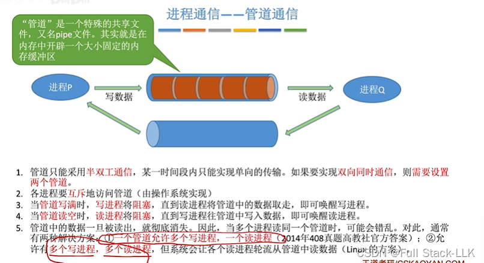
# 总结
注意：使用共享内存时，进程之间的互斥需要由进程自己实现

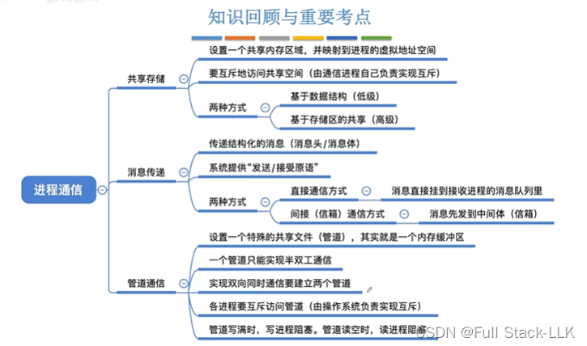
# 注意
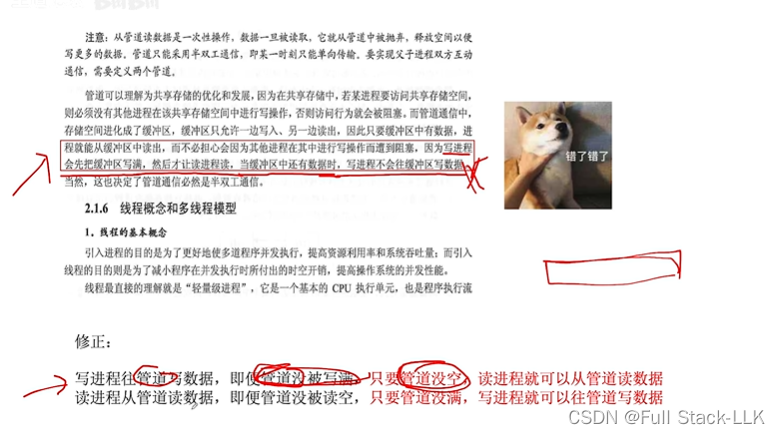

