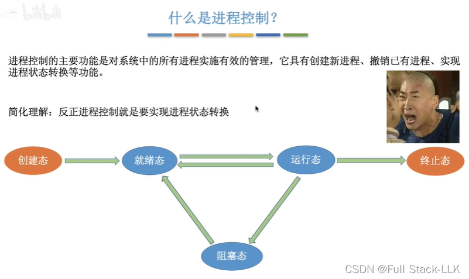
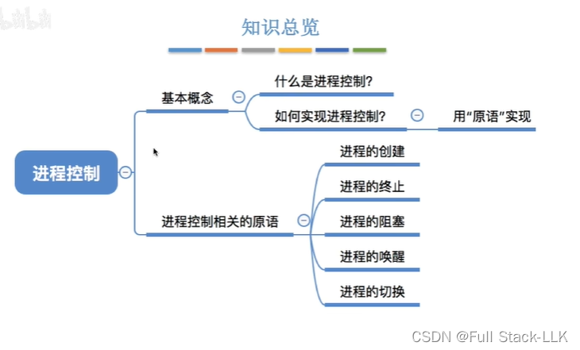
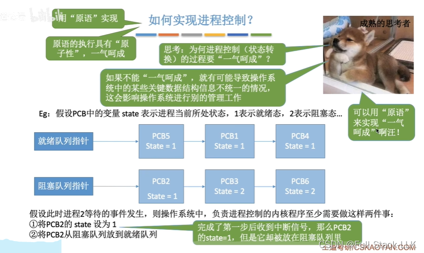
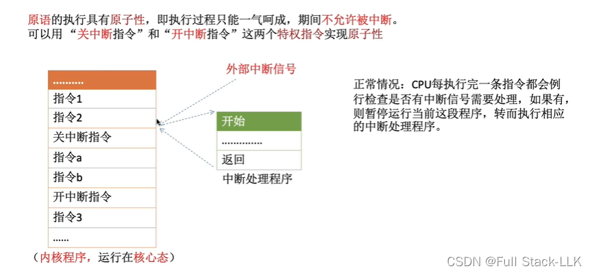
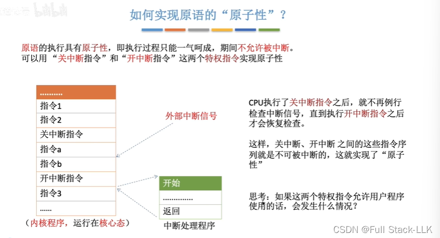
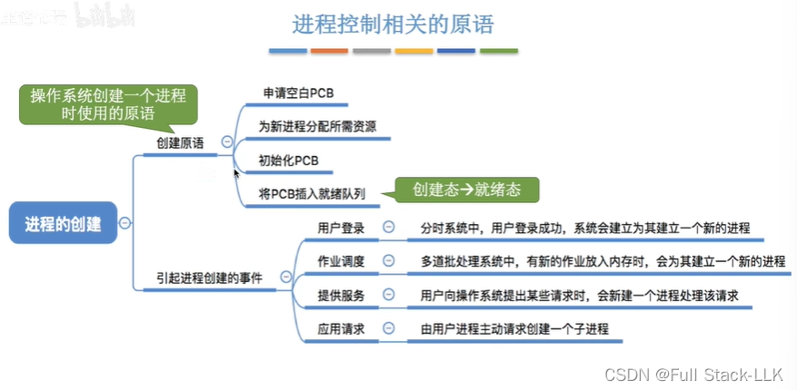
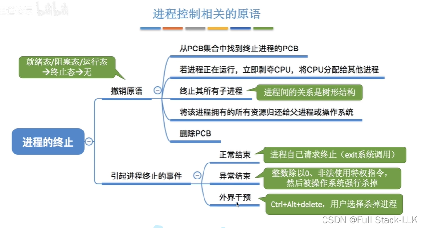
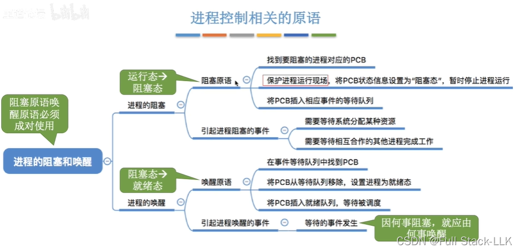
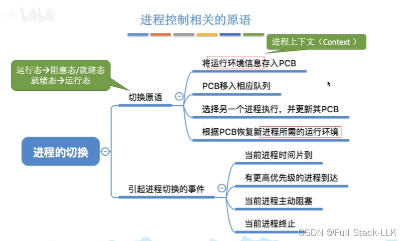
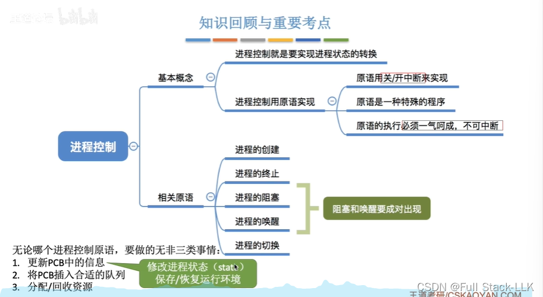


# 什么是进程控制
控制进程的状态转换

# 概述

# 如何实现进程控制？
用原语实现

假设不使用原语：如果 PCB2 等待的事件发生了，负责进程控制的内核程序把 state 设为 1 之后——因为这不是原语——可能有中断信号到来并将其打断。此时 PCB2 的 state=1，却仍在阻塞队列中，状态值就自相矛盾了。使用原语可以防止这种情况发生。

# 原语的“原子性”是如何实现的？
正常情况

只有在关中断指令之后才会检查中断；如果之前有中断信号到来，此时才处理该中断
 
如果关中断/开中断不是特权指令，进程就可以关闭中断，一直霸占 CPU。
# 进程控制相关原语
分配资源：内存空间
## 创建原语
用户登录：创建一个用户管理进程
作业调度：外存上的程序被调入内存（即将被执行的那个）

## 撤销原语
在终止进程时使用；它把进程转为终止态，进程最终消失

## 子进程与父进程
父进程是创建子进程的原始进程，而子进程是父进程通过 fork 系统调用创建的新进程。具体如下：

1. 父子关系：

- 在 Linux 系统中，除了初始进程（0 号进程）外，每个进程都是由另一个进程通过 fork() 函数创建的。
- 调用 fork() 的进程称为父进程，新创建的进程称为子进程。
- 一个进程只能有一个父进程，但可以有多个子进程。

2. fork 系统调用：

- fork() 调用一次，但在父进程和子进程中各返回一次。
- 在子进程中，fork() 返回 0；在父进程中，返回新创建子进程的 PID。
3. 父子进程的执行顺序：

- fork 之后，父进程和子进程的执行顺序是不确定的。操作系统内核调度这两个进程，它们可能交替运行。
4. 子进程的特点：

- 子进程是父进程的副本，它继承了父进程的大部分属性，包括文件描述符、环境变量等。
- 子进程可以通过 exec 系列函数替换自身映像，从而执行新的程序。
5. 父子进程通信：

- 父子进程可以通过管道、信号、共享内存等多种机制进行通信。
- 父进程通常用于创建子进程并等待其结束，或与子进程交换数据。
- 理解父子进程的概念和关系，对于理解 Unix/Linux 进程模型至关重要，也是多进程编程的基础。
## 阻塞原语与唤醒原语
阻塞原语：将进程从运行态转为阻塞态
唤醒原语：将进程从阻塞态转为就绪态

有阻塞通常就有唤醒，所以二者成对出现

## 切换原语
将一个进程从运行态转为就绪态，另一个进程从就绪态转为运行态
运行环境信息（进程上下文）：相关的寄存器信息

# 总结
创建和撤销这两个进程控制原语涉及资源的分配/回收

更新 PCB 一般是指修改进程状态或保存/恢复运行环境


