
# 调度器与空闲进程
## 调度器／调度程序
### 进程调度
是否要把当前进程从处理器上换下来，以及让哪个进程上处理器运行

新进程创建后会进入就绪队列；新进入就绪状态的程序可能会改变就绪队列，因此调度器可能会检查当前进程是否应该让出处理器，以及这个新进入就绪状态的进程是否应该上处理器运行（进程调度）

当一个进程退出时，处理器就会空闲下来，这时也需要调度器

I/O 中断（某个进程等待的事件发生了）会改变就绪队列，调度器会检查这个新进入就绪状态的进程是否需要进入运行状态

调度器被触发时，会检查就绪队列中是否有新加入的进程，以及这些新进入就绪状态的进程是否需要进入运行状态（上处理器）
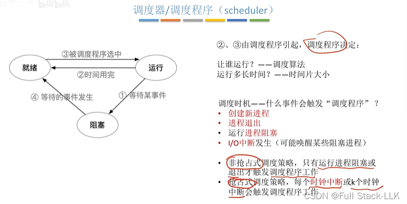
### 线程调度

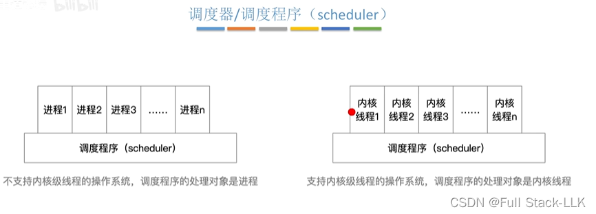
## 空闲进程
当没有就绪进程时，处理器运行空闲进程

检查是否有中断：如果有中断，就唤醒调度器
零地址指令：不需要访问内存，执行简单，消耗低
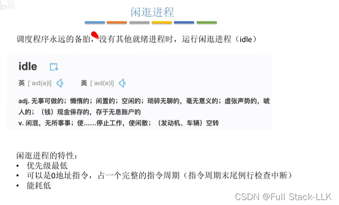
# 调度算法的评价指标
## 概述
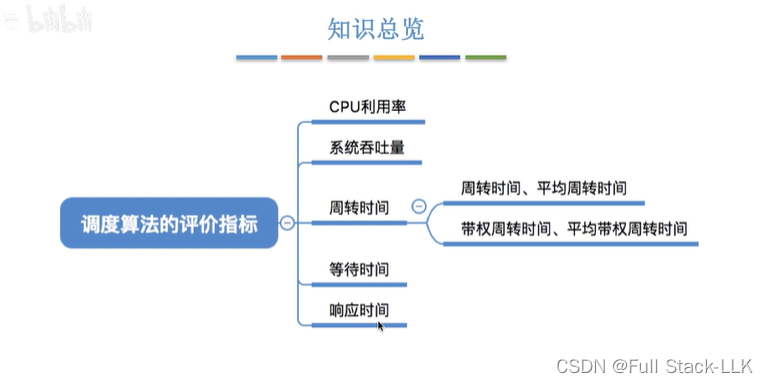
## CPU 利用率
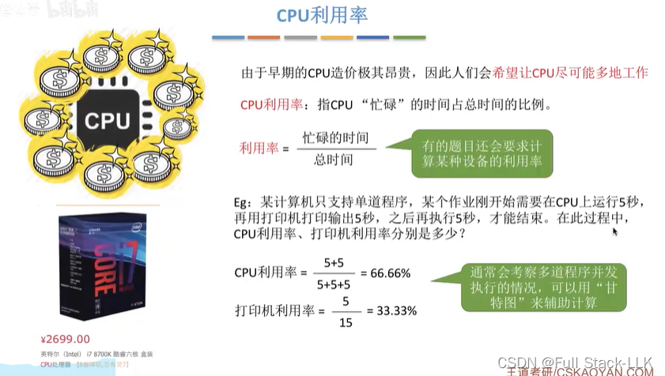
## 系统吞吐量
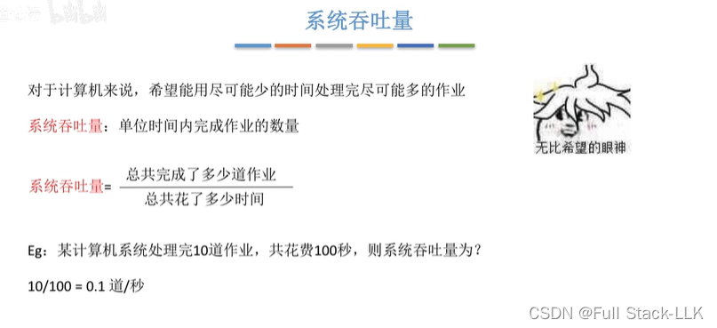
## 周转时间
周转时间相同的情况下，运行时间更长的作业，用户体感会更好，因为它的等待时间更短（也就是更少卡顿）
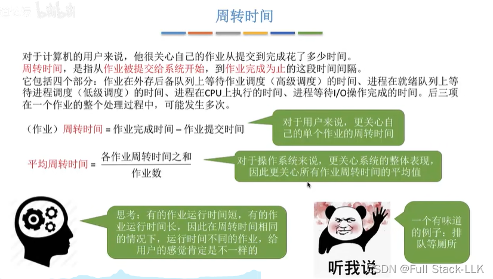
带权周转时间更小，说明运行时间所占的比例更大，相应的等待时间就更小。周转时间更小，说明作业本身完成得更快，自然更好

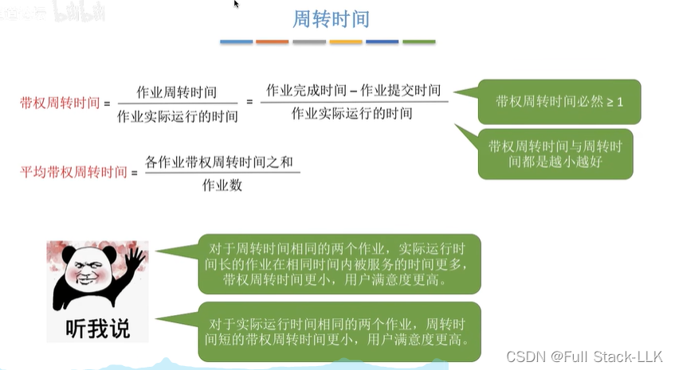
## 等待时间
在等待 I/O 完成的过程中，I/O 设备实际上也在为该进程服务

被服务 = 正在被使用

注意作业的等待时间和进程的等待时间并不是一回事

在操作系统中，一个作业（或进程）的 CPU 服务时间和 I/O 服务时间通常由作业本身的特性决定，例如所需的计算量和要处理的数据量。这意味着无论使用哪种调度算法，这些服务时间本质上都不会改变。具体来说：

- CPU 服务时间：作业在 CPU 上执行指令所需的时间，取决于作业的复杂度和所需的计算量。作业一旦开始执行，就会占用 CPU，直到其计算任务完成
- I/O 服务时间：作业与输入／输出设备交互所需的时间，例如读写文件或网络通信。在这段时间内，作业可能不需要 CPU，而是在等待 I/O 操作完成

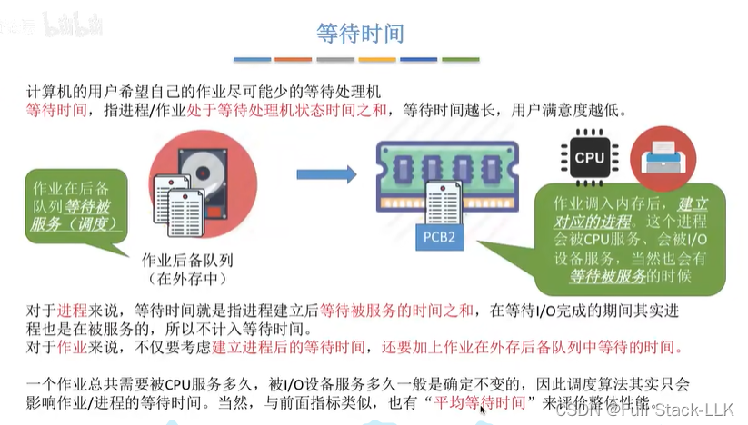
## 响应时间
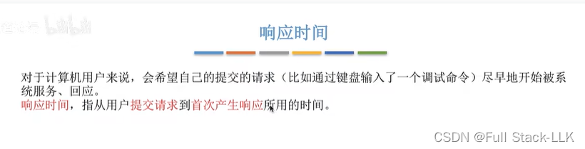
## 总结
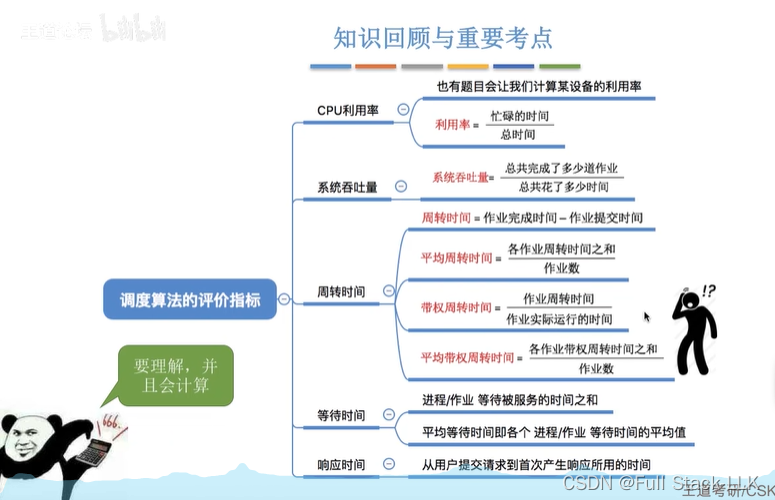

