
# 调度的概念与层次
## 概述
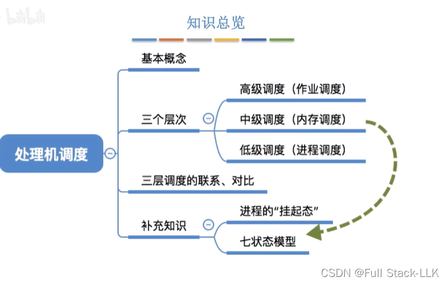
## 调度的基本概念
这是一个资源分配的问题
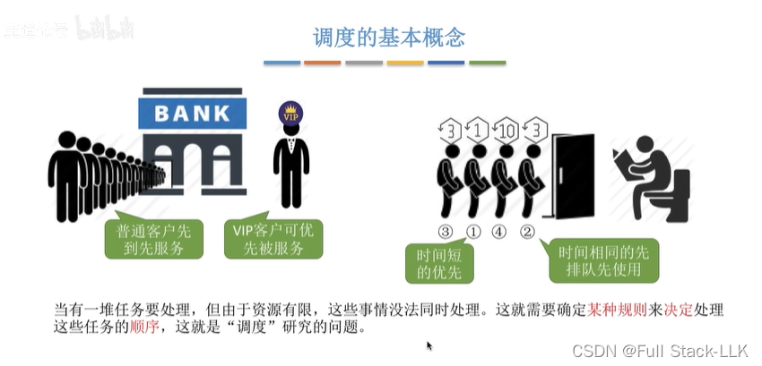
## 三个层次的调度 - 高级调度
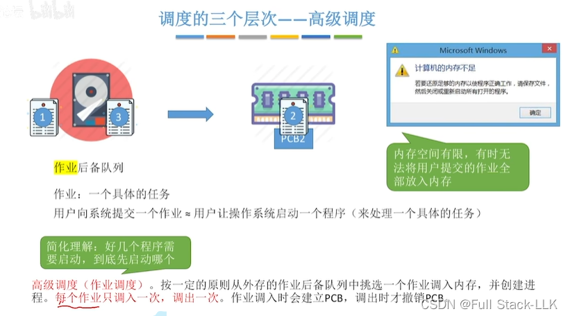
## 三个层次的调度 - 低级调度
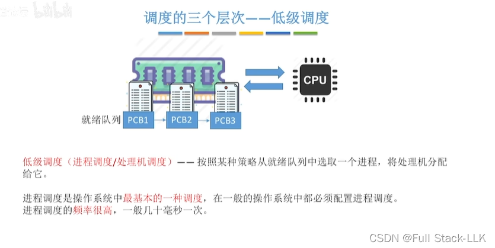
## 三个层次的调度 - 中级调度
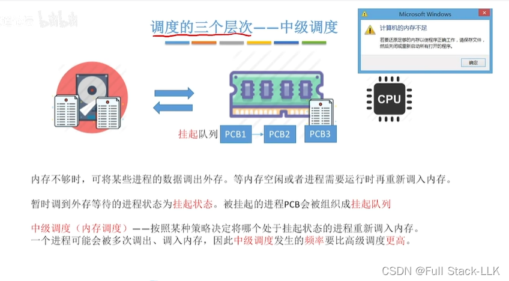
## 补充：挂起状态与七状态模型
当一个就绪进程被换出到外存时，就进入就绪挂起状态；当它需要再次运行时，就把它的内容激活，也就是重新换入内存，回到就绪状态
阻塞状态也是同理

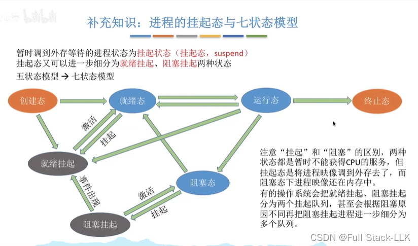
## 三个层次调度的关系与比较
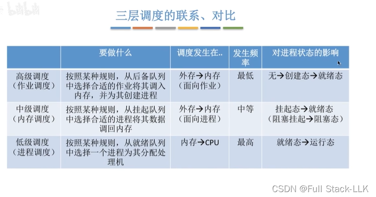
## 总结
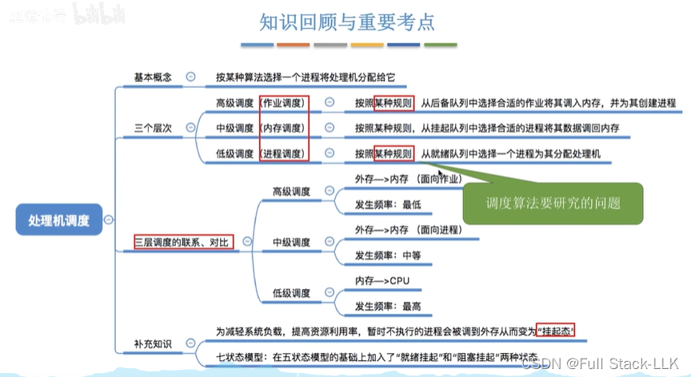
# 进程调度的过程、时机、切换与方式
## 概述
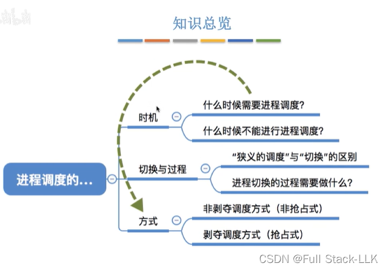
## 进程调度的时机
中断处理过程中的进程切换是指从中断处理程序跳转到另一个程序
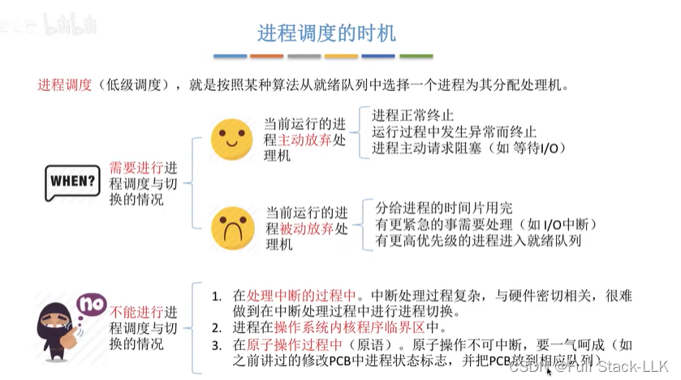
## 临界区
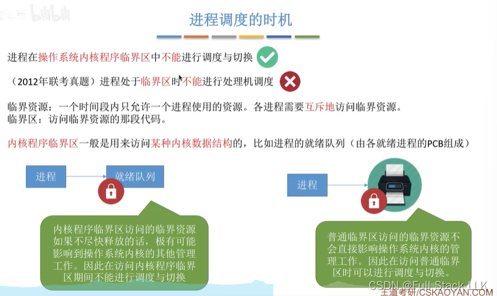
## 进程调度的方式
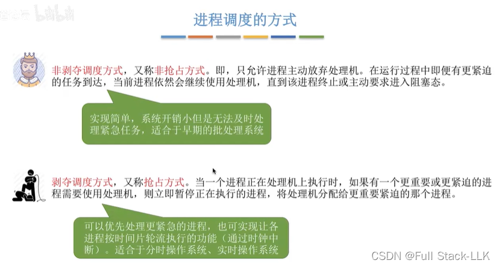
## 进程切换及其过程
狭义的进程调度是从就绪队列中选一个进程来运行；被选中的进程可能就是刚被挂起又放回就绪队列的那个，这种情况不需要进程切换，因为还是同一个进程。如果是另一个进程，就需要进程切换（因为是不同的进程）

“保存”是指保存到进程控制块（PCB）中
“恢复”是指从 PCB 中读出相应的信息并恢复

切换频率越高，并发程度就越高

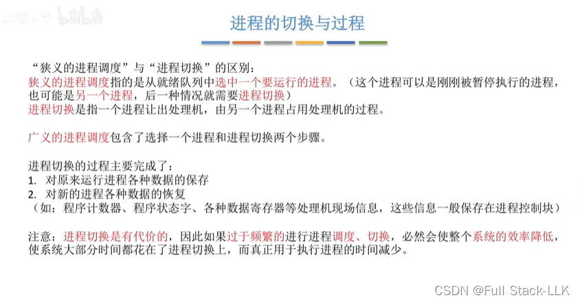
## 总结
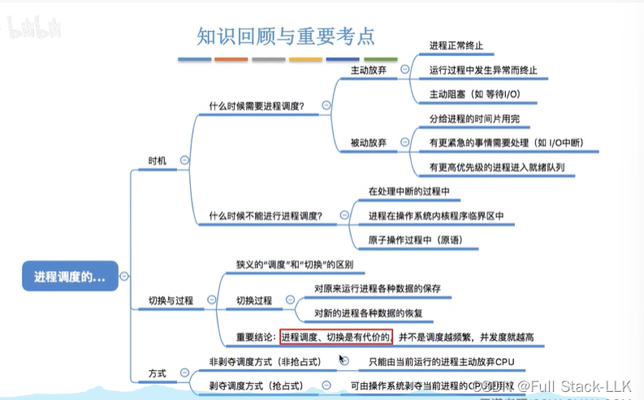

