
# 信号量机制
## 概述
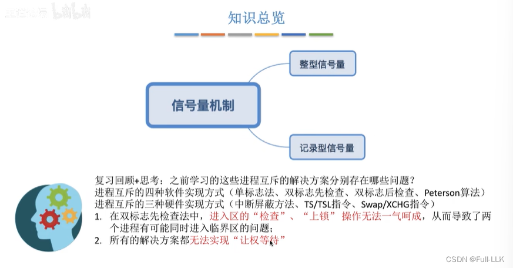
## 信号量机制
wait：进入区操作
signal：退出区操作
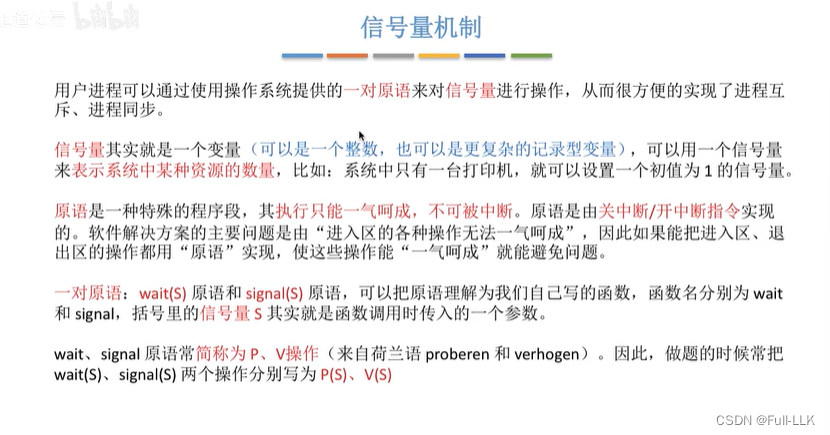
### 整型信号量
wait：检查当前资源是否充足；如果不足，就循环忙等；如果充足，则信号量减一
signal：信号量加一

检查和加锁是在一个原子操作中完成的，因此不会出现在加锁之前发生进程切换，使另一个进程通过检查并进入临界区的情况

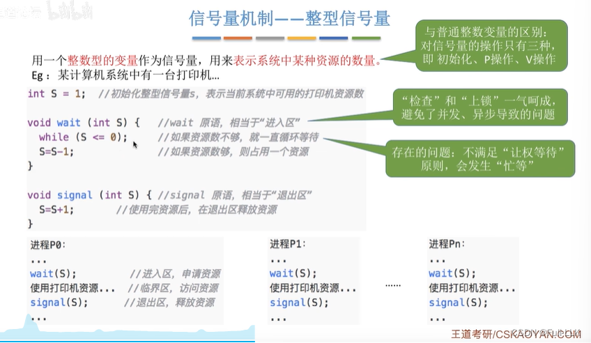
### 记录型信号量
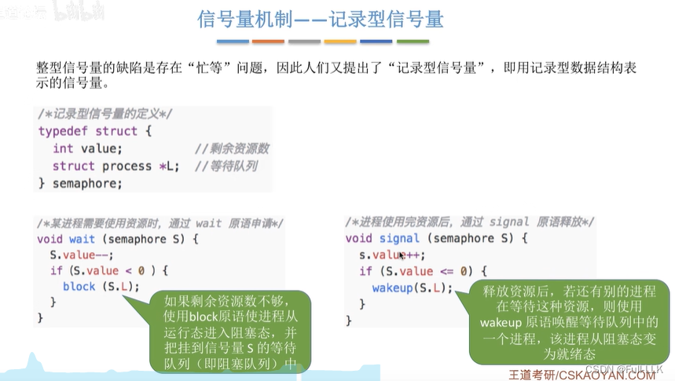
#### 示例
首先，进程 P0 执行 wait；value 的初始值为 2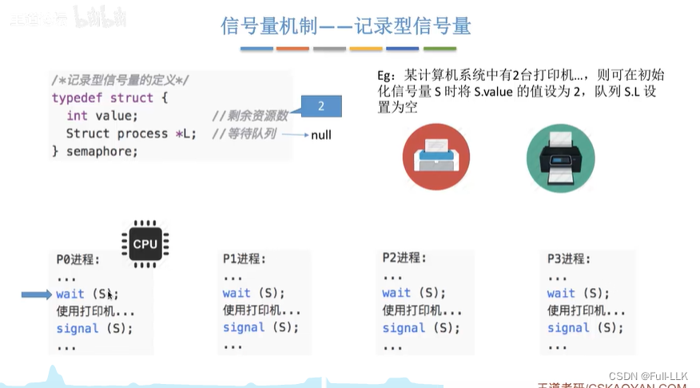
wait 之后 value 变为 1，进程 P0 开始使用它获得的打印机资源。随后进程切换到 P1，P1 即将执行 wait
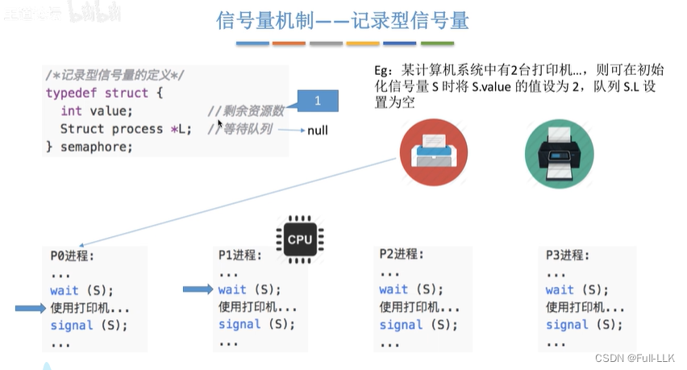
wait 之后 value 变为 0，进程 P1 开始使用它获得的打印机资源。此时 value 为 0，所有资源都已分配出去；随后进程切换到 P2，它准备执行 wait
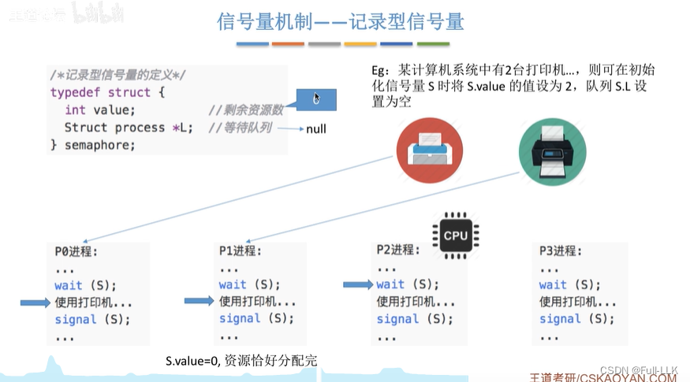
wait 之后 value 变为 -1。由于小于 0，此时资源无法使用，于是用 block 函数将进程 P2 挂起到该信号量的等待队列中
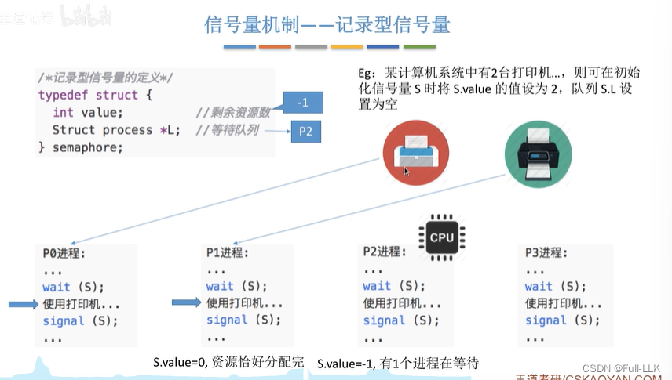
由于进程 P2 已进入阻塞状态，CPU 切换去为进程 P3 服务。wait 之后 value 为 -2，小于零，因此同样执行 block，将 P3 追加到等待队列的队尾
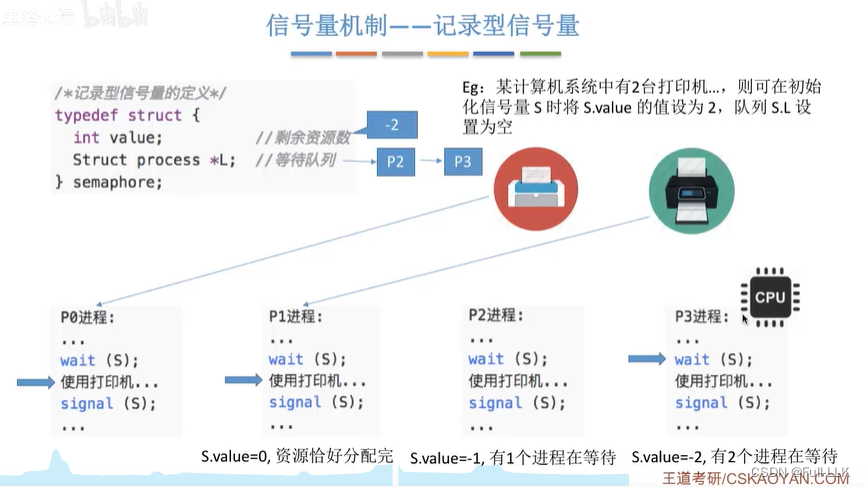
接下来 CPU 为 P0 服务。假设进程 P0 已经用完打印机并执行 signal 原语，value 加一。如果 value 仍然小于等于 0，就执行 wakeup，唤醒等待队列队首的进程。之后在下一次进程切换时，CPU 切换到 P2
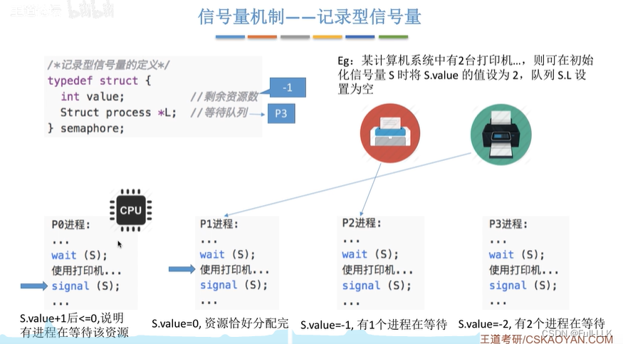
现在 P2 可以开始使用打印机资源。用完之后，它执行 signal；value 加 1，并唤醒等待队列队首的进程——进程 P3 从阻塞态变为就绪态

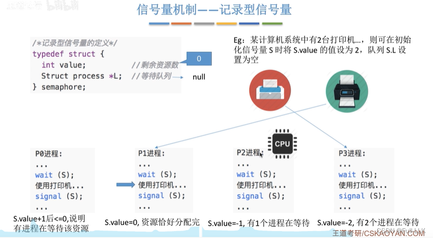

如果此时进程切换到 P1，P1 用完打印机后执行 signal；由于此时 value 已大于 0，不会发生唤醒

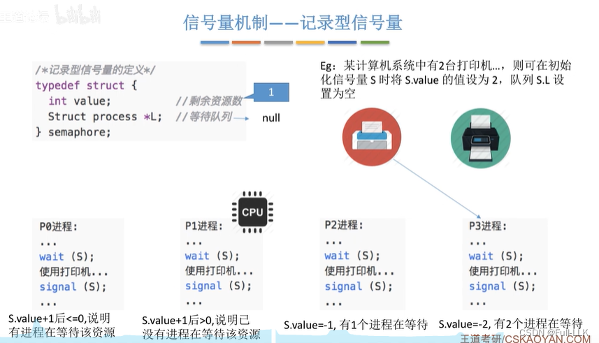
然后进程切换到 P3；它用完打印机后，value 加 1，不会发生唤醒
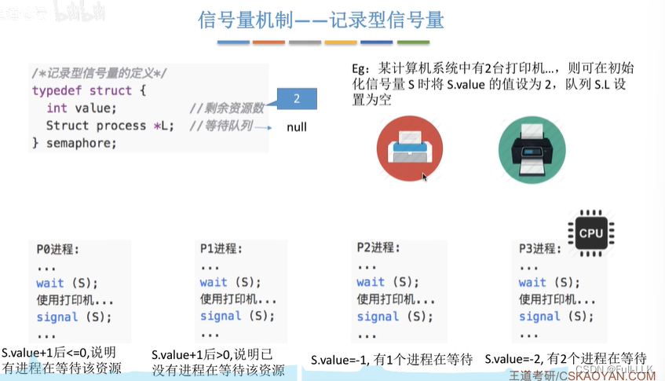
####  记录型信号量小结
自我阻塞：主动放弃 CPU 的使用权
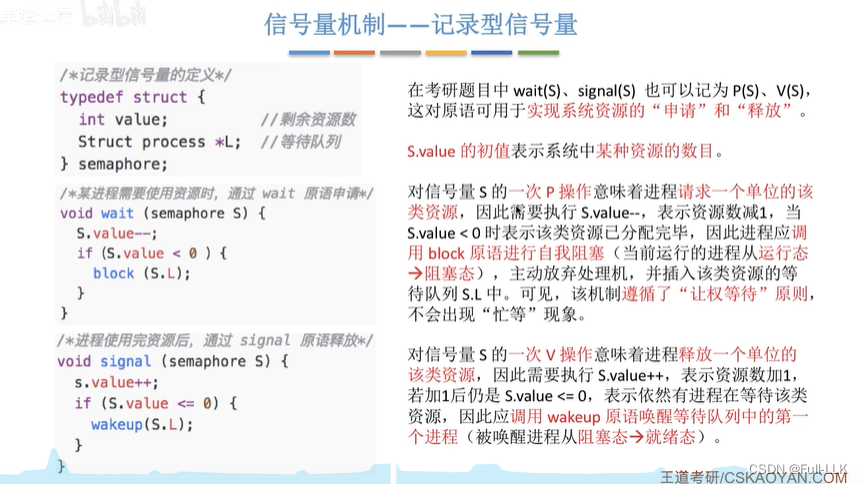
记录型信号量通过 P 操作（wait/申请）和 V 操作（signal/释放）来实现系统资源的申请和释放。这两种操作的具体机制如下：

- 资源申请（P 操作 / Wait 操作）：当进程需要使用某个资源时，执行 P 操作来申请。在 P 操作中，进程检查信号量的值。如果信号量的值大于 0，说明有可用资源：进程进入临界区，并将信号量减 1。如果信号量的值为 0，说明没有可用资源：进程不能立即进入临界区，而是被阻塞并放入等待队列，直到信号量的值变为正数。
- 资源释放（V 操作 / Signal 操作）：当进程用完资源、即将离开临界区时，执行 V 操作来释放资源。该操作将信号量的值加 1，表示多了一个可用资源。同时，如果有其他进程因资源不足而阻塞在等待队列中，系统会从中选择一个或多个进程将其唤醒，使它们得以继续执行。
## 小结
block：value<0
wakeup：value<=0

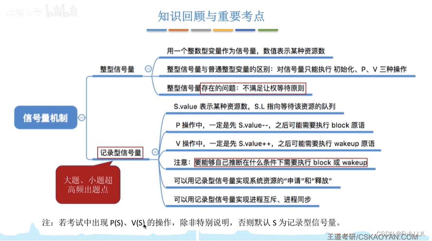
# 利用信号量实现进程互斥、同步和前驱关系
## 概述
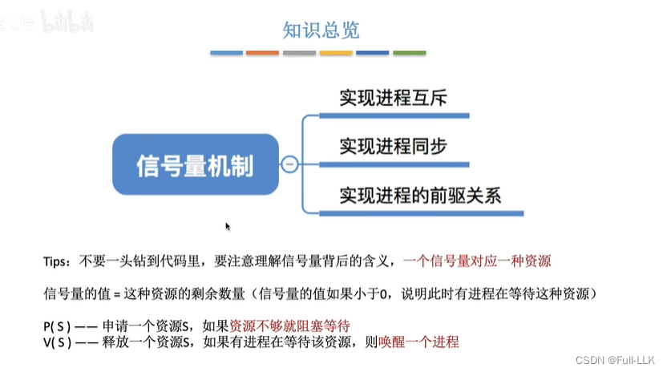
## 利用信号量实现进程互斥

缺少 P：没有 P 就没有限制，因此访问不会互斥

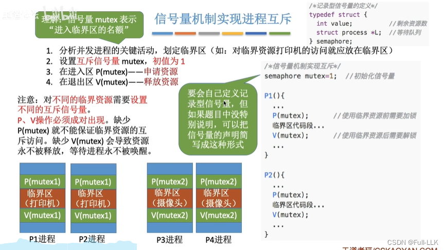

## 利用信号量实现进程同步
### 进程同步
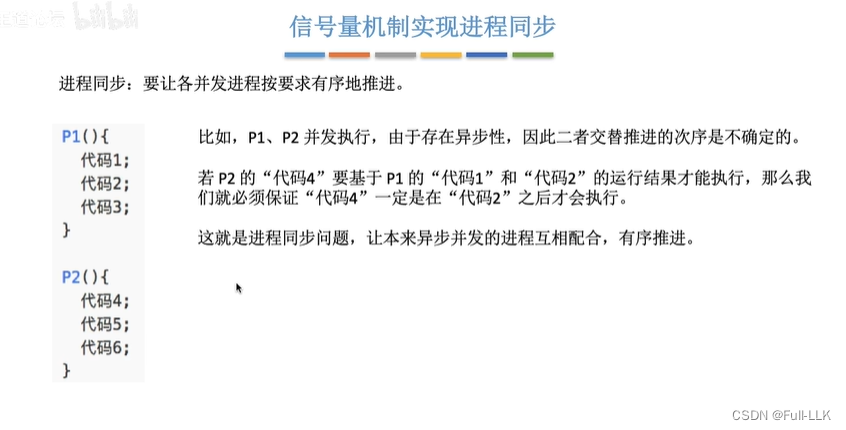
### 利用信号量实现进程同步
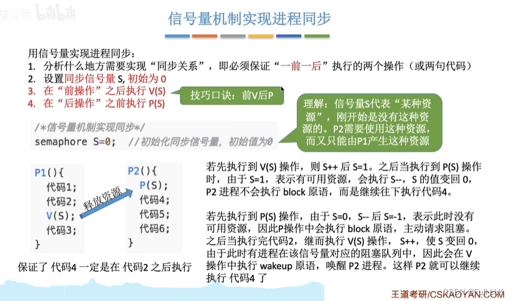
## 利用信号量实现前驱关系
前驱关系：当前事件的发生，要求所有指向它的事件都已经发生

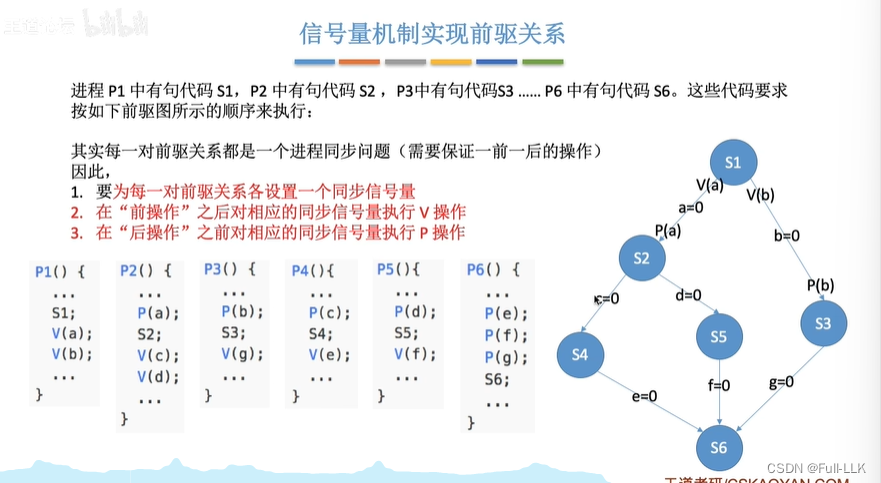
## 小结

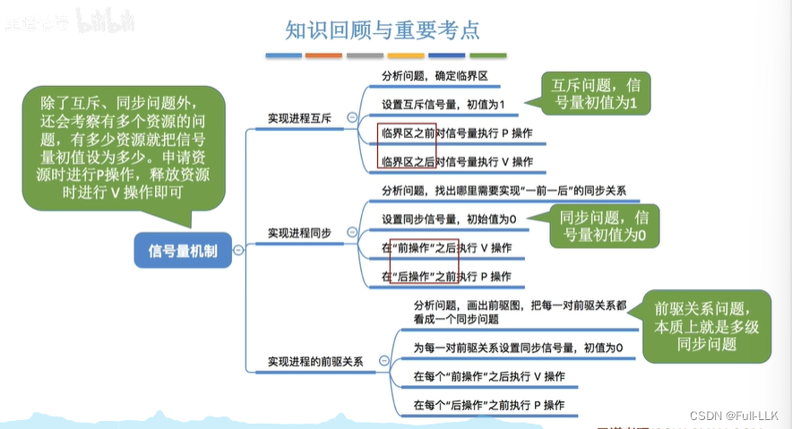

