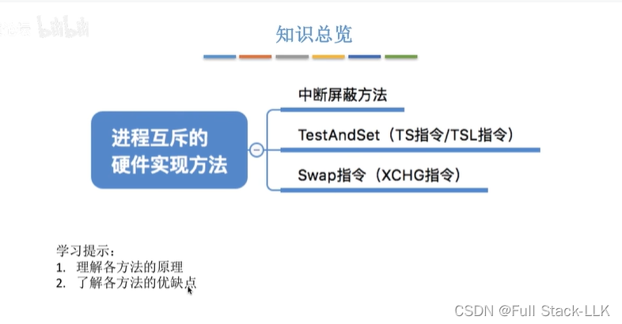
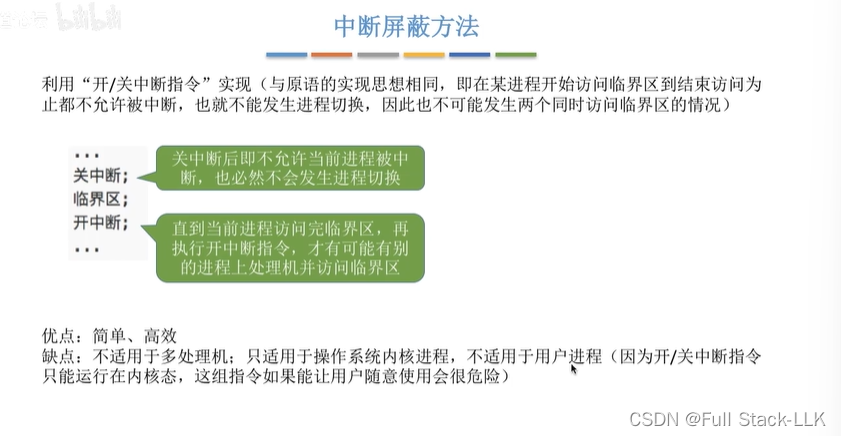
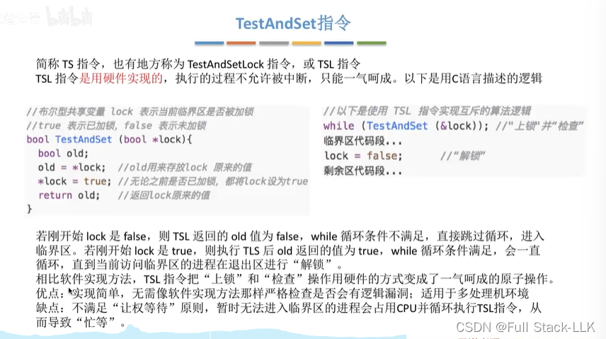
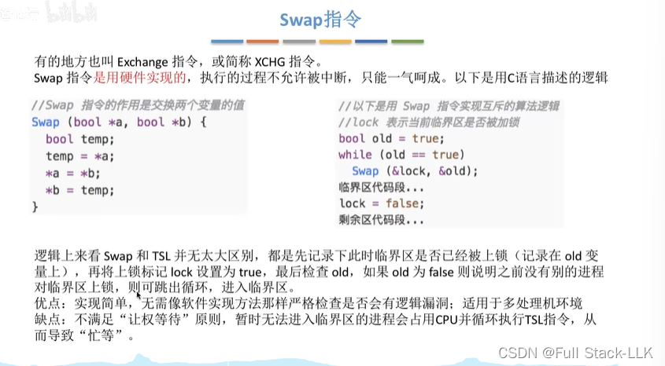
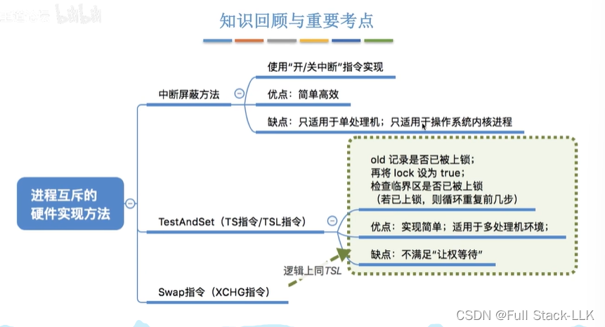
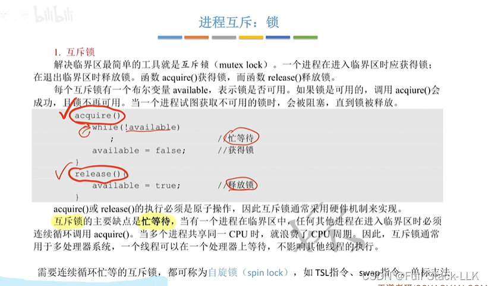
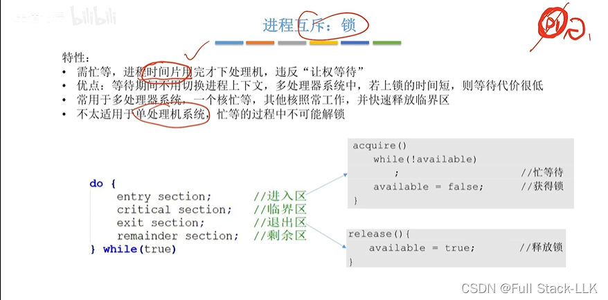


# 概述

# 中断屏蔽方法
不适用于多处理机：多处理机系统中不同处理机上的进程也可能关中断后访问临界资源，因此可能有多个进程同时访问临界资源。

# TestAndSet 指令
Test-and-Set 是一种用于实现进程间互斥的特殊硬件指令，通常用于控制对共享资源（临界资源）的访问。

具体来说，Test-and-Set 指令由两个步骤组成：

测试步骤：检查指定内存地址（通常是一个标志位）的当前值。
设置步骤：将该内存地址置为 1（或某个预设值）。
这两个步骤构成一个原子操作，即执行过程中不会被其他处理器打断，保证了操作的同步性。

Test-and-Set 指令通常应用于以下场景：

当进程需要进入临界区时，执行 Test-and-Set 指令检查锁的状态。
如果返回的旧值为 0（表示锁未被占用），进程就进入临界区，并将锁置为 1，阻止其他进程进入。
当进程离开临界区时，将锁置为 0（解锁），允许其他进程进入。

让权等待：无法访问临界区时仍处于 while 循环中，导致一直占用 CPU。

## 为什么适用于多处理机
TestAndSet 指令适用于多处理机，是因为它提供了一种在多处理机环境下保证共享资源互斥访问的机制。

首先，TestAndSet 指令是一个原子操作，这意味着执行该指令时不会被其他进程或处理器打断。这一特性在多处理机系统中尤为重要，因为多个处理器可能同时尝试访问同一个共享资源。通过使用 TestAndSet 指令，可以保证任一时刻只有一个处理器能够修改共享资源的状态。

其次，TestAndSet 指令允许处理器直接与内存交互，而无需操作系统的介入。这使它在多处理机环境中非常有用，因为它可以减少对操作系统内核的依赖，从而提高系统的效率和响应速度。

最后，虽然 TestAndSet 指令在某些情况下可能不适合用户进程，但在多处理器系统的内核进程中，它仍然是实现临界资源互斥访问的非常有价值的工具。
# Swap 指令
把 lock 的值交给 old（对应此时临界区的上锁状态），然后 lock 的值被置为 true；由于 old 的值一开始被设为 true，之后再对 lock 进行检查。

# 小结

# 进程互斥：锁

如果在忙等期间临界区被解锁，就不需要切换进程上下文。这样相比于等待，代价就很低。另一方面，如果在忙等期间进程被调下处理机、切换到其他进程，那么如果此时临界区恰好解锁了，还得切换回原来那个忙等着访问临界资源的进程，才能使用临界区（当然，这样做的前提是进程从上锁、使用临界区到解锁的总时间比较短，这样其他进程忙等的时间也比较短）。

不适用于单处理机：因为在忙等期间，即使另一个进程想要解锁，也必须等到忙等时间结束。
 

