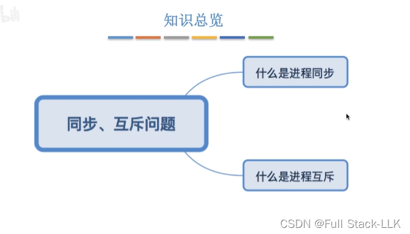
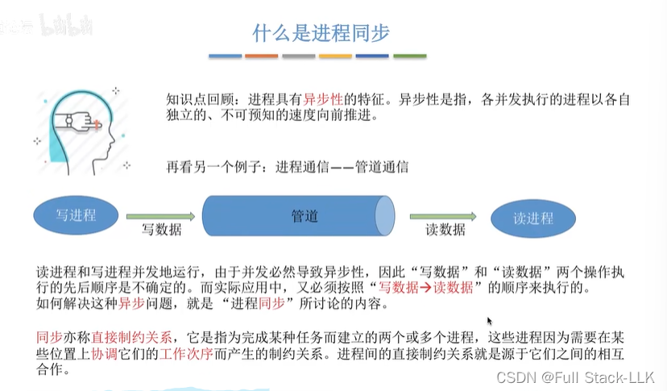
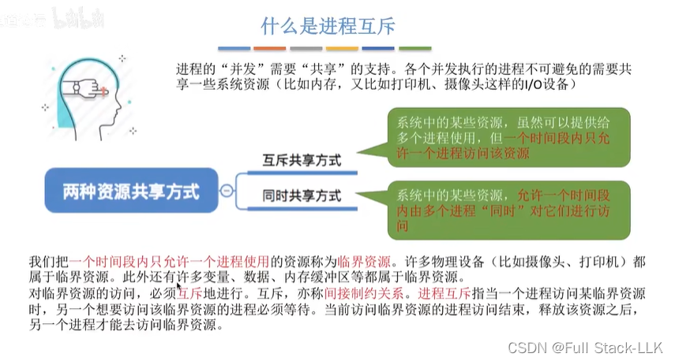
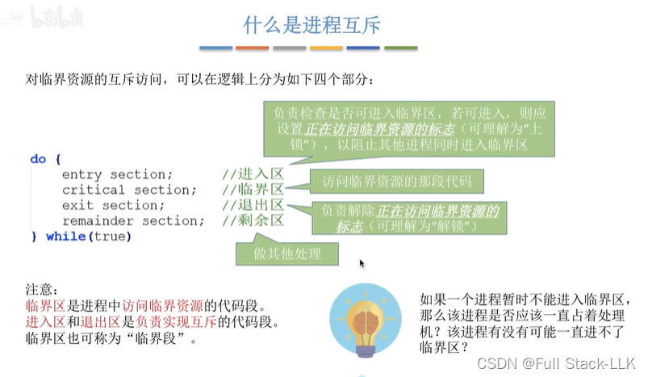
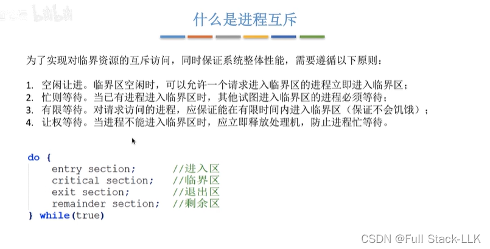
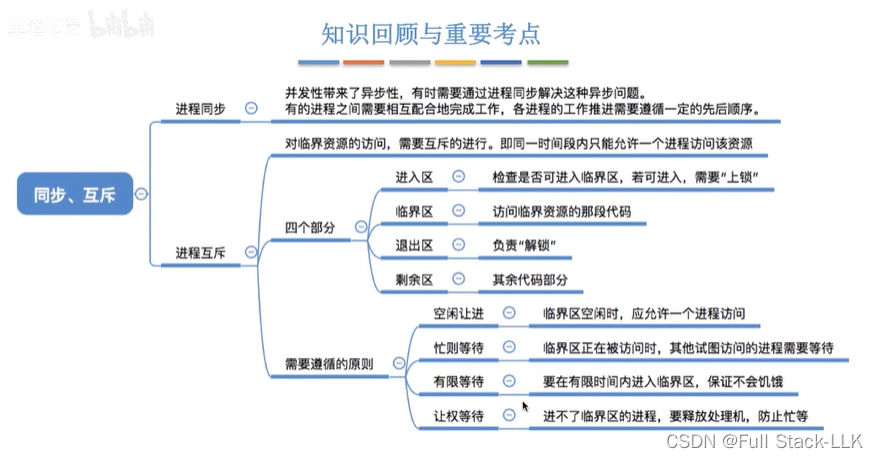


# 概述

# 什么是进程同步

## 例 1
异步性：例如有两个并发进程，其中一个进程几乎已经运行完毕，而另一个进程才运行到中间部分。速度不可预知，进程并不关心另一个进程运行到了哪里，各自独立地向前推进。

如果想让某个进程的某条指令先于另一个进程的某条指令执行，就需要使用进程同步。

## 例 2

# 什么是进程互斥

## 临界资源互斥访问的逻辑
- 进入区：这部分代码负责检查是否可以进入临界区。如果条件允许，即没有其他进程正在访问临界资源，就设置一个标志，该标志表示当前有进程正在访问临界资源，从而阻止其他进程同时进入。
- 临界区：这是真正访问临界资源的代码段。在该区域内，进程独占临界资源并执行必要的操作。
- 退出区：进程访问完临界资源后，会执行退出区的代码。这部分代码的作用是清除之前设置的标志，即“解锁”，以便其他等待访问临界资源的进程可以进入。
- 剩余区：这部分代码对非临界资源进行操作，不涉及对临界资源的访问。

## 互斥访问的原则
忙等待：占用着处理器却什么也不做。

# 总结
进程同步：直接制约关系。
进程互斥：间接制约关系。


