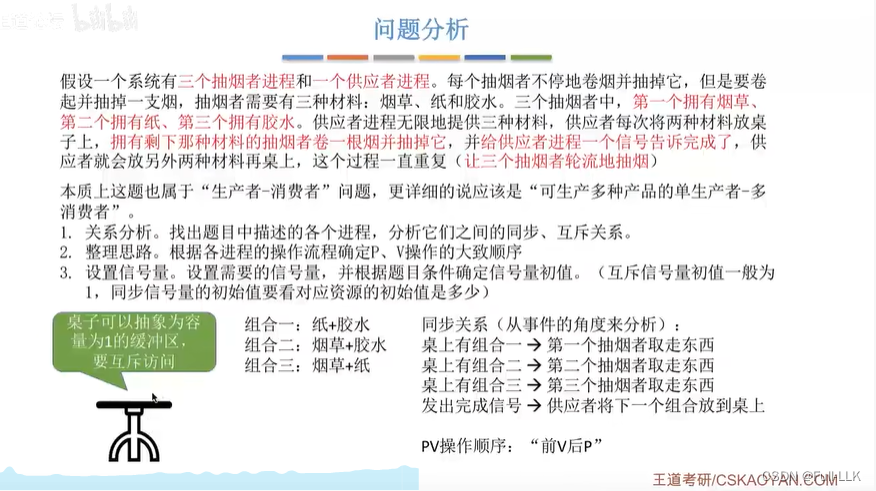
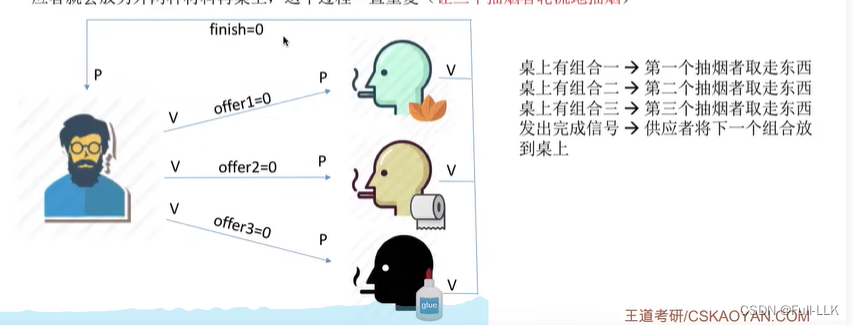
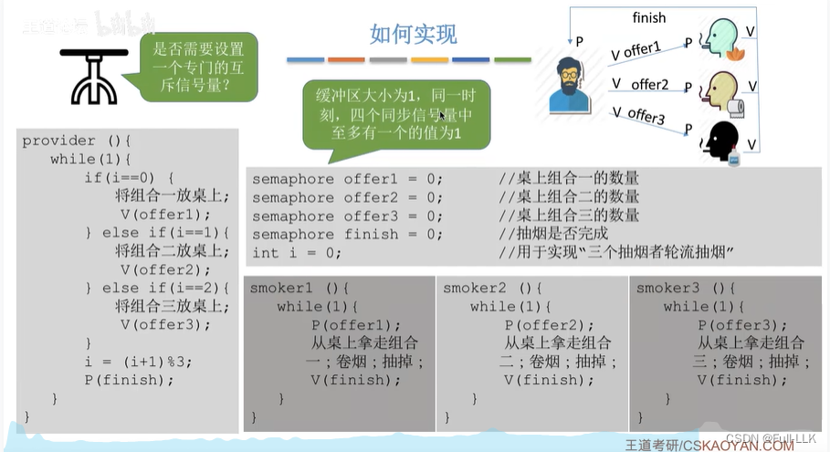
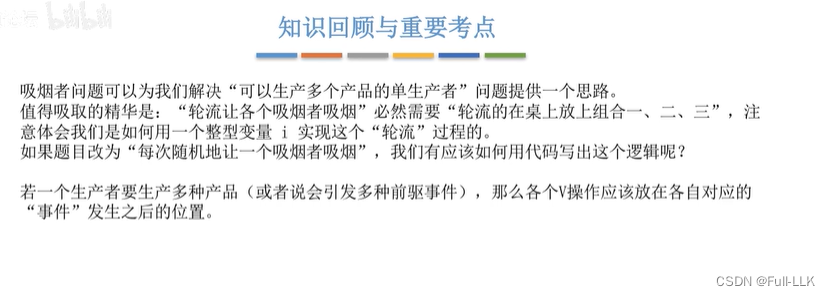


# 概述
操作系统中的吸烟者问题是一个经典的同步问题，涉及进程之间的同步与互斥。

在这个问题中，有三个吸烟者进程和一个供应者进程。每个吸烟者都需要烟草、纸和胶水三种材料才能吸烟。三个吸烟者各自拥有这三种材料中的一种。供应者进程负责提供这些材料，但每次只能提供两种，并且供应者必须等待吸烟者吸完烟并发出信号后，才能提供下一组材料。这个问题的关键在于如何协调供应者与吸烟者之间的动作，使每个吸烟者都能得到所需的材料并按正确的顺序吸烟。

为了解决这个问题，可以设置信号量来控制进程之间的同步与互斥。具体来说，可以设置三个信号量 offer1、offer2 和 offer3，分别表示烟草和纸、烟草和胶水、纸和胶水这三种组合资源。还需要一个信号量 finish 来同步吸烟者进程和供应者进程：供应者需要等待吸烟者吸完烟后才能提供下一份资源，吸烟者则通过 finish 信号量告诉供应者“我已经吸完了”。

总的来说，这个问题的解决涉及操作系统中的生产者-消费者问题，以及信号量和 P、V 操作的使用。通过合理地设计信号量并使用 P、V 操作，可以实现进程之间的有效同步，确保每个进程按既定顺序执行，避免竞争条件和死锁。解决这个问题对于理解和掌握操作系统中的并发控制和进程同步机制非常重要。
# 问题分析
把两种材料抽象成一个组合

由于任何时刻最多只有一个信号量为 1，所以不需要互斥变量

# 如何实现 
用循环来均匀地提供各个组合
不需要互斥信号量

# 总结
随机不等于轮流
轮流通过循环实现
随机通过随机函数生成的随机变量实现

V 操作放在事件发生之后——也就是先把组合放到桌上，再执行 V 操作

