
# 生产者-消费者问题
## 问题分析
存在先后关系：缓冲区未满时生产者才能生产，缓冲区非空时消费者才能消费

缓冲区需要互斥访问的主要原因如下：

- 避免数据竞争：多个线程或进程同时访问同一个缓冲区时，若不加控制，可能出现一个线程正在读数据而另一个线程正在写数据的情况。这种并发访问会导致数据不一致和不可预测。
- 防止死锁：如果在没有可用缓冲区时生产者或消费者一直占用缓冲区，系统可能进入死锁状态，多个进程互相等待对方释放资源，谁都无法继续执行。
- 防止内存泄漏：对于在堆上动态分配的缓冲区，如果访问权限管理不当，可能导致内存泄漏，因为该缓冲区可能永远不会被释放回系统。
- 保护临界区：通过设置互斥信号量（如 mutex），保证同一时刻只有一个线程能在访问缓冲区的临界区中执行，从而有效保护共享资源。

 
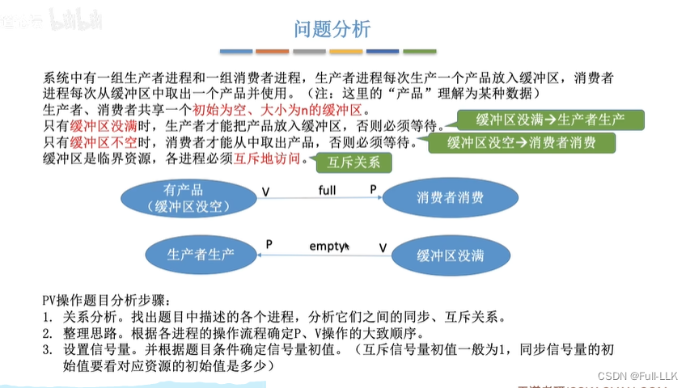
## 如何实现
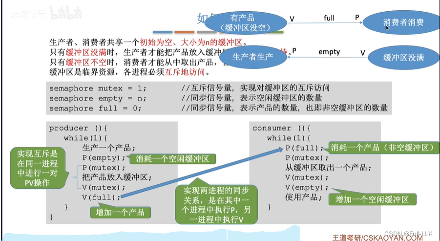
## 思考：相邻 P、V 操作的顺序能否改变？
会产生死锁问题
若把生产者生产产品、消费者消费产品的操作也放到临界区中，会使临界区代码变长，锁被占用的时间也更长，不利于各进程交替使用临界区（但从逻辑上讲放进去并没有问题）
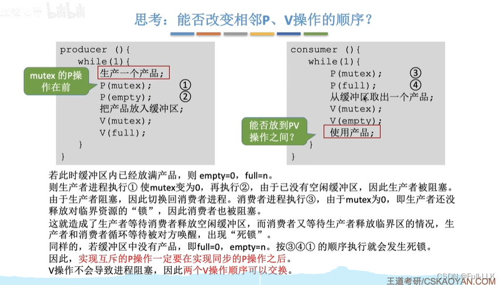
## 小结
注意：互斥是先 P 后 V；同步是先 V 后 P
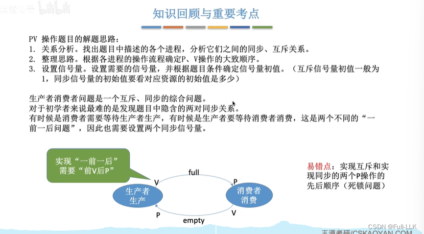
# 多生产者-多消费者问题
“多”指的是多种类型的生产者和消费者之间的关系
## 问题分析
找出互斥关系和同步关系（一前一后）
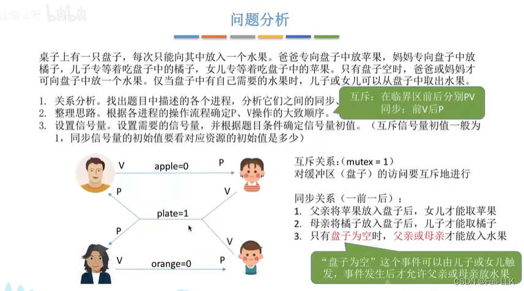
## 如何实现
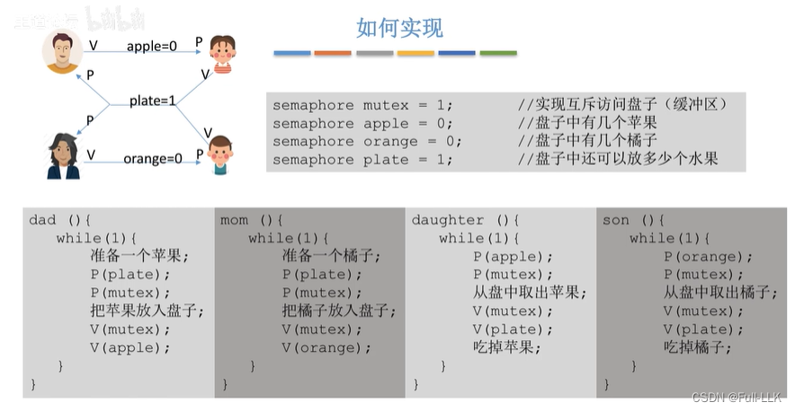
## 如果不使用互斥信号量会怎样？
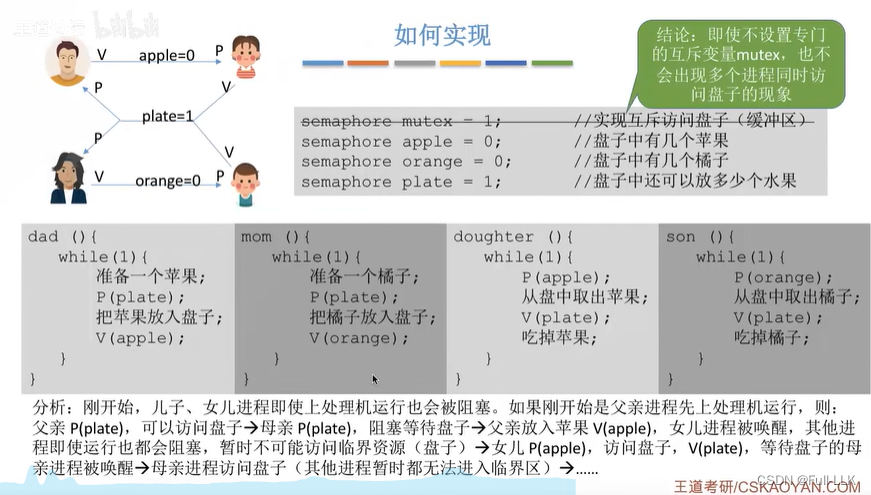
由于盘子只能放一个水果且只有一个盘子，apple、orange、plate 这三个同步信号量中不可能同时有两个或三个为 1

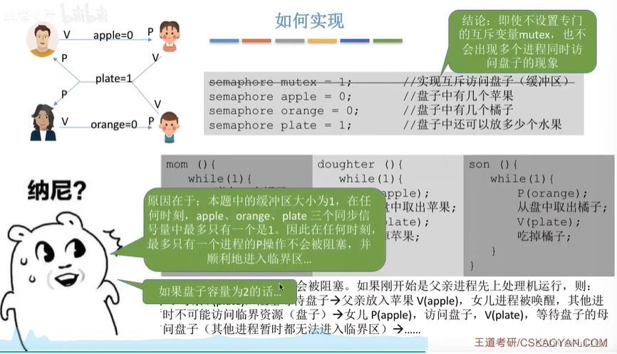
 当缓冲区大小为 2 时，可能出现两个进程同时访问缓冲区的情况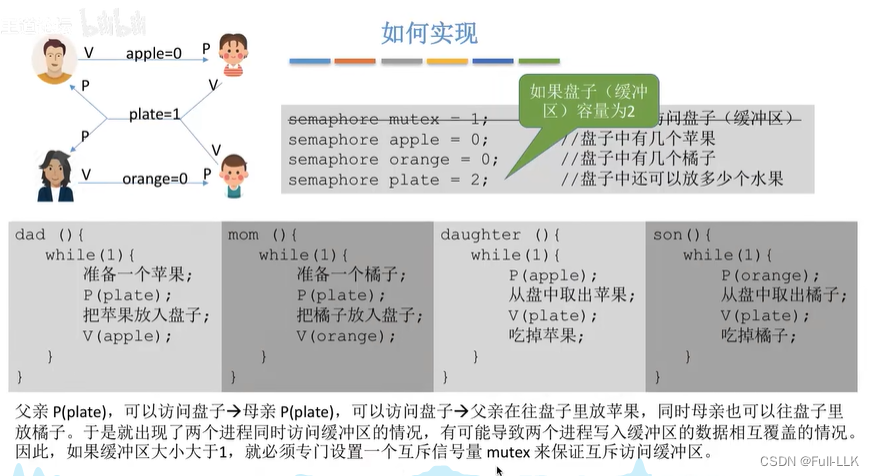
## 小结
死锁：双方都卡在第一个申请互斥访问的函数上
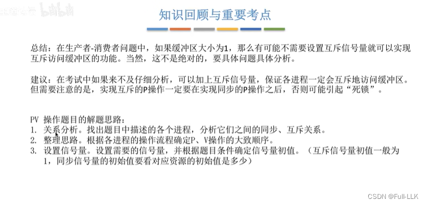
也就是说，需要从多个进程中归纳、抽象出事件，从而简化关系
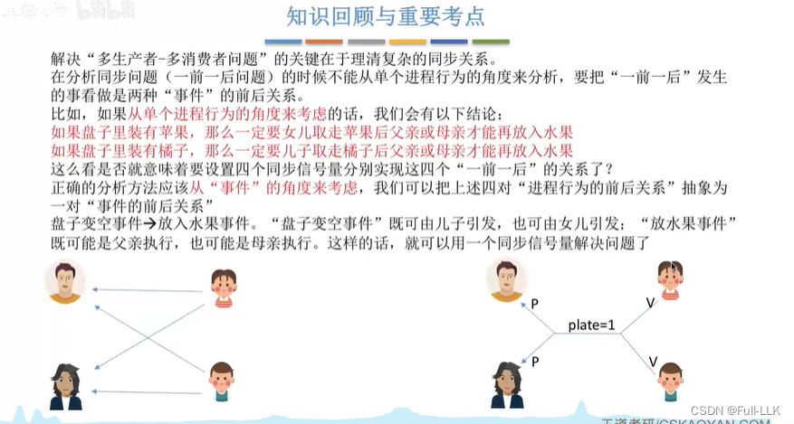

