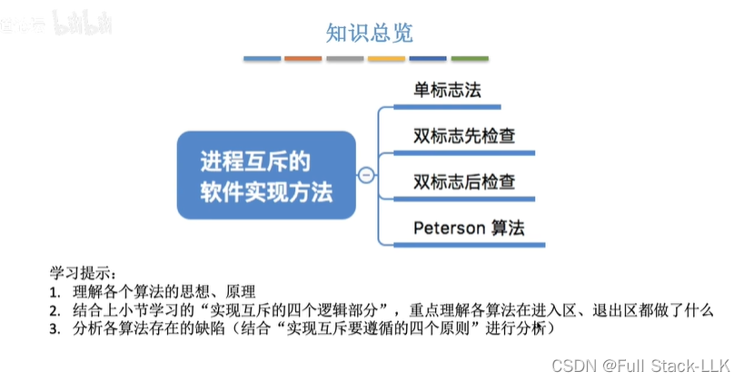
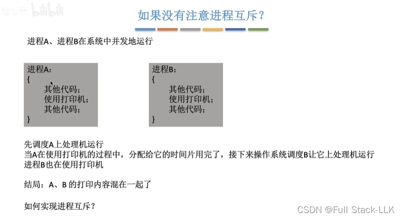
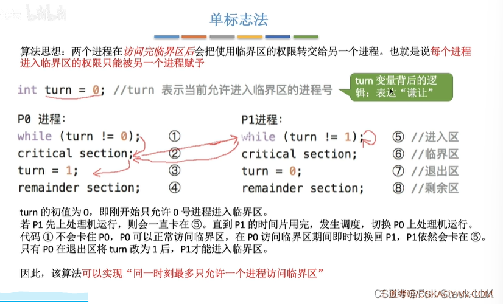
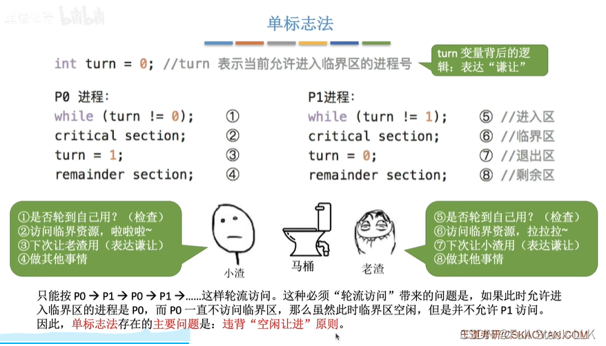
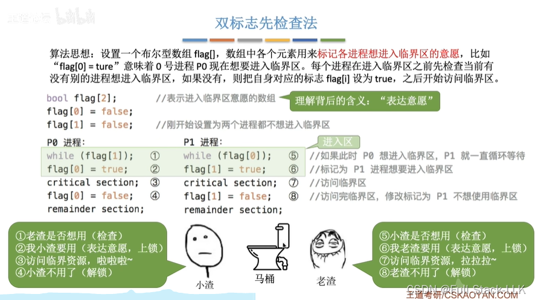
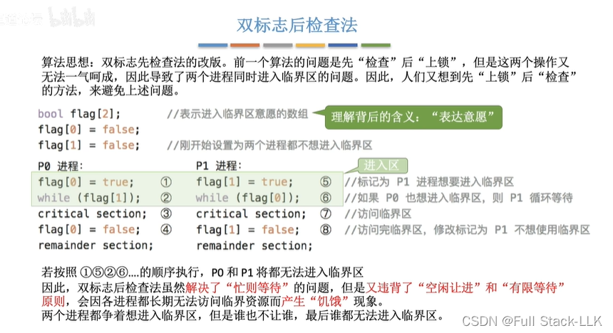
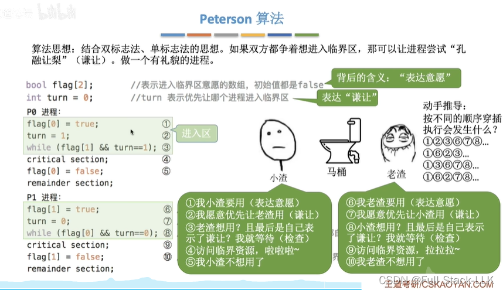
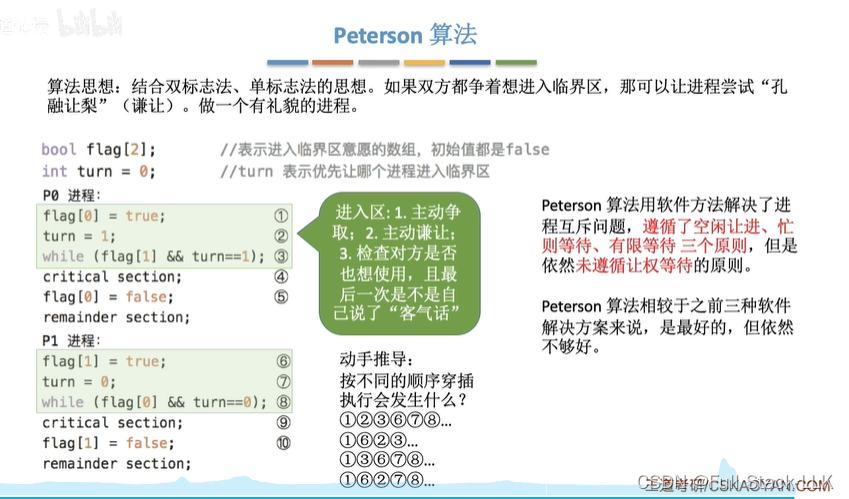
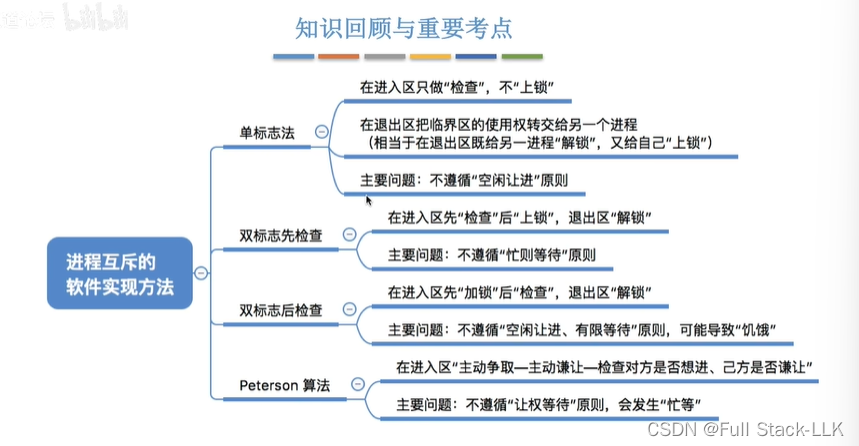


# 概述

# 如果没有进程互斥
如果进程 A 打印到一半被切换到进程 B，那么打印的内容就会混在一起。

# 单标志法
注意 while 循环没有内容（它有一个 ;）。

## 例子
小渣和老渣上厕所。

这种方法会受下一个使用者的限制：如果下一个使用者一直不使用，那么当前这个也不能连续使用两次。

# 双标志先检查法

# 双标志后检查法
当进程 P0 的 while 循环执行到一半切换到进程 P1 时，P1 也会进入它的 while 循环；当进程 P1 的 while 循环执行到一半又切换回进程 P0 时，P0 的 while 循环仍会继续执行——就这样来回切换，但时钟都卡在各个进程的 while 循环里。

# Peterson 算法

让权等待：此时如果进程无法进入临界区，就会在 while 循环中卡住一段时间，浪费处理机资源。

# 总结


