
# 概述
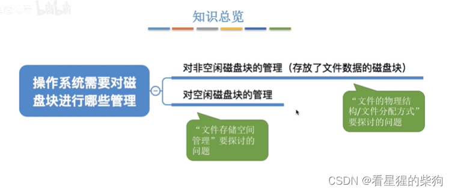
文件数据存放在外存中
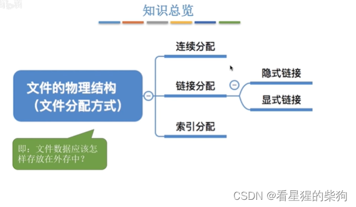
#  文件块和磁盘块
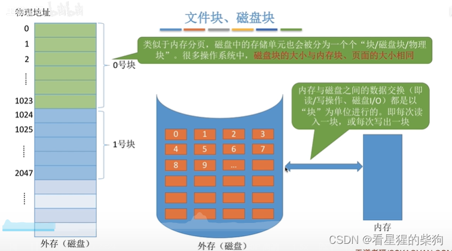
 在文件内部，任意位置都可以通过逻辑块号和块内偏移来定位
 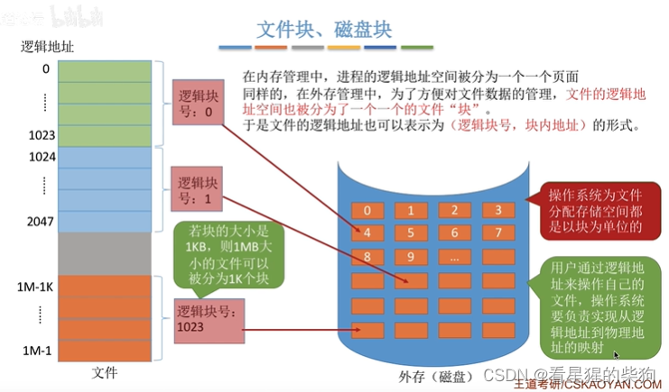
# 连续分配
  逻辑块号类似于偏移量
  
  连续分配是一种文件存储策略，文件的所有部分都存放在磁盘或其他存储介质上的连续块中。这种存储方式支持两种访问方式：顺序访问和直接访问。

### 顺序访问

连续分配非常适合顺序访问，因为在连续分配中文件的各个块是相邻的。这意味着从文件开头读取时，磁头可以从第一个块一直连续读到文件末尾，而无需在磁盘上执行额外的寻道操作。由于磁盘寻道时间是磁盘访问延迟的主要来源之一，连续访问减少了这部分延迟，从而提高了读取速度。

### 直接访问（随机访问）

直接访问是指能够立即访问文件中任意位置的能力。在连续分配中，只要知道文件第一个块的地址，就可以通过简单的算术计算出文件中任意块的地址。这是因为每个块的大小是固定的，所以只需要知道块号（相对于文件起始块的偏移），乘以块大小，就能算出该块在磁盘上的绝对位置。这样即使从文件中间或末尾读取数据，也能快速定位到正确的磁盘位置，而不必从头开始顺序读取。

### 为什么连续分配能同时支持这两种访问方式？

连续分配之所以能同时支持顺序访问和直接访问，是由其数据布局特点决定的。文件连续存放，避免了顺序读取时不必要的寻道；而固定的块大小和位置关系又使得可以根据块号直接计算出物理地址，从而支持直接访问。这种灵活性使连续分配在许多应用中非常有效，尤其是既需要快速顺序读取又需要随机访问的场景，例如数据库和多媒体文件。

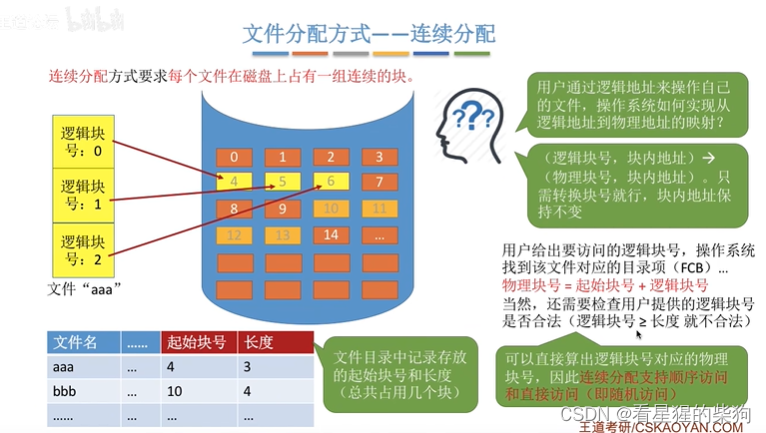
  采用连续分配时，文件的磁盘块是相邻的，所以移动距离短
  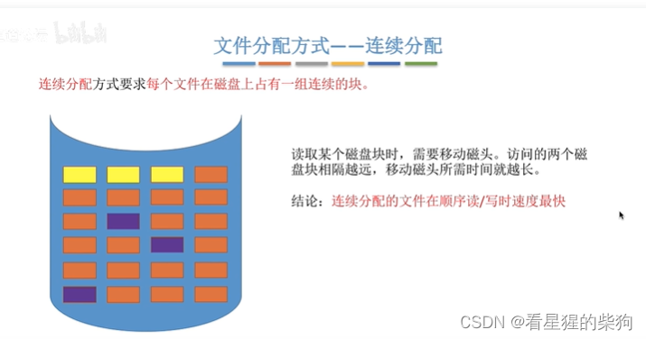扩展时同样要求连续，因此有时需要迁移
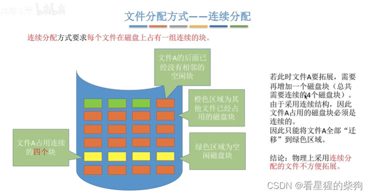
紧凑需要移动磁盘块中的内容，比较耗时
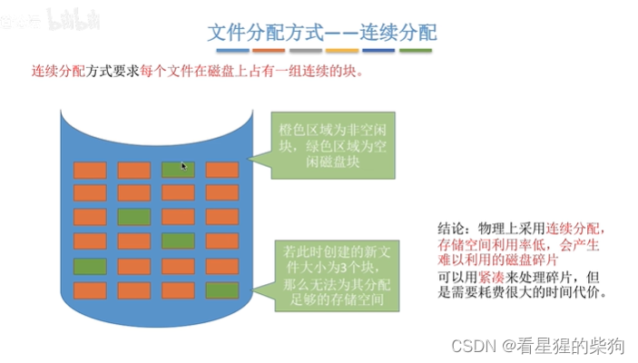

# 链接分配
## 隐式链接
访问第 n 个逻辑块就要沿着第 n 个指针走；第零个逻辑块是起始块
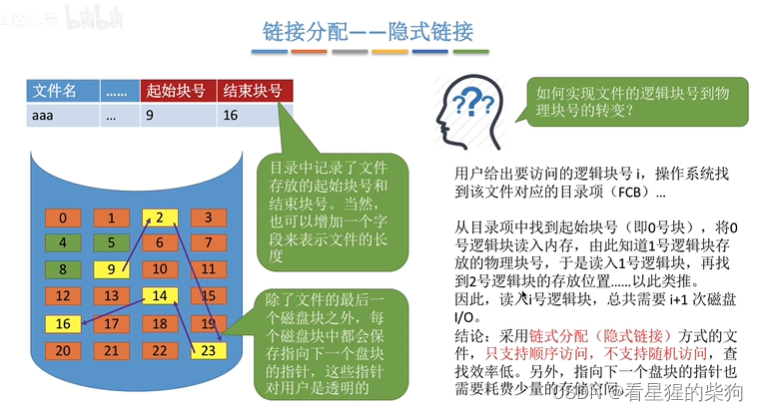
只需在尾部加一个链表结点，然后更新 FCB 即可

## 显式链接
把用于链接文件各物理块的指针不放在块内，而是放在一张表中
之所以是隐式的，是因为每个物理块对应的下一块是按顺序存放的，所以不需要再记录物理块号
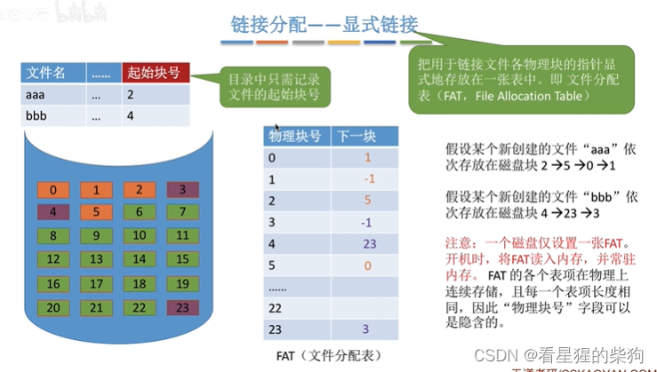

零代表起始块号对应的物理块；大于零则表示还需要继续找下一块

## 小结
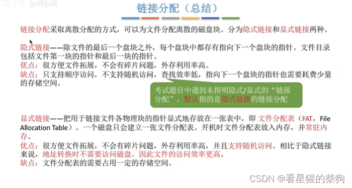
## 索引分配
文件名 -> FCB 中的索引块 -> 内存中的索引表 -> 逻辑块号（隐含）-> 物理块号 

24 位 < 2^30 < 32 位
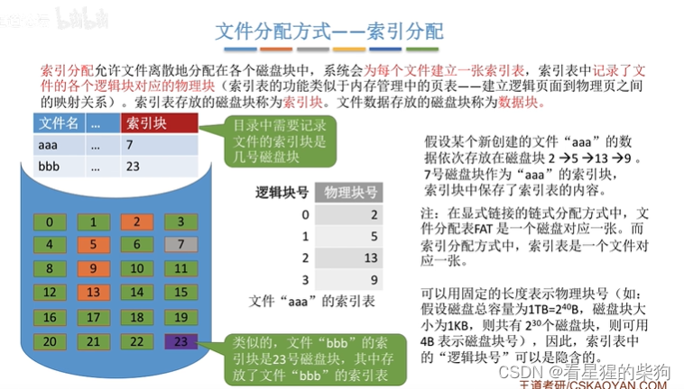
扩展时只需在索引表中增加表项即可
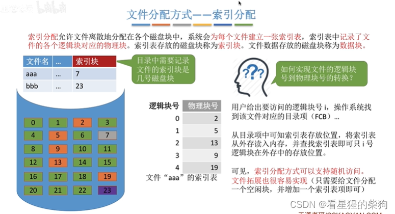
当单个磁盘块对应的索引表放不下文件的全部物理块时
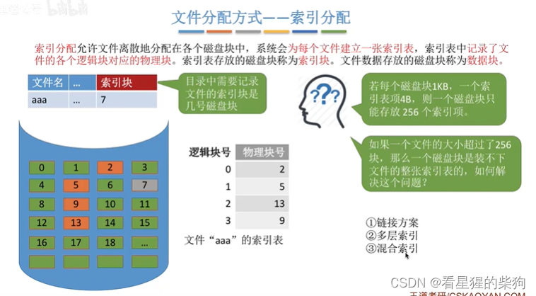

## 链接方案
一个文件对应多个索引块，以链表形式相连，FCB 中只需记录第一个索引块的块号
读入索引块后再确定下一个索引块

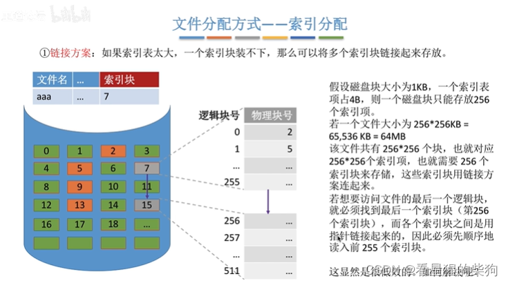
## 多层索引
 
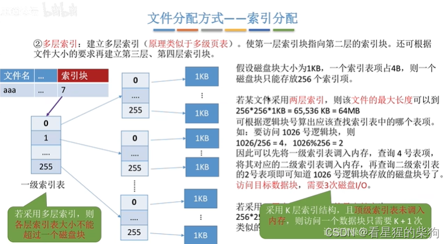
但当文件的块数比较少时，多层索引有些浪费，而且还需要多次读磁盘

## 混合索引
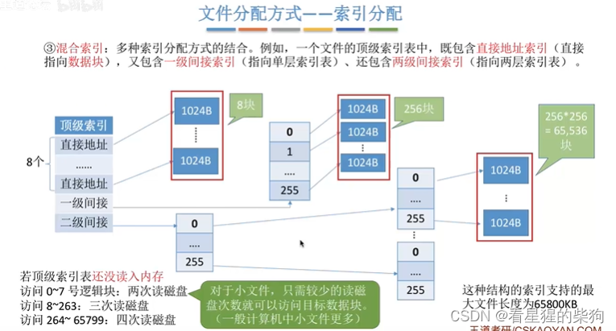
## 小结
 
# 总结
FCB 就是目录项的内容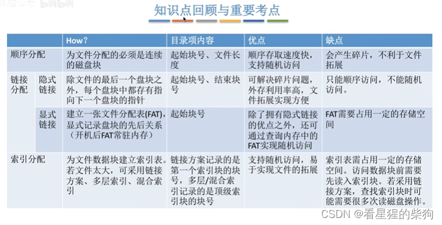

