# 制作 RISC-V 操作系统 五 - RISC-V 汇编语言编程 一


## RISC-V 汇编语言入门
### 汇编语言概念简介
高级：可以理解为更接近人的理解
低级：可以理解为更接近机器

不易移植：汇编指令与机器指令基本一一对应，而不同指令集架构的机器语言不同。所以一种机器上的汇编可能无法在另一种架构的机器上运行。

灵活：高级语言通过编译器生成的机器指令与底层交互，如果想对生成的机器指令进行优化，高级语言无法直接做到，因此不够灵活。而汇编更底层，可以直接控制生成对应的机器指令，所以优化更方便。


## 汇编语言语法介绍（GNU 版本）
不同的汇编器支持不同的汇编语法
大写 S 保留预处理语句
小写 s 是纯汇编语句
[ ] 方括号表示其中的内容是可选的，可以有也可以没有，如果都没有就是一个空行
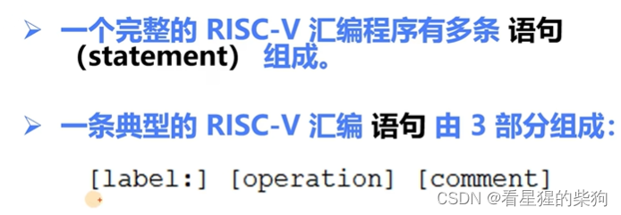
label: content 
label:
				content
标签和内容可以在一行，也可以分成两行
标签可以理解为一个地址
伪指令：包含多条基本指令的指令
汇编器会把伪指令分解为多条指令，再转换成机器指令执行
指示/伪操作：它不是告诉汇编器做什么，而是告诉汇编器怎么做。比如 movq $0, %rax 会被汇编器直接翻译成机器码，最终由 CPU 直接执行；而 .section __TEXT,__text 不会被翻译成机器码，在最终的可执行文件中也找不到这条语句的任何痕迹。它的作用是告诉汇编器如何进行汇编，是汇编器自己定义的语法，是写给汇编器看的。它的定义可以在汇编器的手册中找到
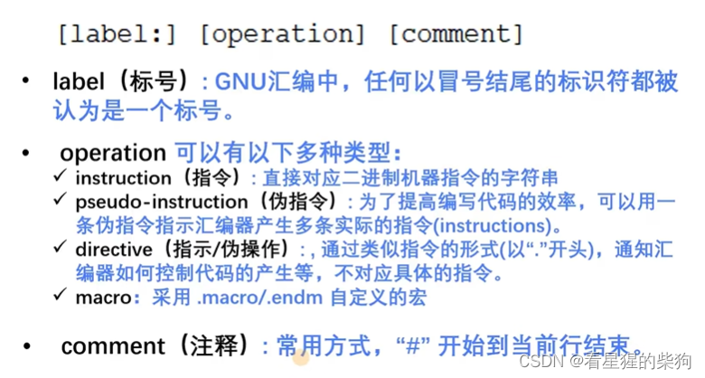


# 制作 RISC-V 操作系统 V - RISC-V 汇编语言编程 II


## RISC-V 汇编指令的操作数
RV32I：RISC-V 32 位整数指令集
指令集分为非特权指令集和特权指令集
XLEN：表示当前机器字长的变量（32 位、64 位、128 位）
x0：不可写，只可读，读出恒为 0
PC：不能直接访问 
ALU 能直接交互的是寄存器
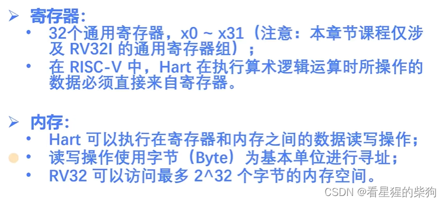
## RISC-V 汇编指令编码格式
指令对齐：下图中为 4 字节的倍数。不对齐可能导致程序抛出异常

funct7：占 7 位
funct3：占 3 位
寄存器字段占 5 位，对应 32 个通用寄存器
rs：源寄存器
rd：目的寄存器
imm：立即数
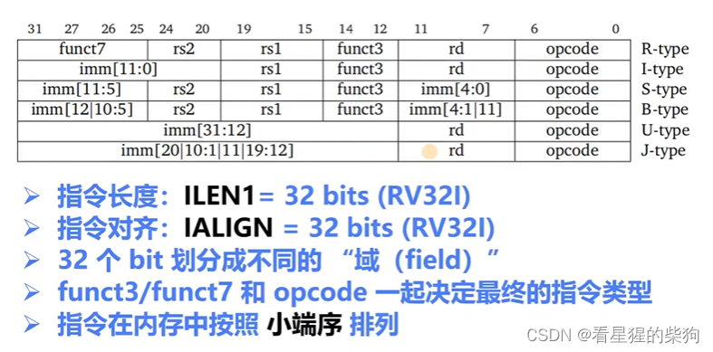
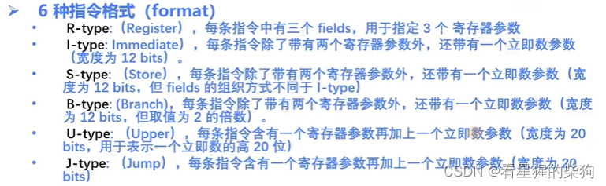

opcode 的编码格式
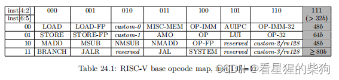
指令的编码格式
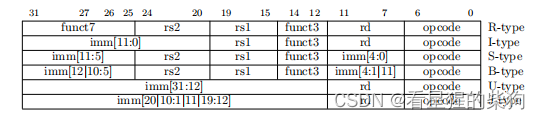
## 小端序的概念
字节序是多字节才存在的概念
主机默认是小端序
 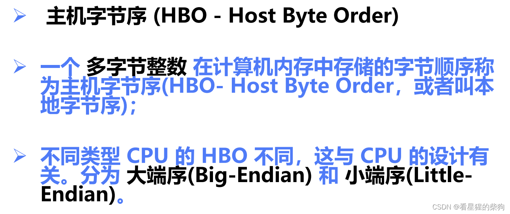
大端序：
 - 数据的高位字节存放在低地址
 - 数据的低位字节存放在高地址
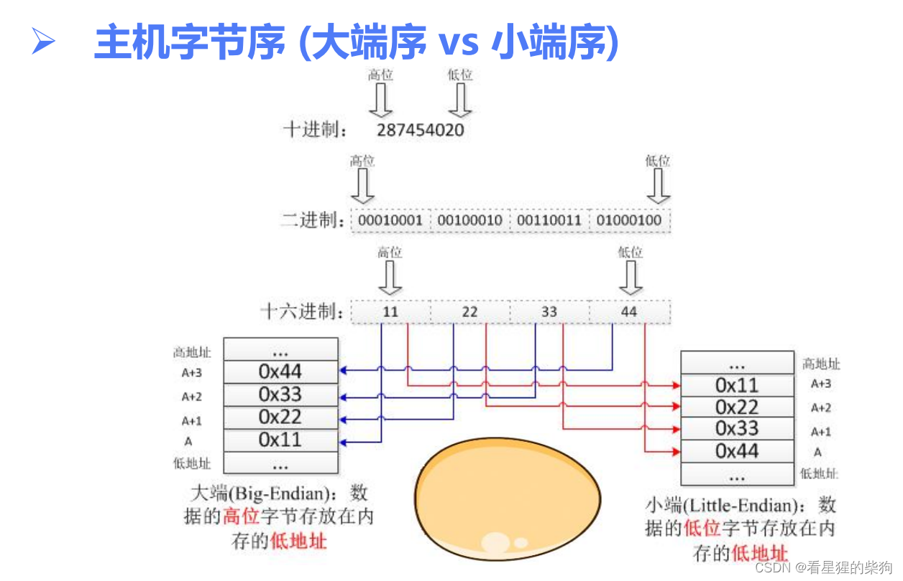
## RISC-V 汇编指令分类
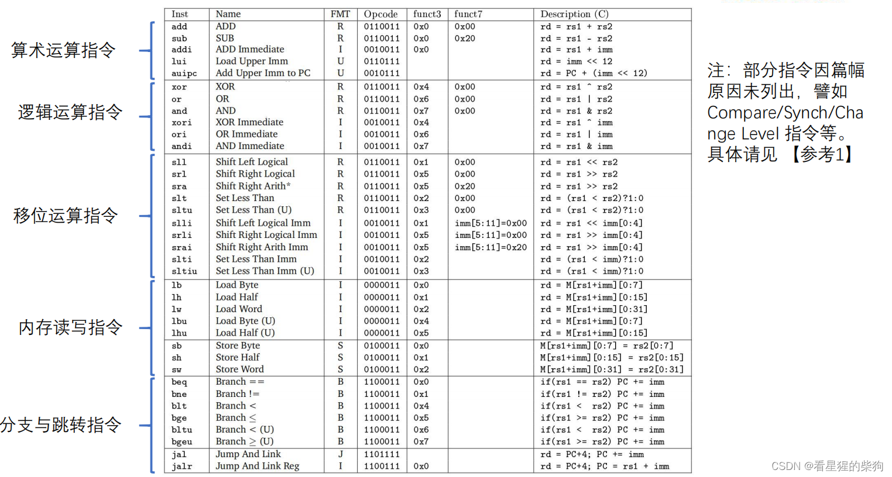
## RISC-V 汇编伪指令
Pseudoinstruction：伪指令
翻译成基本的机器指令
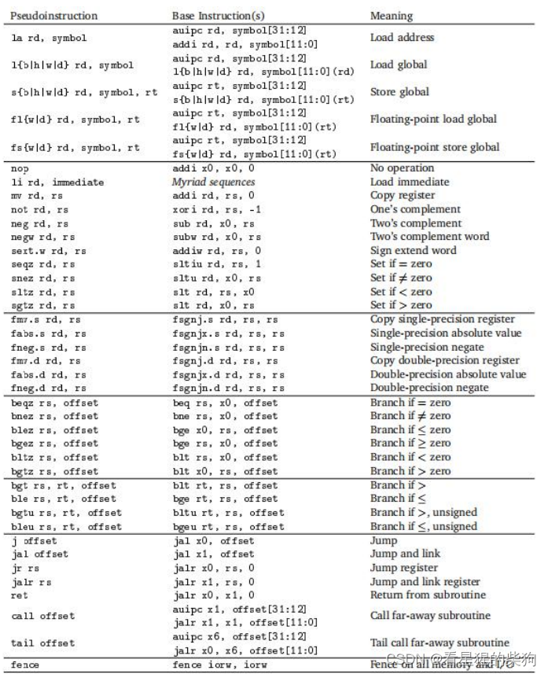


# 制作 RISC-V 操作系统 五 - RISC-V 汇编语言编程 三（Makefile 分析、指令分析）


## 分析 code/asm/add 中的 Makefile
makefile
```bash
EXEC = test

SRC = ${EXEC}.s

GDBINIT = ../gdbinit

include ../rule.mk
```
显然它还要执行 rule.mk

rule.mk
```bash
include ../../common.mk

.DEFAULT_GOAL := all
all:
	@${CC} ${CFLAGS} ${SRC} -Ttext=0x80000000 -o ${EXEC}.elf
	@${OBJCOPY} -O binary ${EXEC}.elf ${EXEC}.bin

.PHONY : run
run: all
	@echo "Press Ctrl-A and then X to exit QEMU"
	@echo "------------------------------------"
	@echo "No output, please run 'make debug' to see details"
	@${QEMU} ${QFLAGS} -kernel ./${EXEC}.elf

.PHONY : debug
debug: all
	@echo "Press Ctrl-C and then input 'quit' to exit GDB and QEMU"
	@echo "-------------------------------------------------------"
	@${QEMU} ${QFLAGS} -kernel ${EXEC}.elf -s -S &
	@${GDB} ${EXEC}.elf -q -x ${GDBINIT}

.PHONY : code
code: all
	@${OBJDUMP} -S ${EXEC}.elf | less

.PHONY : hex
hex: all
	@hexdump -C ${EXEC}.bin

.PHONY : clean
clean:
	rm -rf *.o *.bin *.elf
```
它还要执行 common.mk，然后运行命令行中给出的对应目标
common.mk

```bash
CROSS_COMPILE = riscv64-unknown-elf-
CFLAGS = -nostdlib -fno-builtin -march=rv32ima -mabi=ilp32 -g -Wall

QEMU = qemu-system-riscv32
QFLAGS = -nographic -smp 1 -machine virt -bios none

GDB = gdb-multiarch
CC = ${CROSS_COMPILE}gcc
OBJCOPY = ${CROSS_COMPILE}objcopy
OBJDUMP = ${CROSS_COMPILE}objdump
```
### 相关命令
QEMU -s 会在模拟器启动时自动启动 gdbserver，gdbserver 和 gdb 通过网络连接。gdb server 默认端口为 1234，然后等待 gdb 连接。-S 参数表示 gdbserver 启动被调试程序后停住，然后等待用户输入。-kernel ./executable 指定要加载的镜像
gdb -q 去掉启动时打印的一堆杂乱信息；-x 指定 gdb 启动时运行的配置脚本

远程调试是指要调试的程序不在本地：运行被调试程序的计算机上运行 gdbserver，本地机器可以通过 gdb 连接 gdbserver 来调试那个远程程序
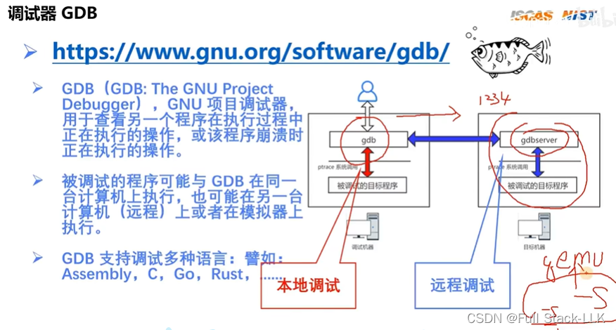

## 算术运算指令
乘法和除法由 M 模块扩展
RISC-V 指令的惯例是源在后、目的在前
### add


通过 funct3、funct7 和 opcode 识别为 add 指令
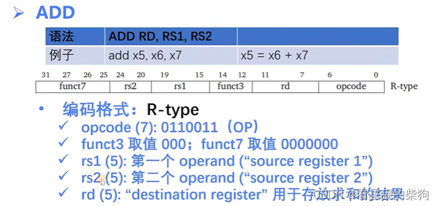
rsn 对应第 n 个寄存器，存储的值为 n
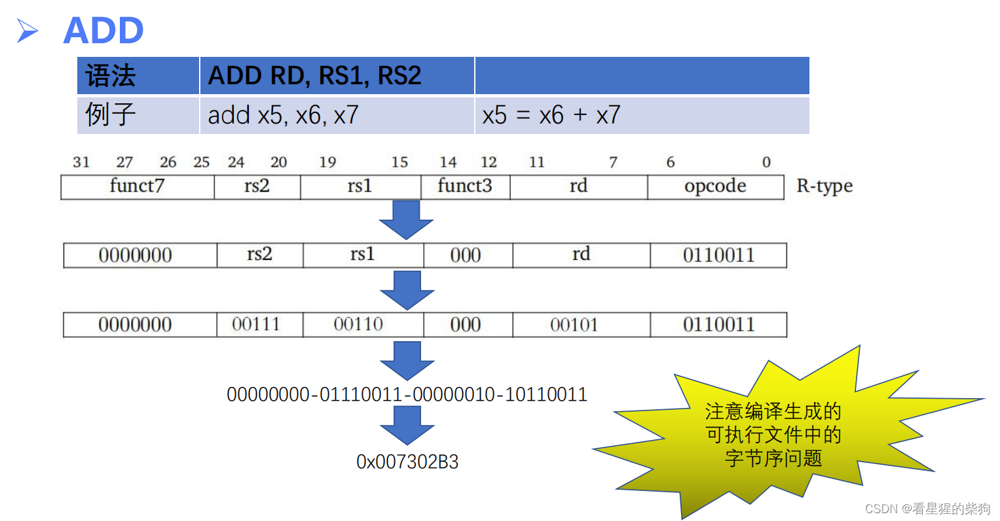


### add2

> 关于 4 和 -4 的补码
符号扩展：按照符号位进行扩展即可
零扩展（无符号扩展）：总是用 0 扩展
对于 4，直接算出 4 的二进制编码 0100（留出一位作为符号位），由于是正整数，向左扩展 0，得到 00000100
对于 -4，先算出 4 的二进制编码 0100，然后取反加 1 得到 1100；由于符号位是 1，向左扩展 1，得到 11111100

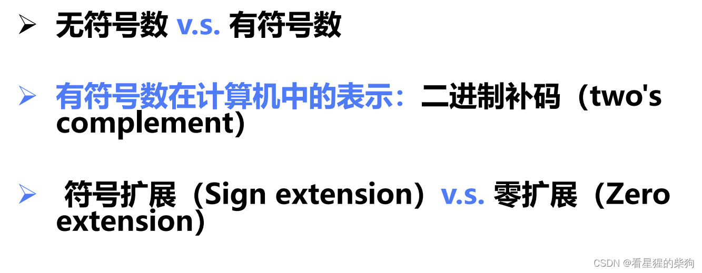   
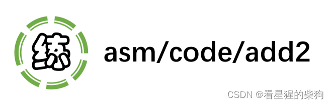


### sub

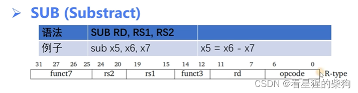


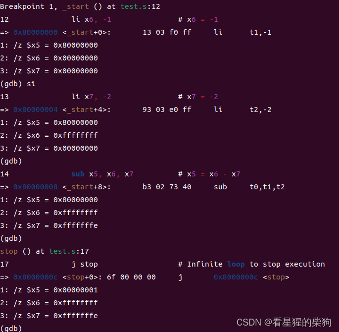

## 练习 5-1
- 对 code/asm/sub 进行反汇编，查看汇编指令 sub x5, x6, x7 对应的机器指令编码，并对照 RISC-V 规范自己解析该指令的编码。
0x407302b3 对应的二进制为 0100000-00111-00110-000-00101-0110011
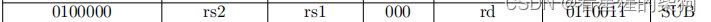

- 已知一条 RISC-V 机器指令在内存中的值为 b3 05 95 00，从左往右为从低地址到高地址，以字节为单位，将其翻译成对应的汇编指令。
0x009505b3 对应的二进制为 0000000-01001-01010-000-01011-0110011
add,x11,x10,x9
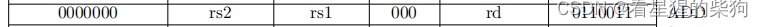


# 制作 RISC-V 操作系统 五 - RISC-V 汇编语言编程 四（伪指令与指令、addi、通过算术运算实现的相关伪指令、addi 指令的局限性、LUI（构造高 20 位）、练习、lui 与 addi 配合使用、li）


## 伪指令与指令
在讨论 RISC-V 架构中伪指令与指令的区别之前，我们先了解一下什么是指令、什么是伪指令。

指令：

- 指令是处理器可以直接执行的最基本的命令。
在 RISC-V 架构中，指令遵循特定的二进制格式，每条指令对应一组由硬件执行的操作。
指令集按照 RISC-V 标准细分为不同类型，包括整数运算指令、控制转移指令、加载和存储指令等。
每条指令都会被编译成固定长度的二进制指令，这些二进制代码由 RISC-V 处理器直接执行。
伪指令：

- 伪指令并不是处理器直接支持的硬件指令，它们是为了编程方便而设计的，使程序员更容易编写汇编代码。
伪指令在被汇编器处理时，通常会被翻译或展开成一条或多条基本机器指令。
伪指令赋予汇编语言更高级的特性，比如可读性更强的数据移动操作、对常数的操作等。
伪指令的例子可能包括 “li”（load immediate，加载立即数）这样的指令，它用于将一个立即数加载到寄存器中；实际上，它可能会被展开为一组 “lui”（load upper immediate，加载高位立即数）和 “addi”（add immediate，加立即数）指令，从而把一个 32 位或 64 位常数加载到寄存器中。

- 区别：- 直接执行 vs. 间接转换：指令可以由硬件直接执行，而伪指令需要由汇编器转换成一条或多条硬件指令。 
- 功能层次：指令通常是底层的、原子性的操作，而伪指令提供了更高层次的抽象，有助于简化复杂的指令序列。 
-  透明性：使用指令时，程序员需要明确知道并指定每条指令的操作；伪指令允许程序员编写更直观的代码，具体的指令细节由汇编器处理。- 二进制表示：指令有确定的二进制格式，而伪指令没有固定的二进制表示，因为它们会被转换成一条或多条实际指令。
-   编程便利性：伪指令旨在提高汇编语言的可读性和编写便利性，而指令是实际执行的基础。

归根结底，伪指令和指令的目标是一样的：完成程序员想要执行的操作。但伪指令提供了一种更简单、更抽象的方式来表达这些操作。

## addi
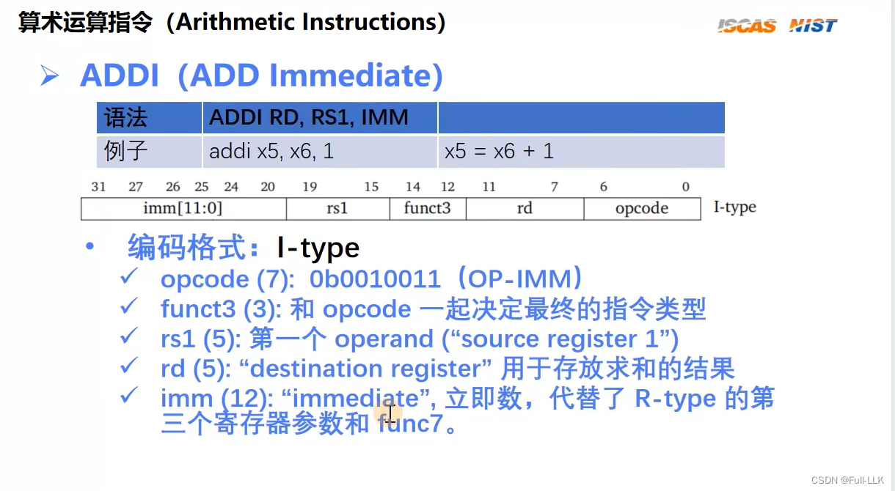
相关说明
addi 加一个负数等价于 subi 减一个整数；为了简洁起见，没有 subi 指令。

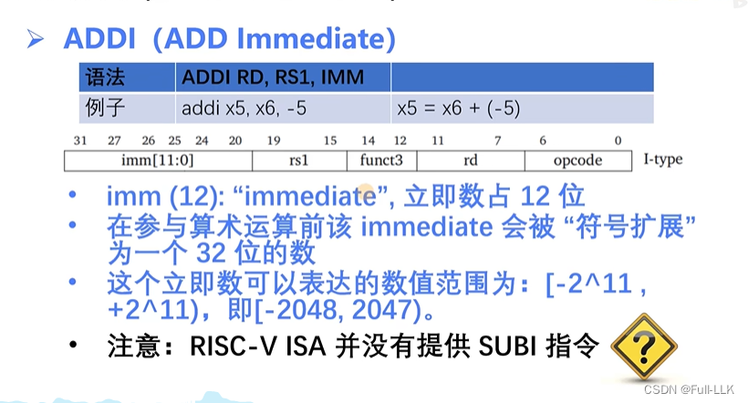
## 通过算术运算实现的相关伪指令
x0 寄存器恒为 0
  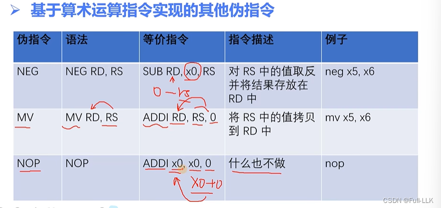
## addi 指令的局限性
这里的大数可以认为是超出这个可表示范围的数。
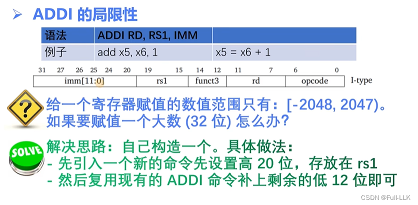
## LUI（构造高 20 位）
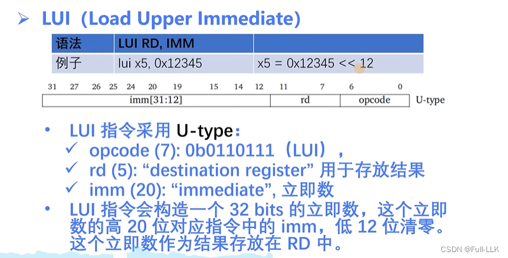
## 练习

##   lui 与 addi 配合使用
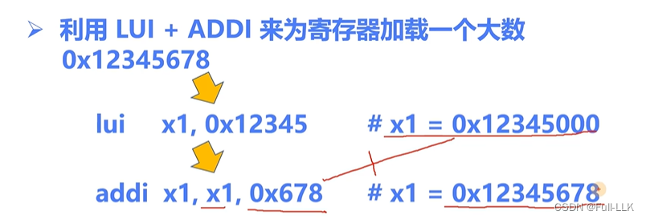
注意 addi 会先对立即数进行符号扩展再计算。
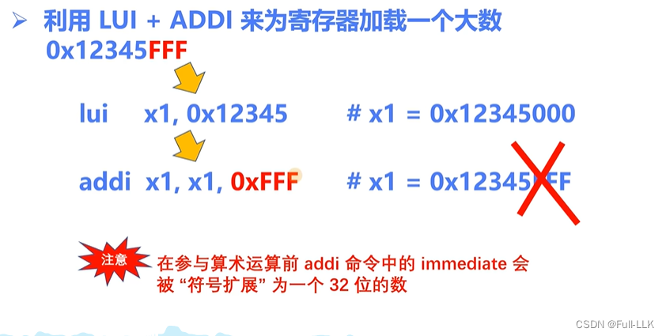
正确的方法
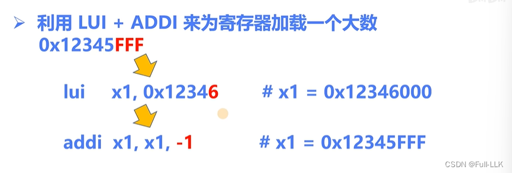
当然，面对这种情况需要做一些判断，比较麻烦；这时就有了 li 伪指令来简化这项工作。
## li
它减少了工作量；等价的指令会根据情况不同而变化，由汇编器负责——这里暂不深究。

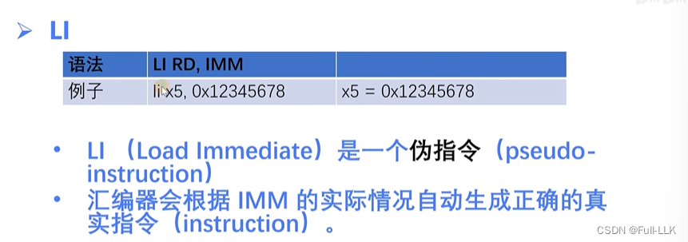

伪指令 li 会根据情况被汇编成不同的指令。
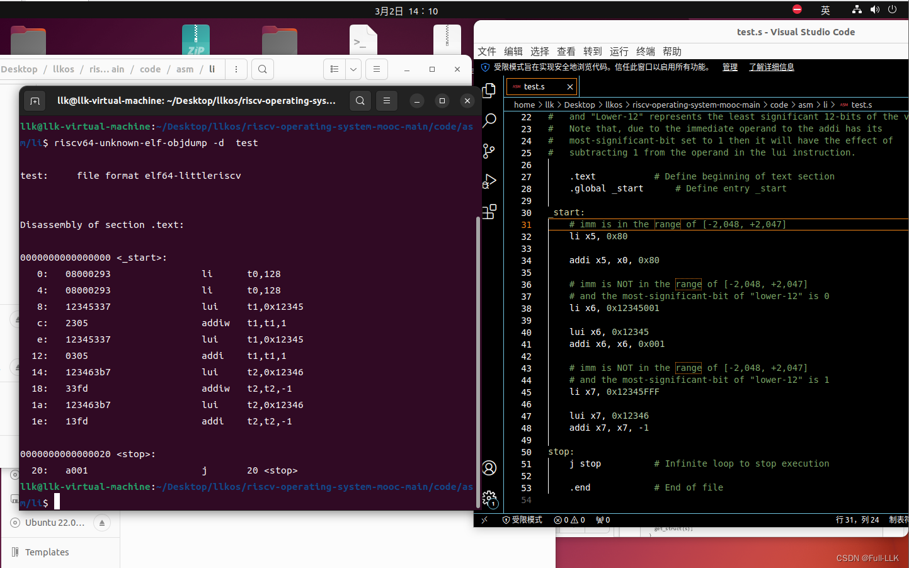

## auipc
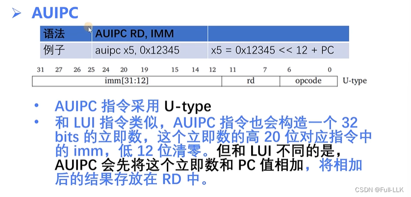

## la
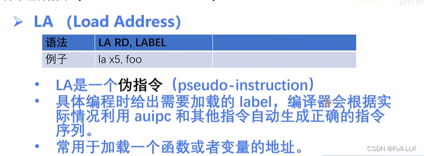

对应的字节码以及汇编后的指令与原指令的对比。
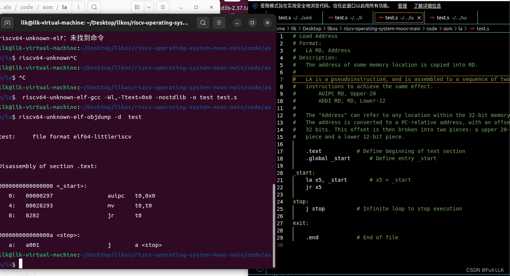

## 总结
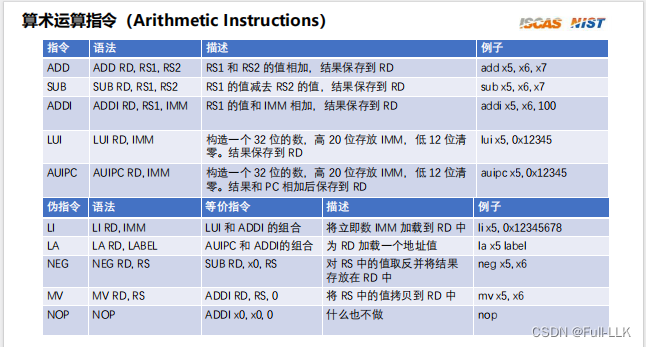


# 从零实现 RISC-V 操作系统五 - RISC-V 汇编语言编程五（逻辑运算、逻辑移位、算术移位、练习 5-4、内存读写指令、Load 指令、Store 指令、练习 5-6、register、.macro macro_name）


## 逻辑运算
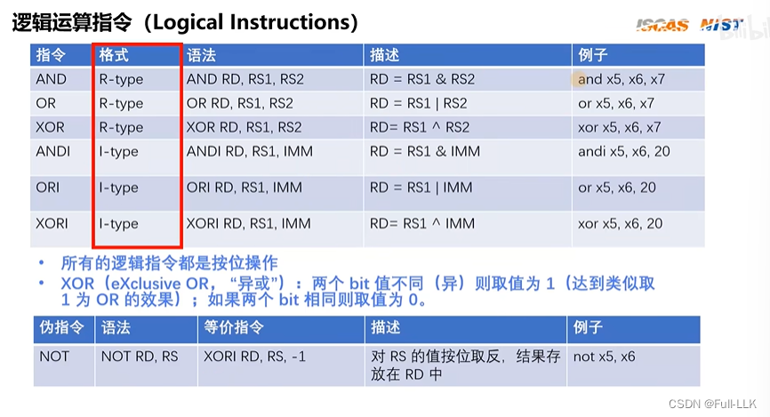
伪指令 NOT 通过与 -1 异或来实现取反的效果。

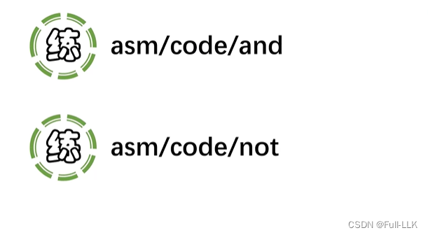
## 逻辑移位
 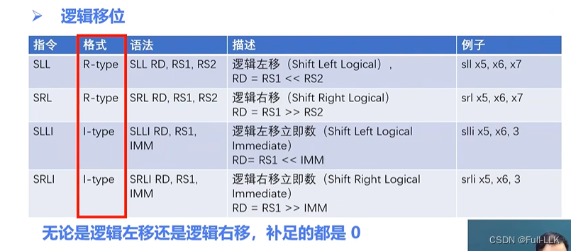
## 算术移位
10010000 右移一位得到 11001000。

右移对应除法。
左移对应乘法。
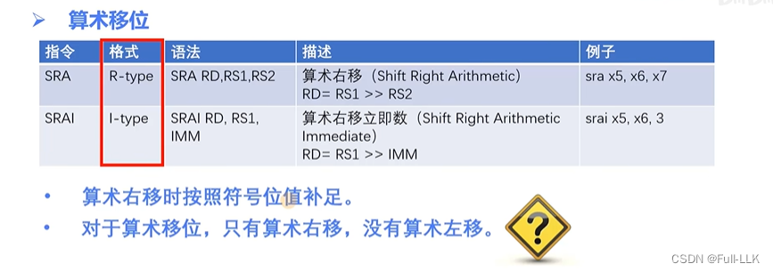
没有算术左移，因为左移会把符号位移出去。
 
 编译器有时会把乘除法指令优化成移位指令。
 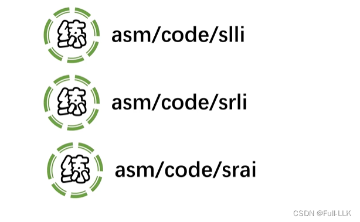
## 练习 5-4

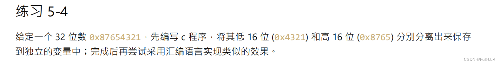

```c
#include<stdio.h>

int main()
{
    unsigned int a,b,c;
    c=0x87654321;
    a=(c<<16)>>16;
    b=c>>16;
    printf("a: 0x%x\n",a);
    printf("b: 0x%x\n",b);
}
```

```bash
.section .data
number:     .int 0x87654321
lowBits:    .int 0
highBits:   .int 0

.section .text
.globl _start
_start:
    movl number, %eax
    sall $16,%eax
    shrl $16, %eax
    movl %eax, lowBits

    movl number, %eax
    shrl $16, %edx
    movl %edx, highBits

    movl $1, %eax
    int $0x80
```

## 内存读写指令
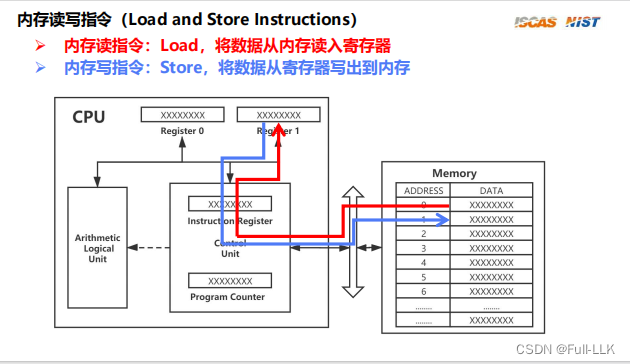
### Load 指令
IMM：12 位，所以能表示的范围有限。
LW：32 位已经填满了，所以不需要扩展。
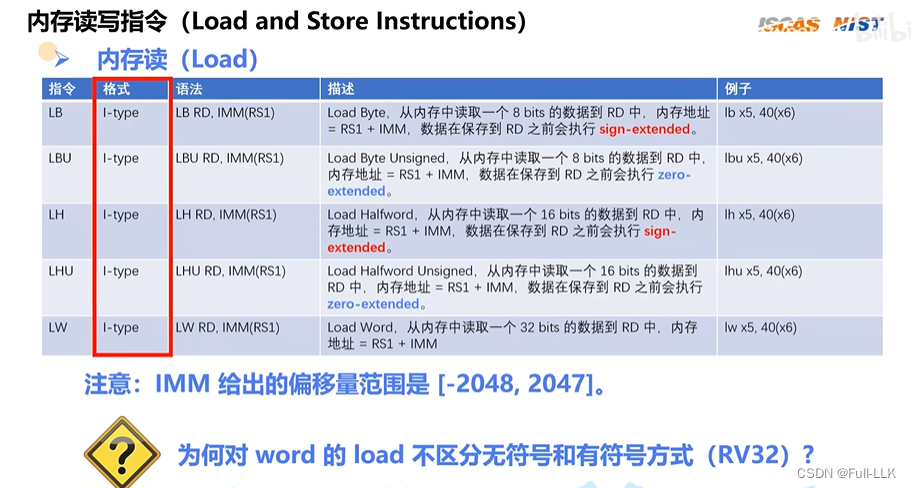
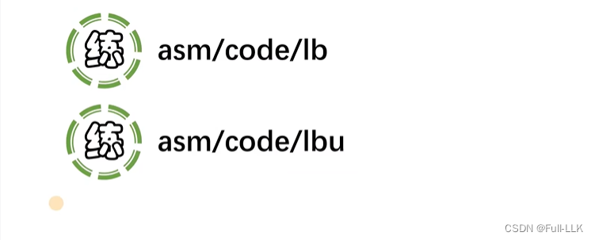
### Store 指令
它只是写入一定数量的位，所以不存在扩展的概念，也就不存在如何扩展的问题。
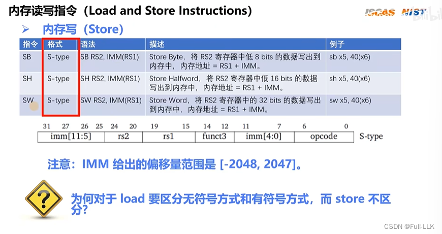


S-type：存储指令
### 练习 5-6

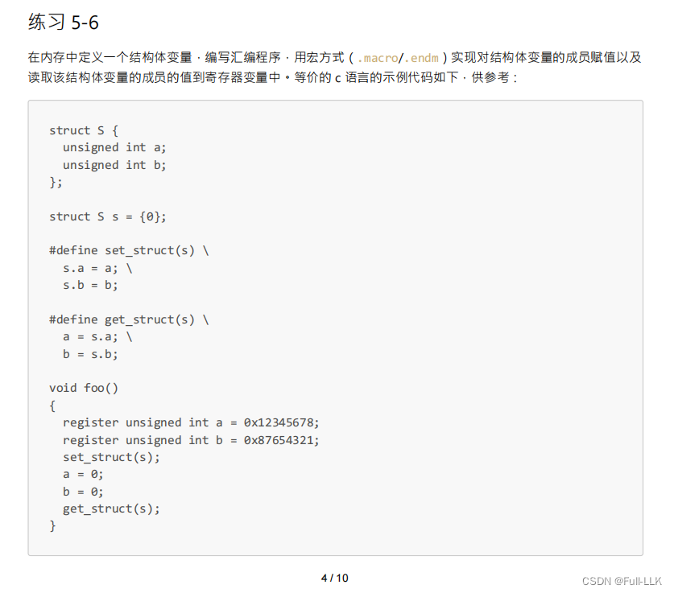
```bash
.macro set_struct s,a,b
    movl \a,\s
    movl \b,\s+4
.endm

.macro get_struct s,a,b
    movl \s,\a
    movl \s+4,\b
.endm

.section .data

stru:  
    .int 0
    .int 0

.section .text
.globl _start
_start:
    nop

.foo:
    movl $0x12345678, %eax
    movl $0x87654321, %edx
    set_struct stru,%eax,%edx
    movl $0, %eax
    movl $0, %edx
    get_struct stru,%eax,%edx
    ret
```


#### register
在 C 语言中，register 关键字用于告诉编译器应尽量把变量 a 存放在 CPU 寄存器中而不是 RAM 中。理论上，这可以让对变量 a 的访问和运算更快，因为 CPU 寄存器中的数据可以直接处理，无需花时间访问 RAM。不过，这个建议对现代优化编译器通常没有实际作用，因为编译器通常会自动选择把哪些变量放进寄存器。

上面的语句声明了一个名为 a 的无符号整型变量，并尝试把它存放在寄存器中。

注意，register 关键字只是一个建议，编译器可以选择忽略它。此外，不能对 register 变量取地址，因为它可能并不存在于内存中，也就没有可引用的内存地址。

不过在现代编程中，register 关键字已经很少使用了，优化编译器足够聪明，能自动决定哪些变量放在寄存器中以获得最佳性能。
####  .macro macro_name [parameter1, parameter2, ...] ; 汇编指令 .endm

```bash
.macro macro_name [parameter1, parameter2, ...] ; 汇编指令 .endm
```

- macro_name：这是你定义的宏的名字，调用宏时使用它。
- parameter1, parameter2, ...：这些是传给宏的参数。在宏体内，可以用反斜杠加参数名（\parameter1、\parameter2 等）来引用这些参数。
- .macro 和 .endm 指令之间的所有行都被视为宏的定义，调用宏时这些行会替换掉宏调用。.macro macro_name [parameter1, parameter2, ...] ;


# 从零构建 RISC-V 操作系统 五 - RISC-V 汇编语言编程 六（条件分支指令、伪指令、无条件跳转指令、问题、指令寻址方式总结）


## 条件分支指令
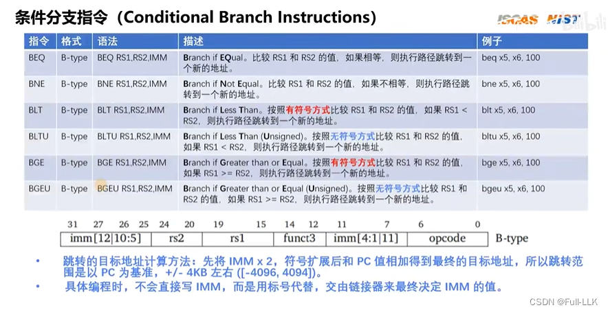
B 型：B 表示 branch（分支）
在第 6-11 位：先是第 11 位，然后是第 1 到 4 位
在第 24-31 位：先是第 5 到 10 位，然后是第 12 位

符号扩展，所以范围是 -2048*2 到 2047*2

标签：标签就相当于一个地址
## 伪指令
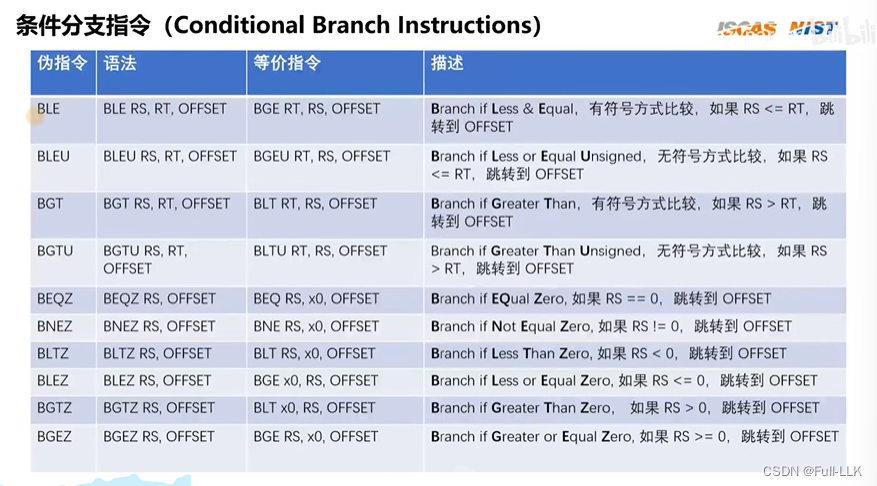
写 loop 而不是写地址值
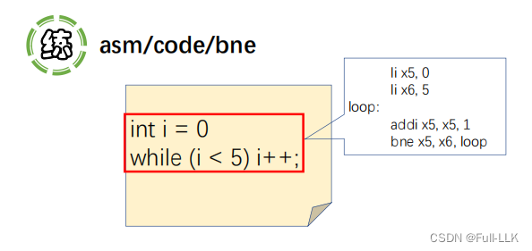

  

```c
char array[] = {'h', 'e', 'l', 'l', 'o', ',', 'w', 'o', 'r', 'l', 'd', '!', '\0'};
int len = 0;
while (array[len] != '\0') {
 len++;
}
```
汇编结果

```bash
.data
array: .byte 'h', 'e', 'l', 'l', 'o', ',', 'w', 'o', 'r', 'l', 'd', '!', 0

.text
.globl _start
_start:
    la t0, array     # 加载数组的地址到寄存器 t0
    li t1, 0         # 初始化计数器 t1 为 0

loop:
    lbu t2, 0(t0)    # 从内存中读取数组元素到寄存器 t2
    beqz t2, end     # 如果读取到的元素值为 0，即结束标记 '\0'，则跳转到 end 标签

    addi t1, t1, 1   # 计数器加1
    addi t0, t0, 1   # 数组指针移动到下一个元素
    j loop           # 无条件跳转到 loop 标签继续循环

end:
    # 此时计数器 t1 中存储的即为数组长度
    # 可以在该处添加代码来利用长度进行其他操作
    # 例如打印数组长度，或进行其他处理
    li a0, 1         # 将系统调用编号 1 (print integer) 装入寄存器 a0
    move a1, t1      # 将计数器 t1 中的值装入寄存器 a1
    ecall            # 发起系统调用

    # 程序结束，退出
    li a7, 10        # 将系统调用编号 10 (exit) 装入寄存器 a7
    li a0, 0         # 将返回值 0 装入寄存器 a0
    ecall            # 发起系统调用
```

## 无条件跳转指令
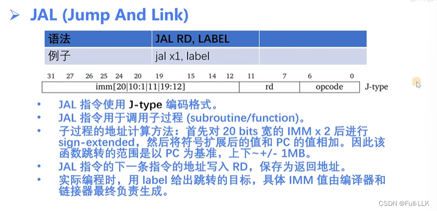
以寄存器的值为基址加上偏移量进行跳转
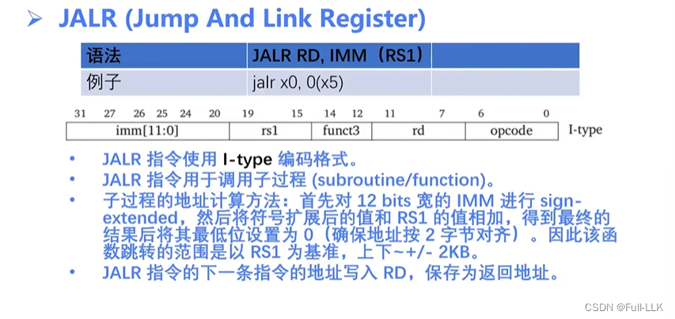

## 问题

AUPIC 构造一个 32 位数，以 IMM 作为其高 20 位，存入 X6；然后 JALR 跳转到 X6 的值加上 IMM 低 12 位的位置。所以整体上就是跳转到 X6 加上一个 32 位的值。

## 指令寻址方式总结



# 构建 RISC-V 操作系统 V - RISC-V 汇编语言编程 VII（栈、栈帧、为什么需要函数调用约定、寄存器约定、跳转与返回指令约定、被调用者约定、练习、C 与汇编混合编程、在汇编中嵌入 C、在 C 中嵌入汇编）


## 栈
先进后出

## 栈帧
栈帧存储了函数的局部变量以及相关的调用信息

## 为什么需要函数调用约定？
 

函数调用约定的存在，是为了确保在函数调用过程中，被调用者和调用者之间的通信和数据传递能够高效进行。它规定了寄存器如何使用、参数如何传递、返回值如何返回、栈如何管理等等。函数调用约定的存在带来了以下好处：

- 一致性与可移植性：函数调用约定定义了通用的规则和标准，确保不同函数之间的交互是一致且可预测的。这使得编译器能够生成遵循同一约定的代码，从而使代码可以在不同的编译器和平台之间移植和执行。

- 寄存器分配与管理：函数调用约定规定了在函数调用期间，哪些寄存器应该由被调用者保存和恢复，哪些寄存器可以由调用者使用。这确保了函数之间对寄存器的使用不会相互干扰，并且在函数调用结束后寄存器能够被正确恢复。

- 参数传递：函数调用约定定义了函数参数的传递方式。通过约定参数的传递方式，编译器和汇编器就能高效地处理函数参数的传递，并生成正确的汇编代码和机器代码。常见的参数传递方式包括将参数值存入特定的寄存器、通过栈传递参数等等。

- 返回值传递：函数调用约定规定了函数如何将返回值传给调用者。通过定义返回值的传递方式，编译器和汇编器能够生成正确的代码，确保函数的返回值被正确地传回给调用者。

- 栈管理：函数调用约定定义了函数调用期间栈的管理方式，包括栈帧如何分配和释放、栈指针如何管理等等。这确保了函数调用期间栈的使用是安全可靠的。
## 寄存器约定
ra 存放函数的返回地址
a0 和 a1 存放函数的返回值

N/A：无关紧要；由谁维护都无所谓

##  跳转与返回指令约定

尾调用的具体用法以后自然会用到，这里先记住就好。


实际调用


## 被调用者约定
如果被调用者还会调用其他函数，就必须额外保存 ra 寄存器（当前函数的返回地址），因为调用其他函数会改变当前的 ra

## 练习


```bash
# Calling Convention
# Demo to create a leaf routine
#
# void _start()
# {
#     // calling leaf routine
#     square(3);
# }
#
# int square(int num)
# {
#     return num * num;
# }

	.text			# Define beginning of text section
	.global	_start		# Define entry _start

_start:
	la sp, stack_end	# prepare stack for calling functions

	li a0, 3
	call square

	# the time return here, a0 should stores the result
stop:
	j stop			# Infinite loop to stop execution

# int square(int num)
square:
	# prologue
	addi sp, sp, -8
	sw s0, 0(sp)
	sw s1, 4(sp)

	# `mul a0, a0, a0` should be fine,
	# programing as below just to demo we can contine use the stack
	mv s0, a0
	mul s1, s0, s0
	mv a0, s1

	# epilogue
	lw s0, 0(sp)
	lw s1, 4(sp)
	addi sp, sp, 8

	ret

	# add nop here just for demo in gdb
	nop

	# allocate stack space
stack_start:
	.rept 12
	.word 0
	.endr
stack_end:

	.end			# End of file


```


```bash
# Calling Convention
# Demo how to write nested routines
#
# void _start()
# {
#     // calling nested routine
#     aa_bb(3, 4);
# }
#
# int aa_bb(int a, int b)
# {
#     return square(a) + square(b);
# }
#
# int square(int num)
# {
#     return num * num;
# }

	.text			# Define beginning of text section
	.global	_start		# Define entry _start

_start:
	la sp, stack_end	# prepare stack for calling functions

	# aa_bb(3, 4);
	li a0, 3
	li a1, 4
	call aa_bb

stop:
	j stop			# Infinite loop to stop execution

# int aa_bb(int a, int b)
# return a^2 + b^2
aa_bb:
	# prologue
	addi sp, sp, -16
	sw s0, 0(sp)
	sw s1, 4(sp)
	sw s2, 8(sp)
	sw ra, 12(sp)

	# cp and store the input params
	mv s0, a0
	mv s1, a1

	# sum will be stored in s2 and is initialized as zero
	li s2, 0

	mv a0, s0
	jal square
	add s2, s2, a0

	mv a0, s1
	jal square
	add s2, s2, a0

	mv a0, s2

	# epilogue
	lw s0, 0(sp)
	lw s1, 4(sp)
	lw s2, 8(sp)
	lw ra, 12(sp)
	addi sp, sp, 16
	ret

# int square(int num)
square:
	# prologue
	addi sp, sp, -8
	sw s0, 0(sp)
	sw s1, 4(sp)

	# `mul a0, a0, a0` should be fine,
	# programing as below just to demo we can contine use the stack
	mv s0, a0
	mul s1, s0, s0
	mv a0, s1

	# epilogue
	lw s0, 0(sp)
	lw s1, 4(sp)
	addi sp, sp, 8

	ret

	# add nop here just for demo in gdb
	nop

	# allocate stack space
stack_start:
	.rept 12
	.word 0
	.endr
stack_end:

	.end			# End of file

```


```c
char array[] = {'h', 'e', 'l', 'l', 'o', ',', 'w', 'o', 'r', 'l', 'd', '!', '\0'};
int len = 0;
while (array[len] != '\0') {
 len++;
}
```

```bash
.section .text
.globl square
.type square, @function
square:
  li t0, 0       # 设置寄存器 t0 为 0 (sum)
  mul a0, a0, a0  # 计算 a0 * a0，并将结果保存在 a0 中
  mv a1, a0      # 将计算结果保存在 a1 中
  jr ra           # 返回到调用者

.globl sum_squares
.type sum_squares, @function
sum_squares:
  li t0, 0       # 设置寄存器 t0 为 0 (sum)
  li t1, 1       # 设置寄存器 t1 为 1 (j)

loop:
  bgt t1, a0, end_loop  # 如果 t1 大于 a0，则跳转到 end_loop 标签处
  mv a0, t1             # 将 j 的值保存在 a0 中
  jal ra, square        # 调用 square 函数，计算平方并返回结果放置在 a0 中
  add t0, t0, a0        # 将计算结果加到 sum 中
  addi t1, t1, 1        # j++
  j loop               # 继续循环

end_loop:
  mv a0, t0   # 将 sum 的值保存在 a0 中
  jr ra       # 返回到调用者

.globl _start
.type _start, @function
_start:
  li a0, 3    # 设置 a0 为 3
  jal ra, sum_squares  # 调用 sum_squares 函数
```

## C 与汇编混合编程

## 在汇编中嵌入 C


```c
# ASM call C

	.text			# Define beginning of text section
	.global	_start		# Define entry _start
	.global	foo		# foo is a C function defined in test.c

_start:
	la sp, stack_end	# prepare stack for calling functions

	# RISC-V uses a0 ~ a7 to transfer parameters
	li a0, 1
	li a1, 2
	call foo      # 
	# RISC-V uses a0 & a1 to transfer return value
	# check value of a0

stop:
	j stop			# Infinite loop to stop execution

	nop			# just for demo effect

stack_start:
	.rept 12
	.word 0
	.endr
stack_end:

	.end			# End of file

```

```c
/*
 * a0 --> a
 * a1 --> b
 * c  <-- a0
 */
int foo(int a, int b)
{
	int c = a + b;
	return c;
}
```
最后，make 把两者编译并链接在一起；汇编代码可以正常调用 C 中定义的 foo 函数，调用形式就是简单的 `call function_name`
## 在 C 中嵌入汇编
volatile：不需要优化

下面两种格式都可以


在 C 代码中嵌入 RISC-V 汇编语言需要使用内联汇编。内联汇编的语法和用法可能因编译器而有所不同；下面是一个通用的示例，展示如何在 C 代码中嵌入 RISC-V 汇编语言。

核心语法：

```c
asm("assembly code"
    : output operands
    : input operands
    : clobbered registers);
 
```

- assembly code：这是要嵌入的 RISC-V 汇编代码。
- output operands：表示输出操作数，可以是变量名、寄存器或内存地址。
- input operands：表示输入操作数，同样可以是变量名、寄存器或内存地址。
- clobbered registers：指定被修改的寄存器。
- 注意：各项之间用冒号（:）分隔，但最后一项之后不加冒号。

1. 操作数约束：
在内联汇编中，操作数约束用于指定嵌入汇编代码中的寄存器约束。

例如，寄存器约束包括以下字符：r（通用寄存器）、a（参数寄存器）和 f（浮点寄存器）。数字表示特定的操作数。例如，%0 表示第一个操作数，%1 表示第二个操作数，以此类推。

2. 输入与输出操作数：
在内联汇编中，可以用输出和输入操作数约束，把 C 代码中的变量名指定为汇编代码的输入和输出。

3. 输出：使用 = 符号配合约束来指定一个输出操作数。例如，"=r"(output_var) 表示把结果输出到 output_var 变量中。
输入：使用输入操作数约束来指定一个输入操作数。例如，"r"(input_var) 表示把 input_var 变量作为输入操作数。
4. 被修改的寄存器：
在内联汇编中，可以指定哪些寄存器会被修改，这样编译器会在嵌入汇编之前保存它们，并在之后恢复它们。

例如，"cc" 表示所有可能被修改的寄存器；"memory" 表示嵌入的汇编可能会修改内存。这些约束确保嵌入的汇编代码不会对其他代码产生副作用。

下面是一个在 C 代码中嵌入 RISC-V 汇编的例子：

```c

int main() {
   int a = 10, b = 20, sum;

   asm volatile (
      "add %0, %1, %2\n\t"  // 使用RISC-V汇编的加法指令
      : "=r"(sum)           // 输出操作数（结果）使用寄存器约束，保存在sum变量中
      : "r"(a), "r"(b)      // 输入操作数使用寄存器约束，对应a和b变量
      : "cc"               // 修改寄存器
   );

   return 0;
}
```

  
在这个例子中，我们使用 RISC-V 汇编的 add 指令来执行 a 和 b 的加法运算，并把结果存入 sum 变量。
## 练习


```c
int foo(int a, int b)
{
int c;
c = a * a + b * b;
return c;
}
```

```c
int foo(int a, int b)
{
    int c;
    asm volatile(
        "mul %[result_a], %[a], %[a]\n"
        "mul %[result_b], %[b], %[b]\n"
        "add %[c], %[result_a], %[result_b]\n"
        : [c] "=r" (c)
        : [a] "r" (a), [b] "r" (b), [result_a] "r" (0), [result_b] "r" (0)
    );
    return c;
}
 
```

通过嵌入 asm volatile 指令，我们可以在 C 函数内部嵌入 RISC-V 汇编代码。在汇编代码中，使用 mul 指令把 a 的平方存入 result_a 寄存器，把 b 的平方存入 result_b 寄存器，然后用 add 指令把 result_a 和 result_b 的值相加，并将结果存入 c 寄存器。最后，使用约束操作数（[c] "=r" (c)）把 c 寄存器的值存入变量 c，变量 a 和 b 的值则存入对应的寄存器中。

