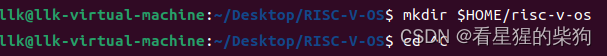
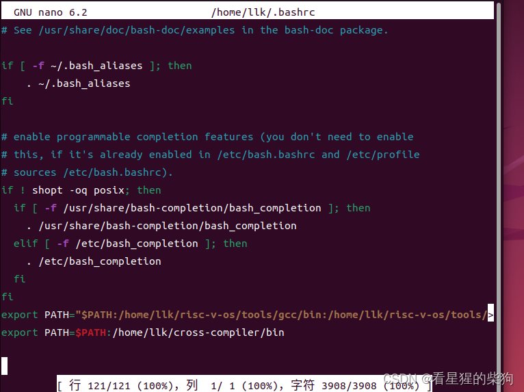


# 前言
由于之前那个操作系统难度太大，打算先从这个 RISC-V 操作系统入手，等以后知识更深入了再回头完善。
# 环境配置
安装依赖
```bash
$ sudo apt update
$ sudo apt install build-essential gcc make perl dkms git gcc-riscv64-unknown-elf gdb-multiarch qemu-system-misc
```
创建目录 risc-v-os 并进入
将压缩包复制到该目录下

在此处解压

将 export PATH="$PATH:/home/llk/risc-v-os/tools/gcc/bin:/home/llk/risc-v-os/tools/qemu/bin" 写入主目录

然后激活
```bash
source $HOME/.bashrc
Linux source命令：

通常用法：source filepath 或 . filepath

功能：使当前shell读入路径为filepath的shell文件并依次执行文件中的所有语句，通常用于重新执行刚修改的初始化文件，使之立即生效，而不必注销并重新登录。
```
然后导入项目文件
试一下 make 能否编译成功

说明成功了

