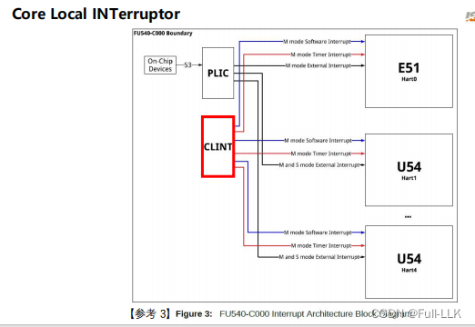
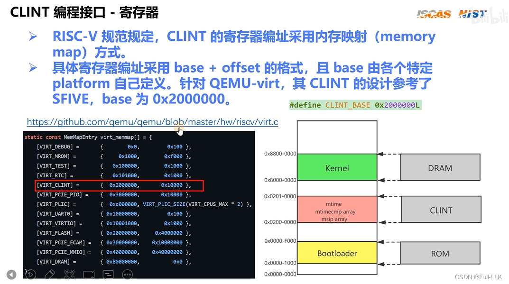
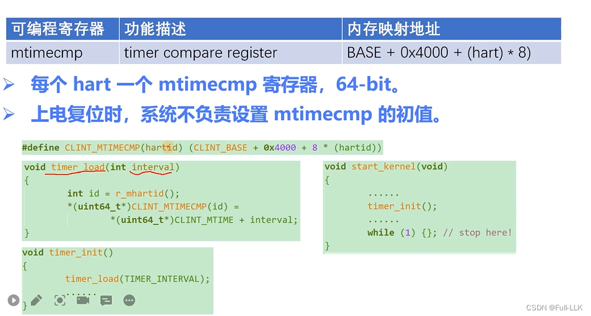
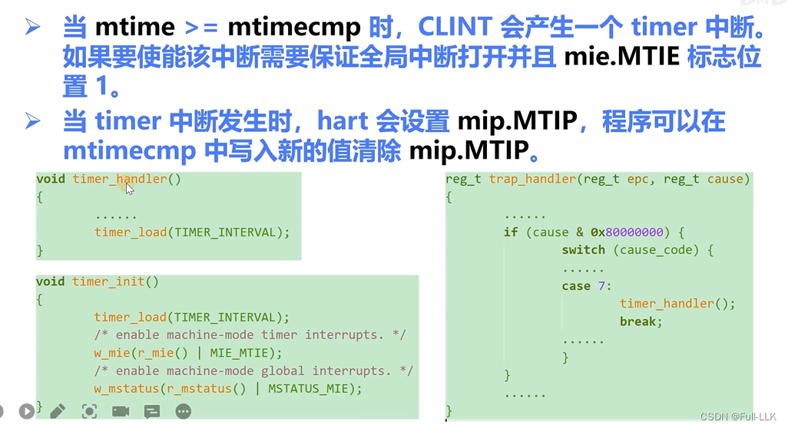
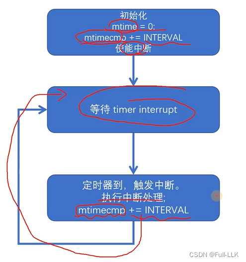
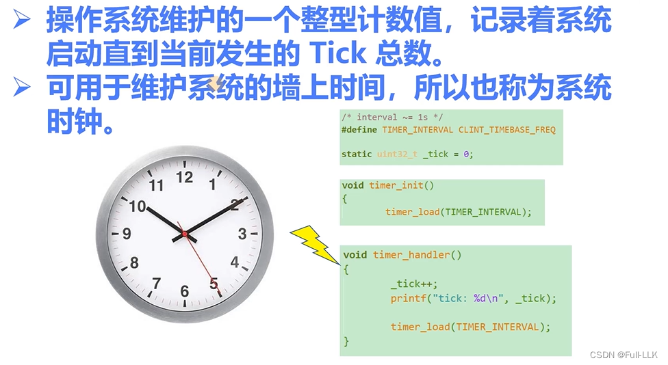



# CLINT
产生软件中断和定时器中断

# 定时器中断

# mtime
类似计数器，按照硬件对应的固定频率递增

上电后自动复位为 0，由硬件自动完成

# mtimecmp
 需要手动设置，同样是 64 位
我们实现的初始化根据 hartid 给对应的 mtimecmp 设置一个初始值，然后设置一些中断使能位

# 机制
mtime 按一定频率递增，当它大于等于 mtimecmp 时，就会产生定时器中断

MTIE 是 mie 中 M 模式的定时器中断使能位
MTIP 是 mip 中 M 模式下表示当前是否正在发送定时器中断的位

# 总体框架流程

# 时钟节拍（Time Tick）
硬件定时器的周期：多久触发一次定时器中断

# 系统时钟
通过读取当前时间和此时的 tick 值，计算出最新的当前时间

# 代码

[https://github.com/FULLK/risllkos/tree/main/Fullkenerl7](https://github.com/FULLK/risllkos/tree/main/Fullkenerl7)

