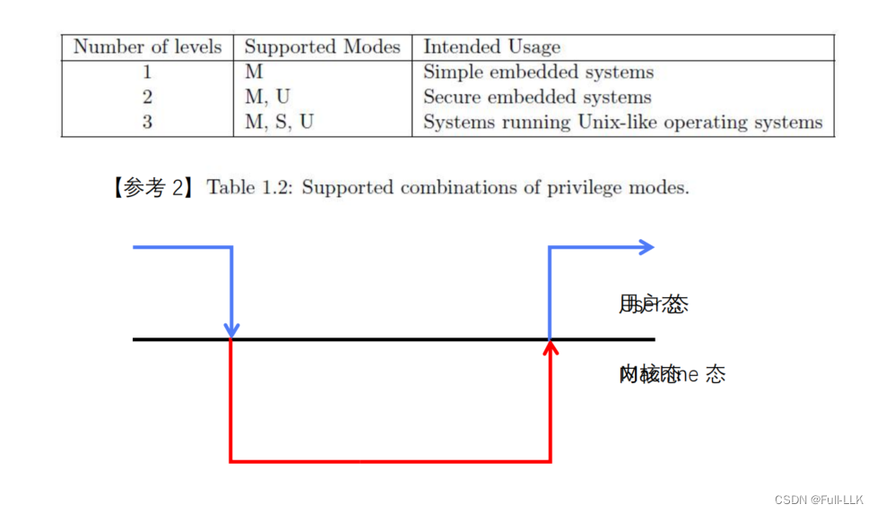
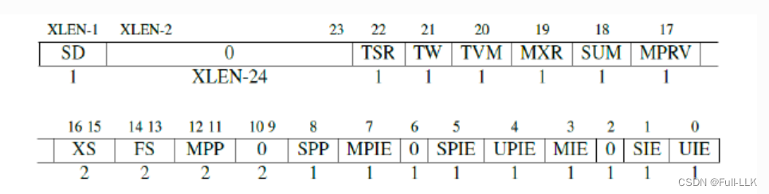
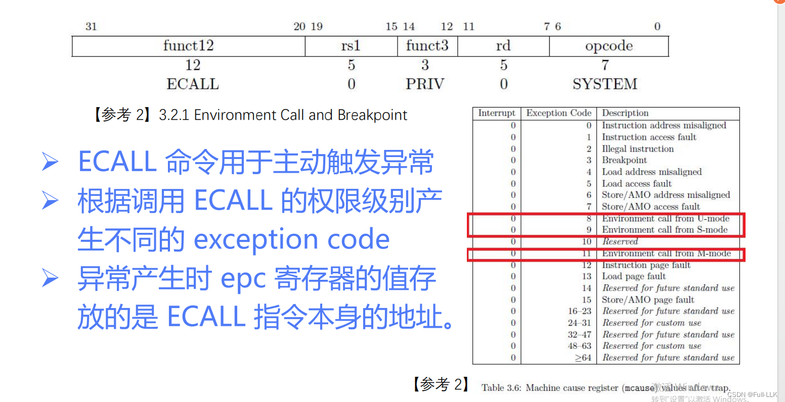
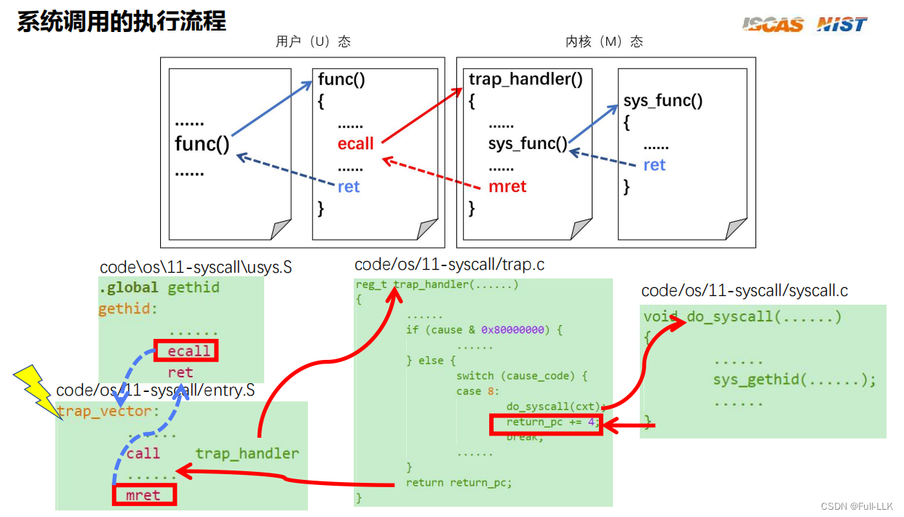
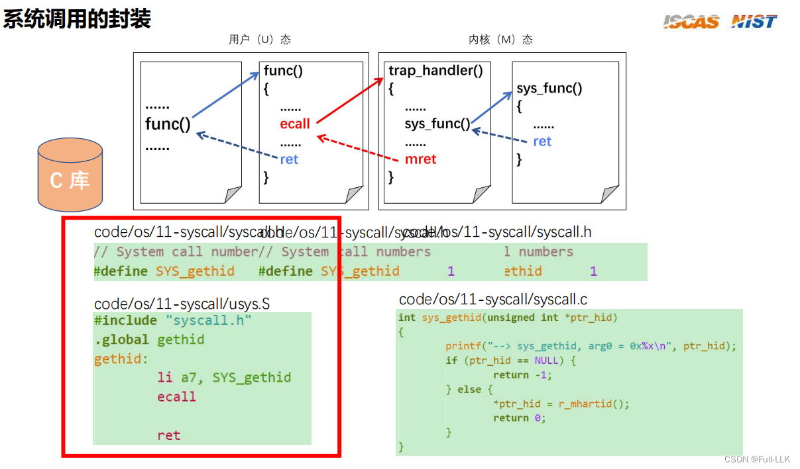


# 用户态和内核态



# mstatus 的设置
此时 UIE 置 1，MPIE 为 1，MPP 置 0
这意味着当前特权级允许 UIE 中断发生，并且第一次 mret 之后特权级恢复为用户态，同时 MIE 也保持开启

# 模式切换
ecall 相当于触发一个异常，然后在对应的异常中处理相应的系统调用

# 核心流程
- 首先在进程中使用 gethartid 函数
-  gethartid 函数将寄存器 a7 保存为调用号，然后 ecall 进行系统调用，ret 返回到调用 gethartid 函数之后的下一个地址
- ecall 触发中断进入 trap_vector，此时 mepc 是 ecall 的地址，mecause 为 8
- trap_vector 保存当前上下文，然后把指向所保存上下文的指针作为 trap_hander 的第三个参数；trap_hander 执行完后把返回值写入 mepc，然后 mret 到 mepc 对应的位置，此时就是 ecall+4 的地址
- trap_hander 执行 syscall 函数，参数是之前传入的已保存上下文，然后 syscall 函数把 hart 的 id 赋给该上下文的 a0 寄存器
- 这时返回到最终恢复已保存上下文的地方，也就是 trap_vector 中，恢复上下文后，此时的返回值恰好就是 hart 的 id，而 mepc 也已被设为 ecall+4，于是返回到上一级 gethartid 的 ret 处，此时返回值同样是 hart 的 id，也就拿到了 hartid

原则上 a6 其实也可以用作参数

# 封装
建议把用户态函数使用的头文件和内核态函数使用的头文件分别封装成单独的文件；用户态的作为 C 库，内核态的由内核维护。如果头文件中的相关定义不一致，就可能出问题



# 代码
[https://github.com/FULLK/risllkos/tree/main/Fullkenerl11](https://github.com/FULLK/risllkos/tree/main/Fullkenerl11)


```assembly
#ifdef CONFIG_SYSCALL
    li      t0, 0xffffffff          # Load the value 0xffffffff into register t0
    csrw    pmpaddr0, t0           # Write this value to the PMP address register 0
    li      t0, 0xf                 # Load the value 0xf (binary 1111) into register t0
    csrw    pmpcfg0, t0             # Write this value to the PMP configuration register 0
#endif
```
## 背景说明

在 RISC-V 架构中，PMP（Physical Memory Protection，物理内存保护）是一项用于控制不同特权级访问内存能力的功能。它通过一系列配置寄存器（PMP 配置寄存器，如 `pmpcfg0`）和地址寄存器（PMP 地址寄存器，如 `pmpaddr0`）来定义内存区域的访问权限（读、写、执行）以及哪些特权模式可以访问这些区域。

## 代码示例分析

假设你正在开发一个 RISC-V 操作系统，并使用 QEMU 作为模拟器来测试代码。当升级到 QEMU 6.0 及以上版本时，会遇到一个与 PMP 配置有关的问题：如果没有设置任何 PMP 条目，来自 Supervisor（S）模式或 User（U）模式的内存访问就会引发异常。

##  解释

- **`li t0, 0xffffffff`**：这行代码把值 `0xffffffff` 赋给寄存器 `t0`。这个值在 32 位地址空间中代表一个非常大的地址（几乎接近地址空间的最大值）。按照标准，这个值用于设置 PMP 条目的上界地址，但由于 QEMU 的某些实现细节，全部设为 1 可能会被解释为覆盖整个地址空间的特殊情况。

- **`csrw pmpaddr0, t0`**：这条指令把寄存器 `t0` 的值写入 PMP 地址寄存器 0（`pmpaddr0`），尝试将第一个 PMP 条目设置为覆盖整个地址空间的访问权限。

- **`li t0, 0xf`**：这行代码把寄存器 `t0` 设为 0xf，其二进制形式为 1111。在 PMP 配置中，每一位对应 PMP 条目的一种访问权限（读、写、执行），所以 0xf 表示开启全部权限。

- **`csrw pmpcfg0, t0`**：最后，这行代码把寄存器 `t0` 的值写入 PMP 配置寄存器 0（`pmpcfg0`），激活第一个 PMP 条目并设置读、写、执行权限。

## 目的

这段代码的主要目的是作为一种临时解决方案，确保即使没有对 PMP 条目进行详细配置，用户态和监管态的程序也能正常访问内存，以避免在使用 QEMU 6.0 及以上版本时遇到的异常问题。其做法是配置一个覆盖整个地址空间的 PMP 条目并授予全部访问权限，从而绕过新版 QEMU 对未配置 PMP 条目的严格检查。

在 RISC-V 架构中，PMP（物理内存保护）机制通过一系列配置寄存器来控制对物理内存的访问权限，从而增强系统安全性。PMP 寄存器分为地址寄存器（如 `pmpaddrN`）和配置寄存器（如 `pmpcfgN`），二者共同定义多个内存访问控制区域。

当我们说“尝试将第一个 PMP 条目设置为覆盖整个地址空间的访问权限”时，指的是通过编程 PMP 地址寄存器和配置寄存器，创建一条 PMP 规则，意在允许对整个物理地址空间进行读、写和执行操作，不加任何访问限制。具体到代码示例：

- `li t0, 0xffffffff`：这一行是加载指令，把立即数 0xffffffff（即 32 位地址空间中的最大值减一）加载到寄存器 `t0` 中。在 TOR（Top of Range）匹配模式下，PMP 地址寄存器中的值通常表示区间的上界地址。理论上，全 1 的上界地址可以被理解为试图覆盖整个地址空间，不过实际上由于地址对齐和边界处理的原因，它可能无法精确覆盖地址空间的最后一个字节。

- `csrw pmpaddr0, t0`：这条指令把寄存器 `t0` 中的值写入 PMP 地址寄存器 0（`pmpaddr0`），尝试设置第一个 PMP 条目的上界地址。

- `li t0, 0xf` 和 `csrw pmpcfg0, t0`：这两行配置 PMP 条目的权限。`0xf`（十六进制）等于二进制的 1111，分别代表读（R）、写（W）、执行（X）和锁定（L）权限位。通过写入 `pmpcfg0`，为 PMP 条目 0 设置了全部权限。

然而，根据 RISC-V PMP 规范，单个 PMP 条目通常无法直接覆盖整个地址空间。尤其是在 TOR 模式下，`pmpaddr0` 寄存器存放的是第一个区间上界物理地址的高 32 位；即使全部设为 1，也无法完美覆盖地址空间的最末端。此外，正如前面讨论中提到的，QEMU 的具体实现可能会在某些情况下对 `pmpaddr0 = 0xffffffff` 做特殊处理，使其看起来覆盖了整个地址空间。

