
# ISA 基础介绍
## 什么是 ISA
接口规范：可以理解为一种标准
微架构：指令集架构的一种硬件实现；例如，如果两种硬件架构都能实现 x86，那么这两种硬件架构都可以称为微架构
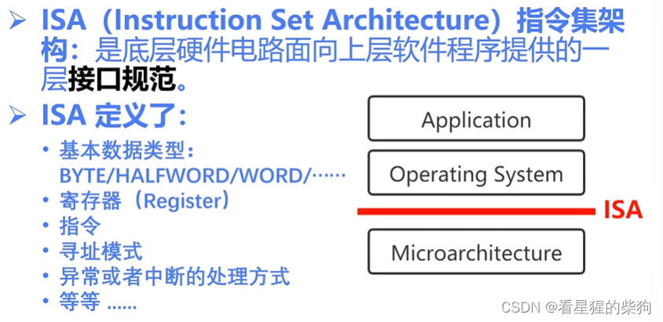
##  为什么要设计 ISA
为上层软件提供一种抽象，建立规则与约束，使程序员不必关心具体的电路结构，也不必担心引发硬件故障
## CISC 与 RISC
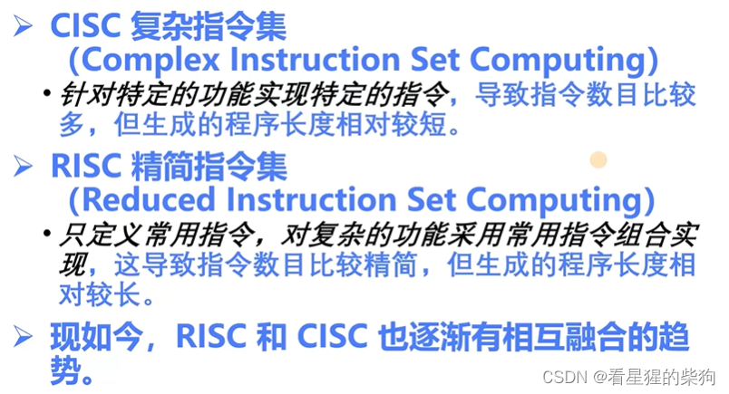
## ISA 的位宽
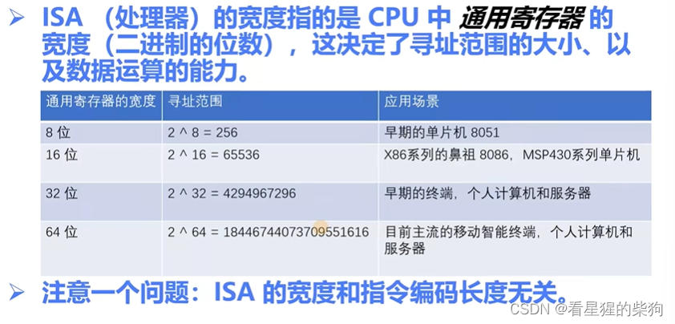
ISA 的位宽与指令的位宽无关（即不能说 32 位机器的指令必然是 32 位的）

## 知名 ISA 简介
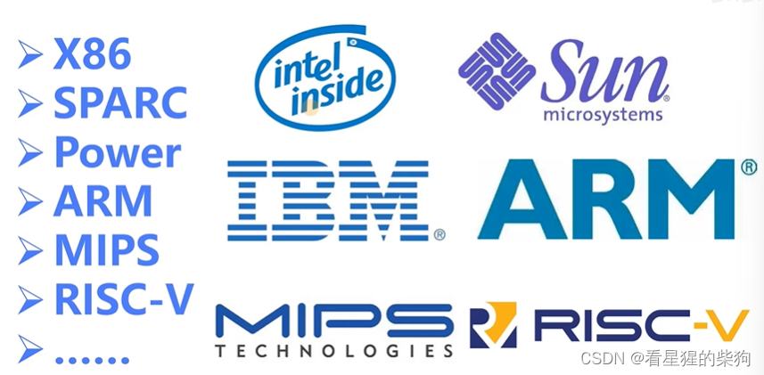
CISC：X86
RISC：图中除此之外的全部
# RISC-V 的历史与特点

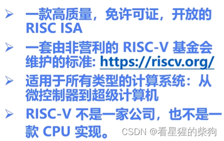

# RISC-V 的发展
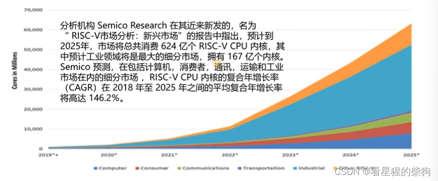
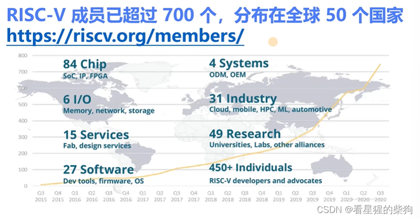

# RISC-V ISA 命名规则
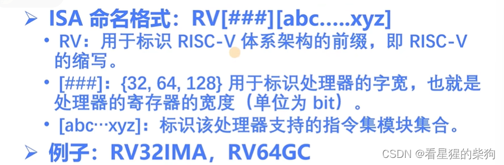
RV32IMA：32 位，I 模块，M 模块，A 模块
# 模块化 ISA
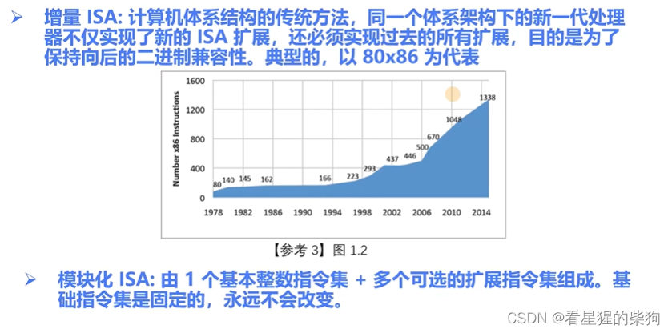

无论是 32 位还是 64 位 RISC-V，指令都是 32 位的，而使用压缩指令集时指令为 16 位
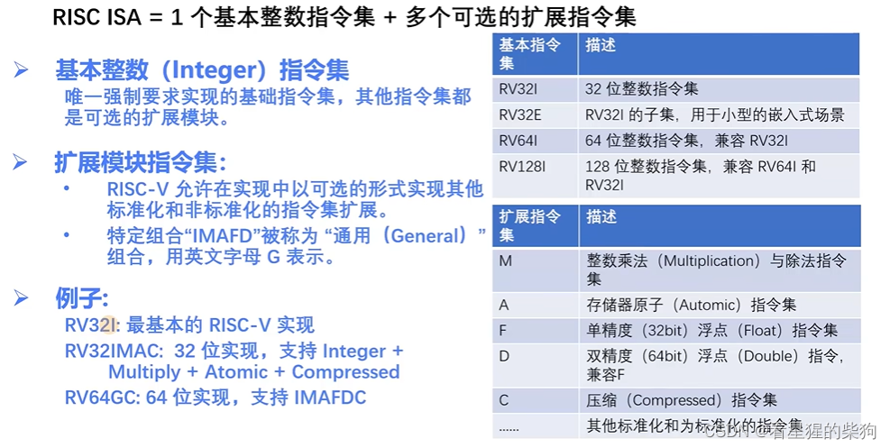
# 通用寄存器
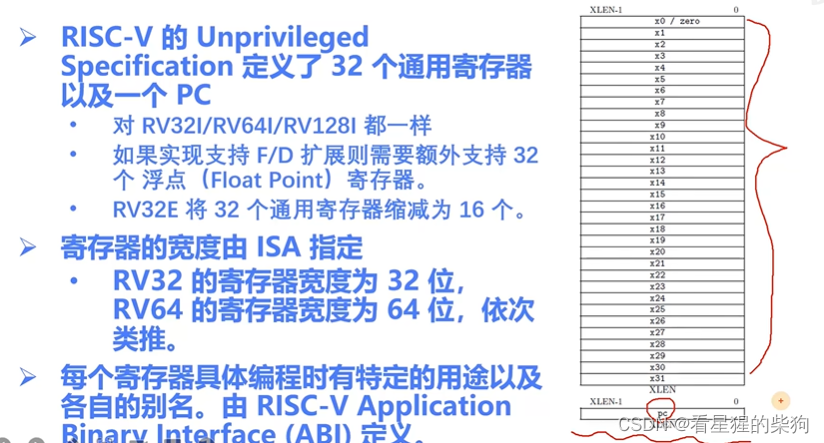
# Hart
一个 CU：一条指令流
一个 Hart 相当于一条指令流
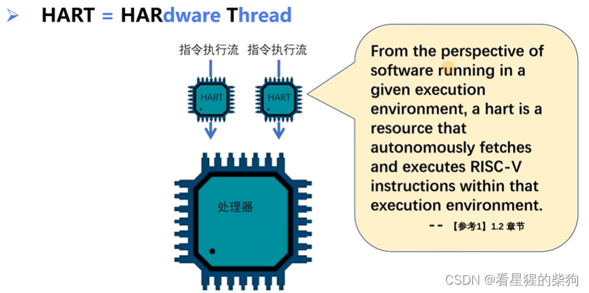
# 特权级别
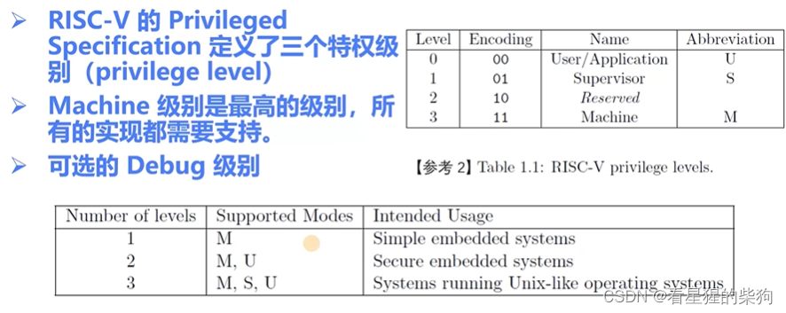
# 控制状态寄存器（CSR）
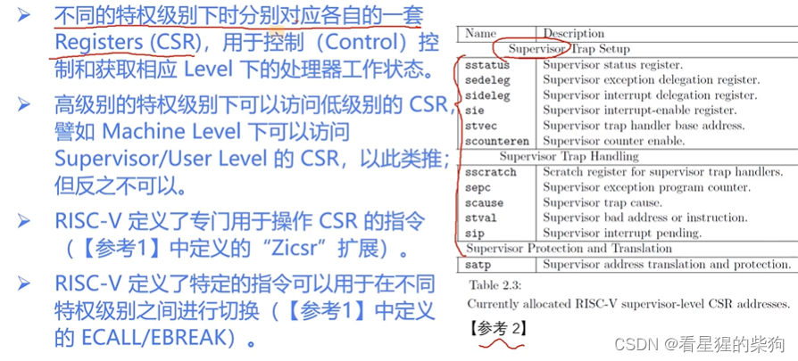
# 内存管理与保护
Lock：无法使用
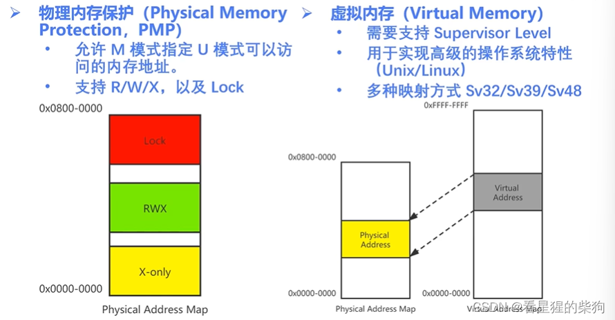
# 异常与中断
异常会跳转到异常处理程序，执行结束后返回继续执行原来的指令
中断同样会跳转到中断处理程序，执行结束后返回执行原指令的下一条指令
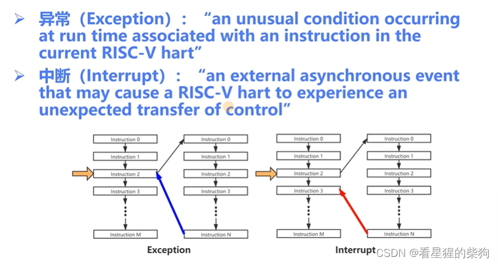

