
# 内存管理的分类

# 链接脚本
各个目标文件通过链接脚本链接在一起
最后会添加一个程序表
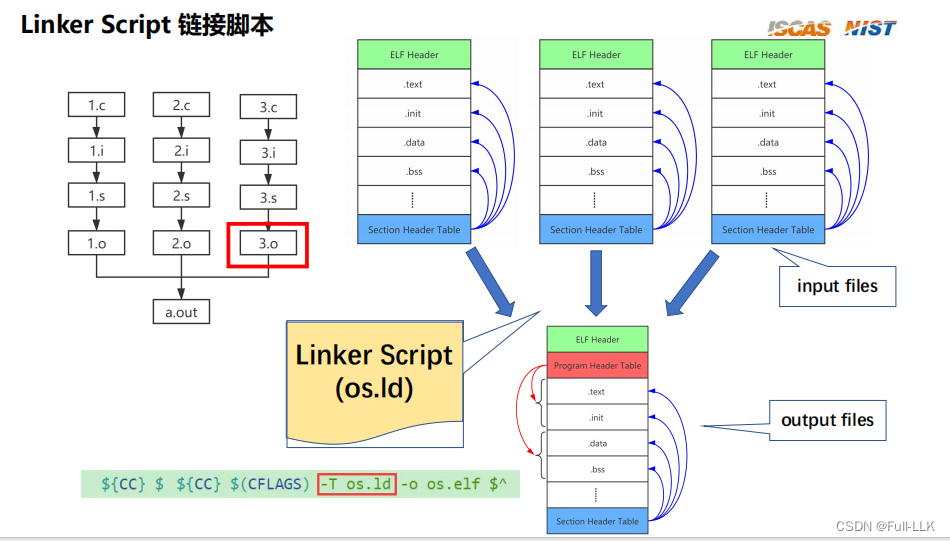
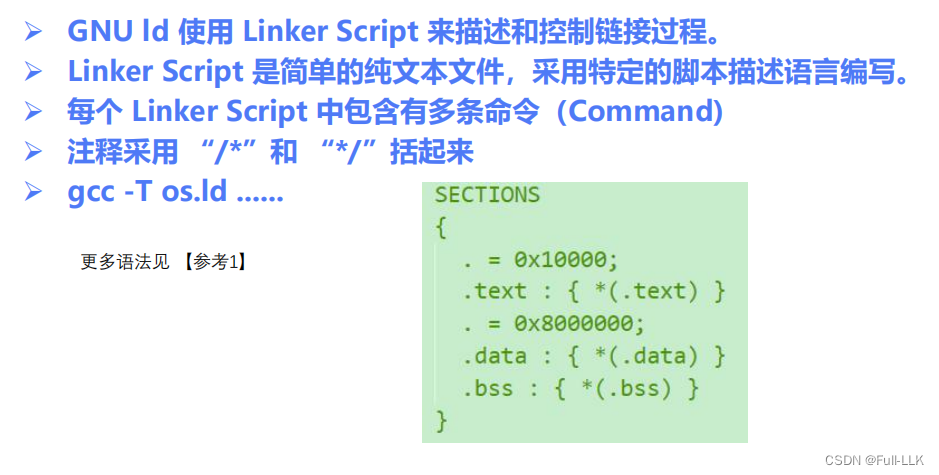
# ld 脚本语法
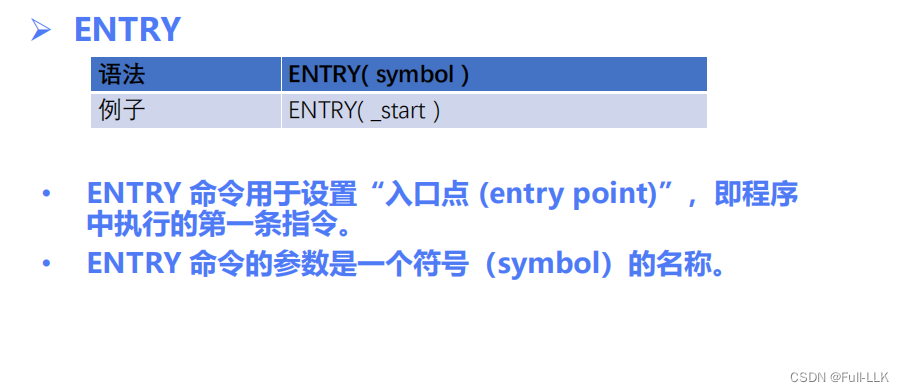
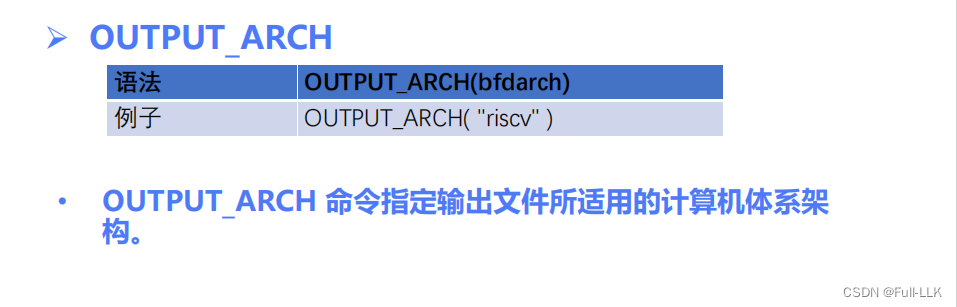
memory 定义了一个区域
其中 rx 表示该内存区域是一个只读区域
origin 是起始位置，length 是长度
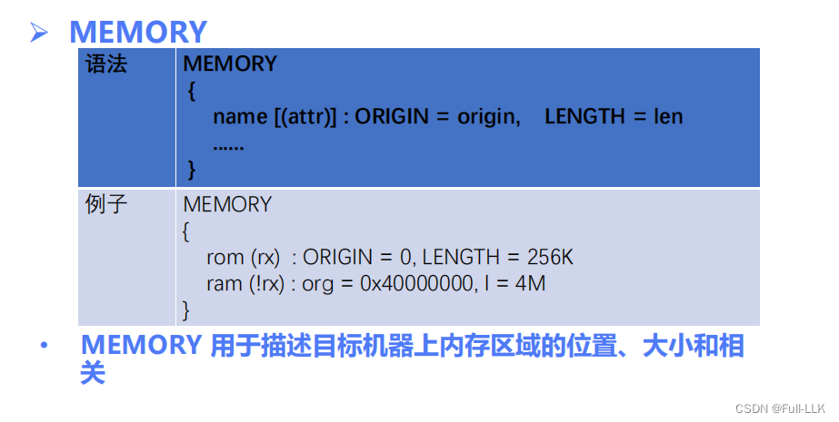
`.` 表示当前位置指针；.=0x10000 表示当前指针为 0x10000。>ram 表示把这些段布局并加载到名为 ram 的内存区域中

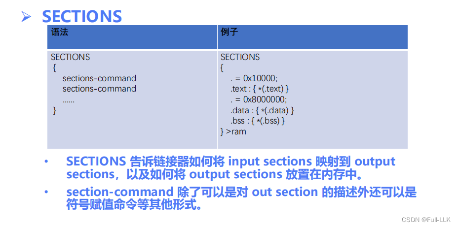
对符号赋值
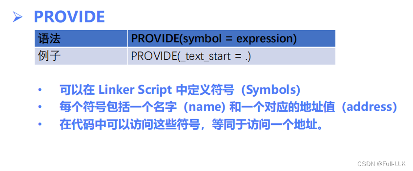
# 从 ld 脚本获取符号值
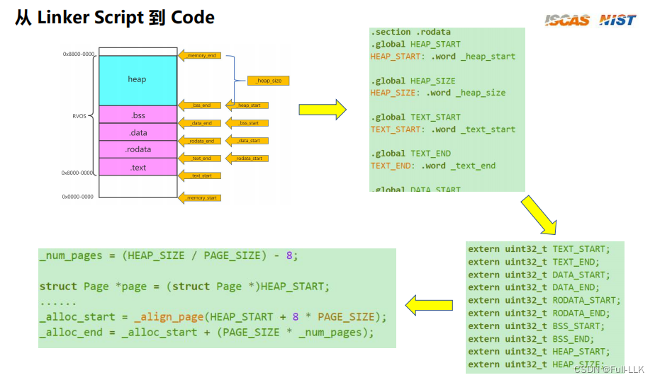
# 实现页级的动态分配
页级指的是大小为 4K
也就是在堆中动态分配页级大小
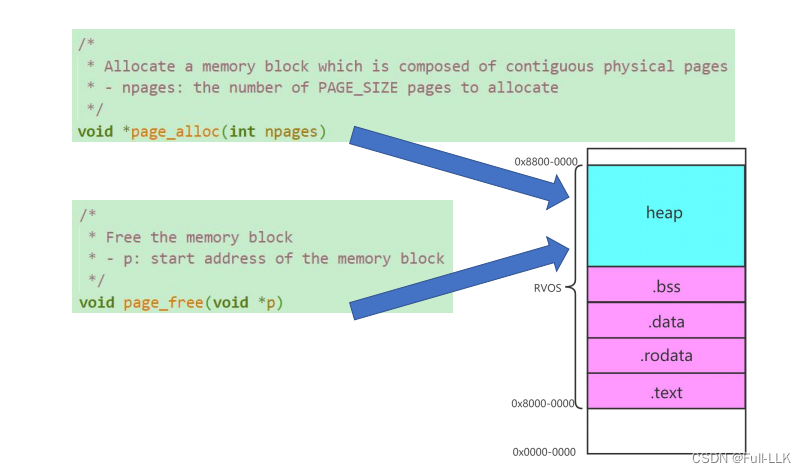
# 管理 heap 区域每个页的状态
链表方式：用链表把 heap 区域中所有未分配的页链接起来，再用另一条链表把所有已分配的区域链接起来
数组方式：用一个数组表示 heap 区域中所有的页，并设置某些标志位来表示数组元素对应的页是否已被分配
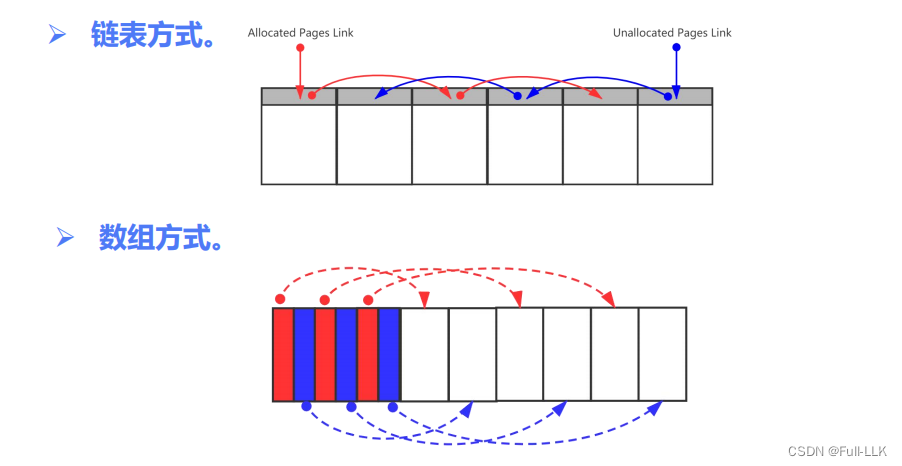
# 动态分配（页级）

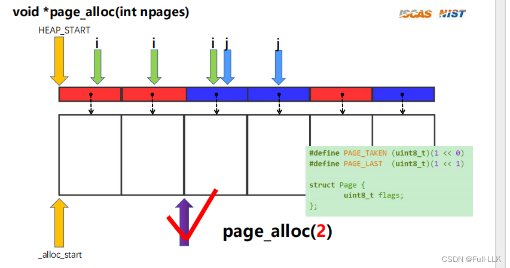
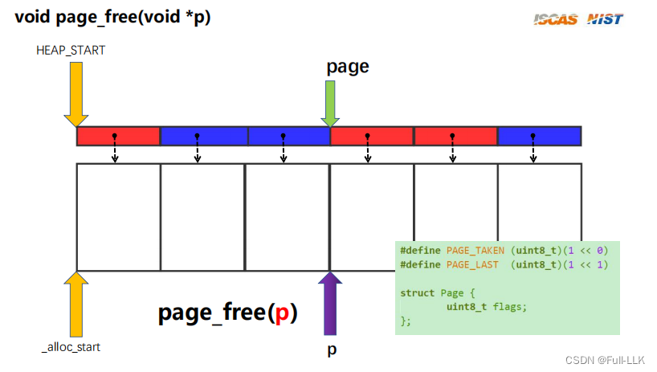
# 代码
整体上实现了两部分：内存布局和内存动态分配

链接脚本和汇编文件 memory.S 实现了内存布局
页级动态分配在 page.c 中实现

- word：表示四个字节

- 在汇编中，可以使用链接脚本中的符号进行赋值，但它们只在链接之后才生效；也就是说，生成目标文件时赋值并没有成功（该符号被识别为未定义符号，意味着该符号在当前目标文件中没有定义，会在链接阶段被解析为在另一个目标文件中定义的符号。在这种情况下，_heap_start 可能在另一个目标文件中定义，并在链接阶段被解析。）

- extern 关键字不仅可以用来声明在其他 C 文件中定义的全局变量，也可以用来声明在汇编文件中定义的全局变量。这通常出现在嵌入式开发或底层系统编程中，需要与汇编代码交互的场合。

- 数据段中声明了一个变量，这个变量的值会被包含进 ELF 中；ELF 文件中包含该变量的符号和值，但如果编译器发现你的某些变量初始值是 0，编译器可以只存储它们的符号而不存储值（反正都是 0），把它们统一放进 BSS 段（**参考：刘霁兰老师**）

- la 是 "load address" 的缩写；它是一个伪指令，用于把一个符号的地址加载到寄存器中。
- bgeu 是 "branch if greater or equal, unsigned" 的缩写；它是一条条件分支指令。
- sw 是 store word
- addi 是 add immediate
- bltu 是 branch if less than unsigned
- sll 是 Shift Left Logical

[代码链接 https://github.com/FULLK/risllkos](https://github.com/FULLK/risllkos)

# 待完善（整体完成后再补充 :smile:）
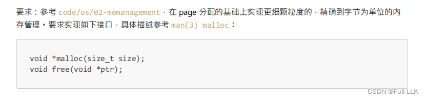

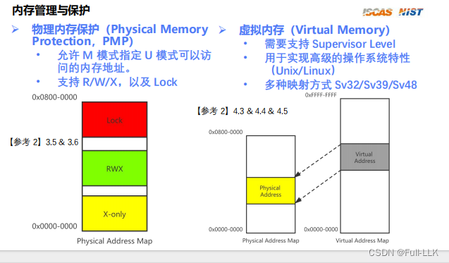

