
# 计算机的硬件组成
所有硬件都通过总线相连
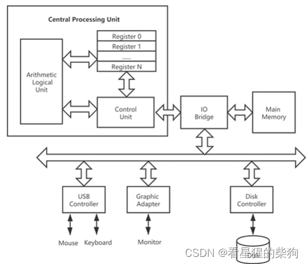
# 两种体系结构
总线的数量不同，Memory 中存放的内容也不同
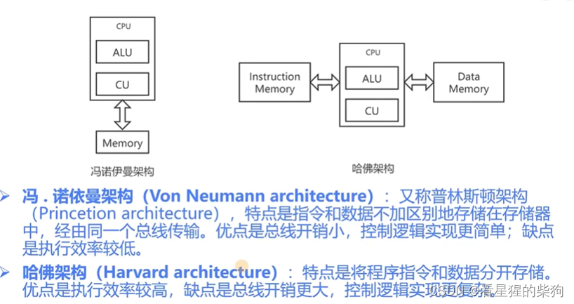
# 程序的存储与执行
先编译链接一个 C 文件，得到的可执行文件存放在磁盘上
只有在即将运行时才会被加载到内存中
把机器指令取到寄存器中，然后翻译，再执行，接着再取指令，如此循环往复
由晶振驱动，也就是时钟频率；时钟频率越快，循环就越快
依次执行内存中的指令

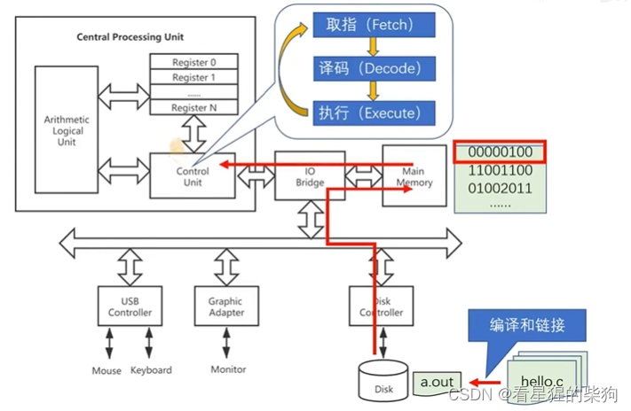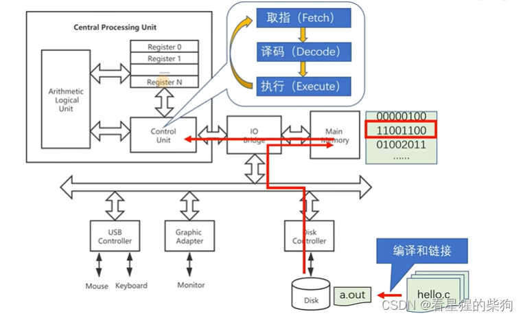
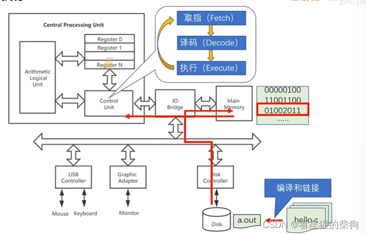
# 编程语言的设计与演进
## 一台迷你计算机
假设现在要实现 a+b
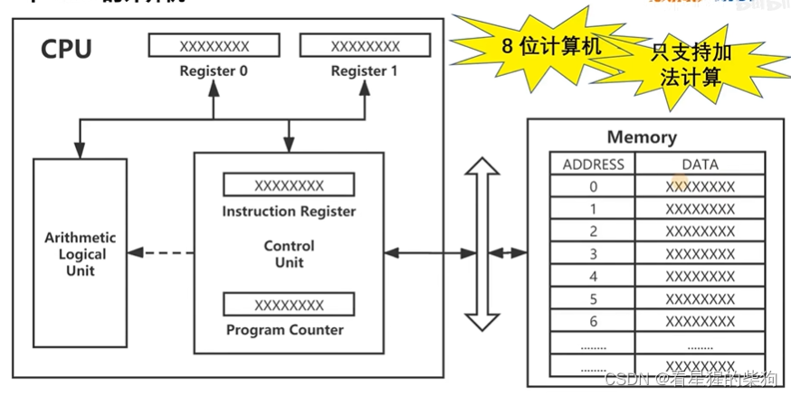
a+b 的实现可以分为图中所示的四个步骤
指令的编码各不相同
第 1、2、4 条使用第一种格式
第 3 条使用第三种格式（最高两位在这里没有意义，因为没有被用到）

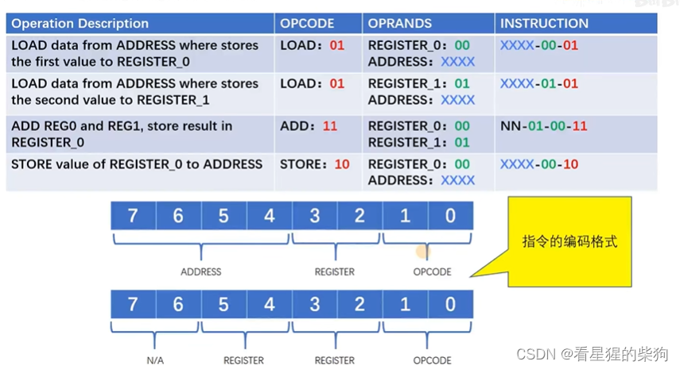
PC 指向将要运行（即将运行）的指令的地址
此时它指向第一个位置的内容，并把该位置的内容放入指令寄存器
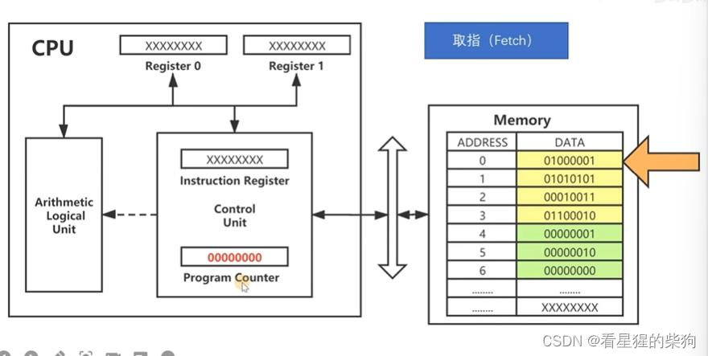
翻译指令寄存器中的内容
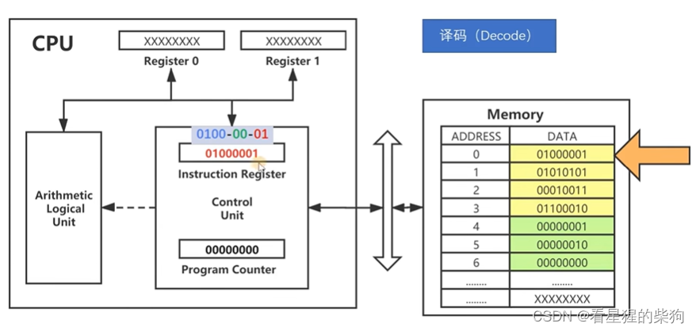
执行第一条指令
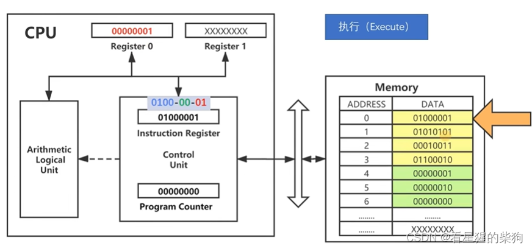
执行第二条指令
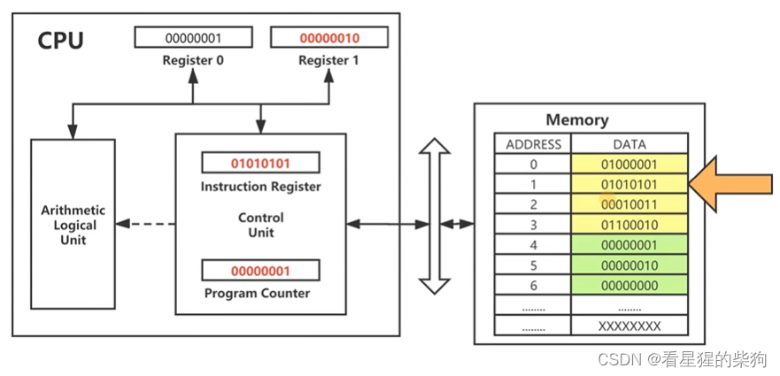
执行第三条指令
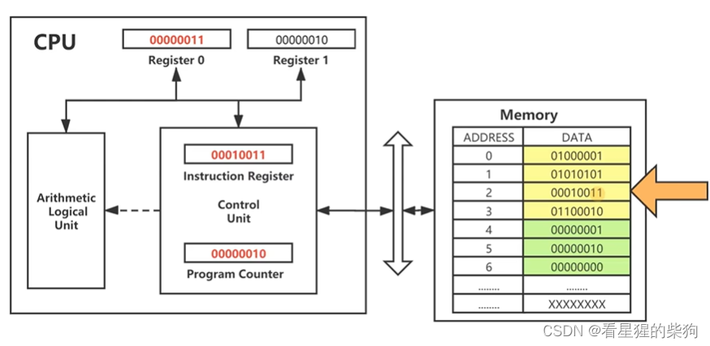
执行第四条指令
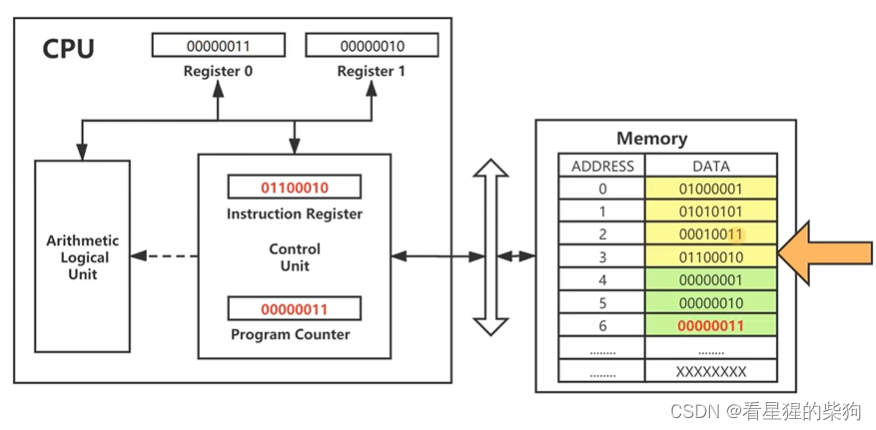
# 编程语言的演进
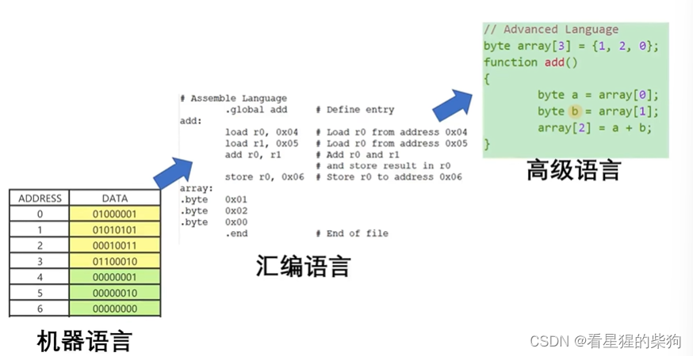
# 存储设备的层次结构
把常用的东西放得离 CPU 更近
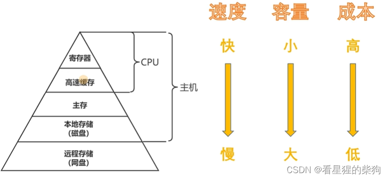
# 操作系统
系统调用是应用程序到操作系统的接口
指令集架构（ISA）则是操作系统到硬件的接口

操作系统的作用
 - 防止有错误的应用程序直接访问硬件而导致硬件出问题
 - 为应用程序提供简单一致的抽象接口，以访问复杂多样的外设硬件

感觉它像是一个中间人，防止应用程序直接访问硬件带来的一些不良影响
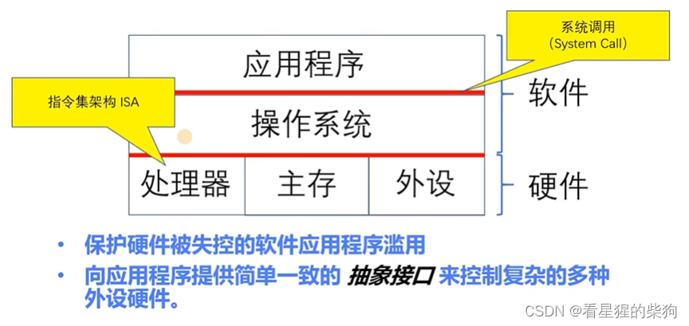

